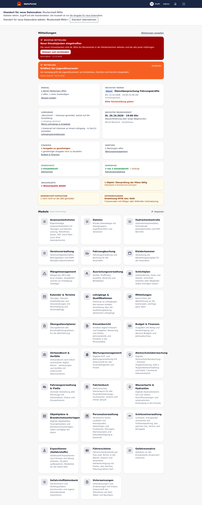
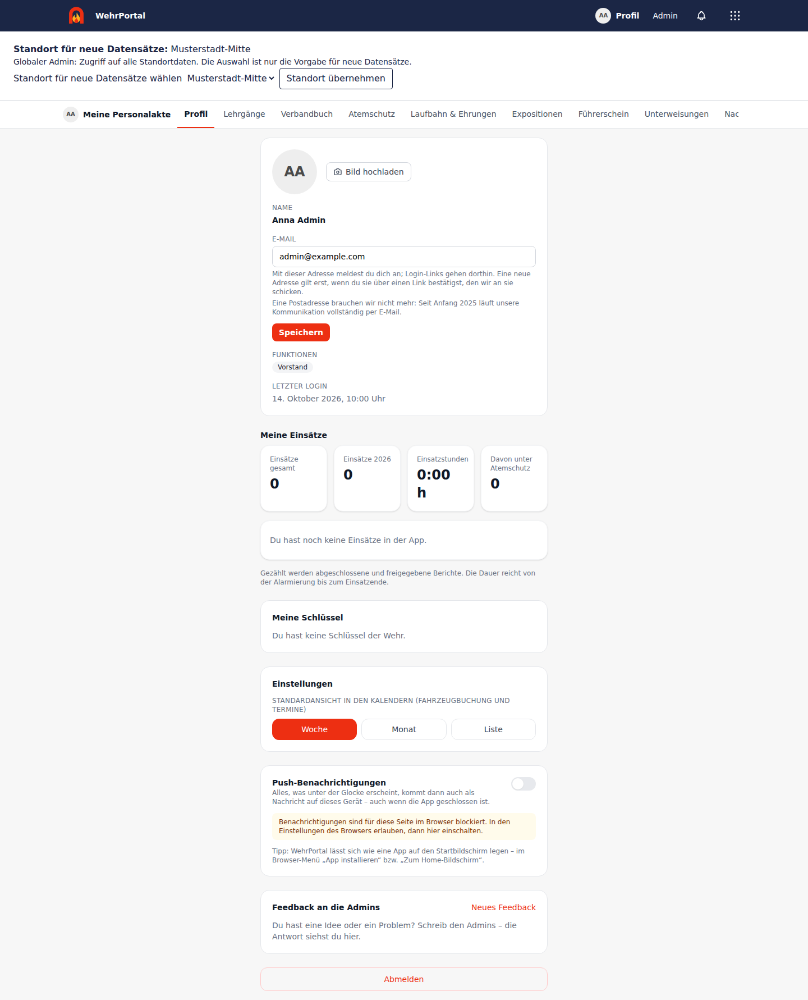
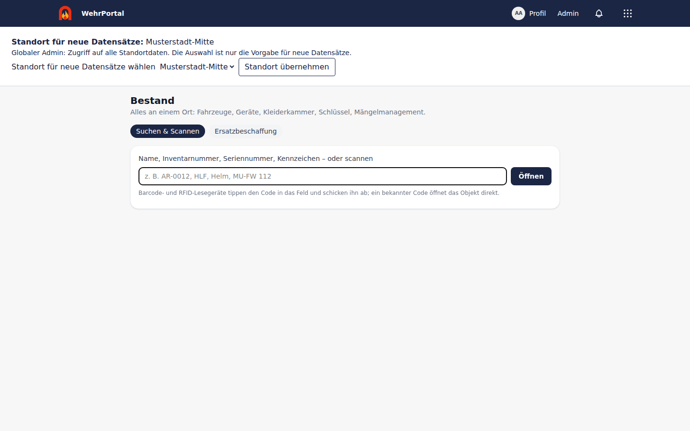

# WehrPortal

[](LICENSE)
[](composer.json)
[](composer.json)
[](package.json)
[](composer.json)
[](composer.json)
[](composer.json)
[](package.json)
[](.github/workflows/deploy.yml)
[](Dockerfile)


**WehrPortal** ist eine Web-App für Freiwillige Feuerwehren: ein gemeinsamer Kern (Anmeldung, Kameraden, Startseite, Benachrichtigungen, Admin-Bereich) und Module, die jede Wehr einzeln einschaltet, etwa Kalender, Fahrzeugbuchung, Einsatzbericht, Atemschutz, Personalverwaltung oder Kleiderkammer. Die Bedienung ist für das Handy gemacht, die Anmeldung läuft ohne Passwort über einen Link per E-Mail. Oberfläche und E-Mails sind deutsch.

Du brauchst WehrPortal, wenn deine Wehr Termine, Fahrzeuge, Material, Ausbildung und Einsatzdokumentation an einem Ort verwalten will, ohne mehrere Insellösungen zu pflegen. Selbst betreibbar, ohne Cloud-Zwang.

## Screenshots

Beispieldaten einer Testinstallation, weitere Bilder in der [Galerie](docs/SCREENSHOTS.md#galerie).

| Startseite | Personalakte | Bestand |
|---|---|---|
|  |  |  |

## Dokumentation

| Für wen | Dokument |
|---|---|
| Kameraden | [User-Guide](handbuch/USER.md): Anmeldung, Navigation, Alltag |
| Admins | [Admin-Guide](handbuch/ADMIN.md): Ersteinrichtung, Module, Rollen |
| Betreiber | [Installationsguide](handbuch/INSTALLATION.md) und [Serverbetrieb mit Docker Compose](docs/BETRIEB.md): Installation, Konfiguration, Sicherheit, Updates, Releases |
| Alle | [Kernfunktionen](docs/KERNFUNKTIONEN.md): Startseite, Fahrzeugbuchung, Rollen, Admin-Bereich |
| Alle | [Module im Überblick und im Detail](docs/MODULE.md) |
| Alle | [Modulhandbücher](docs/README.md): Anwesenheit, Dateien, Locations, Offline/PWA, OIDC, Mitteilungen, Einsatzbericht |
| Entwickler | [Screenshots und E2E-Tests](docs/SCREENSHOTS.md), [Tech-Stack](docs/BETRIEB.md#tech-stack) |

## Schnellstart

```bash
composer setup && composer dev
```

Voraussetzung ist PostgreSQL; Details im [Installationsguide](handbuch/INSTALLATION.md).

## Herkunft und Lizenz

**[TimUx/WehrPortal](https://github.com/TimUx/WehrPortal)** ist auf der Idee und Codebasis von **[roberteinsle/openwehr](https://github.com/roberteinsle/openwehr)** von Robert Einsle und weiteren Beitragenden sowie den Erweiterungen aus `TimUx/openwehr-extended` entstanden und wird eigenständig weiterentwickelt. WehrPortal benötigt weder deren Repositories noch Images oder Updates; es startet als Neuinstallation ohne übernommene Bestandsdaten. Git-Historie und ursprüngliche Urheberhinweise bleiben erhalten.

Lizenz: [AGPL-3.0-only](LICENSE), Details in [Betrieb und Entwicklung](docs/BETRIEB.md#lizenz). Die App-Marke ([`public/images/wehrportal-logo.svg`](public/images/wehrportal-logo.svg)) ist eigenständig entworfen und verwendet keine fremden Wappen.
