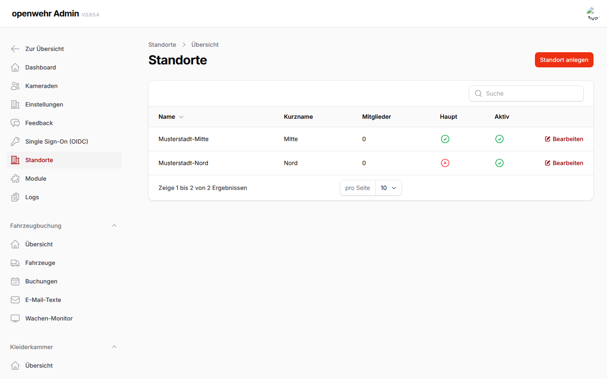

# Mehrere Standorte (Extension `Locations`)

[Zur Hauptdokumentation](../README.md) · [Erweiterungsindex](README.md) · [Fork-Leitfaden](../FORK.md)

Für Gemeinden mit mehreren Feuerwehrhäusern. Code: `extensions/Locations/`, Abschaltung mit `LOCATIONS_ENABLED=false`.



## Inhalt

- [Rollen](#rollen)
- [Datenmodell](#datenmodell)
- [Wirkung](#wirkung)
- [Standortbezogene Modulrollen: gestufte Umstellung](#standortbezogene-modulrollen-gestufte-umstellung)
- [Kleiderkammer: optionaler Mengenbestandsadapter](#kleiderkammer-optionaler-mengenbestandsadapter)
- [Schutzmanifest und Schema-Guard](#schutzmanifest-und-schema-guard)
- [Lesende Bestandsinventur](#lesende-bestandsinventur)
- [Grenzen / offen](#grenzen--offen)

## Rollen

| Rolle | Wie | Sieht / darf |
|---|---|---|
| Globaler Admin | `users.is_admin` (unverändert) | alles, alle Standorte, legt Standorte an |
| Standort-Admin | `x_location_user.role = admin` | nur den eigenen Standort: Name, Mitglieder, Abteilungen und Zuordnung von Fahrzeugen und Ausrüstung (Admin → Standorte) |
| Mitglied | `x_location_user` oder `users.ext_location_id` | nur Daten des eigenen Standorts |

Standort-Admins erreichen `/admin` über `MyLocationPage` (`ModuleArea`), `User::canAccessPanel` bleibt unverändert. Core-Ressourcen (`AdminOnly`) bleiben globalen Admins vorbehalten.

## Datenmodell

- `x_locations`, `x_location_user`; Spalte `ext_location_id` (nullable, FK, `nullOnDelete`) an `users`, `groups`, `member_functions`, `vehicles`, `ar_equipment`, `ar_categories`, `kk_items`, `eb_reports`, `mm_defects`, `kal_events` (Liste in `config/locations.php`).
- Zeilen ohne Standort (`NULL`) gelten als gemeinsam und bleiben sichtbar.
- Die Migration legt den Hauptstandort an und ordnet vorhandene Daten zu; `app:ensure-locations` (Entrypoint `61-ensure-locations.sh`) und `Location::default()` stellen sicher, dass immer einer existiert. Der Hauptstandort und der letzte Standort sind nicht löschbar.

## Wirkung

- `LocationScope` (globaler Scope) filtert die konfigurierten Modelle auf die Standorte des angemeldeten Nutzers. Ohne angemeldeten Nutzer (Konsole, Queue, Scheduler, Login, Magic Link) und für globale Admins ist er aus.
- Neue Datensätze erhalten für angemeldete Nutzer einen frisch geprüften aktiven Standort: gültige Auswahl, sonst berechtigter Primärstandort, sonst erster aktiver Mitgliedsstandort. Ohne solchen Standort wird die Vorbelegung abgewiesen; Schreiben in einen fremden Standort wirft `AuthorizationException`. Die Auswahl erweitert keine Berechtigung.
- Abteilungen gehören zu einem Standort. Standort-Admins legen sie in **Admin → Standorte → Standort bearbeiten** an und ordnen Mitglieder dort mehreren Abteilungen zu; dabei bleiben Zuordnungen zu anderen Standorten unverändert.
- `PersonnelService::visibleMembers()` und alle Listen, die über Eloquent laufen, sind damit automatisch standortbezogen.
- Bei Benutzern bleiben zusätzlich das eigene Konto und Mitglieder sichtbar, die über `x_location_user` einem der eigenen Standorte zugeordnet sind.
- Mitteilungen tragen eine eigene optionale `announcements.ext_location_id`-Spalte. `NULL` bedeutet allgemein; ein Standortwert beschränkt Listen, Anhänge, Bestätigungen und Empfänger auf tatsächliche Mitgliedschaften dieses Standorts. Die Mitteilungs-Migration fügt vorhandene Mitteilungen nicht rückwirkend einem Standort zu.

## Sichtbarer Standortkontext und Wechsel

Bei aktiver Locations-Erweiterung sehen angemeldete Mitglieder unter der App-Kopfzeile den **Standort für neue Datensätze**. Der Bereich ist auch ohne Panelzugang erreichbar. Dieselben Angaben stehen im bestehenden Standortbereich des Admin-Menüs. Sind mehrere aktive berechtigte Standorte vorhanden, erlaubt ein beschriftetes Formular den Wechsel mit **Standort übernehmen**, ohne automatisches Absenden beim Auswählen und ohne JavaScript-Abhängigkeit. Bei einem Standort wird die Vorbelegung angezeigt; bei keinem erscheint ein ausdrücklicher Hinweis.

Die Anzeige und der Wechsel lesen den aktuellen Aktivstatus, die globale Adminrolle sowie Primär-/Pivot-Mitgliedschaften erneut aus der Datenbank. Veraltete oder entzogene Auswahlen werden verworfen; inaktive Standorte werden nicht angeboten. Die reine Anzeige erzeugt keinen Hauptstandort und keine Mitgliedschaft. Der Server prüft das Ziel bei jedem Wechsel erneut. Nach dem Wechsel wird nur zu einer zulässigen anwendungsinternen Rücksprungadresse zurückgeleitet.

**Keine neue Datenfreigabe:** Der gewählte Standort ist eine Vorbelegung neuer Datensätze, kein Filter aller Listen oder Ersatz für eine Modulrolle. Globale Admins behalten Zugriff auf alle Standortdaten. Normale Nutzer benötigen weiterhin ihre jeweiligen Objekt- und Fachrechte; eine Mehrfachmitgliedschaft wird nicht auf den ausgewählten Standort reduziert. Ohne aktiven berechtigten Standort wird für einen angemeldeten Akteur kein Hauptstandort als Ersatz vergeben. Bestehende ausdrücklich akteurlosen Konsolenpfade behalten ihren bisherigen Default und benötigen weiterhin eine eigene fachliche Absicherung.

Der Kontext erscheint weder für Gäste noch bei ausgeschalteter Erweiterung. Dieser P7-Teilschritt ist keine vollständige Browser-/Screenreader-/Offline-Abnahme und kein Nachweis, dass alle Fachmodule bereits standortisoliert sind.

## Standortbezogene Modulrollen: gestufte Umstellung

Die neue Rollenverwaltung ergänzt die vorhandene globale Tabelle `module_user`, ohne sie automatisch umzuschreiben. Globale Admins vergeben unter **Admin → Standorte → Standort bearbeiten → Standort-Modulrollen und Verlauf** eine Zuweisung für genau eine Person, ein Modul und diesen Standort. Begründung, vergebender Admin, Vergabezeit, optionaler Ablauf und ein späterer Entzug mit Begründung bleiben nachvollziehbar. Standort-Admins dürfen diese Zuweisungen weder vergeben noch entziehen.

Eine Zuweisung ohne Fachrolle ermöglicht nur den Moduleinstieg, keine Verwaltungsrechte auf beliebige Datensätze. Mitgliedschaft, aktiver Standort, aktives Mitglied, aktives Modul und Gültigkeit werden bei der Berechtigungsprüfung erneut geprüft. Rollen eines anderen Standorts und bereits entzogene oder abgelaufene Zuweisungen gelten nicht. Pro Person, Modul und Standort gibt es höchstens eine noch nicht entzogene Zuweisung; die Kleiderkammer bildet mit den getrennten Rollen `bestand` und `kleiderwart` eine ausdrückliche Ausnahme (siehe unten). Auch eine abgelaufene Zuweisung muss vor einer neuen Vergabe derselben Rolle ausdrücklich entzogen werden.

Endet die wirksame Standortmitgliedschaft, werden die dortigen Vergaben mit einer systemseitigen Begründung geschlossen. Solange noch eine Mitgliedschaft über Primärstandort oder Pivot besteht, bleibt sie wirksam. Ein späterer Wiedereintritt stellt entzogene Rollen nicht wieder her; dafür ist eine neue ausdrückliche Vergabe erforderlich.

**Bewusster Kompatibilitätsmodus:** Standardmäßig bleibt `locations.scoped_role_modules` leer. Damit ändern vorbereitete Zuweisungen noch keine vorhandenen Modulberechtigungen. Der erste unterstützte Adapter ist **Anwesenheit**. Weitere Module dürfen nicht ohne vollständige Umstellung ihrer Objekt-, Datei-, Such- und Hintergrundprüfungen aktiviert werden; unbekannte Adapter werden nicht stillschweigend akzeptiert.

### Vorbereitung und Aktivierung

1. PostgreSQL-Backup und Wiederherstellung prüfen, anschließend die neuen Migrationen ausführen.
2. `php artisan locations:inventory-module-roles` aufrufen. Der Bericht listet alte Modulrollen und mögliche Standorte als **zero**, **single** oder **multiple**. Auch ein einzelner Kandidat ist noch keine Freigabe. Der Befehl schreibt nichts, kopiert keine Rolle auf alle Standorte und verwendet keinen pauschalen Hauptstandort.
3. Als globaler Admin die benötigten Anwesenheitsrollen ausdrücklich je Standort vergeben. Personen ohne Standort oder mit mehrdeutiger Zuständigkeit zuerst prüfen. Bei den übrigen Modulen bleiben die bisherigen Rollen maßgeblich.
4. Den Anwesenheitsadapter über `LOCATIONS_SCOPED_ROLE_MODULES=anwesenheit` einschalten und den Konfigurationscache erneuern beziehungsweise die Anwendung neu starten. Locations und Anwesenheit müssen dabei geladen sein. Die Fachmodule werden weiterhin unter **Admin → Module** aktiviert.
5. Zugriffe als Mitglied, standortbezogener Verwalter und globaler Admin prüfen; insbesondere Entzug, Ablauf und mehrere Standortmitgliedschaften kontrollieren.

Nach Aktivierung zählt für Anwesenheits-Verwaltungsaktionen ausschließlich die gültige Rolle `verwalter` am Zielstandort. Alte globale Modulrollen und die bloße Standort-Adminrolle sind dafür kein Ersatz. Globale Admins behalten Zugriff auf alle Daten. Bestehende normale Moduleinstiege beziehungsweise Auto-Assign können weiter gelten; sie sind keine Verwaltungsberechtigung. Eigene Listen und Teilnahmen behalten ihre ausdrücklich geprüften Mitgliedsaktionen.

Die bisherige globale Modulverwaltung bleibt für Legacy-Zugänge zuständig. Dort eine Rolle zu ändern erzeugt **keine** neue standortbezogene Vergabe. Rollen am Zielobjekt werden mit expliziter Standort-ID geprüft; der aktuelle Standortumschalter ersetzt keine Berechtigung. Eine standortlose Rollenabfrage liefert im umgestellten Modul für Nicht-Admins keine Fachrolle.

Der Primärstandort bleibt vorerst wie bisher eine Mitgliedschaftsquelle. Es gibt in diesem Schritt keine automatische Umstellung auf „nur Voreinstellung“, keine Bestandsdatenmigration und keine allgemeine Freigabe gemeinsamer Inhalte. Eine Rücknahme der Adapteraktivierung stellt die Legacy-Regeln wieder her und ist daher **keine sicherheitsneutrale Rollback-Maßnahme**; sie erfordert eine bewusste Betriebsentscheidung.

**Geschützte Identität:** Personen, die im Rollenverlauf als Mitglied oder vergebender/entziehender Admin referenziert werden, können nicht gelöscht oder mit „Löschen mit Übertragung“ auf eine andere Person übertragen werden. Das gilt auch für bereits entzogene Vergaben. Stattdessen den Mitgliedsstatus auf inaktiv/ausgetreten setzen; die Historie darf weder fremde Rechte noch eine falsche Urheberschaft erzeugen. Standorte mit Rollenverlauf sind ebenfalls gegen Löschen geschützt.

## Schutzmanifest und Schema-Guard

Das Schutzmanifest in `extensions/Locations/config/protection.php` (Konfigurationsschlüssel `locations.protection`) erfasst jede Anwendungstabelle ausdrücklich mit zuständigem Modul, Datenklasse, Zielmodus, Eltern-/Eigentümerbeziehungen, NULL-Regel und den zu prüfenden Autorisierungsmechanismen. Infrastruktur wird separat und abschließend benannt. Neue Tabellen dürfen nicht allein aufgrund ihres Namens oder Präfixes automatisch als freigegeben gelten.

**Klassifikation ist keine Autorisierung:** Das Manifest beschreibt die Schutzentscheidung und ihren Prüfstatus. Zielangaben sind noch keine Freigabe gemeinsamer Bestände oder personenbezogener Daten. Es registriert keine zusätzlichen Laufzeitfilter, migriert keine Daten und erteilt keine Rechte. Ein dokumentierter Zielmodus oder eine geplante NULL-Regel ändert daher nicht die oben beschriebene Ist-Semantik oder bestehende modulspezifische Ausnahmen. Globale Admins behalten Zugriff auf sämtliche Daten aller Standorte, einschließlich sensibler Inhalte.

„Bewusst global“ beschreibt den fachlichen Geltungsbereich, nicht eine öffentliche Freigabe. Auch globale Konfiguration, Authentisierungsdaten und Protokolle benötigen weiterhin ihre jeweiligen Zugriffsprüfungen.

`mode` und `null_rule` halten den vorgeschlagenen Zielzustand fest; `current_null_rule` und `parents[].source_null_rule` trennen davon das beobachtete Verhalten beziehungsweise die heutige Schema-Nullbarkeit. Fehlende Standortzuordnungen oder noch nötige Spalten/Migrationen werden als offene Zielarbeit dokumentiert, nicht als Genehmigung standortübergreifenden Zugriffs. Historische, nullable Personenverweise dürfen erhalten bleiben, ohne dadurch eine Freigabe zu bewirken.

`Extensions\Locations\Services\ProtectionManifest` prüft im bestehenden PostgreSQL-Audit-Test die tatsächlichen Tabellen gegen das Manifest. Fehlende Klassifikationen, ungültige Definitionen und fehlerhafte Elternbeziehungen blockieren die Prüfung. Der Fork-Workflow führt die Audit-Tests vor den übrigen Featuretests ausdrücklich aus; dieselben Tests bleiben zusätzlich Bestandteil der vollständigen Regression.

Optionale Tabellen dürfen nur fehlen, wenn die ausdrücklich benannte Erweiterung abgeschaltet ist; dafür enthält das Manifest eine endliche Tabellenliste, den Konfigurationsschalter und den zugehörigen Provider. Bereits vorhandene Tabellen werden auch nach dem Abschalten weiter geprüft. Entfernte oder umbenannte Migrationstabellen werden getrennt erfasst und dürfen nicht als Ausnahme für heute noch vorhandene Tabellen dienen.

Bei Änderungen an Migrationen muss die zugehörige Schutzentscheidung mit überprüft werden. Eigene Datei-ACLs, Vereinsrechte und personenbezogene Zugriffe bleiben eigenständige fachliche Schutzmechanismen; ein Eintrag im Manifest ersetzt ihre Tests nicht.

Eine bestandene Manifestprüfung belegt nur die Vollständigkeit und strukturelle Konsistenz der Klassifikation. Standortbezogene Modulrollen, Bestandszuordnung, Durchsetzung der Ziel-NULL-Regeln und positive wie negative Tests aller Fach-, Datei-, Export- und Hintergrundpfade bleiben eigene Abnahmen der folgenden Pakete.

## Lesende Bestandsinventur

`php artisan locations:audit-data` ist der vorbereitende P3-Trockenlauf für Bestandsdaten. `--json` liefert dieselbe Inventur maschinenlesbar. Der Befehl prüft zunächst das Schutzmanifest gegen das installierte PostgreSQL-Schema und bricht bei Widersprüchen ab.

Die Ausgabe enthält ausschließlich Tabellennamen, Datenklassen und Anzahlen: Gesamtzeilen sowie fehlende direkte Standortzuordnungen. Sie enthält keine Namen, Adressen, Inhalte oder einzelnen Datensatz-IDs. Tabellen mit einer deklarierten direkten Beziehung zu `x_locations` werden getrennt von Tabellen mit indirekten Elternbeziehungen oder globalen Regeln ausgewiesen.

**Keine automatische Migration:** Ein NULL-Wert wird weder als Freigabe noch als Beweis einer Datenschutzverletzung gewertet. Der Befehl vergibt keine Standorte, erzeugt keine Mitgliedschaften, stellt keine Isolation fest und besitzt keinen Schreibmodus. Auch eine vollständig gefüllte Standortspalte beweist keine korrekte Autorisierung. Kinddaten, widersprüchliche Elternbezüge und ausdrücklich gemeinsame Kataloge benötigen weiterhin die modulbezogene Prüfung. Für einen nachvollziehbaren Vorher-/Nachher-Abgleich sollte die Inventur bei ruhendem Schreibbetrieb ausgeführt werden.

Der erste kontrollierte Übernahmeschritt ist auf Anwesenheitslisten und -vorlagen begrenzt (siehe unten). Weitere Datenbereiche, indirekte Elternkonflikte und gemeinsam genutzte Bestände folgen separat. Globale Admins behalten ihre Zugriffsrechte; der Inventurbefehl selbst bleibt unverändert lesend.

## Bestandszuordnung Anwesenheit (P3, erster Datenbereich)

`php artisan locations:assign-attendance <plan.json>` prüft einen **vom Betreiber ausdrücklich zusammengestellten** Zuordnungsplan. Ohne `--apply` bleibt der Befehl lesend. Er errechnet keine automatische Verteilung auf Mitgliedsstandorte und verwendet weder den Hauptstandort noch Vorlagen oder Kalenderquellen als stillschweigende Zuordnungsentscheidung.

Die JSON-Datei enthält eine Liste mit höchstens 500 Einträgen (höchstens 256 KiB). Jeder Eintrag enthält genau `table` (`x_att_lists` oder `x_att_templates`), eine positive ganzzahlige `id`, die geprüfte `location_id` und `expected_location_id` mit dem Wert `null`. IDs stammen aus einer lokalen Bestandsprüfung mit berechtigtem Zugriff, nicht aus öffentlichen Berichten. Beispiel mit ausschließlich fiktiven IDs:

```json
[
  {"table": "x_att_lists", "id": 12, "location_id": 3, "expected_location_id": null},
  {"table": "x_att_templates", "id": 8, "location_id": 3, "expected_location_id": null}
]
```

### Vorbereitung und bestätigte Übernahme

1. Vollständiges PostgreSQL-Backup erstellen und die Wiederherstellung in einer getrennten Umgebung prüfen. Neue Migrationen einspielen. Bei der Vorprüfung insbesondere Personenbezüge, bestehende Empfänger, historische Quellen und die vorgesehenen Zugriffsberechtigten fachlich prüfen; eine technische Mitgliedschaft allein beweist noch keine fachliche Zuständigkeit.
2. Schreibbetrieb für den betroffenen Bereich pausieren. Der Befehl prüft in einer Transaktion und hält dabei Sperren auf Zuordnungs-, Mitgliedschafts- und Kinddaten. Auch die Vorschau kann deshalb Schreibvorgänge anderer Nutzer vorübergehend blockieren; kleine Pläne und ein Wartungsfenster verwenden.
3. Plan mit `--by=<globale-admin-id> --reason="<geprüfter Zuordnungsgrund>"` ohne `--apply` ausführen. Die Ausgabe enthält nur technische IDs, Zielstandorte, Status und einen SHA256-Prüfwert, keine Titel, Notizen, Empfänger oder Dateiinhalte. Eine Vorschau ist noch keine Datenänderung.
4. Den gesamten Plan samt Vorschau prüfen. NULL-Personenverweise bleiben historisch unverändert; sie sind kein Beleg für einen Standort und müssen ausdrücklich mitbeurteilt werden. Mehrfachmitgliedschaften sind kein Anlass für Kopien oder Mehrfachzuordnungen.
5. Mit identischem Plan, Admin und Grund sowie `--apply --backup-confirmed --expect=<SHA256-aus-der-Vorschau>` übernehmen. `--backup-confirmed` ist **nur die Bestätigung des Betreibers**, kein technischer Backup- oder Restore-Test. Bei veraltetem Prüfwert erneut vorprüfen, nicht die Kontrolle umgehen.
6. Inventur wiederholen und Vorher-/Nachher-Anzahlen, geschlossene Zuordnungslücken und Journal-Batch vergleichen. Als berechtigtes Mitglied und als Nutzer eines anderen Standorts getrennt prüfen. Globale Admins behalten Zugriff auf alle Daten.

### Konflikte, Journal und Rückfallgrenzen

Der gesamte Plan wird zurückgewiesen, wenn ein Eintrag fehlt, doppelt ist, bereits einen Standort besitzt oder auf einen fehlenden/inaktiven Standort zeigt. Auch nicht zum Zielstandort gehörende verknüpfte Ersteller, Leitungen oder Teilnehmende blockieren die Übernahme. Mitgliedschaft kann aus dem Primärstandort oder der expliziten Standortzuordnung stammen. Widersprüche müssen fachlich geklärt werden; das Werkzeug verändert keine Mitgliedschaften und verschiebt keine anderen Datensätze, um einen Konflikt passend zu machen.

Geänderte Datensätze, Personen-/Mitgliedschaftsbezüge oder Kinddaten machen eine vorherige Vorschau ungültig. Prüfung und Übernahme erfolgen für den gesamten Plan atomar; es gibt keine beabsichtigte Teilübernahme. Geändert wird ausschließlich der bisher leere Standort. Status, Zeitangaben, Teilnehmende, Anhänge und Empfänger bleiben unverändert; es werden keine E-Mails versendet.

Jede übernommene Zuordnung erhält einen unveränderlichen Eintrag in `x_location_data_assignments` mit Zielobjekt, Standort, ausführendem Admin, Grund, Zeitpunkt, Batch und Prüfwert. Der Grund gehört zur internen Historie: keine sensiblen Inhalte hineinschreiben. Referenzierte Adminidentitäten und Standorte sind vor Löschen beziehungsweise Übertragung geschützt. Das Journal ist ein Nachweis der ausgeführten Zuordnung, kein allgemeiner Nachweis vollständiger Standortisolation.

Das Werkzeug ist **kein Umbuchungs- oder Undo-Befehl**. Falsche Zuordnungen erfordern einen geprüften Restore oder eine gesondert geprüfte, protokollierte Korrektur; niemals Standortwerte pauschal auf NULL setzen, Journalzeilen löschen oder alte Freigaben wiederherstellen. Ein Restore muss zwischenzeitliche Änderungen berücksichtigen. Zugeordnete Anwesenheitslisten und Vorlagen verhindern das Löschen ihres Standorts, statt durch eine Standortlöschung wieder standortlos zu werden.

Bei aktiver Locations-Erweiterung bleiben standortlose Anwesenheitslisten und -vorlagen für normale Nutzer gesperrt; globale Admins können sie weiterhin prüfen. Die übrigen Module, bereits zugeordnete Daten, allgemein geteilte Kataloge sowie eine vollständige P3-Bestandsmigration sind nicht Gegenstand dieses Befehls.

## Kleiderkammer: lesende Hybrid-Vorprüfung (P4)

`php artisan locations:audit-clothing` (optional `--json`) ergänzt die allgemeine Inventur um eine fachbereichsspezifische Vorprüfung. Der Bericht unterscheidet gemeinsam vorgesehene Kataloge, Einzelteile mit direktem Standort, Mengenbestand mit noch nicht operativ durchgesetzter Standortzuordnung sowie personenbezogene Ausgaben, Größen und Meldungen. Er gibt nur Anzahlen und technische Prüfkategorien aus, keine Namen, Empfänger, Notizen oder einzelnen Datensatz-IDs.

Die Auswertung nutzt eine eigene PostgreSQL-Verbindung mit einer konsistenten, nur lesenden Transaktion. Sie umfasst **auch zurückgegebene und soft-gelöschte Ausgaben**; `open_membership_needs_review` grenzt bei Ausgaben die noch offenen, nicht gelöschten Fälle ab. Historische Auffälligkeiten müssen anhand der damaligen Verhältnisse geprüft werden, nicht allein anhand heutiger Mitgliedschaften.

Die JSON-Gruppen unter `checks` sind:

| Gruppe | Bedeutung |
|---|---|
| `items` | Einzelteile ohne Standort oder mit inaktivem Standort |
| `issuances` | Ausgaben ohne Einzelteil, ungeklärte Artikelstandorte und heutige Mitgliedschaftsabweichungen |
| `issuance_provenance` | Gespeicherte Herkunftsbestände (`source_bound`) und Mengenausgaben/ungeklärte Ausgaben ohne Verweis (`unsourced_bulk_or_unlinked`); ohne installierte Herkunftsspalte nicht verfügbar |
| `stock` | Operativ weiterhin ungeklärte Mengenbestandszeilen und Stückzahlsumme; zusätzlich Zuordnungsstand der Standortmetadaten |
| `messages` | Fehlender Ausgabebezug, abweichende Person zwischen Meldung/Ausgabe und prüfbedürftige Artikelbezüge |
| `treatments` | Behandlungen mit ungeklärtem beziehungsweise inaktivem Artikelstandort |
| `personal_owner_candidates` | Unterschiedliche Personen aus Ausgaben, Größen und Meldungen; heutige aktive Standortmitgliedschaften sind nur potenzielle Kandidaten, keine bestätigten Eigentümer |

Anzahlen verschiedener Gruppen können dieselben Daten betreffen und dürfen nicht zu einer Gesamtfehlerzahl addiert werden. Bei nicht verfügbaren optionalen Teilprüfungen stehen `availability: unavailable` und `counts: null`; fehlende notwendige Tabellen oder ein widersprüchliches Manifest führen zum Abbruch mit Fehlerstatus statt zu einer leeren Erfolgsmeldung. Exitcode `0` bedeutet ausschließlich „Bericht erstellt“, auch bei Prüfbedarf oder nicht verfügbaren Teilprüfungen; Exitcode `1` bedeutet „Bericht nicht verfügbar“. Für Betriebsentscheidungen immer den Berichtsinhalt auswerten.

Für `stock` bleiben `rows_unresolved` und `quantity_unresolved` bewusst die Anzahl **aller** Mengenbestandszeilen beziehungsweise deren Gesamtmenge: Auch ein eingetragener Standort löst die globale Ausgabesuche und den historischen Rücknahmefallback noch nicht ab. Neue Mengenausgaben können bereits einen festen Herkunftsbestand besitzen (siehe unten); das ist kein Standort-Rollenmodell. Zusätzlich zeigen `null_location`, `assigned`, `inactive_location` und `quantity_unassigned` den aktuellen Metadatenstand. `stock_global_uniqueness_preserved` bestätigt nur den beibehaltenen Kompatibilitätsvertrag; `stock_operation_policy` benennt den noch fehlenden Fachadapter.

**Bedeutung der Prüfung:** Ein Artikelstandort wird mit den tatsächlichen Mitgliedschaften des Empfängers beziehungsweise bei Meldungen der meldenden Person verglichen (Primärstandort oder Standort-Pivot). Der gerade ausgewählte Standort ist dafür ebenso wenig maßgeblich wie globale Adminrechte der betreffenden Person. Mehrfachmitgliedschaft wird nicht in eine automatische Eigentümerentscheidung übersetzt. Eine standortübergreifende Ausgabe kann eine legitime zentrale Versorgung sein; eine Auffälligkeit bedeutet deshalb **fachlicher Prüfbedarf**, nicht automatisch unzulässigen Zugriff.

Mengenbestand und Ausgaben ohne Einzelteilbezug lassen sich nicht allein aus Artikeltyp, Größe oder Empfänger einem Lagerstandort zuordnen. Dasselbe gilt für persönliche Größen und Historien: Heutige Mitgliedschaft beweist keine historische Eigentümerschaft. Diese Fälle benötigen ein freigegebenes Zielmodell und gegebenenfalls eine gesonderte Bestandsmigration. Fehlende Daten oder Tabellen sind keine bestandene Prüfung.

**Betreiberablauf:** Bericht lokal mit berechtigtem Datenbankzugriff ausführen, Prüfkategorien und Anzahlen festhalten und auffällige Bestände innerhalb der bestehenden Zugriffsrechte fachlich untersuchen. Auch reine Anzahlen gehören in den internen Betrieb, nicht in öffentliche Audit-Anhänge. Bei späteren Wiederholungen Bestandsänderungen berücksichtigen; der Bericht ist kein Freigabeprotokoll für nachfolgende Schreibvorgänge.

Der Befehl hat **keinen Schreibmodus**: keine Zuordnung, Rollenvergabe, Bestandsbewegung oder Benachrichtigung. Er ändert weder die bisherige Sichtbarkeit noch die globalen Adminrechte. Eine grüne beziehungsweise leere Auswertung bestätigt keine vollständige Standortisolation. Standortbezogene Mengenbestandsoperationen, zentrale Bestandsrollen, weitere Migrationen und Autorisierung aller Kleiderkammerpfade bleiben weitere P4-Arbeit.

## Kleiderkammer: kontrollierte Einzelteilzuordnung (P4)

`php artisan locations:assign-clothing <plan.json>` ergänzt die Vorprüfung um eine **ausdrücklich bestätigte Zuordnung standortloser Einzelteile**. Ohne `--apply` bleibt der Befehl eine Vorschau. Er bearbeitet ausschließlich nicht archivierte Zeilen aus `kk_items`, deren `ext_location_id` noch NULL ist; Mengenbestand, persönliche Größen, Rollen und bereits zugeordnete Teile werden nicht migriert.

Die lokale JSON-Datei enthält 1 bis 500 Einträge bei höchstens 256 KiB, jeweils genau `table` mit dem Wert `kk_items`, eine positive ganzzahlige `id`, die geprüfte `location_id` und `expected_location_id: null`. Ein Plan darf insgesamt höchstens 10.000 verknüpfte Ausgaben, Meldungen und Behandlungen betreffen; größere Bestände benötigen kleinere Pläne. Weder Artikeltyp noch Primärstandort, ausgewählter Standort oder bestehende Empfängerbeziehungen erzeugen automatisch eine Zuordnung.

### Vorbereitung und Übernahme

1. Vollständiges Datenbankbackup erstellen und dessen Wiederherstellung separat prüfen. Neue Migrationen einspielen. `locations:audit-clothing` auswerten und die Einzelteile innerhalb der bestehenden Berechtigungen fachlich prüfen, insbesondere deren Lagerort, Ausgabehistorie und Meldungen. Der Bericht selbst enthält keine einzelnen IDs.
2. Schreibbetrieb im betroffenen Bereich pausieren und kleine Pläne verwenden. Auch die Vorschau sperrt Mitgliedschafts- und Kinddaten kurzzeitig; das Werkzeug gehört in ein Wartungsfenster.
3. Den Plan ohne `--apply`, aber mit `--by=<globale-admin-id>` und `--reason="<geprüfter Grund>"` ausführen. Die Ausgabe enthält technische Zuordnungen und einen SHA256-Prüfwert, keine Artikelcodes, Notizen, Namen oder Nachrichteninhalte. Den gesamten Plan fachlich bestätigen.
4. Mit identischem Plan, Admin und Grund sowie `--apply --backup-confirmed --expect=<SHA256-aus-der-Vorschau>` übernehmen. Nur ein aktuell aktiver globaler Admin kann anwenden. Die Backup-Option bestätigt lediglich die Betreiberentscheidung; sie prüft kein Backup.
5. Vorher-/Nachher-Inventur und Journal-Batch vergleichen, auch die Sichtbarkeit für Nutzer verschiedener Standorte prüfen. Diese Zuordnung ist **keine Abnahme der vollständigen Kleiderkammer-Autorisierung**.

### Konflikte und Historie

Eine laufende, nicht archivierte Ausgabe muss zum ausdrücklich gewählten Ziel passen: Der Empfänger benötigt dort eine tatsächliche Mitgliedschaft über Primärstandort oder Standort-Pivot. Globale Adminrechte ersetzen bei diesem Datenvergleich keine Mitgliedschaft. Mehrere laufende Ausgaben desselben Einzelteils, fehlende/inaktive Zielstandorte oder bereits zugeordnete beziehungsweise archivierte Teile blockieren den gesamten Plan. Eine zentrale, standortübergreifende Versorgung wird hier nicht automatisch genehmigt; solche Fälle bleiben bis zu einem gesonderten Hybridmodell außerhalb dieses Werkzeugs.

Zurückgegebene oder soft-gelöschte Ausgaben werden nicht anhand heutiger Mitgliedschaften umgedeutet. Ihre Historie und verknüpfte Meldungen/Behandlungen bleiben unverändert und müssen fachlich mitgeprüft werden. Ersteller, Bearbeiter und Behandlungspersonal sind handelnde Personen, nicht automatisch Eigentümer. Änderungen am geprüften Zustand machen eine Vorschau ungültig; in diesem Fall erneut vorprüfen. Bei einem älteren Schema ohne optionale Meldungs- oder Behandlungstabellen werden nur die vorhandenen Beziehungen geprüft; fehlende Tabellen sind kein Nachweis vollständig geprüfter Historie.

Die gesamte Übernahme ist atomar und ändert ausschließlich den leeren Artikelstandort, keine Zeitstempel, Status, Ausgaben, Stückzahlen, Größen, Behandlungen oder Meldungen. Sie löst keine E-Mails aus. Jede Zuordnung landet ohne Fachinhalte im bestehenden unveränderlichen Journal `x_location_data_assignments`; sensible Inhalte gehören auch nicht in den Prüfgrund. Standorte mit zugeordneten Einzelteilen werden gegen Löschen geschützt, statt die Teile wieder standortlos zu machen. Vor der Übernahme muss dieser restriktive Fremdschlüssel installiert sein; ein nur teilweise migrierter Stand ist keine Freigabe.

Es gibt **keinen Undo- oder Umbuchungsmodus**. Falsche Zuordnungen erfordern einen geprüften Restore oder eine separat geprüfte, protokollierte Korrektur. Journalzeilen dürfen nicht gelöscht und Standorte nicht pauschal auf NULL zurückgesetzt werden. Ein Schema-Rollback darf vorhandene Kleiderkammer-Journalnachweise nicht beseitigen und wird beim Zurücknehmen der Journalerweiterung deshalb abgewiesen, solange solche Einträge bestehen. Die restriktive Standort-Löschregel bleibt beim Rollback bewusst erhalten; eine frühere installationsspezifische Fremdschlüsseldefinition lässt sich nicht sicher automatisch rekonstruieren.

**Verbleibend:** Standortbezogene Mengenbestandsoperationen und Eindeutigkeit, personenbezogene Eigentümerschaft, zentrale Rollen und durchgängige Autorisierung aller Fach-, Datei-, Scan- und Benachrichtigungspfade. Globale Admins behalten Zugriff auf alle Daten; die bisherige allgemeine NULL-Sichtbarkeit wird durch diesen Befehl nicht umgestellt.

## Kleiderkammer: Mengenbestandszuordnung als Vorbereitung (P4)

`php artisan locations:assign-clothing-stock <plan.json>` ermöglicht die ausdrücklich geprüfte Zuordnung **einer ganzen bisher standortlosen Mengenbestandszeile**. Die neue nullable Spalte `kk_stock.ext_location_id` besitzt einen restriktiven Standort-Fremdschlüssel; Migrationen tragen weder Defaultstandorte noch aus Empfängern abgeleitete Eigentümer ein.

**Wichtig: Noch kein standortgetrennter Mengenbestand.** Die bisherige globale Eindeutigkeit aus Artikeltyp, Größe und Gruppe bleibt unverändert, einschließlich der Behandlung von NULL als eindeutigem Wert. Es können nicht mehrere Lagerzeilen derselben Kombination für unterschiedliche Standorte angelegt werden. Die Ausgabe und historische Rücknahmen ohne Herkunftsverweis suchen weiterhin nach dieser globalen Kombination; neue herkunftsgebundene Rücknahmen verwenden die gespeicherte Bestands-ID (siehe unten). Die Standortmetadaten sind Vorbereitung für einen späteren Fachadapter, kein zusätzlicher Zugriffsfilter und kein neues Recht für Kleiderwarte oder zentrale Rollen.

### Voraussetzung und bestätigte Übernahme

1. Vollständiges Datenbankbackup erstellen und die Wiederherstellung getrennt prüfen. Neue Migrationen einspielen; den lesenden Bericht `locations:audit-clothing` auswerten. Den tatsächlichen physischen Bestand und seinen Standort innerhalb bestehender Berechtigungen prüfen.
2. Einen lokalen JSON-Plan mit 1 bis 500 Einträgen (höchstens 256 KiB) erstellen. Jeder Eintrag enthält genau `table: "kk_stock"`, positive ganzzahlige `id` und `location_id` sowie `expected_location_id: null`. Insgesamt dürfen höchstens 10.000 passende historische/aktuelle Ausgaben und Meldungen betroffen sein. Keine Mengenangabe: Das Werkzeug teilt keine Zeilen, führt keine zusammen und korrigiert keine Stückzahlen.
3. Ein Wartungsfenster für die **gesamte Kleiderkammer** verwenden und Schreibvorgänge pausieren. Auch die Vorschau sperrt Ausgabe-/Meldungs- und Mitgliedschaftsdaten; dadurch können Ausgaben und Rücknahmen anderer Artikel vorübergehend warten.
4. Ohne `--apply`, aber mit `--by=<globale-admin-id> --reason="<fachlich geprüfter Grund>"` vorprüfen. Ganze Zeilen, Katalogbezüge und Historie fachlich prüfen. Die Ausgabe enthält nur technische IDs, Zielstandorte, Status und Prüfwert, keine Namen oder Fachinhalte.
5. Mit demselben Plan, Admin und Grund sowie `--apply --backup-confirmed --expect=<SHA256-aus-der-Vorschau>` übernehmen. Die Bestätigung ersetzt keinen Backup-/Restore-Test. Nur ein aktuell aktiver globaler Admin darf anwenden. Veraltete Vorschauen erneut prüfen.
6. Zeilenanzahl, Mengen und Zuordnungen vor/nach der Übernahme sowie den Journal-Batch abgleichen. Im Bereitschaftsbericht bleiben auch zugeordnete Zeilen operativ prüfbedürftig, solange Ausgabe und Rücknahme keinen expliziten Lagerstandort führen.

### Bewusste Grenzen und Konflikte

Die Zuordnung betrifft nur ganze Zeilen mit noch leerem Standort, nicht bereits zugeordnete Bestände. Ein fehlender/inaktiver Zielstandort, eine negative Stückzahl oder eine offene, nicht gelöschte Mengenausgabe derselben Artikeltyp-/Größen-/Gruppenkombination blockiert den Plan. Ebenso blockieren offene Ausgaben mit direktem Herkunftsverweis auf die Bestandszeile, auch nach geänderten Katalogangaben. Historische Ausgaben ohne Einzelteilbezug besitzen keinen eindeutigen Herkunftsbestand; eine Mitgliedschaft des Empfängers löst diese Mehrdeutigkeit nicht. Auch neue Ausgaben mit Herkunftsverweis lockern diesen konservativen Zuordnungsblocker in diesem Schritt nicht.

**Häufig dauerhaft ausgegebene Kombinationen sind damit vorerst nicht zuordenbar.** Keine künstlichen Rücknahmen oder Mitgliedschaften erzeugen, um die Prüfung zu umgehen. Solche Fälle brauchen einen gesondert geprüften Herkunfts-/Migrationsprozess. Historische zurückgegebene beziehungsweise soft-gelöschte Ausgaben und verknüpfte Meldungen werden in den privaten Zustandsprüfwert einbezogen, aber nicht umgeschrieben oder nach heutigen Mitgliedschaften einem Standort zugerechnet.

Die gesamte Übernahme ist atomar. Geändert wird nur `ext_location_id`, keine Mengen, Zeitstempel, Kataloge, Ausgaben oder Meldungen; es werden keine E-Mails versendet. Das bestehende unveränderliche Zuordnungsjournal hält Admin, Grund, Batch und Prüfwert fest, keine Fachinhalte. Ein Prüfgrund darf keine sensiblen Inhalte enthalten.

Es gibt keinen Umbuchungs-/Undo-Modus. Falsche Zuordnungen erfordern einen geprüften Restore oder eine gesondert geprüfte, protokollierte Korrektur. Schema-Rollbacks dürfen zugeordnete Bestände und ihre Journalnachweise nicht löschen oder wieder standortlos machen und werden in solchen Fällen abgewiesen. Globale Admins behalten alle Datenzugriffe; Mengenbestandsautorisierung und zentrale Rollen bleiben offen.

## Kleiderkammer: Herkunftsgebundene Mengenausgaben (P4)

Nach Installation der optionalen Spalte `kk_issued_items.ext_source_stock_id` speichert die reguläre Mengenausgabe über `IssuingService` die ID genau der Bestandszeile, deren Menge vermindert wird. Bereits vorhandene Ausgaben bleiben unverändert mit NULL-Herkunft; die Migration leitet keinen Herkunftsbestand aus Katalogkombination, Mitgliedschaft oder heutigem Lagerort ab. Einzelteilausgaben erhalten keinen Mengenbestandsverweis.

Eine Rücknahme mit gespeichertem Herkunftsbestand erhöht **genau diese Bestandszeile**, nicht eine neu anhand geänderter Größen-/Gruppenangaben gefundene Zeile. Das gilt auch dann, wenn ein alter Größenbezug später entfällt oder Locations abgeschaltet wird, die Spalte und Daten aber installiert bleiben. Fehlt der referenzierte Bestand, bricht die Rücknahme atomar ab, statt einen Ersatzbestand anzulegen; auch das Rücknahmedatum wird dann nicht gespeichert. Eine zweite Rücknahme bleibt unzulässig.

**Datenintegrität:** Der Herkunftsverweis ist unveränderlich und verweist restriktiv auf den Bestand. Auch NULL-Herkünfte werden nicht nachträglich mit einer geratenen ID gefüllt. Ein referenzierter Bestand darf nicht gelöscht werden; zurückgegebene oder soft-gelöschte Ausgaben verlieren ihren Nachweis nicht. Der Datenbankabgleich bei neuen herkunftsgebundenen Ausgaben prüft die passende Katalogkombination; daraus werden keine zusätzlichen Benutzerrechte abgeleitet. Historische Datenkorrekturen erfordern einen gesondert geprüften Prozess.

**Kompatibilität:** Fehlt die optionale Spalte vollständig, arbeitet die reguläre Ausgabe wie bisher. Rücknahmen historischer NULL-Herkünfte nutzen weiterhin den bisherigen Artikeltyp-/Größen-/Gruppen-Fallback. Bereits vorhandene Herkunftsdaten werden dagegen auch bei abgeschalteter Erweiterung berücksichtigt. Die Herkunfts-ID ist kein frei editierbares Formularfeld. Ein Schema-Rollback darf vorhandene Herkunftsnachweise nicht löschen und wird abgewiesen, solange solche Verweise bestehen.

Die neue Herkunftsbindung verhindert keine standortfremden Zugriffe: Ausgaben wählen weiterhin global nach Artikeltyp/Größe/Gruppe, globale Eindeutigkeit und die bisherigen Rollen bleiben erhalten. Sie gilt für neue Mengenausgaben über den regulären Ausgabedienst; eigene Importe oder direkte Datenbankeinträge ohne Herkunftsverweis werden dadurch nicht automatisch nachgerüstet. Mehrere Lager je Kombination, zentrale Bestandsrollen, sichere Migration historischer Herkünfte und vollständige Standort-Autorisierung bleiben offen. Globale Admins behalten Zugriff auf sämtliche Daten.

## Kleiderkammer: optionaler Mengenbestandsadapter

Der zusätzliche Schalter `LOCATIONS_CLOTHING_STOCK_ENABLED=true` aktiviert ausschließlich die Standortprüfung des Mengenbestands. Standardmäßig ist er aus. Er ist **nicht** gleichbedeutend mit `LOCATIONS_SCOPED_ROLE_MODULES=kleiderkammer`: Ein vollständiger Kleiderkammer-Rollenadapter ist weiterhin nicht freigegeben; diese Modulkonfiguration bleibt unzulässig.

### Vorbereitung und Rechte

1. PostgreSQL-Backup und Wiederherstellung prüfen. Bei ausgeschaltetem Bestandsadapter die benötigten Migrationen installieren; anschließend `locations:audit-clothing` auswerten und fachlich bestätigte Bestandsstandorte mit dem beschriebenen Zuordnungswerkzeug vorbereiten. Es gibt keinen automatischen Standort- oder Herkunfts-Backfill.
2. Als globaler Admin unter **Standorte → Standort bearbeiten → Standort-Modulrollen und Verlauf** für das Modul Kleiderkammer die Rolle **Mengenbestand** (`bestand`) ausdrücklich vergeben. Mitgliedschaft, aktives Mitglied, aktiver Standort, aktives Modul sowie Ablauf und Entzug werden erneut geprüft. Die Vergabe hat denselben unveränderlichen Verlauf wie die vorbereiteten Anwesenheitsrollen.
3. `LOCATIONS_CLOTHING_STOCK_ENABLED=true` setzen und den Konfigurationscache erneuern beziehungsweise die Anwendung neu starten. Locations und das erforderliche migrierte Schema müssen vorhanden sein; eine unvollständige Vorbereitung darf nicht auf die globalen Legacy-Regeln zurückfallen.
4. Als Bestandsberechtigter, bisheriger Kleiderwart ohne Bestandsvergabe und globaler Admin prüfen: sichtbare Lager, direkte Bearbeitungsadresse, Mengenänderung, Entzug und Ablauf.

Die reine Bestandsvergabe erlaubt das Ansehen der ausdrücklich berechtigten Bestandszeilen und das Ändern ihrer nichtnegativen Stückzahlen. Sie schaltet **keine** Personenübersicht, persönlichen Größen, Ausgabehistorien, Nachrichten oder übrige Kleiderkammer-Verwaltung frei. Anlegen, Löschen sowie Änderungen von Artikeltyp, Größe, Gruppe oder Eigentümer bleiben in diesem Teilschritt globalen Admins vorbehalten. Ein Bestandsstandort ist keine frei wählbare Berechtigungsquelle.

Der bestehende **Massenbestand** unter `/admin/kleiderkammer/massenbestand` dient zugleich als begrenzter Panel-Einstieg. Die Seite weist bei aktivierter Durchsetzung auf die Trennung von Bestands- und Personenrechten hin; dafür wird keine zusätzliche Seite und kein persönliches Kleiderkammer-Dashboard freigeschaltet.

Ohne fachlich zugeordnete Bestandszeilen kann die Liste leer bleiben. Unzugeordnete Bestände (`NULL`) sind im aktivierten Adapter nur globalen Admins zugänglich. Eine alte globale Kleiderwartrolle und die Auswahl im Standortumschalter ersetzen keine Bestandsvergabe am betroffenen Standort. Globale Admins behalten Zugriff auf sämtliche Daten.

### Ausgabe, Rücknahme und Kompatibilität

Für personenbezogene Mengenausgaben reicht die Bestandsvergabe allein nicht: Es wird zusätzlich die persönliche Kleiderkammer-Verwaltungsberechtigung benötigt. Solange der persönliche Adapter ausgeschaltet ist, bleibt dafür die bisherige Kleiderwartberechtigung maßgeblich. Bei aktiviertem persönlichen Adapter gelten die ausdrücklichen persönlichen Standortvergaben und Zielprüfungen aus dem folgenden Abschnitt. Der Dienst prüft den tatsächlich betroffenen Bestand erneut; versteckte Formulare oder eine manipulierte Bestands-ID dürfen diese Prüfung nicht ersetzen. Neue Ausgaben behalten ihren unveränderlichen Herkunftsverweis.

Rücknahmen mit Herkunft füllen weiterhin genau den referenzierten Bestand auf. Historische Mengenausgaben ohne Herkunft dürfen bei aktivierter Bestandsdurchsetzung nur globale Admins zurücknehmen; dabei bleibt der bisherige Katalogkombinations-Fallback bestehen. Dieser kann eine inzwischen zugeordnete Bestandszeile treffen, ist aber **kein** Nachweis des historischen Eigentümers und ergänzt keinen Herkunftsverweis. Vor einer solchen Rücknahme muss der Betreiber den Bestand fachlich prüfen.

Der pauschale Datenimport/-export bleibt bei aktivierter Bestandsdurchsetzung globalen Admins vorbehalten, statt eine unvollständige standortbezogene Übertragung vorzutäuschen. Dienste ohne angemeldeten Benutzer erhalten keinen automatischen globalen Zugriff; Hintergrundvorgänge benötigen einen ausdrücklich berechtigten Akteur.

Bei ausgeschaltetem Bestandsadapter bleiben die bisherigen Berechtigungsregeln bestehen; installierte Herkunftsverweise werden weiterhin beachtet. **Abschalten ist keine sicherheitsneutrale Rücknahme:** Es stellt die bisherige globale Mengenbestandsverwaltung wieder her und erfordert eine bewusste Betreiberentscheidung.

### Verbleibende Grenzen

Die globale Eindeutigkeit von Artikeltyp, Größe und Gruppe bleibt unverändert. Mehrere Lager derselben Kombination sind noch nicht möglich. Es gibt weder Lageraufteilung noch Umbuchung, historische Herkunftszuordnung oder neue kommunale Führungsrechte. Die übrigen persönlichen und Einzelteilpfade der Kleiderkammer werden durch den Bestandsadapter allein nicht auf persönliche Standortrollen umgestellt; dafür ist der gesonderte persönliche Adapter vorgesehen. Insbesondere ersetzt dieser Teilabschluss nicht P3, P5–P7 oder die Mehrstandort-Betriebsfreigabe.

## Personenbezogene Kleiderkammerrechte: gesonderter Rollout

Der zusätzliche Schalter `LOCATIONS_CLOTHING_PERSONAL_ENABLED=true` aktiviert die zielbezogene Personenverwaltung und ist standardmäßig ausgeschaltet. Er ist vom Mengenbestandsadapter getrennt; eine reine Vergabe `bestand` schaltet keine persönlichen Größen, Ausgabehistorien oder Nachrichten frei. Auch diese Umstellung ist keine Zulassung von `kleiderkammer` in `LOCATIONS_SCOPED_ROLE_MODULES` und keine vollständige Mehrstandortfreigabe.

### Vorbereitung und ausdrückliche Vergaben

1. Backup erstellen und Wiederherstellung prüfen. Bei noch ausgeschaltetem Adapter die neuen Migrationen installieren und Artikel-/Bestandszuordnungen sowie ungeklärte Ausgaben mit den vorhandenen lesenden Berichten prüfen.
2. Als aktiver globaler Admin unter **Standorte → Standort bearbeiten → Standort-Modulrollen und Verlauf** die persönliche Rolle `kleiderwart` am jeweils benötigten Standort ausdrücklich vergeben. Bestehende globale Kleiderwartrollen werden nicht kopiert oder als Ersatz verwendet.
3. Die Rollen `bestand` und `kleiderwart` können für dieselbe Person am selben Standort unabhängig nebeneinander bestehen. Die neue Eindeutigkeitsregel erweitert nur Kleiderkammer-Vergaben um die Rolle; andere Module behalten ihre bisherige Eindeutigkeit. Alte Vergaben und ihr unveränderlicher Verlauf werden nicht umgeschrieben. Eine Rückmigration darf parallele Vergaben nicht löschen, um den alten Index wiederherzustellen.
4. `LOCATIONS_CLOTHING_PERSONAL_ENABLED=true` setzen und Konfigurationscache beziehungsweise Anwendung erneuern. Locations und das erforderliche migrierte Schema müssen vorhanden sein. Rollen, Mitgliedschaften, Aktivstatus, Entzug und Ablauf werden bei der Aktion frisch geprüft, nicht aus einem alten Authentisierungsmodell oder dem Standortumschalter übernommen.
5. Mit persönlicher Rolle, reiner Bestandsrolle, bisherigen globalen Kleiderwartrollen und globalem Admin die vorgesehenen positiven und negativen Zugriffe prüfen. Der Schalter aktiviert keine fehlenden Rollen und führt keine Betreiberbestände zusammen.

**Schutzmodell:** Persönliche Größen gehören zum Mitglied, nicht zu einer erfundenen historischen Standortkopie. Die Verwaltung benötigt eine ausdrücklich vergebene persönliche Standortrolle und eine tatsächlich passende Mitgliedschaft der betroffenen Person. Bei Mehrfachmitgliedschaft ist das Größenprofil gemeinsam; daraus entsteht keine Einsicht in sämtliche Ausgabevorgänge dieser Person. Jeder Ausgabevorgang und jede verknüpfte Nachricht wird zusätzlich anhand seines Einzelteils beziehungsweise des gespeicherten Mengenbestands-Herkunftsverweises geprüft. Die Mitgliedschaft muss zum konkreten Quellstandort passen; zwei getrennte Rollen an A und B ersetzen diese Übereinstimmung nicht. Ungeklärte oder standortlose Herkunft wird nicht aus heutigen Mitgliedschaften geraten.

**Bewusst eingeschränkte Verwaltungswege:** Allgemeine Mitgliedsnotizen sind keine standortbezogenen Kleiderkammerdaten. Ohne globale Adminrechte werden sie in der aktivierten Kleiderkammerverwaltung nicht bearbeitet. Behandlungsnotizen können personenbezogene Angaben enthalten, besitzen aber keine hinreichende Mitgliederherkunft; ihre Verwaltung bleibt deshalb globalen Admins vorbehalten. Nicht zielbezogen portierte Sammelimporte, Gesamtauswertungen und Etikettenwege bleiben ebenfalls global beschränkt. Eine persönliche Standortrolle ist keine allgemeine Lager-, Katalog- oder Personalaktenberechtigung.

**Unveränderte Grenzen:** Globale Admins behalten sämtliche Datenzugriffe. Mitglieder behalten ihre eigene Selbstbedienung; diese ist keine Verwaltungsbefugnis auf fremde Datensätze. Alte globale Kleiderwartrollen werden nicht automatisch auf Standorte verteilt. Die Bestandszuordnung, Herkunftskorrektur und reale Backup-/Restore-Abnahme bleiben gesonderte Schritte. P1 bleibt ausdrücklich offen.

## Grenzen / offen

- `DB::table(...)`-Abfragen umgehen den Scope; bei Upstream-Syncs prüfen.
- Eindeutige Schlüssel sind global (`eb_reports.number`, `ar_equipment.code`).
- Standortfilter in den übrigen Upstream-Formularen und -Tabellen gibt es nicht; Mitglieder und Abteilungen lassen sich unter Admin → Standorte zuordnen.
- Der Standortkontext erscheint in der App und im Admin-Menü; er steuert die Vorbelegung neuer Datensätze, nicht die gesamte Sicht. Browser-/Offline- und modulübergreifende Abnahmen bleiben offen.
- Verbandbuch, Mitteilungen und weitere Datenbereiche brauchen jeweils eine eigene Standortprüfung; ein Eintrag in `config/locations.php` allein begrenzt sie nicht. Mitteilungen sind über ihre explizite Standortspalte und `Announcement::for()` begrenzt.
