# Abläufe

[Zur Hauptdokumentation](../README.md) · [Berechtigungsmatrix](BERECHTIGUNGEN.md) · [Kernfunktionen](KERNFUNKTIONEN.md) · [Module](MODULE.md)

Die wichtigsten Abläufe in WehrPortal als Diagramm: wer was wo tut und was danach passiert. Jeder Abschnitt nennt zuerst **wer** und **wo**, dann folgt der Ablauf. Die Einzelheiten stehen in [KERNFUNKTIONEN.md](KERNFUNKTIONEN.md) und [MODULE.md](MODULE.md), die Rechte in der [Berechtigungsmatrix](BERECHTIGUNGEN.md).

Die Diagramme sind in Mermaid geschrieben; GitHub zeigt sie direkt an.

## Inhalt

**Kern**

- [Anmelden mit Login-Link](#anmelden-mit-login-link)
- [Neuen Kameraden aufnehmen](#neuen-kameraden-aufnehmen)
- [Modul einschalten und freischalten](#modul-einschalten-und-freischalten)
- [Wehrführung eines Standorts wechseln](#wehrführung-eines-standorts-wechseln)
- [Kamerad verlässt die Wehr](#kamerad-verlässt-die-wehr)

**Module**

- [Fahrzeugbuchung: Buchung und Konflikt](#fahrzeugbuchung-buchung-und-konflikt)
- [Einsatzbericht: vom Alarm bis zur Freigabe](#einsatzbericht-vom-alarm-bis-zur-freigabe)
- [Lehrgänge: vom Interesse zum absolvierten Lehrgang](#lehrgänge-vom-interesse-zum-absolvierten-lehrgang)
- [Führerscheine: Kontrolle per Foto](#führerscheine-kontrolle-per-foto)
- [Unterweisungen: durchführen und unterschreiben](#unterweisungen-durchführen-und-unterschreiben)
- [Kalender: Termin, Rückmeldung, Anwesenheit](#kalender-termin-rückmeldung-anwesenheit)
- [Mitteilungen: Lesebestätigung](#mitteilungen-lesebestätigung)
- [Schichtplan: Selbst-Eintragung](#schichtplan-selbst-eintragung)
- [Mängelmanagement: vom Melden bis erledigt](#mängelmanagement-vom-melden-bis-erledigt)
- [Fahrzeuge: Prüfung und Mangel](#fahrzeuge-prüfung-und-mangel)
- [Fahrtenbuch: Fahrt und Korrektur](#fahrtenbuch-fahrt-und-korrektur)
- [Kleiderkammer: Ausgabe und Wäsche](#kleiderkammer-ausgabe-und-wäsche)
- [Schlüssel: Ausgabe mit Quittung](#schlüssel-ausgabe-mit-quittung)
- [Finanzen: Ausgabe einreichen und genehmigen](#finanzen-ausgabe-einreichen-und-genehmigen)
- [Verbandbuch: Eintrag und Nachtrag](#verbandbuch-eintrag-und-nachtrag)
- [Personalverwaltung: Änderungswunsch](#personalverwaltung-änderungswunsch)
- [Vereinsverwaltung: Beitritt und Vorstand](#vereinsverwaltung-beitritt-und-vorstand)

---

## Kern

### Anmelden mit Login-Link

**Wer:** jeder aktive Kamerad mit E-Mail-Adresse. **Wo:** `/anmelden`.

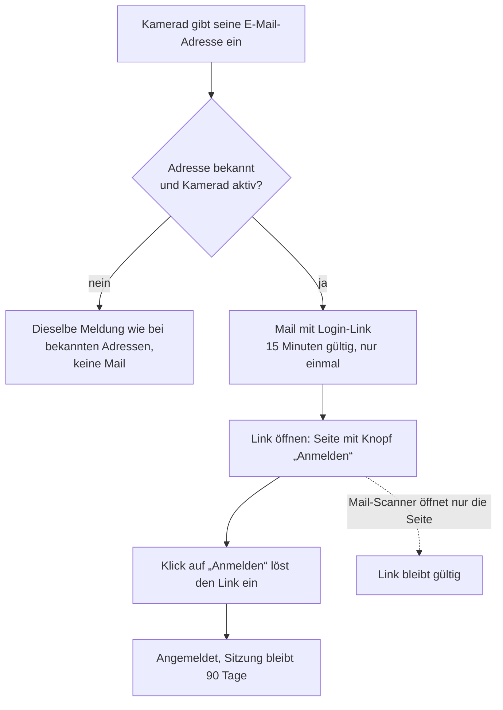

Anfragen sind je Adresse (5 pro Stunde) und je IP (20 pro Stunde) begrenzt. Mitglieder ohne E-Mail-Adresse können sich nicht anmelden.

### Neuen Kameraden aufnehmen

**Wer:** globaler Admin unter Admin → Kameraden, oder wer die Personalakten verwaltet unter Personalverwaltung → „Neue Mitglieder“ (auch viele auf einmal per CSV).

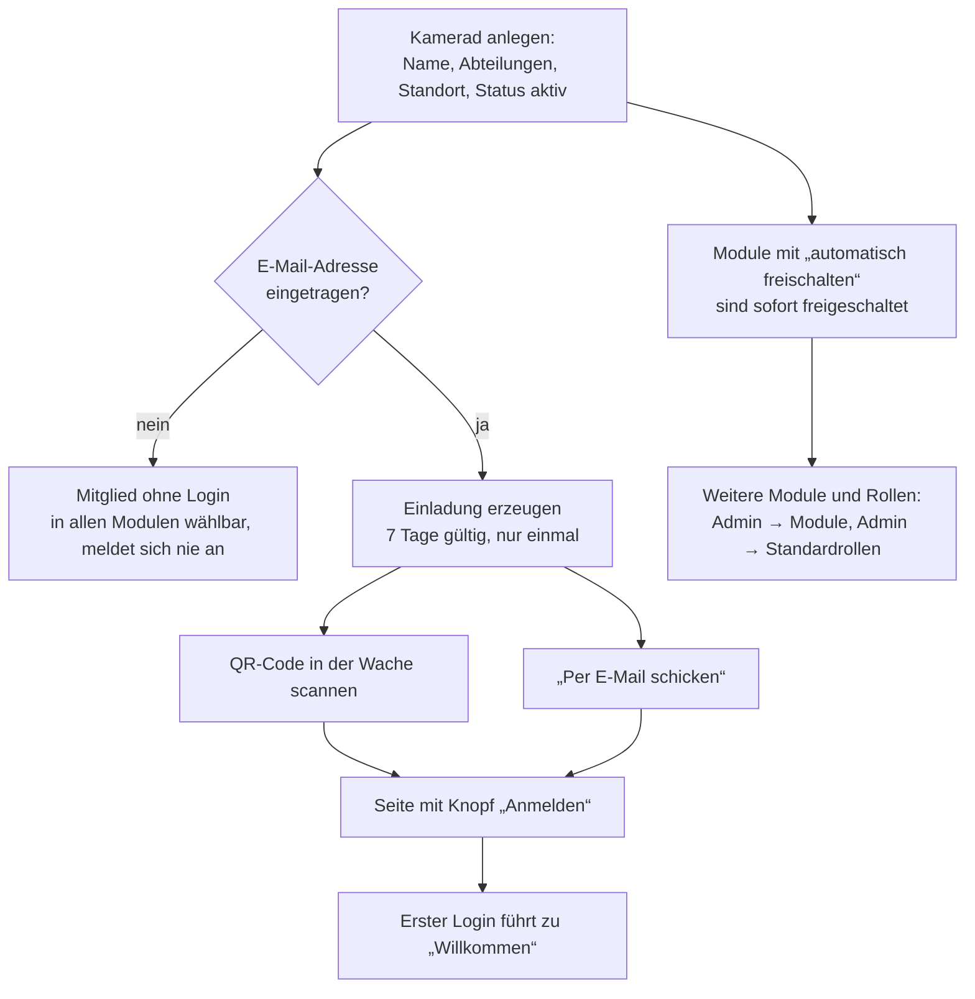

### Modul einschalten und freischalten

**Wer:** globaler Admin. **Wo:** Admin → Module.

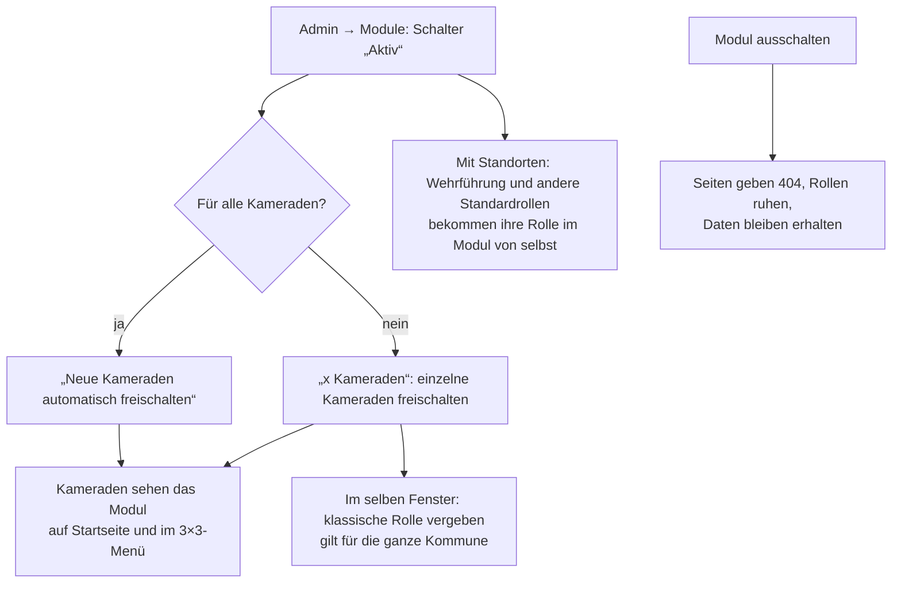

### Wehrführung eines Standorts wechseln

**Wer:** nur ein globaler Admin. Die Wehrführung selbst, Standort-Admins und GBI/SBI können das nicht. **Wo:** Admin → Standardrollen.

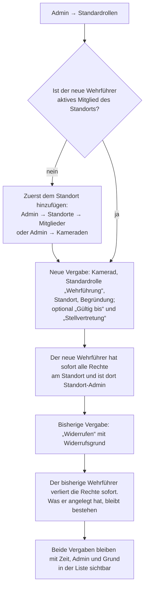

Was dabei gilt:

- **Reihenfolge:** Erst neu vergeben, dann die alte Vergabe widerrufen. So ist der Standort nie ohne Wehrführung. Mehrere Kameraden können die Rolle am selben Standort gleichzeitig haben.
- **Vergaben werden nicht geändert:** Kamerad, Standort, „Gültig bis“ und „Stellvertretung“ stehen nach dem Speichern fest. Wird der Stellvertreter zum Wehrführer, wird seine Vergabe widerrufen und ohne „Stellvertretung“ neu angelegt.
- **Befristete Vertretung:** Vergabe mit „Stellvertretung“ und „Gültig bis“; sie endet von selbst.
- **Kein eigener Schritt je Modul:** Die Rolle bringt die Rechte in allen Modulen mit, siehe [Berechtigungsmatrix](BERECHTIGUNGEN.md#standardrollen-führung-von-standort-und-kommune). Klassische Modulrollen des bisherigen Wehrführers (unter Admin → Module vergeben) bleiben davon unberührt und müssen bei Bedarf dort entfernt werden.
- **Benachrichtigungen** an die Wehrführung des Standorts gehen ab der Vergabe an den neuen Inhaber.
- **Verlässt der Wehrführer den Standort** oder wird er inaktiv, ruht die Rolle sofort, auch ohne Widerruf.

Für alle anderen Standardrollen (Gerätewart, Jugendwart, GBI/SBI …) ist der Ablauf derselbe; Jugend- und Kinderwart brauchen zusätzlich die Abteilung.

### Kamerad verlässt die Wehr

**Wer:** globaler Admin. **Wo:** Admin → Kameraden.

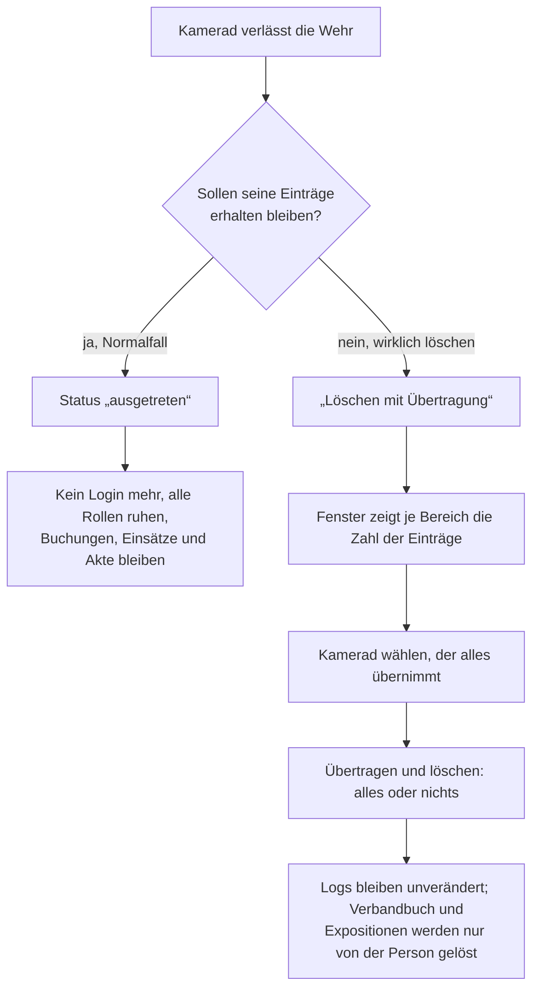

---

## Module

### Fahrzeugbuchung: Buchung und Konflikt

**Wer:** jeder mit Modulzugang bucht; Entscheider (mit Standorten auch die Wehrführung des Fahrzeug-Standorts) entscheiden Konflikte, ohne Entscheider die Admins. **Wo:** `/fahrzeugbuchung`.

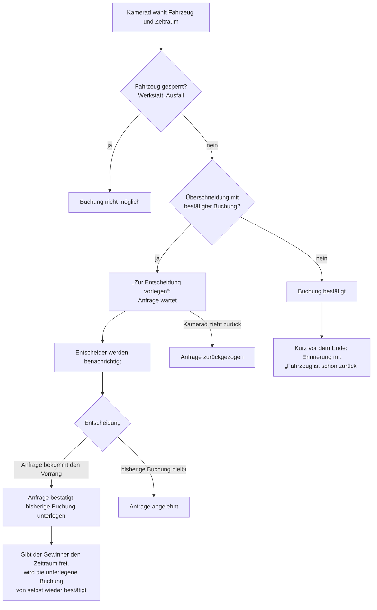

Doppelbuchungen verhindert zusätzlich die Datenbank. Nach Beginn lässt sich eine Buchung nicht mehr ändern oder stornieren, nur vorzeitig beenden.

### Einsatzbericht: vom Alarm bis zur Freigabe

**Wer:** jeder Kamerad mit Modulzugang schreibt; die Wehrführung des Standorts, GBI/SBI und Admins geben frei. **Wo:** `/einsatzbericht`.

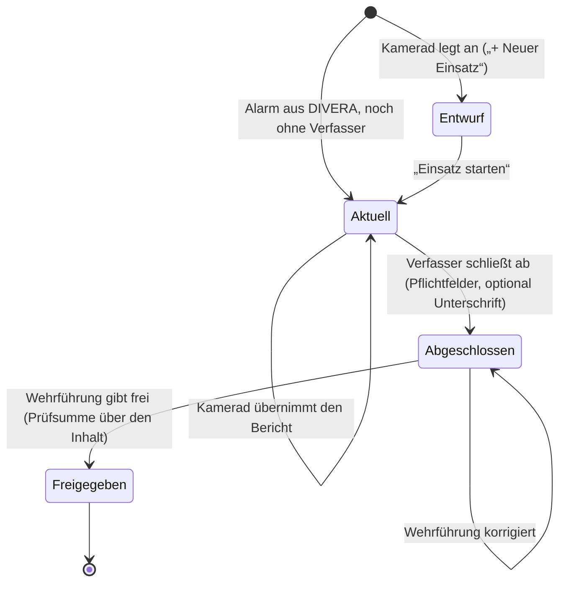

- Solange der Einsatz läuft, senden alle mit Modulzugang Lagemeldungen.
- Nach dem Abschluss ist der Verfasser draußen: Den Bericht öffnen nur noch Wehrführung des Standorts, GBI/SBI, Admins und die Rolle Einsicht.
- Erst freigegebene Berichte zählen in Jahresstatistik und Jahresbericht (abschaltbar).
- Eine Erinnerung geht an die zuständige Wehrführung, wenn Berichte auf die Freigabe warten.

### Lehrgänge: vom Interesse zum absolvierten Lehrgang

**Wer:** Kamerad meldet Interesse; Ausbildungsleiter, mit Standorten auch die Wehrführung für ihre Kameraden, bearbeiten. **Wo:** `/lehrgaenge`, „Anmeldungen“.

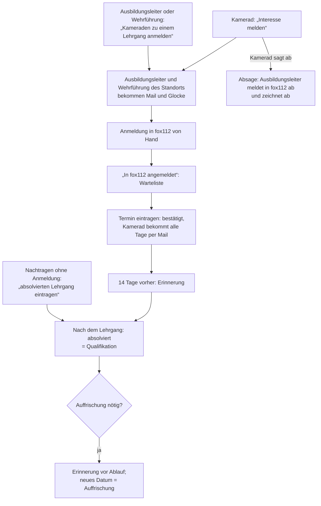

### Führerscheine: Kontrolle per Foto

**Wer:** Kamerad reicht ein; Führerscheinprüfer, mit Standorten auch die Wehrführung für ihre Kameraden, prüfen. **Wo:** `/fuehrerscheine`, „Prüfen“.

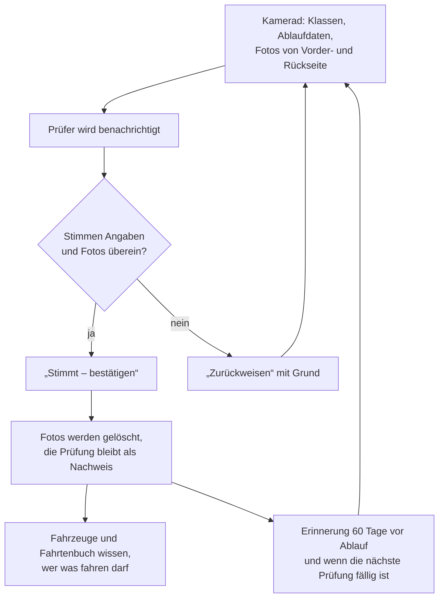

### Unterweisungen: durchführen und unterschreiben

**Wer:** Unterweisungsbeauftragte legen Arten an und führen durch; die Wehrführung führt für die Kameraden ihres Standorts durch. **Wo:** `/unterweisungen`.

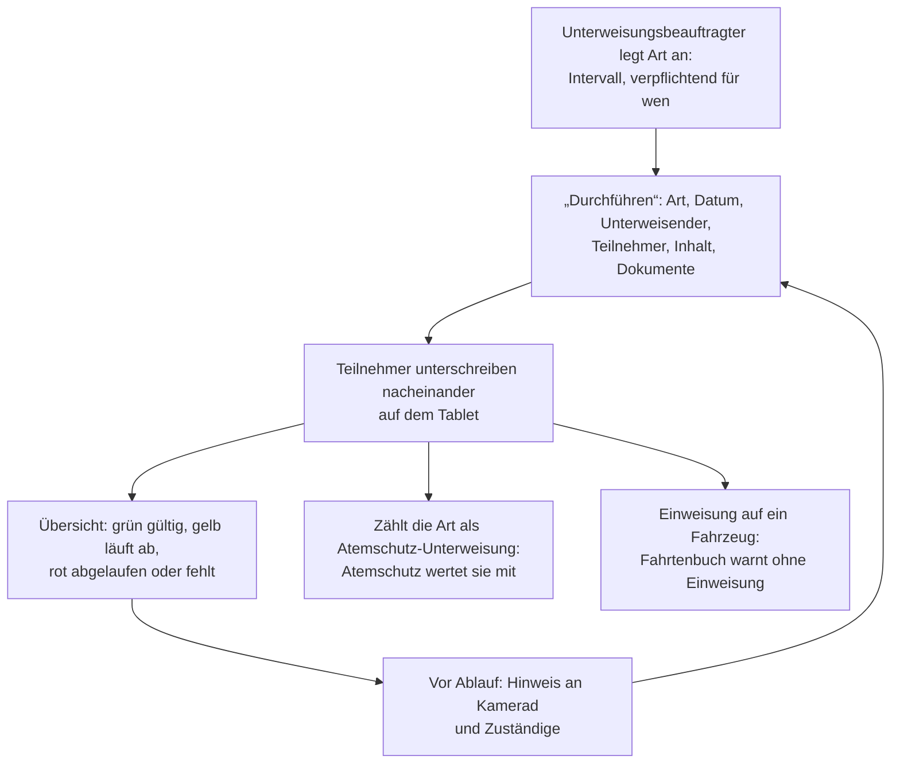

### Kalender: Termin, Rückmeldung, Anwesenheit

**Wer:** Terminverwalter und Wehrführung für ihren Standort; Jugend- und Kinderwarte für die eigene Abteilung. **Wo:** `/kalender`.

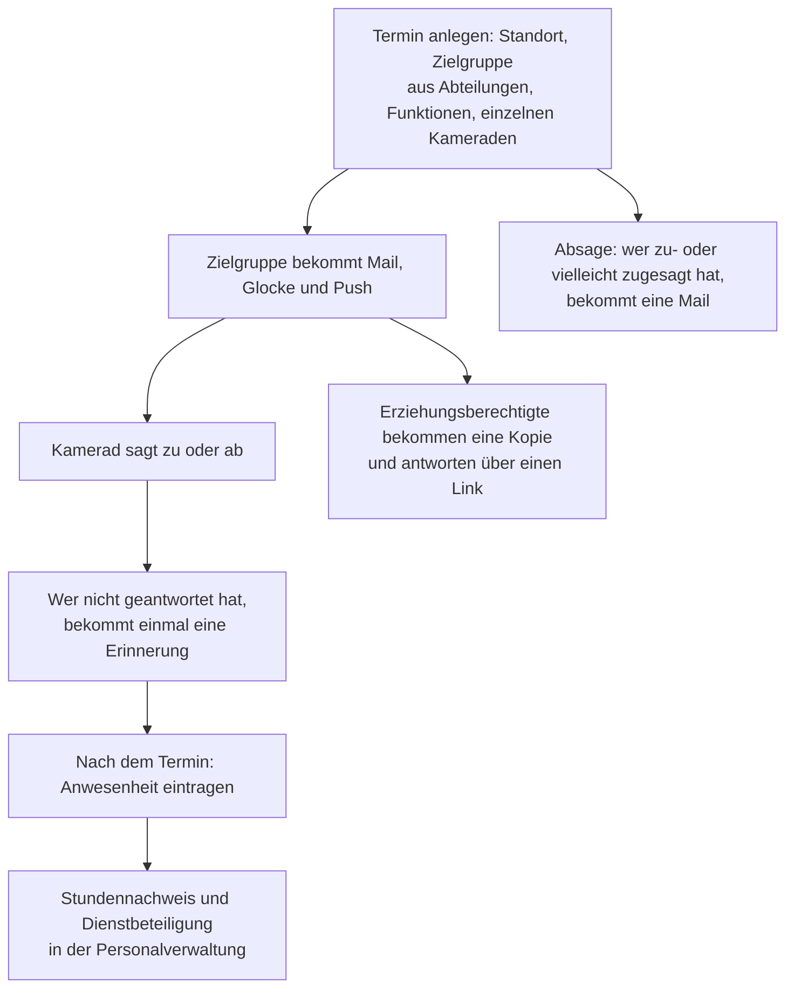

### Mitteilungen: Lesebestätigung

**Wer:** Redakteure und Admins; mit Standorten Standort-Admins für ihren Standort. **Wo:** `/mitteilungen/verwalten`.

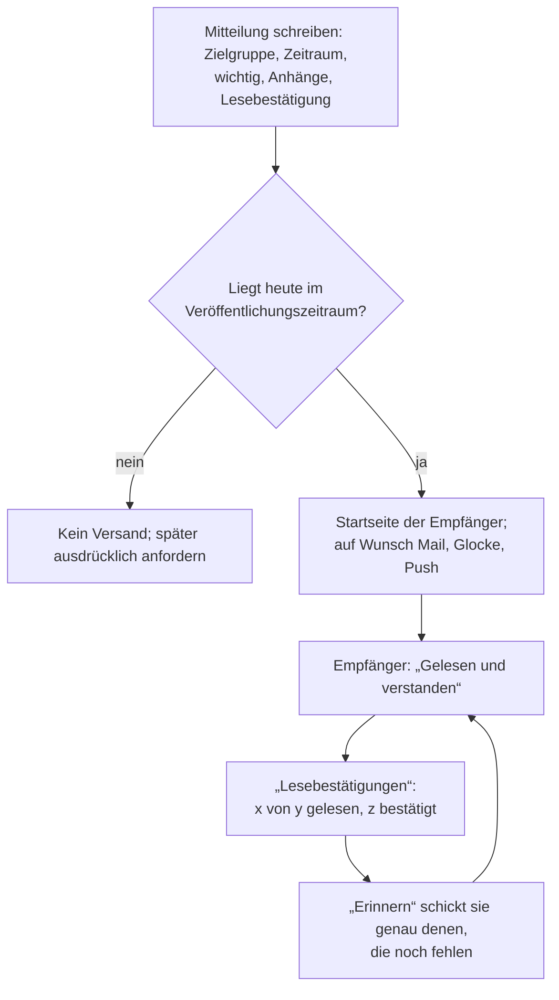

### Schichtplan: Selbst-Eintragung

**Wer:** Planer legen an; Kameraden der Zielgruppe tragen sich ein. **Wo:** `/schichtplan`.

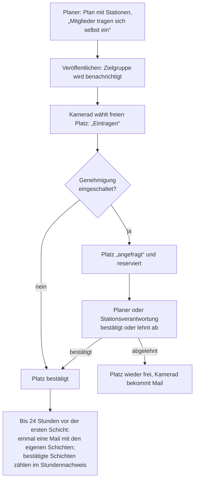

Alternativ verteilt der Planer mit „Plan füllen“ automatisch und ändert einzelne Plätze von Hand.

### Mängelmanagement: vom Melden bis erledigt

**Wer:** jeder mit Modulzugang meldet; Verantwortliche (mit Standorten Wehrführung und Gerätewart des Standorts) und Zuständige bearbeiten. **Wo:** `/maengelmanagement`, per QR-Code am Gerät.

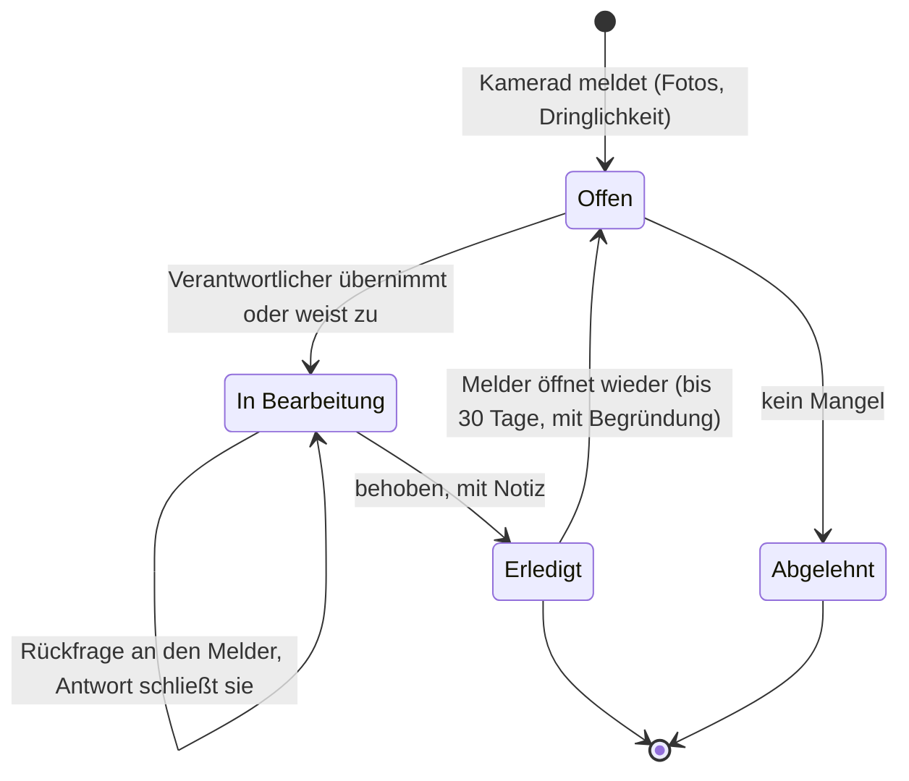

Ein neuer Mangel geht an alle Verantwortlichen, ohne Verantwortliche an die Admins. Hat das Objekt eine zuständige Person, wird ihr der Mangel gleich zugewiesen. Betrifft er ein Gerät der Ausrüstung, entsteht dort ein Schaden, der mit dem Mangel erledigt wird.

### Fahrzeuge: Prüfung und Mangel

**Wer:** Fahrzeugwarte; mit Standorten Wehrführung und Gerätewart des Standorts. **Wo:** `/fahrzeuge`, Fahrzeugprofil → Fristen.

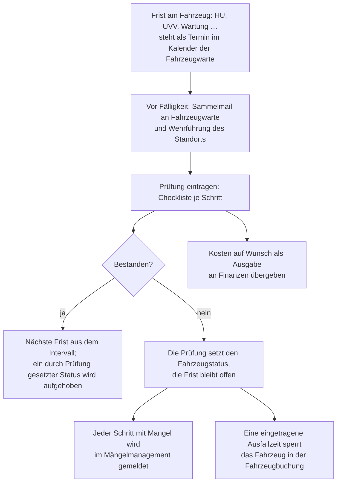

### Fahrtenbuch: Fahrt und Korrektur

**Wer:** alle mit Modulzugang fahren und tragen ein; Fahrtenbuchwarte korrigieren. **Wo:** `/fahrtenbuch`.

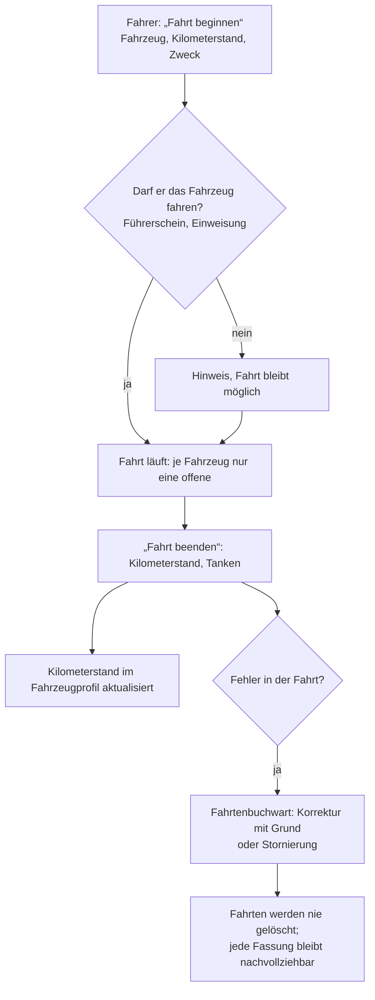

### Kleiderkammer: Ausgabe und Wäsche

**Wer:** Kleiderwarte; mit eingeschalteter Standortprüfung auch die Wehrführung für ihren Standort. **Wo:** `/admin/kleiderkammer`, für Kameraden `/kleiderkammer`.

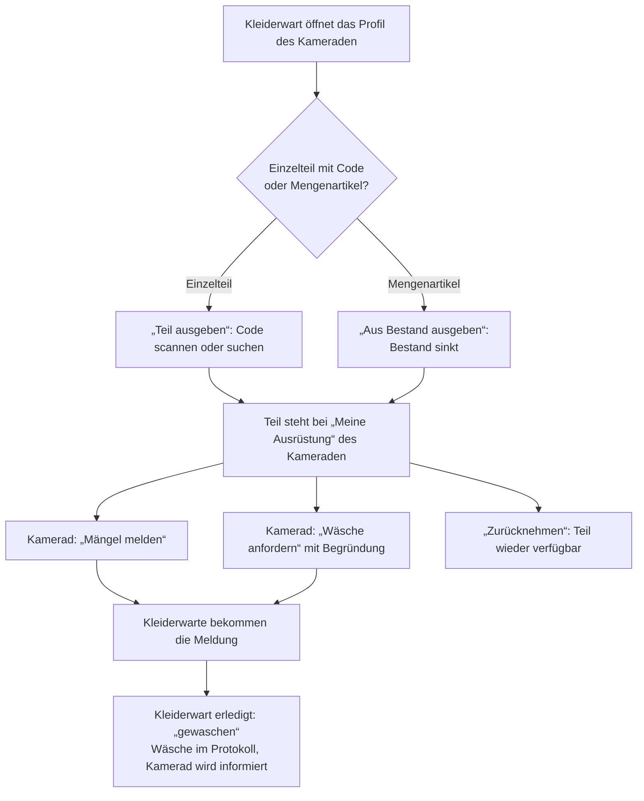

Ausgegeben wird nur an aktive Kameraden.

### Schlüssel: Ausgabe mit Quittung

**Wer:** Schlüsselwarte; mit Standorten jede Wehrführung. **Wo:** `/schluessel`.

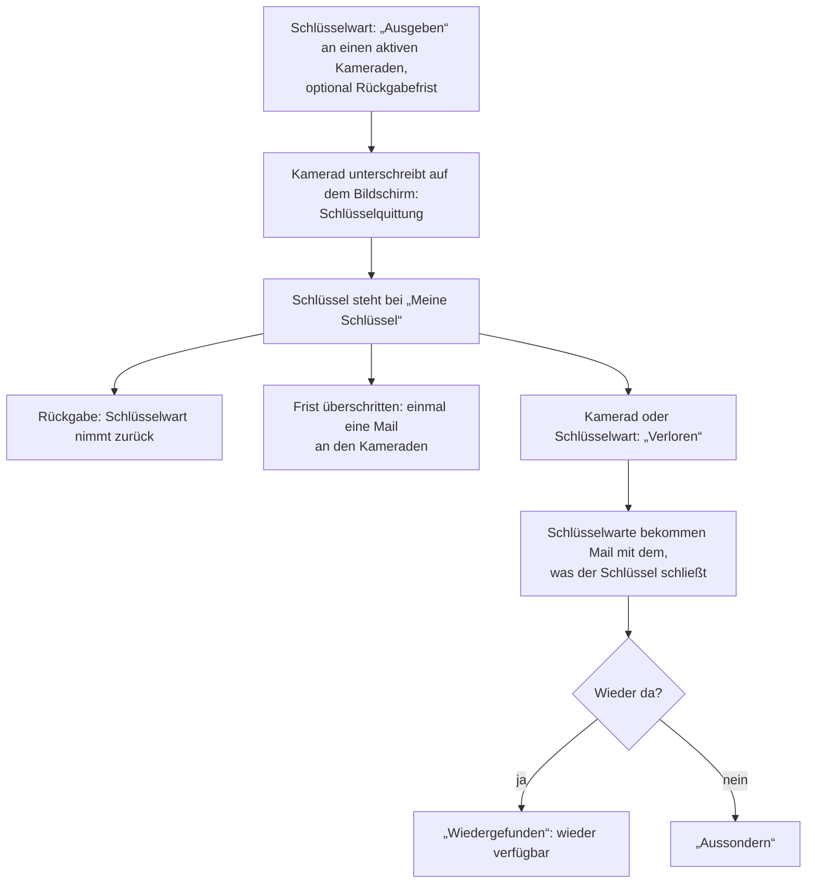

Ein Schlüssel kann nur einmal gleichzeitig ausgegeben sein.

### Finanzen: Ausgabe einreichen und genehmigen

**Wer:** jeder mit Modulzugang reicht ein; Kassenwart und Wehrführung des Buchungsstandorts genehmigen; der Kassenwart bezahlt. **Wo:** `/finanzen`.

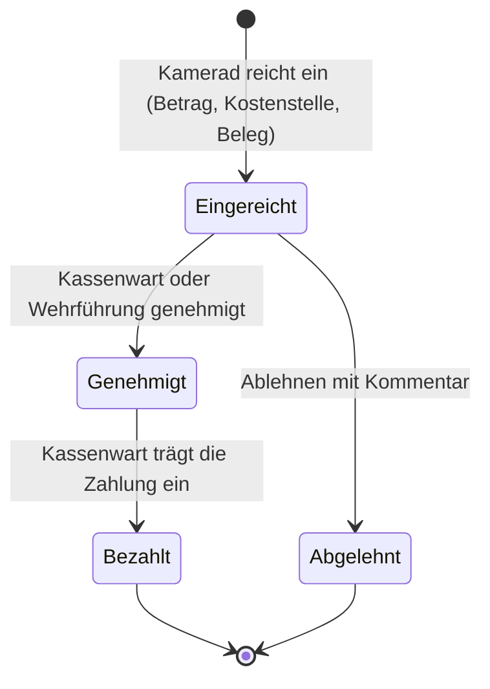

- Die eigene Ausgabe genehmigt immer jemand anderes (außer Admins).
- Von zwei gleichzeitigen Entscheidungen gilt die erste.
- Einnahmen und bereits bezahlte Ausgaben bucht der Kassenwart direkt, ohne Genehmigung.
- Ein abgeschlossenes Jahr ist gesperrt.

### Verbandbuch: Eintrag und Nachtrag

**Wer:** jeder mit Modulzugang schreibt; die Wehrführung des Standorts, GBI/SBI und Admins verwalten. **Wo:** `/verbandbuch`.

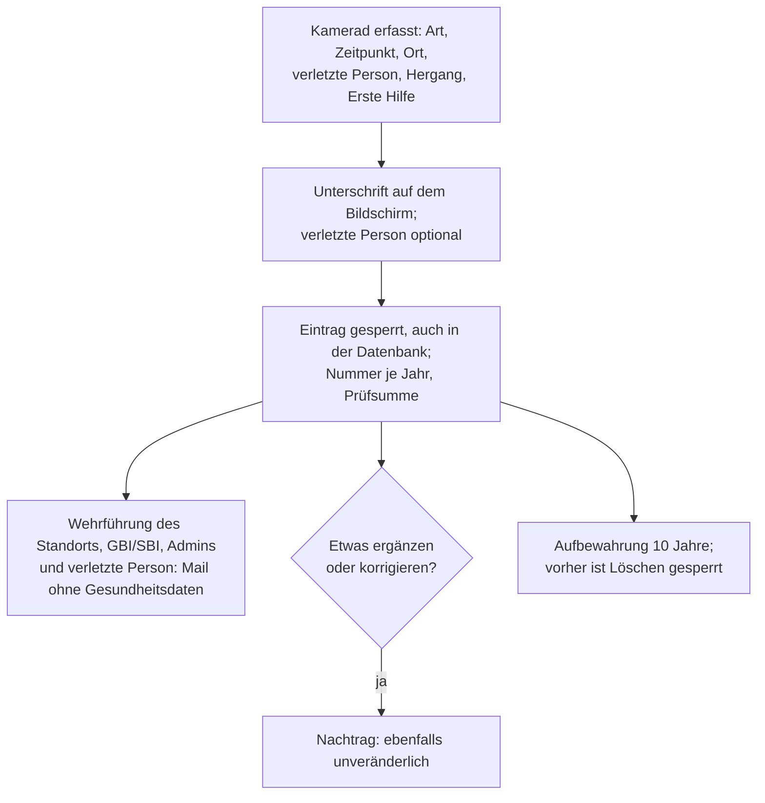

Das Verbandbuch führt ein eigenes Zugriffsprotokoll.

### Personalverwaltung: Änderungswunsch

**Wer:** jeder Kamerad meldet; wer seine Personalakte verwaltet, beantwortet. **Wo:** Personalakte → Laufbahn & Ehrungen, `/personalverwaltung/aenderungswuensche`.

```mermaid
flowchart TD
    A["Kamerad: „Änderung melden“<br>Thema und Beschreibung, höchstens fünf offene"] --> B["Zuständige bekommen Mail und Glocke"]
    B --> C{"Stimmt die Angabe?"}
    C -- ja --> D["Akte ändern: Dienstgrad, Abteilung,<br>Ehrung, Lehrgang …"]
    D --> E["„Erledigt“"]
    C -- nein --> F["„Nicht übernommen“ mit Begründung"]
    E --> G["Kamerad bekommt die Antwort und sieht<br>den Status in seiner Personalakte"]
    F --> G
```

Anschrift, Geburtsdatum und Mobilnummer trägt jeder Kamerad selbst ein, solange die Felder eingeschaltet sind; die Zuständigen bekommen dann nur den Hinweis, welche Felder sich geändert haben.

### Vereinsverwaltung: Beitritt und Vorstand

**Wer:** Antrag öffentlich ohne Anmeldung; der Vorstand des gewählten Vereins bearbeitet. **Wo:** `/vereinsbeitritt`, `/verein`.

```mermaid
flowchart TD
    A["Antrag auf /vereinsbeitritt:<br>Verein, Angaben, Einwilligungen, Bankverbindung"] --> B["Antrag beim Vorstand dieses Vereins"]
    B --> C{"Vorstand entscheidet"}
    C -- annehmen --> D["Passives Mitglied mit Standardbeitrag"]
    C -- ablehnen --> E["Antrag abgelehnt"]
    D --> F["SEPA-Mandat getrennt dokumentieren:<br>Unterschrift, Referenz, Status"]
    D --> G["Jugend- und Kinderfeuerwehr: beitragsfrei,<br>keine Bankdaten"]
```

Den Vorstand zusammenstellen:

```mermaid
flowchart TD
    A["Admin → Vereine: Verein anlegen,<br>Standort zuordnen"] --> B["Admin weist den Vorsitz zu<br>nur Kamerad des Vereins-Standorts"]
    B --> C["Vorsitz oder Stellvertretung:<br>Verein → Reiter „Vorstand“"]
    C --> D["Kamerad hinzufügen, Amt wählen:<br>Kassierer, Schriftführer, Beisitzer,<br>jeweils auch Stellvertretung"]
    D --> E["Zuordnung gibt den Zugang zum Verein"]
    C --> F["Das eigene Amt ändert der Vorsitz nicht;<br>das macht ein Admin"]
```
