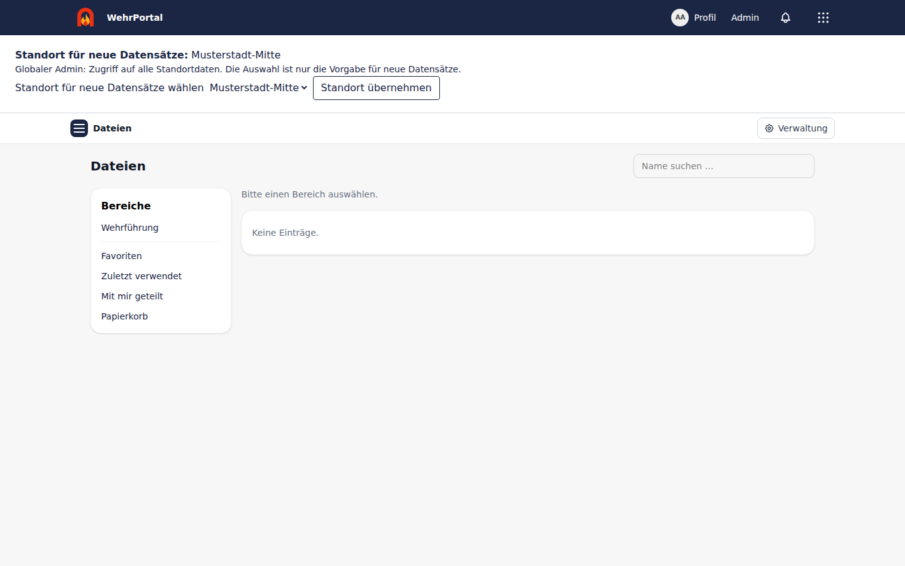

# Dateien

[Zur Hauptdokumentation](../README.md) · [Erweiterungsindex](README.md) · [Roadmap](DATEIEN-ROADMAP.md)

Die Erweiterung `extensions/Dateien/` ergänzt eine interne Dateiablage. Sie wird automatisch geladen und ist als Modul **standardmäßig ausgeschaltet**.

Die Erweiterung hat keinen eigenen `DATEIEN_ENABLED`-Schalter: Sie wird geladen, wenn der Erweiterungs-Provider aktiv ist. Die Freischaltung des Moduls unter **Admin → Module** steuert den Kameradenzugang; sie ersetzt nicht die unten beschriebenen Rechte pro Ablage und Eintrag.



## Inhalt

- [Einrichtung und Bedienung](#einrichtung-und-bedienung)
- [Rechte](#rechte)
  - [Standorte](#standorte)
- [Versionierung und Papierkorb](#versionierung-und-papierkorb)
- [Datenmodell](#datenmodell)
- [Betrieb und Sicherheit](#betrieb-und-sicherheit)
- [Tests und Grenzen](#tests-und-grenzen)
- [Betrieb (Meilenstein 2)](#betrieb-meilenstein-2)
- [Online-Office (Meilensteine 3 und 4)](#online-office-meilensteine-3-und-4)
- [Öffentliche Links (Meilenstein 5)](#öffentliche-links-meilenstein-5)
- [Komfort und Zusammenarbeit (Meilenstein 6)](#komfort-und-zusammenarbeit-meilenstein-6)

## Einrichtung und Bedienung

1. Unter **Admin → Module** „Dateien“ einschalten. Ist Locations aktiv, wird automatisch für jeden Standort eine Ablage mit dessen Namen eingerichtet; Standortangehörige erhalten dort auch ohne eigenen Dateien-Modulzugang Lese- und Bearbeitungsrechte, aber keine Rechteverwaltung. Andere Ablagen bleiben durch Modulzugang und ACL geschützt.
2. Als globaler Admin unter **Admin → Dateien** (`/admin/dateien`) weitere Ablagen anlegen. Optional einen Standort und ein Kontingent in MiB wählen. Ohne Standort ist eine Ablage standortübergreifend; ein Kontingent umfasst **alle Versionen einschließlich Papierkorb**, nicht nur die aktuellen Inhalte.
3. Dort eigene Dateigruppen anlegen und bestehende Mitglieder zuordnen. Dateigruppen sind unabhängig von Abteilungen und Funktionen. Die Modulrolle `gruppenverwalter` erlaubt Gruppen- und Mitgliederverwaltung, aber keinen automatischen Zugriff auf Dateien. Das Gruppenverwalter-Kennzeichen einer Mitgliedschaft dokumentiert die Zuständigkeit; es ersetzt die Modulrolle nicht.
4. Unter `/dateien` die Ablage öffnen und Rechte an Kameraden, Abteilungen oder Dateigruppen vergeben. Globale Admins dürfen in aktiven Modulen alles; für andere Ablagen gilt **standardmäßig kein Zugriff**.

Das Layout folgt einem klassischen Dateibrowser: links die Bereiche (Favoriten, Zuletzt verwendet, Papierkorb), in der Mitte die Ordnerstruktur als Baum neben der Liste, Tabelle oder den Kacheln mit Ordnern und Dateien, rechts ein Detailbereich (Metadaten, Versionen, Kommentare, Berechtigungen, öffentliche Links) für den gewählten Eintrag. „Neuer Ordner“ liegt als Menü neben dem Ordnerpfad, der Upload als Drop-Zone über der Dateiliste. Der Explorer bietet Ordner, Mehrfach-Upload per Dateiauswahl oder Drag-and-drop sowie das Ablegen ganzer Ordner einschließlich Unterordnern. Die Ordnerstruktur bleibt erhalten; Namenskonflikte werden angezeigt und nicht still überschrieben. Außerdem gibt es Umbenennen, Verschieben innerhalb einer Ablage, Downloads, Versionsverlauf, Rechte, Suche, Favoriten, „Zuletzt verwendet“, Bildvorschau, ZIP-Download, Kommentare und Papierkorb. Für einen Inhaltswechsel ausdrücklich eine **neue Version** hochladen. „Mit mir geteilt“ erschließt Direktfreigaben, auch wenn der übergeordnete Ordner nicht zugänglich ist.

## Rechte

| Recht | Befugnisse |
|---|---|
| `read` – Lesen | Auflisten, ansehen, herunterladen, Versionsverlauf lesen |
| `edit` – Bearbeiten | Zusätzlich hochladen, Ordner erstellen, umbenennen, neue Versionen und Versionswiederherstellungen |
| `manage` – Verwalten | Zusätzlich Rechte/Vererbung ändern, verschieben, Papierkorb und Wiederherstellung, endgültig löschen |

Rechte gelten für eine ganze Ablage oder einen einzelnen Ordner/eine Datei. Kameraden-, Abteilungs- und Dateigruppenrechte werden zusammengeführt; das **höchste zutreffende Recht** gewinnt. Abteilungsfreigaben gelten nur für die gewählte Abteilung am Standort der Ablage. Es gibt keine expliziten Verbote. Neue Einträge erben Rechte vom Elternordner beziehungsweise der Ablage. Wird die Vererbung an einem Eintrag unterbrochen, zählen dort nur dessen eigene Rechte und für dessen Nachkommen die Rechte unterhalb dieser Grenze.

Eine Direktfreigabe verrät keine Namen gesperrter Eltern oder Geschwister. Ein Ordnerrecht öffnet nicht automatisch Kinder mit unterbrochener Vererbung. Verschieben erfordert `manage` an Quelle **und** Ziel; es kann die geerbten Rechte verändern. Ablageübergreifendes Verschieben ist in diesem Meilenstein absichtlich ausgeschlossen.

### Standorte

Bei aktiver Locations-Extension prüft die zentrale Berechtigungslogik zusätzlich den Standort der Ablage. Für die automatisch angelegte Standortablage erhalten Standortangehörige Bearbeitungsrecht und Standort-Admins Verwaltungsrecht. Der Zugriff auf diese Ablage ist auch ohne eigene Dateien-Modulrolle möglich; er öffnet keine anderen Ablagen. In Unterordnern kann die Vererbung unterbrochen und der Zugriff gezielt an einzelne Kameraden oder Abteilungen vergeben werden. Auch ein direktes Benutzerrecht oder eine Gruppenmitgliedschaft umgeht die Standortgrenze nicht. Das gilt für technische Downloads und Service-Aufrufe, nicht nur für die Oberfläche. Gruppenverwalter sehen nur gemeinsame Gruppen und Gruppen ihrer Standorte und dürfen keine fremden Standortmitglieder durch manipulierte IDs hinzufügen. Globale Admins verwalten alle Standorte. Standortlose Ablagen und Dateigruppen sind bewusst gemeinsam – für vertrauliche Standortdaten immer einen Standort setzen.

Eine Mitgliedschaft über den Primärstandort **oder** eine ausdrückliche Standortzuordnung genügt für diese zusätzliche Standortgrenze; sie erteilt noch keine Datei-ACL. Entfällt nur eine von mehreren passenden Mitgliedschaftsquellen, ist das nicht automatisch der vollständige Standortentzug. Beim nächsten Zugriff zählen die dann gültigen Rechte, nicht ein zuvor geöffnetes Formular oder eine frühere erfolgreiche Anmeldung. Öffentliche Links sind die unten beschriebene, ausdrücklich eingeschaltete Ausnahme für Gäste.

## Versionierung und Papierkorb

- Jede neue Datei beginnt mit Version 1. Inhaltsänderungen hängen eine neue Version an; bestehende Versionsmetadaten sind durch einen PostgreSQL-Trigger gegen Updates geschützt.
- Eine alte Version wiederherzustellen erzeugt eine neue aktuelle Version. Der Verlauf wird nicht zurückgesetzt.
- Jede Version trägt SHA-256-Prüfsumme, Bytezahl, erkannten MIME-Typ, Endung, Ersteller und Herkunft. Identische erneute Verarbeitung des aktuellen Inhalts erzeugt keine Doppelversion.
- Änderungen an einer Ablage werden innerhalb einer Datenbanktransaktion gesperrt. Versionsaktionen unterstützen zusätzlich eine erwartete Versionsnummer: Ist der Stand veraltet, wird die Änderung mit einem Konflikt abgelehnt statt fremde Änderungen unbemerkt zu ersetzen.
- Löschen verschiebt in den Papierkorb. Inhalte unter einem gelöschten Ordner sind nicht mehr lesbar, auch nicht über frühere Direktfreigaben. Vor der Wiederherstellung muss der Elternordner wieder verfügbar sein; ein inzwischen belegter Name verhindert die Wiederherstellung.
- Endgültiges Löschen ist eine eigene bestätigungspflichtige Aktion mit `manage`. Die konfigurierbare Mindestaufbewahrung (Standard: 30 Tage) muss abgelaufen sein. **Es gibt keine automatische Löschung**.

## Datenmodell

Alle Tabellen verwenden `x_files_`:

| Tabelle | Inhalt |
|---|---|
| `spaces` | Ablagen, optionaler Standort, Kontingent |
| `nodes` | Datei-/Ordnerbaum, Vererbungsgrenze, Papierkorb |
| `versions` | Unveränderliche Versionsmetadaten und privater Speicherschlüssel |
| `groups`, `group_members` | Dateigruppen und bestehende Benutzer mit Zuständigkeitskennzeichen |
| `permissions` | Benutzer-/Gruppenrechte auf Ablagen oder Einträgen |
| `audit_events` | Aktionen und IDs, ohne Dateibytes oder Speicherzugangsdaten |
| `pending_deletions` | Dauerhafte Warteschlange für physische Löschungen nach dem Datenbank-Commit |
| `office_sessions`, `office_locks` | Kurzlebige Office-Sitzungen und WOPI-Sperren |
| `shares` | Gehashte Tokens und Einstellungen öffentlicher Lesefreigaben |
| `previews` | In der Datenbank gespeicherte Bildvorschauen pro Version |

Fremdschlüssel, Prüfungen und eindeutige aktive Namen pro Ordner sichern die Struktur zusätzlich zur zentralen Service-Schicht. Favoriten und „Zuletzt verwendet“ kamen nach dem ursprünglichen ersten Meilenstein hinzu; siehe [Komfort und Zusammenarbeit](#komfort-und-zusammenarbeit-meilenstein-6).

## Betrieb und Sicherheit

- Dateien liegen auf dem privaten Laravel-Disk `dateien` unter **`storage/app/private/dateien`**, niemals unter `public/` oder dem Storage-Symlink. Die Pfade bestehen aus generierten Schlüsseln, nicht aus eingegebenen Dateinamen.
- Dieses Verzeichnis muss persistent, für den PHP-Prozess schreibbar und auf allen App-Instanzen konsistent verfügbar sein. Standard ist ein lokales Dateisystem mit atomarem Umbenennen. Andere Storage-Treiber sind in diesem Meilenstein nicht unterstützt.
- **Datenbank und Dateiablage zusammen sichern und zusammen wiederherstellen.** Ein Datenbankbackup allein enthält keine Datei-Inhalte. Beim Backup Schreibzugriffe anhalten oder einen konsistenten gemeinsamen Snapshot erstellen.
- Uploads durchlaufen temporäres Schreiben, Typ-/Größenprüfung und atomare Veröffentlichung. Normale Fehler räumen temporäre beziehungsweise noch nicht referenzierte neue Inhalte auf. Ein harter Prozess-/Hostabbruch kann verwaiste Dateien hinterlassen: Speicher überwachen; unbekannte Dateien niemals allein anhand ihres Alters ohne Abgleich mit `x_files_versions` löschen.
- Endgültige Löschungen verwenden eine persistente Löschliste (`x_files_pending_deletions`): Erst nach erfolgreichem Datenbank-Commit werden Dateibytes entfernt. Bei Speicherfehlern bleiben die Aufträge erhalten. Globale Admins können unter **Admin → Dateien → Speicherbereinigung** ausstehende Löschungen erneut versuchen; weitere endgültige Löschaktionen arbeiten die Liste ebenfalls ab.
- Uploadlimit standardmäßig 20 MiB, administrativ bis maximal 50 MiB. Erlaubt sind nur ausgewählte Endungen aus der zentralen `FileResponse`-Allowlist und passende MIME-Typen. PHP (`upload_max_filesize`, `post_max_size`), Livewire-Temporärupload und Reverse Proxy können kleinere Grenzen setzen und müssen zum gewünschten Limit passen.
- Office-Dateien werden nur gespeichert/heruntergeladen, nicht serverseitig ausgeführt. Die Typprüfung ersetzt **keinen Virenscanner**. Dateien nur aus vertrauenswürdigen Quellen öffnen; ein Virenscanner ist nicht integriert.
- Interne Downloads benötigen Anmeldung, aktives Konto, Modulzugriff, Standortzugriff und ACL. Versions-IDs werden an die angefragte Datei gebunden. Sichere Dateiauslieferung erfolgt über `FileResponse` mit `private, no-store` und `nosniff`. Die optionale öffentliche Lesefreigabe ist eine eng begrenzte Ausnahme und wird unter [Öffentliche Links](#öffentliche-links-meilenstein-5) beschrieben.
- Datei-Inhalte, Tokens und Speicherzugangsdaten gehören nicht in Logs. Die Extension führt eigene Metadaten-Auditereignisse; der allgemeine ActivityRecorder verarbeitet keine Extension-Modelle.
- Die Dateien-Oberfläche und Downloads sind kein Offline-Angebot. Keine Dateien in Service-Worker- oder Proxy-Caches aufnehmen.

## Tests und Grenzen

Pest-Featuretests liegen unter `tests/Feature/Extensions/Dateien/` und benötigen PostgreSQL wie die übrigen Featuretests:

```bash
./vendor/bin/pest tests/Feature/Extensions/Dateien
./vendor/bin/phpstan analyse -c extensions/Dateien/phpstan.neon --memory-limit=2G
```

Geprüft werden Modulfreigabe, Benutzer-/Gruppenrechte, Vererbungsgrenzen, Direktfreigaben ohne Metadatenlecks, Versionierung und Wiederherstellung, Namens-/Versionskonflikte, Papierkorb, IDOR-Schutz und Standortgrenzen.

Die gezielten Zwei-Standort-Regressionen in `LocationBoundaryTest.php` und `OfficeLocationBoundaryTest.php` umfassen Downloads mit fremden Versions-IDs, bereits erzeugte Vorschaubilder, rekursive ZIPs, gefilterte Listen und geöffnete Explorer-/Office-Sitzungen nach Rechteentzug. Office-Anfragen verwenden gültige JWT-/WOPI-Nachweise ohne Browser-Anmeldung. Die lokalen Tests ersetzen keine Abnahme einer externen Office-Installation und bestätigen nicht die übrigen Audit-Pakete.

Die Suche umfasst Namen und Beschreibungen, aber keine Dateiinhalte. Nicht enthalten sind WebDAV, Desktop-Sync, Offline-Bearbeitung und PDF-Vorschau. Favoriten und „Zuletzt verwendet“ sind inzwischen Teil des späteren Meilensteins 6.

## Betrieb (Meilenstein 2)

- **Hochladen:** mehrere Dateien oder ganze Ordner per Drag & Drop, mit Fortschritt und Abbrechen (`POST /dateien/hochladen`, eine Datei pro Anfrage). Die Ordnerstruktur bleibt erhalten; höchstens 50 Dateien und 500 Ordner pro Ablagevorgang. Größenobergrenze der Admin-Einstellung: `DATEIEN_MAX_UPLOAD_LIMIT_KB` (Standard 51200). PHP (`upload_max_filesize`, `post_max_size`) und Reverse-Proxy müssen mindestens so viel zulassen.
- **Herunterladen:** gestreamt mit Range-Anfragen; Prüfsumme wird vor der Auslieferung geprüft (abschaltbar). Begrenzung: 60 Uploads und 300 Downloads pro Minute und Kamerad (`config/dateien.php` → `rate_limits`).
- **Suche:** Namenssuche über alle Bereiche; nur Einträge, die der Kamerad lesen darf, nie Papierkorb.
- **Benachrichtigung:** neue oder geänderte Freigaben melden sich bei den Empfängern (Glocke, Mail, Push), nur Name und Recht.
- **Kontingent-Warnung** ab einstellbarem Prozentsatz (Standard 90 %).
- **Dateiprotokoll:** `/admin/dateien/protokoll` (nur Admins), Filter und CSV-Export. Aufbewahrung einstellbar (Standard 730 Tage, 0 = unbegrenzt); `dateien:prune-audit` löscht täglich, sonst bleibt das Protokoll unveränderbar.
- **Geplante Läufe:** `dateien:drain-deletions` (alle 15 Min., ausstehende physische Löschungen mit wachsendem Abstand), `dateien:prune-audit` (täglich), `dateien:reconcile` (wöchentlich, löscht nichts).
- **Sicherung/Wiederherstellung:** Datenbank und `storage/app/private/dateien` gemeinsam sichern (zuerst DB, dann Dateien). Nach einer Wiederherstellung `php artisan dateien:reconcile --verify` ausführen; Exit-Code ≠ 0 bei fehlenden, veränderten oder verwaisten Dateien. Verwaiste Dateien löscht nur ein Admin auf der Verwaltungsseite nach erneuter Prüfung.
- **Ausgeschiedene/inaktive Kameraden** verlieren sofort jeden Zugriff; ihre Freigaben bleiben bis zur Reaktivierung bestehen. „Löschen mit Übertragung“ überträgt ihre Versionen an den gewählten Kameraden; das Protokoll behält die ursprüngliche ID.

## Online-Office (Meilensteine 3 und 4)

- **Anbieter:** ONLYOFFICE Docs (ab 8.1, wegen PDF) **oder** Collabora Online (WOPI); höchstens einer je Instanz. Einstellung in `/admin/dateien` → „Online-Office“ (nur Admins).
- **Adressen:**
  - *Office-Server für den Browser* (z. B. `https://office.ff-musterstadt.de`): iframe, Skript, CSP.
  - *Interne Adresse* (optional, z. B. `http://onlyoffice` im Docker-Netz): Healthcheck bzw. `/hosting/discovery`.
  - *Rückruf-Adresse der App* (leer = `APP_URL`): so erreicht der Office-Server die App.
  - Bewusste Entscheidung: diese Admin-Adressen laufen **nicht** über `SafeUrl` (interne Ziele sind erlaubt); die App ruft nur genau diese Adressen auf, ohne Weiterleitungen, Timeout 5 s.
- **ONLYOFFICE:** JWT-Secret Pflicht (≥ 32 Zeichen, gleich `JWT_SECRET` des Document Servers), verschlüsselt gespeichert, im Aktivitätsprotokoll maskiert. Konfiguration, Dateiabruf und Rückruf sind HS256-signiert; andere Algorithmen werden abgelehnt.
- **Collabora:** Jeder WOPI-Aufruf (`CheckFileInfo`, `GetFile`) braucht eine gültige Proof-Signatur (Schlüssel aus Discovery, auch der alte Schlüssel, höchstens 20 Minuten alt). Discovery wird eine Stunde zwischengespeichert.
- **Office-Sitzungen** (`x_files_office_sessions`): zufälliges Token je Öffnen, nur als SHA-256 gespeichert, gebunden an Kamerad, Datei, Version und Anbieter, 8 Stunden gültig (`config/dateien.php` → `office.session_minutes`). Bei **jedem** Aufruf des Office-Servers werden Token, Ablauf, Widerruf, Datei und die aktuellen Rechte (inkl. Standort, Status, Modulzugang) erneut geprüft. Antworten: 401 (Token/Signatur), 403 (Recht entzogen), 404 (Modul oder Office aus).
- **Routen ohne Login** unter `/dateien/office/…`: kein Session-Cookie, kein CSRF, eigenes Rate-Limit (600/Min. je IP), `NoIndex` global.
- **Editor-Seite** `/dateien/dateien/{id}/office`: eigene, **erzwungene** CSP (`default-src 'none'`, Skripte nur mit Nonce und vom Office-Host, `frame-src`/`form-action` nur Office-Host), `no-referrer` per Meta-Tag.
- **Protokoll:** `office.opened` (mit Stufe `read`/`edit`), `office.closed` (ONLYOFFICE Status 2/4, WOPI Unlock, untätig, abgelaufen, widerrufen), `office.revoked_all`, `office.settings_changed` – nie Tokens oder Secrets.
- **Widerruf:** Knopf „Alle Office-Sitzungen beenden“; Wechsel von Anbieter, Server-Adresse oder Secret beendet alle Sitzungen automatisch. `dateien:prune-office-sessions` (stündlich) räumt abgelaufene Sitzungen auf.
- **Bearbeiten (M4):**
  - Knopf „Im Office bearbeiten“ nur mit Recht `edit` und nur für Formate, die beide Server im selben Format zurückspeichern: `docx`, `odt`, `txt`, `xlsx`, `ods`, `csv`, `pptx`, `odp` (alte Binärformate und PDF nur ansehen). Admin-Schalter „Bearbeiten im Office erlauben“ (Standard an); aus = Speichern wird abgelehnt.
  - Sitzungen mit Stufe `edit` arbeiten immer auf der neuesten Version; jede Speicherung prüft die **aktuellen** Bearbeitungsrechte und das Speicherlimit und wird eine Version mit Quelle `office` (Ersteller = Kamerad der Sitzung).
  - **ONLYOFFICE:** Alle, die dieselbe Version öffnen, bearbeiten gemeinsam (gleicher `document.key`). Rückruf Status 2 (alle geschlossen) und 6 (Speichern-Knopf/Forcesave) speichern; der Download erfolgt **nur** vom eingestellten Office-Server (Browser- oder interne Adresse; die Browser-Adresse wird intern abgerufen), ohne Weiterleitungen, höchstens bis zum Upload-Limit, Timeout `office.save_timeout` (60 s). Es zählt nur der Inhalt des geprüften JWT; ein abweichender `filetype` oder `key` wird abgelehnt. Fehlschlag → `{"error":1}` (der Document Server behält das Dokument) und `office.save_failed`.
  - **Collabora (WOPI):** `Lock`, `GetLock`, `RefreshLock`, `Unlock` (30 Minuten, `x_files_office_locks`), `PutFile` nur mit der aktuellen Sperre, sonst 409 mit `X-WOPI-Lock`. Weicht `X-COOL-WOPI-Timestamp` von der neuesten Version ab, folgt 409 mit `COOLStatusCode 1010` (Collabora fragt dann nach). `PutRelativeFile` und `RenameFile` sind abgeschaltet (501). Schreiben nur mit einer Bearbeitungssitzung.
  - **Versionen:** Automatische Zwischenspeicherungen (Collabora `IsAutosave`, ONLYOFFICE Forcesave per Timer) ersetzen die vorige Zwischenspeicherung **derselben Sitzung**, solange sie die neueste Version ist; ausdrückliche Speicherungen und das Schließen bleiben eigene Versionen. Ersetzte Dateien gehen über die Lösch-Warteschlange.
  - **Sperre für Uploads:** Solange eine Bearbeitungssitzung aktiv ist (Aktivität innerhalb `office.edit_idle_minutes`, 60 Min.) oder eine WOPI-Sperre gilt, werden „Neue Version“ und „Wiederherstellen“ abgelehnt; der Explorer zeigt einen Hinweis. Wurde trotzdem außerhalb des Office gespeichert (nach Ablauf des Fensters), bleibt die Office-Speicherung eine weitere Version und `office.saved` vermerkt `conflict`.
  - `dateien:prune-office-sessions` beendet zusätzlich untätige Bearbeitungssitzungen (`office.closed`, Grund `idle`) und löscht abgelaufene Sperren.
  - **Protokoll:** `office.saved` (Version, Autosave, beteiligte Kameraden bei ONLYOFFICE), `office.save_failed` (Grund, ohne Inhalt).

## Öffentliche Links (Meilenstein 5)

Optional und **standardmäßig aus**. Damit gibt ein Verwalter eine Datei oder einen Ordner an Externe (Gemeinde, Nachbarwehr) zum Herunterladen frei, ohne Anmeldung.

- **Einschalten (Admin, `/admin/dateien` → „Öffentliche Links“):** globaler Schalter und Höchstdauer (1–365 Tage, Standard 30); zusätzlich jede Ablage einzeln „Erlauben“. Ohne beides entsteht kein Link; Ausschalten (global oder pro Ablage) macht alle bestehenden Links sofort wirkungslos. Dort steht auch die Liste aller aktiven Links mit Widerruf.
- **Erstellen (Explorer, Abschnitt „Öffentliche Links“):** nur mit Recht „Verwalten“ auf dem Eintrag. Pflicht: Gültigkeit in Tagen; optional Passwort (mind. 8 Zeichen), Download-Limit, Bezeichnung. Der Link wird **nur einmal** angezeigt (gespeichert ist nur der SHA-256-Hash des 48-Zeichen-Tokens). Verwalter sehen die aktiven Links des Eintrags und widerrufen sie.
- **Öffentliche Seite `/freigabe/{token}`:** zeigt nur den freigegebenen Teilbaum (Pfad ab der Freigabe, keine Namen darüber oder daneben), Name, Größe, Datum; Download der jeweils neuesten Version. Kein Office, keine Bearbeitung, keine älteren Versionen. Eigenständige Seite ohne App-Layout, eigene CSP (`default-src 'none'`), `Cache-Control: no-store`, `<meta name="referrer" content="no-referrer">` (der globale Header aus `SecurityHeaders` bleibt), `noindex`; der Service Worker lässt `/freigabe/` aus.
- **Immer 404** (ohne Unterscheidung), wenn: Funktion aus, Modul aus, Ablage nicht freigegeben, Link abgelaufen, widerrufen oder Download-Limit erreicht, Eintrag oder ein übergeordneter Ordner im Papierkorb, Ziel außerhalb des Teilbaums (IDOR), Ersteller hat „Verwalten“ verloren oder ist nicht mehr aktiv.
- **Download-Limit:** wird atomar gezählt (`UPDATE … WHERE download_count < max_downloads`); öffentliche Downloads liefern nur ganze Dateien (`Range` wird ignoriert), damit das Limit nicht stückweise umgangen wird.
- **Schutz:** Rate-Limit pro Adresse (`dateien.shares.rate_limit`, 60/min) für Seiten und Downloads; Passwort 5 Fehlversuche pro Adresse und 30 pro Link in 15 Minuten, danach 429. Entsperren gilt für die Browsersitzung (Session wird erneuert).
- **Audit:** `share.created`, `share.revoked`, `share.downloaded`, `share.unlocked`, `share.password_failed`, `share.settings_changed`, `share.space_changed`; IP gekürzt (IPv4 /24, IPv6 /48), nie das Token.
- **Aufräumen:** `dateien:prune-shares` (täglich 03:30) löscht Links 30 Tage nach Ablauf oder Widerruf.
- **Grenzen:** Ein weitergeleiteter Link gilt für jeden, der ihn kennt – daher kurze Laufzeiten, Passwort über einen anderen Kanal, Download-Limit. Kein Upload für Externe (Briefkasten erst mit Virenscanner, M7).

## Komfort und Zusammenarbeit (Meilenstein 6)

Alle Listen werden beim Lesen mit den vollen Rechten gefiltert: Wer ein Recht verliert, sieht den Eintrag auch nicht mehr in Favoriten, „Zuletzt verwendet“, Startseite oder Mails.

- **Favoriten und „Zuletzt verwendet“:** Stern im Explorer (Eintrag oder offener Ordner), eigene Ansichten in der Seitenleiste. „Zuletzt verwendet“ merkt sich Downloads und Office-Öffnungen (je Kamerad die letzten 30). Startseiten-Karte „Dateien“ (`DashboardRegistry`) mit je 5 Einträgen, nur wenn es etwas zu zeigen gibt.
- **Öffnen und Ansichten:** Ein Klick auf eine Datei öffnet sie direkt (Office-Dokumente zum Bearbeiten im Online-Office, sonst Ansicht bzw. Download). Details, Umbenennen, Versionen und Kommentare gibt es über das Kontextmenü (rechte Maustaste) oder das Info-Symbol. Liste und Details-Tabelle zeigen Typ, Größe, Erstellt, Geändert, Version und „Geändert von“ und sind danach sortierbar (Spaltenkopf bzw. Auswahl „Sortieren nach“, Ordner stehen immer oben).
- **Beschreibung:** Freitext (max. 2000 Zeichen) pro Datei/Ordner, bearbeitbar mit Recht „Bearbeiten“.
- **Kommentare:** Jeder mit Leserecht darf kommentieren; löschen dürfen Autor, Verwalter des Eintrags und Admins (Audit `comment.created`/`comment.deleted`).
- **Abos („Bei Änderungen benachrichtigen“):** gelten für den Eintrag und – bei Ordnern – alles darunter. Mail + Glocke bei neuer Datei/neuem Ordner, neuer Version (keine Office-Zwischenspeicherungen) und neuem Kommentar; nur an Abonnenten mit Leserecht auf den betroffenen Eintrag, nie an den Auslöser, höchstens eine Mail je Eintrag und Kamerad in 10 Minuten. Die Mail nennt nur Namen, nie Inhalte oder Kommentartexte. Versand nach dem Commit, Fehler brechen nichts ab.
- **Gemeinsame Ablagen:** Berechtigte Empfänger anderer Standorte erhalten Freigabe- und Abo-Benachrichtigungen ebenfalls. Maßgeblich sind ihr eigener aktueller Modulzugang und ihre Datei-Rechte, nicht die Standorte des Auslösers; ein Abo allein verleiht keine Rechte.
- **Bildvorschau:** JPEG, PNG, GIF, WebP; serverseitig mit GD auf 480 px verkleinert (WebP, sonst PNG) und pro Version in `x_files_previews` (Datenbank) zwischengespeichert – wird mit der Version gelöscht und taucht nie als verwaiste Datei auf. Route `/dateien/dateien/{id}/vorschau` prüft Leserecht bei jedem Aufruf. Bilder über 20 MB oder 16 Megapixel (`dateien.previews.*`) bekommen keine Vorschau (Schutz vor Speicher-Bomben). Keine PDF-/Office-Vorschau (kein zusätzlicher Parser).
- **Ordner als ZIP:** `/dateien/ordner/{id}/zip`; enthält nur, was der Kamerad lesen darf – ein Unterordner ohne Leserecht fehlt samt Inhalt und Namen. Unkomprimiert gestreamt (konstanter Speicher), UTF-8-Namen, jeweils die neueste Version. Grenzen: 2000 Einträge, 2 GiB, 5 ZIPs pro Minute (`dateien.zip.*`); darüber Hinweis „Unterordner einzeln herunterladen“. Audit `folder.zipped`.
- **Volltextsuche:** Die Suche findet zusätzlich zu Teilstrings im Namen Wörter in Name und Beschreibung (PostgreSQL `to_tsvector('german', …)`, GIN-Index `x_files_nodes_fulltext`, Wortstämme: „Grundausbildungen“ findet „Grundausbildung“). Treffer werden wie bisher einzeln gegen die Rechte geprüft. Dateiinhalte werden nicht durchsucht.
- **Nicht umgesetzt:** PDF-Vorschau, Inhaltsindex, Verschieben zwischen Ablagen, Verknüpfung aus anderen Modulen (siehe Roadmap).
