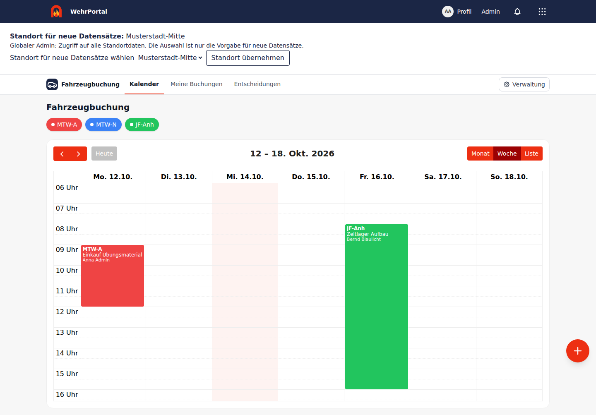
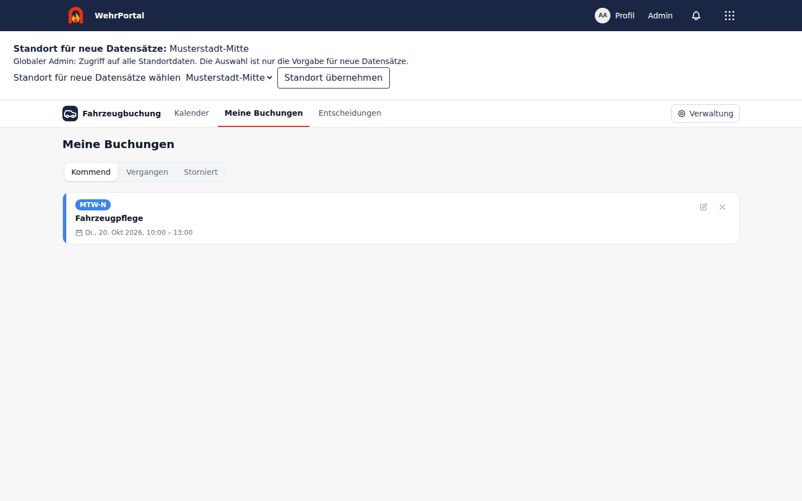
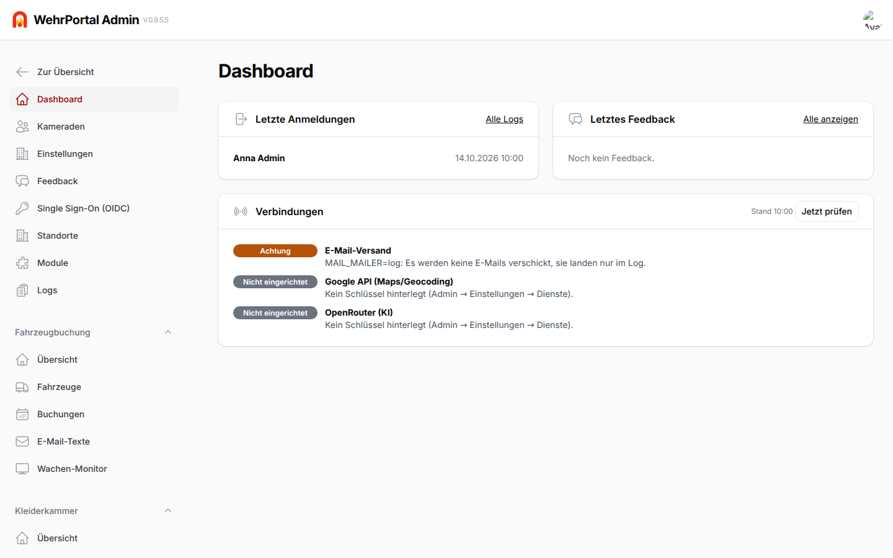

# Kernfunktionen

[Zur README](../README.md) · [Modulhandbücher](README.md)

## Kernfunktionen

### Startseite und Navigation

 

- **Personalakte** (`/personalakte`, bisher Profil): eigene Daten und – je nach Modul – weitere Menüpunkte wie „Einsätze“. In der Personalverwaltung zeigt die Akte eines Kameraden außerdem alle ihm zugewiesenen Standorte.
- **Digitale Nachweise** (`/personalakte/nachweise`, Menüpunkt „Nachweise“ in der Personalakte, sobald es einen gibt): der **Atemschutzpass** (Atemschutzüberwachung, für alle im Pool), die **Fahrerlaubnis** (Führerscheine) auf dem Handy, dazu ein **QR-Code zum Prüfen**. Der **digitale Dienstausweis** hat seine eigene Seite (`/dienstausweis`): das Ausweis-Symbol oben rechts neben Glocke und Profilbild, für jedes aktive Mitglied, sobald die Personalverwaltung ihn eingeschaltet hat – ohne Zugang zum Modul; der Prüf-QR-Code dort zeigt dieselbe Prüfseite. Wer ihn scannt, sieht ohne Anmeldung den Stand von jetzt (`/nachweis/{id}`): Foto, Name, „Aktives Mitglied“, Dienstgrad, Abteilung, Ausweisnummer und Gültigkeit, Einsatzbereitschaft unter Atemschutz mit allen Fristen – keine Befunde, keine Kontaktdaten. Der Code ist signiert und gilt nur 10 Minuten (die Seite erneuert ihn von selbst), ein Foto des Codes taugt also nicht als Dauerausweis; ist der Kamerad ausgetreten, zeigt die Prüfseite „Kein aktives Mitglied“.
- **Stundennachweis** (`/personalakte/stunden`, Menüpunkt „Stunden“ in der Personalakte): die geleisteten Stunden des Jahres, ohne dass jemand etwas eintragen muss – sie kommen aus dem, was es ohnehin gibt: **Dienste und Termine**, bei denen die Anwesenheit vermerkt ist (Kalender, auch Übungsdienste; ganztägige Termine ohne Stunden), **Einsätze** in der Besatzung (abgeschlossen oder freigegeben, Alarmierung bis Einsatzende), **Lehrgangstage** mit Uhrzeit (Lehrgänge) und bestätigte **Schichten** veröffentlichter Schichtpläne. Summe, Stunden je Herkunft, Filter nach Jahr und Herkunft, Liste mit Datum und CSV. Ausgeschaltete Module zählen nicht mit. Personalverwalter sehen alle Kameraden (siehe Personalverwaltung → Stunden), der Jahresbericht die Stunden der Wehr.
- **Startseite** (`/`): das persönliche Dashboard. Oben stehen die Mitteilungen, darunter Karten – „Nächster Termin“ aus dem Kalender, „Nächster Geburtstag“ (zurzeit abgeschaltet) und Hinweise der Module (z. B. der nächste Lehrgang) – und die Module, die der Kamerad nutzen darf. Modul-Kacheln zeigen Symbol und Namen; die Kurzbeschreibung erscheint bei Bedarf als Tooltip statt dauerhaft Platz zu belegen.
- **Geburtstage:** Die Karte „Nächster Geburtstag“ zeigt Name und Tag/Monat der nächsten Geburtstagskinder unter den aktiven Kameraden, ohne Jahr und Alter. Wer das nicht möchte, schaltet es im Profil ab („Meinen Geburtstag … anzeigen“). Wer am 29. Februar geboren ist, erscheint in anderen Jahren am 28. Februar. Das Admin-Dashboard zeigt die nächsten fünf Geburtstage mit Alter, unabhängig von dieser Einstellung. **Zurzeit abgeschaltet** – zusammen mit dem Geburtsdatum (siehe Profil, `MemberFields::BIRTH_DATE`).
- **Reihenfolge:** Standardmäßig ist die **eigene Reihenfolge fixiert** – die Module stehen in der festen Standardreihenfolge, bis der Kamerad sie selbst sortiert. Auf Wunsch schaltet er unter „Anpassen“ auf **„Automatisch nach Nutzung sortieren“**: Dann stehen die Module oben, die er am häufigsten nutzt. Gezählt wird jeder Besuch eines Moduls (Kachel, Modul-Menü oder Link), mehrere Seitenaufrufe innerhalb von 30 Minuten zählen einmal. Ältere Nutzung verliert an Gewicht (halbiert sich alle 30 Tage), damit die Reihenfolge den aktuellen Gewohnheiten folgt. Was ein Admin über „Als Kamerad ansehen“ öffnet, zählt nicht. Neben „Module“ steht „nach Nutzung“ bzw. „eigene Reihenfolge“.
- **Module anpassen:** Über „Anpassen“ sortiert jeder Kamerad seine Module mit den Pfeilen oder per Ziehen und blendet einzelne auf der Startseite aus. Wer selbst sortiert, **fixiert** damit die Reihenfolge (Schloss); der Schalter „Automatisch nach Nutzung sortieren“ / „Reihenfolge fixiert“ wechselt jederzeit zurück. „Zurücksetzen“ blendet alles wieder ein und stellt die Standardreihenfolge (fixiert) wieder her. Mit dem Update auf V.0.9.0 ist die Reihenfolge bei allen Kameraden fixiert; eigene Sortierungen bleiben erhalten, wer nach Nutzung sortieren möchte, schaltet es wieder ein. Ausgeblendete Module bleiben nutzbar und im Modul-Menü.
- **Benachrichtigungen:** Die Glocke oben rechts (neben „Profil“, auch auf dem Handy) zeigt die Zahl ungelesener Benachrichtigungen und die letzten acht; „Alle anzeigen“ öffnet `/benachrichtigungen` (mit Filter „Nur ungelesene“). Jede E-Mail an einen Kameraden steht dort auch – z. B. Interesse an einem Lehrgang (für die Ausbildungsleiter), ein gemeldeter Mangel, eine anstehende Entscheidung über einen Buchungskonflikt, neue Termine oder Mitteilungen. Ein Klick markiert den Eintrag als gelesen und führt direkt dorthin, wo etwas zu tun ist (derselbe Link wie der Button in der Mail, bei der Erinnerung vor Buchungsende „Meine Buchungen“), immer unter der Adresse, unter der man die App gerade nutzt; „Alle als gelesen markieren“ (in der Glocke oder auf `/benachrichtigungen`) leert die Zahl und nimmt die roten Punkte sofort an beiden Stellen weg; beim Öffnen lädt die Glocke den aktuellen Stand. Titel, erste Zeile und Link kommen aus der Mail (`App\Notifications\Concerns\InApp`; Mails mit eigener Vorlage wie der Schichtplan liefern Text und Link selbst), die E-Mails gehen weiter wie bisher. Führt der Link in ein Modul, für das der Kamerad keinen Zugang hat (z. B. Verantwortlicher im Übungsdienstplaner ohne Planungszugang), zeigt der Eintrag auf die Startseite. Nicht in der Glocke: Login-Links und E-Mail-Bestätigungen. Wer als Admin „Als Kamerad ansehen“ nutzt, sieht dessen Benachrichtigungen, markiert sie aber nicht als gelesen – statt „Alle als gelesen markieren“ steht dann „Als Kamerad angesehen – bleibt ungelesen“. Einträge werden nach 180 Tagen gelöscht; die Glocke aktualisiert sich jede Minute.
- **Navigation – zwei Ebenen, überall gleich:**
  - **Blaue Leiste (App):** Logo/Name (zur Startseite), Dienstausweis (wenn eingeschaltet), Glocke, das **3×3-Menü**, „Profil“ und „Admin“ (immer der Admin-Bereich `/admin`) für Admins und für alle, die ein Modul verwalten (Kleiderwart, Gerätewart, Verantwortliche im Mängelmanagement, Wehrführung, Personalverwalter). Sie ändert sich nie je Modul. Auf breiten Bildschirmen nutzt sie die Fensterbreite statt eines schmalen, mittig begrenzten Rahmens; auf dem Handy stehen „Profil“ und „Admin“ im 3×3-Menü (ein roter Punkt am Menü zeigt eine neue Feedback-Antwort).
  - **3×3-Menü:** Startseite, Profil (Handy), **Bestand** (für alle, die eines seiner Module nutzen), Ansprechpartner, Admin (Handy, nur Admins) und alle Module des Kameraden in seiner Reihenfolge.
  - **Modulleiste (weiß, direkt darunter):** in jedem Modul an derselben Stelle – links Symbol und Name des Moduls (zur Startseite des Moduls), daneben die **Reiter**, rechts **„Verwaltung“** für die Rollen mit eigenem Verwaltungsbereich (z. B. Gerätewart → Ausrüstungsverwaltung, Kleiderwart → Kleiderkammer verwalten, Verantwortliche → Mängelverwaltung, Admins → Fahrzeugbuchung verwalten). Jeder sieht nur die Reiter, die er öffnen darf (Admins alle); gibt es nur einen, entfällt die Reiterzeile. Auf Unterseiten (Detail, Neuer Plan …) bleibt die Leiste mit dem passenden Reiter markiert, dazu oben ein Zurück-Link. Auf großen Bildschirmen richtet sie sich an der breiten App-Leiste aus; auf dem Handy stehen die Reiter in einer Zeile zum Wischen. Offene Entscheidungen der Fahrzeugbuchung zeigt der Reiter „Entscheidungen“ mit roter Zahl. Eine Leiste unten auf dem Handy gibt es nicht mehr.
  - **Hauptaktion:** Der rote Knopf einer Seite („Neuer Plan“, „Mangel melden“, „Termin anlegen“, „Neues Fahrzeug“, „Neuer Schlüssel“, „Durchführen“ …) steht genau einmal, rechts neben dem Seitentitel – nicht in der Modulleiste. Was schon ein Reiter ist (Terminabfragen, Orte & Kleidung, Externe Kalender), hat keinen zusätzlichen Knopf auf der Seite.
  - **Wohin ein Modul führt:** Startseiten-Kachel und 3×3-Menü öffnen bei Personalverwaltung und Unterweisungen für Rollenträger (Personalverwalter/Personaleinsicht, Unterweisungsbeauftragter) das Modul, für alle anderen die eigene Seite in der Personalakte (Laufbahn bzw. Unterweisungen); die Schlüsselverwaltung öffnet für Kameraden ohne Rolle das Profil mit ihren Schlüsseln.
  - **Personalakte:** Auf allen Seiten unter `/personalakte` heißt die Leiste „Meine Personalakte“ mit den Reitern Profil, Laufbahn & Ehrungen, Lehrgänge, Atemschutz, Stunden, Nachweise … (je nach eingeschalteten Modulen) – auch wenn ein Modul die Seite beisteuert. **Meine Einsätze** und **Meine Schlüssel** stehen direkt auf dem Profil (die alten Adressen `/personalakte/einsaetze` und `/personalakte/schluessel` führen dorthin).
- **Mitteilungen:** kommen aus dem Modul Mitteilungen (siehe unten) und stehen ganz oben – aber nur, wenn es aktuelle gibt. Sie stehen in **Orange** (`fw-orange`, wichtige in Dunkelrot) mit der Überschrift „Mitteilung“ bzw. „Wichtige Mitteilung“, damit man sie nicht mit den anderen Karten verwechselt.
- **Karten der Module:** Module können über die `DashboardRegistry` eine Karte auf die Startseite legen; sie erscheint nur, solange das Modul aktiv ist und der Kamerad es nutzen darf.
- **Link-Vorschau:** Wird ein Link der App (z. B. `/fahrzeugbuchung`) in WhatsApp, Signal, Telegram & Co. geteilt, zeigt die Vorschau den Modulnamen mit Wehr (z. B. „Fahrzeugbuchung – FF Musterstadt“), die Modulbeschreibung und das Logo statt „Anmelden“; Links außerhalb der Module zeigen den Namen der Wehr. Vorschau-Abrufer ohne Login bekommen dafür eine kleine Seite mit diesen Angaben (ohne Inhalte); Menschen ohne Login landen wie bisher bei der Anmeldung, die dieselben Angaben trägt. Messenger merken sich eine Vorschau eine Weile – ein schon einmal geteilter Link zeigt die neue Vorschau eventuell erst später.
- **Als App auf dem Handy (PWA):** WehrPortal lässt sich ohne App-Store auf den Startbildschirm legen (Android/Chrome: „App installieren“, iPhone/Safari: „Teilen“ → „Zum Home-Bildschirm“) und öffnet sich dann wie eine App, mit eigenem Symbol und ohne Browserleiste (`/manifest.webmanifest`, Name = Kurzname der Wehr). Ein Service Worker (`/sw.js`) zeigt ohne Netz die Seite „Keine Verbindung“ statt einer Fehlermeldung; Seiten werden nie aus einem Zwischenspeicher gezeigt, die Daten sind also immer aktuell. Der Offline-Status zeigt die Verbindung und lokale Entwürfe; das Formular für Wasserquellen kann markierte Felder sichern und wiederherstellen (Koordinaten können dafür offline manuell eingegeben werden), wird aber nie automatisch abgesendet. Objektpläne haben weiter ihren eigenen Offline-Speicher.
- **Push-Benachrichtigungen:** Unter **Profil → Push-Benachrichtigungen** schaltet jeder Kamerad Push für das aktuelle Gerät ein (der Browser fragt nach der Erlaubnis). Dann kommt **alles, was unter der Glocke erscheint**, zusätzlich als Nachricht aufs Handy – auch bei geschlossener App; ein Tipp öffnet die passende Seite. Die Liste zeigt die Geräte (z. B. „Chrome auf Android“) zum Entfernen und „Test-Nachricht schicken“. Auf dem iPhone geht Push nur in der auf dem Home-Bildschirm installierten App (iOS 16.4 oder neuer); der Hinweis steht im Profil. Geräte, die der Push-Dienst nicht mehr kennt, werden automatisch entfernt. Die Schlüssel (VAPID) erzeugt die App beim ersten Mal selbst und speichert den privaten verschlüsselt – einzurichten ist nichts. Es werden keine Inhalte außer Titel, erster Zeile und Link verschickt.
- **Ansprechpartner** (`/ansprechpartner`, im 3×3-Menü, sobald welche eingetragen sind): die wichtigen Kontakte der Wehr – Aufgabe (z. B. Wehrführer, Jugendwartin), Name, Hinweis, E-Mail und Telefon als großer Knopf zum direkten Anrufen, gruppiert nach Abteilung. Admins pflegen sie unter Admin → Kameraden → **Ansprechpartner** (Reihenfolge per Drag & Drop). Die Telefonnummern sind die, die dort eingetragen werden, nicht die privaten Nummern aus den Mitgliedsdaten.
- **Erziehungsberechtigte** (z. B. für die Jugendfeuerwehr, auch für Kinder ohne eigenen Login – siehe „Mitglieder ohne Login“): Je Kamerad lassen sich bis zu vier Erziehungsberechtigte mit Name, E-Mail und Telefon eintragen – unter Admin → Kameraden (Abschnitt „Erziehungsberechtigte“) oder von Personalverwaltern in der Personalakte. Sie haben **kein eigenes Konto**: Sie bekommen eine Kopie jeder Kalender-Mail des Kindes (neuer, geänderter, abgesagter Termin, Erinnerung an die Rückmeldung) mit dem Knopf **„Rückmeldung für …“**. Der Link ist signiert und gilt bis zum Beginn des Termins; die Seite zeigt den Termin und die bisherige Rückmeldung, Zusage/Vielleicht/Absage mit Bemerkung wird erst mit dem Knopf gespeichert (nicht schon beim Öffnen des Links). Die Rückmeldung steht beim Kind mit „(Rückmeldung von …)“. Im Log sind E-Mail und Telefon verborgen.

### Fahrzeugbuchung

Reservierung der Fahrzeuge der Wehr – z. B. MTW oder Anhänger der Jugendfeuerwehr. Mitglieder sehen in einem gemeinsamen Kalender, wann welches Fahrzeug belegt ist, und buchen freie Zeiträume selbst. Die Anmeldung läuft ohne Passwort über einen Magic Link per E-Mail.

### Rollen, Buchungen und Verwaltung

#### Rollen

| Rolle          | Darf                                                                                           |
|----------------|------------------------------------------------------------------------------------------------|
| Mitglied       | Kalender ansehen, eigene Buchungen anlegen, ändern und stornieren, Konflikte zur Entscheidung vorlegen, Feedback senden |
| Entscheider    | zusätzlich Buchungskonflikte entscheiden, Entscheidungen ändern und zurücknehmen, laufende Buchungen anderer beenden (Fahrzeug zurückgeben), gelöschte und frühere Fassungen von Nachrichten sehen |
| Administrator  | alles, dazu Admin-Bereich, Buchungen für andere anlegen, Besitzer tauschen, vergangene Buchungen bearbeiten |

Entscheider und Administratoren werden im Admin-Bereich pro Benutzer per Häkchen festgelegt. Gibt es keinen aktiven Entscheider, übernehmen die Administratoren diese Rolle.

#### Anmeldung

- **Passwortloser Login per Magic Link:** E-Mail-Adresse eingeben, Link aus der Mail öffnen und auf „Anmelden“ klicken. Erst dieser Klick löst den Link ein, damit E-Mail-Scanner ihn nicht vorzeitig verbrauchen.
- Links gelten 15 Minuten und nur einmal. Anfragen sind pro Adresse und IP begrenzt. Für unbekannte Adressen erscheint dieselbe Meldung, damit sich nicht ausprobieren lässt, wer registriert ist.
- Die Sitzung bleibt 90 Tage bestehen.
- **Admin-Konten ohne Terminal:** Die Adressen aus `ADMIN_EMAILS` werden bei jedem Container-Start als aktive Admins angelegt.

#### Kalender

- **Ansichten:** Woche (Standard), Monat und Liste, farbig nach Fahrzeug. Die bevorzugte Standardansicht stellt jeder unter „Profil → Einstellungen“ ein.
- **Filter:** Über die Fahrzeug-Chips oben lassen sich Fahrzeuge ein- und ausblenden.
- **Liste:** Fahrzeug, Zweck und Name stehen mit Icons nebeneinander. Bereits beendete Buchungen sind grau.
- **Woche:** Fahrzeug, Zweck und Name stehen untereinander, auf dem Handy nur das Fahrzeug. Die Ansicht beginnt um 6 Uhr.
- **Monat:** Auf dem Handy erscheinen die Buchungen als farbige Punkte. Ein Tipp auf den Tag öffnet die Tagesliste.
- **Offene Konfliktanfragen** sind gestreift und mit „Angefragt“ markiert.
- **Zeitzone:** Alle Zeiten werden in Europe/Berlin angezeigt, inklusive Sommer- und Winterzeit.

#### Buchen

1. Über den Plus-Button oder einen Klick auf einen Tag öffnet sich das Buchungsformular mit Fahrzeug, Von/Bis (Standard: 08:00 Uhr am gewählten Tag, 3 Stunden lang), Zweck, Ziel, Abteilung und Notizen. Verschiebt man den Start, wandert das Ende mit, die Dauer bleibt gleich. Als Gruppe stehen alle Gruppen zur Wahl, nicht nur die eigenen.
2. Beim Ändern von Fahrzeug oder Zeitraum prüft die App sofort die Verfügbarkeit. Ist das Fahrzeug belegt, zeigt sie die kollidierende Buchung und freie Alternativfahrzeuge.
3. Doppelbuchungen verhindert zusätzlich die Datenbank (PostgreSQL-Exclusion-Constraint). Buchungen, die direkt aneinander anschließen (bis 14:00 / ab 14:00), sind erlaubt.
4. **Admins** wählen im Feld „Gebucht für“ per Suche (Name oder E-Mail) eine andere Person als Besitzer. Beim Bearbeiten lässt sich der Besitzer so auch tauschen.
5. **Meine Buchungen** zeigt die eigenen Buchungen, aufgeteilt in „Kommend“, „Vergangen“ und „Storniert“, jeweils mit Bearbeiten und Stornieren.

Mitglieder bearbeiten und stornieren nur ihre eigenen Buchungen, und nur solange sie noch nicht begonnen haben. Vergangene Buchungen ändern oder löschen nur Admins.

**Änderungen durch andere:** Bucht ein Admin für jemanden, ändert, storniert oder beendet ein Admin oder Entscheider eine fremde Buchung (auch im Admin-Bereich), bekommt der Besitzer eine Mail und den Eintrag in der Glocke – mit dem neuen und bei Änderungen dem bisherigen Stand. Eigene Änderungen lösen nichts aus.

**Fahrzeug früher zurückgeben:** Ist man früher als geplant von einer Fahrt zurück, beendet „Fahrzeug zurückgeben“ (in den Buchungsdetails und unter „Meine Buchungen“) die laufende Buchung sofort. Das Ende wird auf die aktuelle Minute gesetzt, und das Fahrzeug ist ab dann wieder frei. Das geht für den Besitzer, für Entscheider und für Admins. Entscheider sehen den Button bei jeder laufenden Buchung im Kalender, Admins finden ihn zusätzlich im Admin-Bereich unter „Buchungen“ (Aktion „Zurückgeben“). So lässt sich ein Fahrzeug auch freigeben, wenn die buchende Person die Rückmeldung vergessen hat. Hatte die Buchung eine Konfliktentscheidung gewonnen, wird eine unterlegene Buchung im freigewordenen Zeitraum automatisch wieder aktiv.

**Erinnerung vor Buchungsende:** Eine Stunde vor dem Ende bekommt die buchende Person eine Mail. Darin steht, dass die Reservierung bald endet und das Fahrzeug rechtzeitig zurück sein soll. Über den Button „Fahrzeug ist schon zurück“ lässt sich das Fahrzeug direkt aus der Mail zurückmelden, ohne Anmeldung. Der Link öffnet eine Seite mit Bestätigungsbutton, damit E-Mail-Scanner die Buchung nicht versehentlich beenden. Buchungen, die eine Stunde oder kürzer dauern, bekommen keine Erinnerung. Wird das Ende einer Buchung geändert, kommt die Erinnerung passend zur neuen Endzeit.

#### Nachrichten zur Buchung

In den Buchungsdetails (Buchung im Kalender antippen) gibt es unter „Nachrichten“ einen Chat zu jeder Buchung, z. B. für Absprachen zur Übergabe oder zum Mitfahren.

- Alle Mitglieder können die Nachrichten lesen und schreiben. Bei stornierten Buchungen lassen sich keine neuen Nachrichten mehr schreiben.
- Eigene Nachrichten lassen sich bearbeiten und löschen. Bearbeitete Nachrichten sind für alle mit „bearbeitet“ markiert, gelöschte verschwinden für Mitglieder.
- **Entscheider und Admins** sehen zusätzlich gelöschte Nachrichten (durchgestrichen, mit Zeitpunkt) und unter „Frühere Fassungen“ den bisherigen Text bearbeiteter Nachrichten.

#### Konflikte und Entscheidungen

Ist ein Fahrzeug bereits gebucht, kann man trotzdem eine **Entscheidung anfragen**.

1. **Anfrage:** Das geht bei neuen Buchungen und beim Verschieben bestehender Buchungen, jeweils mit Pflicht-Begründung. Die Anfrage wird als „wartet auf Entscheidung“ gespeichert und blockiert das Fahrzeug nicht. Bei einer Änderung bleibt die bisherige Buchung bis zur Entscheidung unverändert.
2. **Benachrichtigung:** Alle Entscheider bekommen eine Mail mit direktem Link zur Entscheidung. Solange etwas offen ist, zeigt die Navigation den roten Button **„Entscheidung (n)“**, auf dem Handy als rote Leiste.
3. **Entscheiden:** Die Entscheidungsseite zeigt Anfrage, Begründung, die bestehende Buchung und gegebenenfalls die bisherige Buchung.
   - **„Anfrage genehmigen“** gibt der Anfrage das Fahrzeug und storniert die kollidierenden Buchungen. Bei einer Änderung wird die bisherige Buchung ersetzt.
   - **„Bestehende Buchung behalten“** lehnt die Anfrage ab.
   - Eine Anmerkung ist optional. Entscheiden zwei gleichzeitig, zählt nur die erste Entscheidung.
4. **Information:** Anfragende Person und Besitzer der bestehenden Buchungen bekommen das Ergebnis per Mail. Die übrigen Entscheider erfahren, dass bereits entschieden wurde.
5. **Ändern oder zurücknehmen:** Eine getroffene Entscheidung kann umgedreht oder zurückgenommen werden. Beim Zurücknehmen wartet die Anfrage wieder, und stornierte Buchungen gelten wieder. Ist der Zeitraum inzwischen anderweitig belegt, lehnt die App das mit einer Meldung ab. Alle Beteiligten werden per Mail informiert.
6. **Automatische Reaktivierung:** Wird die Buchung, die Vorrang bekam, storniert, gelöscht oder so verschoben, dass sie nicht mehr kollidiert, wird die unterlegene Buchung automatisch wieder aktiv. Das gilt in beide Richtungen, sofern die unterlegene Buchung noch in der Zukunft liegt und ihr Zeitraum frei ist. Alle Beteiligten bekommen eine Mail.
7. **Zurückziehen:** Wer die eigene offene Anfrage storniert, zieht sie zurück. Die Entscheider werden informiert.
8. **Dokumentation:** Jede Entscheidung hat einen Verlauf mit Anfrage, Entscheidung, Änderungen und automatischen Reaktivierungen, jeweils mit Person, Zeitpunkt und Anmerkung. Unter „Entscheidungen“ stehen offene und erledigte Fälle.

#### Profil

- **Profilbild:** hochladen, ändern oder entfernen. Das Bild wird mittig quadratisch zugeschnitten, auf 256 px verkleinert und als WebP in der Datenbank gespeichert. Ein eigener Dateispeicher ist deshalb nicht nötig. Ohne Bild erscheinen die Initialen. Angezeigt wird es im Profil, in der Kopfzeile und in den Buchungsdetails.
- **E-Mail:** Kameraden ändern sie selbst im Profil. **Mobiltelefon, Geburtsdatum und Anschrift** werden vorerst nicht gebraucht und sind abgeschaltet (`App\Support\MemberFields`); unter der E-Mail steht im Profil der Hinweis, dass die Kommunikation seit Anfang 2025 vollständig per E-Mail läuft und keine Postadresse gebraucht wird: Sie stehen weder im Profil noch unter Admin → Kameraden, die Mobilnummer erscheint nicht bei Buchungskonflikten, und die Geburtstagskarten (Startseite und Admin-Dashboard) sind aus. Die Spalten bleiben in der Datenbank, gespeicherte Werte bleiben erhalten und werden beim Speichern nicht überschrieben. Wird ein Schalter in `MemberFields` wieder auf `true` gesetzt, kommt alles zurück (die Adressfelder im Profil müssten neu eingefügt werden). Eine **neue E-Mail-Adresse** gilt erst nach **Double-Opt-in**: Das Profil schickt einen Bestätigungslink an die *neue* Adresse (24 Stunden gültig, höchstens 5 Anfragen pro Stunde); bis dahin gilt die bisherige Adresse weiter, und Login-Links (Magic Link) gehen dorthin. Wie beim Login zeigt der Link nur einen Button, erst der Klick bestätigt, damit Mail-Scanner es nicht auslösen. Nach der Bestätigung ist die neue Adresse der Login; noch ungenutzte Login-Links der alten Adresse verfallen, und die alte Adresse bekommt eine Info-Mail. Im Profil lässt sich die Mail erneut senden oder die Änderung abbrechen. Wird in der Zwischenzeit dieselbe Adresse vergeben oder von einem Admin geändert, ist die Anfrage hinfällig. **Admins** ändern die E-Mail-Adresse unter „Kameraden“ sofort und ohne Bestätigung. Name und Rolle ändern nur Admins; die Mobilnummer ist optional und lässt sich löschen (sie ist für spätere SMS-Benachrichtigungen vorgesehen), sie erscheint bei Buchungskonflikten für andere Kameraden.
- **Einstellungen:** Standardansicht des Kalenders.

#### Feedback

- **Mitglieder** senden unter „Profil → Feedback an die Admins“ Nachrichten mit Betreff. Die Gespräche lassen sich im Chat-Stil nachlesen und beantworten. Neue Admin-Antworten erscheinen als roter Punkt am Menüpunkt „Profil“.
- **Admins** finden alle Gespräche im Admin-Bereich unter „Feedback“, mit Zähler für ungelesene. Dort können sie antworten und Gespräche als erledigt markieren oder wieder öffnen.
- Jede Nachricht wird per Mail an die Gegenseite geschickt, mit direktem Link zum Gespräch.

#### Admin-Bereich (`/admin`)

Es gibt **einen** Admin-Bereich für alle. Was man darin sieht, hängt von der Rolle ab: Admins sehen alles – oben den Kern (Kameraden, Abteilungen, Funktionen, Module, Einstellungen, Feedback, Logs), darunter je Modul eine aufklappbare Gruppe **Fahrzeugbuchung**, **Kleiderkammer**, **Ausrüstung** und **Mängelmanagement** mit eigener „Übersicht“, dazu **Einsatzbericht** und **Personalverwaltung** mit ihren Einstellungen (`/admin/fahrzeugbuchung`, `/admin/kleiderkammer`, `/admin/ausruestung`, `/admin/maengelmanagement`). Kleiderwarte, Gerätewarte, Verantwortliche im Mängelmanagement, die Wehrführung (Einsatzbericht → Einstellungen) und – ohne aktivierte Standorte – Personalverwalter (Personalverwaltung → Einstellungen) sehen nur die Gruppe ihres Moduls (wer mehrere Rollen hat, mehrere Gruppen); `/admin` führt sie direkt zur Übersicht ihres Moduls, Kern-Seiten wie Kameraden oder Logs geben 403. Bei aktivierten Standorten sind die Personalverwaltungs-Einstellungen globalen Admins und GBI/SBI vorbehalten; die Wehrführung bearbeitet nur Akten ihres Standorts. Die Fahrzeugbuchung verwalten nur Admins. „Verwaltung“ in der Modulleiste führt zur Übersicht des jeweiligen Moduls; die Adressen der Modul-Seiten sind dieselben wie vorher.

- **Benutzermenü** (Profilbild oben rechts): Name und darunter klein die E-Mail-Adresse, dann „Zur Übersicht“ (zurück in die App), „Meine Personalakte“ und „Abmelden“.
- **Module** (`/admin/module`): alle Module mit Beschreibung, Rollen und Anzahl freigeschalteter Kameraden; Schalter für „Aktiv“ und „Neue Kameraden automatisch freischalten“. Sortierbar nach Name, Anzahl und den Schaltern, durchsuchbar nach Name, Beschreibung und Rollen, filterbar nach aktiv/ausgeschaltet und automatischer Freischaltung. Ein Klick auf „x Kameraden“ öffnet die **Kameraden des Moduls** (`/admin/module/{modul}/kameraden`): alle Kameraden mit Abteilungen, Status, Schalter „Freigeschaltet“ und – bei Modulen mit Rollen – der Rolle (eine Rolle zu wählen schaltet das Modul gleich mit frei). Suche nach Name und E-Mail, Filter nach freigeschaltet ja/nein, Rolle, Abteilung und Status (vorgewählt: aktiv), sortierbar nach Name und Freischaltung. Mit Häkchen markierte Kameraden lassen sich gesammelt freischalten (optional mit Rolle; vorhandene Rollen bleiben) oder entziehen. Oben steht, wenn das Modul ausgeschaltet ist oder „automatisch freischalten“ ohnehin allen Zugang gibt; Admins haben immer Zugang.
- **Fahrzeuge:** Name, Kurzname, Farbe, Reihenfolge und aktiv/inaktiv. Ist das Modul **Fahrzeugverwaltung** eingeschaltet, werden Fahrzeuge besser dort gepflegt (dieselbe Liste, mit Profil, Status und Fristen). Eine dort eingetragene **Werkstatt-/Ausfallzeit** sperrt das Fahrzeug: Buchen, Verschieben in diesen Zeitraum und Entscheidungsanfragen werden abgelehnt, das Formular zeigt „Fahrzeug nicht verfügbar“ mit Grund und freien Alternativen, der Kalender die Ausfallzeit grau. Bestehende Buchungen bleiben; ihre Buchenden bekommen eine Mail.
- **Abteilungen:** Wo jemand Mitglied ist, zum Beispiel Einsatzabteilung, Jugendfeuerwehr, Kinderfeuerwehr oder Alters- und Ehrenabteilung (Datenbank-Tabelle `groups`). Jede Abteilung gehört verpflichtend zu genau einem Standort; gleiche Namen an verschiedenen Standorten sind erlaubt. Die zentrale Verwaltung unter **Admin → Abteilungen** zeigt den Standort in einer eigenen Spalte. Standort-Admins sehen und bearbeiten dort nur ihre Standorte. Standortseiten dienen zum Hinzufügen von Mitgliedern und zur Zuordnung der dortigen Abteilungen, nicht als zweite Abteilungsverwaltung. Mitgliedern lassen sich mehrere Standorte und Abteilungen zuweisen; in Auswahllisten steht der Standort immer hinter dem Abteilungsnamen in Klammern. Buchungen lassen sich einer Abteilung zuordnen. Die Reihenfolge ändert man per Drag & Drop („Reihenfolge ändern“).
- **Funktionen:** Was jemand macht, zum Beispiel Jugendwart, getrennt von der Abteilung (die Jugendfeuerwehr ist eine Abteilung, der Jugendwart eine Funktion). Jede Funktion kann Unterfunktionen haben (zwei Ebenen); beides ist sortierbar. Das Löschen einer Funktion entfernt sie samt Unterfunktionen bei allen Mitgliedern.
- **Export und Import (Abteilungen, Funktionen):** Oben auf beiden Listen. „Exportieren“ lädt eine CSV für Excel (UTF-8, Semikolon); bei aktiven Locations enthält die Abteilungsdatei auch die Spalte **Standort**. So bleiben gleichnamige Abteilungen auseinanderzuhalten. Alte Dateien ohne Standortspalte bleiben nutzbar, solange der Name eindeutig ist; bei Mehrdeutigkeit muss der Standort ergänzt werden. Vorhandene Einträge werden aktualisiert, neue angelegt, Unterfunktionen unter ihrer Funktion; gelöscht wird nichts. Mit „Mitglieder zuordnen“ werden die Kameraden über die E-Mail-Adresse hinzugefügt (niemand wird entfernt); unbekannte Adressen stehen in der Meldung. Eine Datei mit anderen Spalten wird abgelehnt.
- **Einstellungen** (`/admin/einstellungen`, nur aktive globale Admins): Wehrname, Kurzname, Mail-Signatur, Code-Präfix der Kleiderkammer und Feuerwehrlogo. Logos dürfen PNG, JPEG oder WebP bis 2 MB und höchstens 4096 × 4096 Pixel sein. Sie werden geprüft, ohne Metadaten als WebP neu kodiert und in der Datenbank gespeichert. Neues Hochladen ersetzt das bisherige Logo, Speichern ohne Datei behält es; **Logo entfernen** löscht die Bilddaten. Die Bild-URL ändert sich auch bei mehreren Änderungen innerhalb einer Sekunde. SVG-Uploads sind nicht erlaubt. Darunter die **Dienste**: API-Schlüssel für Google Maps und für OpenRouter sowie das KI-Modell, das über OpenRouter genutzt wird (Liste von OpenRouter, nach Namen sortiert). Die Schlüssel werden verschlüsselt gespeichert und nach dem Speichern nicht mehr angezeigt; leer lassen behält den gespeicherten, ein Schalter entfernt ihn. „Google Maps testen“ und „OpenRouter testen“ prüfen den eingegebenen oder gespeicherten Schlüssel. Noch nutzt keine Funktion die Schlüssel.
- **Kameraden** (`/admin/kameraden`): Die Liste zeigt Name, E-Mail, primären Standort, Abteilungen, Funktionen (Unterfunktionen als „Funktion › Unterfunktion“), Admin, Status und letzten Login; nach Modulzugang filtert der Filter „Modul-Zugriff“. Häkchen für Administrator und Entscheider, dazu der Status (aktiv, inaktiv, ausgetreten). Nur aktive Kameraden können sich anmelden. Unter „Mitgliedsdaten“ werden bei aktivem Locations-Modul Standorte (Mehrfachauswahl) und Abteilungen (Mehrfachauswahl, auf die ausgewählten Standorte begrenzt) zugewiesen. Abteilungsnamen zeigen in allen Auswahllisten den Standort in Klammern. Außerdem stehen dort Geschlecht, Dienstgrad, „Im Dienstgrad seit“, Eintritt in die Feuerwehr (beides TT.MM.JJJJ, Grundlage für Beförderungsvoraussetzungen), Funktionen und Notizen. Der **Dienstgrad** kommt bei „männlich“ und „weiblich“ aus der jeweiligen Liste der Feuerwehr Schleswig-Holstein (von Feuerwehrmann-Anwärter bis Landesbrandmeister, bei Frauen in der weiblichen Form); wechselt das Geschlecht, springt der Dienstgrad auf dieselbe Stufe der anderen Liste. Bei „divers“ ist er ein Freitext. Ein früher eingetragener Freitext-Dienstgrad bleibt als „(bisher)“ wählbar. Bei den Funktionen wählt man Unterfunktionen (Anzeige „Funktion › Unterfunktion“); eine Funktion ohne Unterfunktion steht direkt zur Wahl. Die Suche im Feld findet auch über den Namen der Funktion, „Jugend“ also alle Unterfunktionen von „Jugendwart“. Das **Geburtsdatum** wird ohne Kalender als TT.MM.JJJJ eingetippt (im Profil genauso); diese Daten pflegen nur Admins, die Kleiderkammer liest sie mit. Filter nach Abteilung, Funktion, Rolle und Status. Die Spalten E-Mail und Module lassen sich ein- und ausblenden; „Module“ zeigt je Kamerad die freigeschalteten Module (Admins: „Alle“). **Module zuordnen:** Mit Häkchen markierte Kameraden bekommen über „Module freischalten“ (Sammelaktion) Module samt Rolle: Die Module stehen als Liste mit Häkchen da, mehrere auf einmal; für jedes angekreuzte Modul mit Rollen erscheint eine Rollenauswahl („Ohne Rolle“ lässt eine Rolle, die jemand schon hat, stehen). „Modul entziehen“ nimmt ein Modul wieder weg. Der Button „Module für alle Gefilterten“ oben wirkt dagegen auf alle Kameraden, die Filter und Suche gerade treffen, auch auf anderen Seiten; die Zahl steht im Dialog. Außerdem lässt sich ein Login-Link direkt versenden.
- **Mitglieder ohne Login** (z. B. Kinder der Jugendfeuerwehr, Mitglieder des Musikzugs): Beim Anlegen das Feld **E-Mail-Adresse leer lassen** – unter Admin → Kameraden oder in der Personalverwaltung unter „Neue Mitglieder“. Das Mitglied ist ein ganz normales, aktives Mitglied und steht überall zur Auswahl, wo Kameraden gewählt werden: Kleidung ausgeben (Kleiderkammer), Unterweisungen, Verbandbuch, Lehrgänge, Kalender-Zielgruppen, Personalverwaltung usw. Es **kann sich aber nicht anmelden**: kein Login-Link, keine Einladung (die Knöpfe fehlen), kein Zugang zum Admin-Bereich; in der Liste steht statt der Adresse „ohne Login“, in der Personalakte die Marke „ohne Login“. Mails an das Mitglied entfallen, Benachrichtigungen landen nur unter der Glocke. Sind **Erziehungsberechtigte** eingetragen, bekommen sie die Kalender-Mails des Kindes trotzdem und antworten für es. Mehrere Mitglieder ohne Adresse sind kein Problem; Admins brauchen eine Adresse. Soll das Mitglied später doch selbst in die App, trägt man eine Adresse nach und schickt die Einladung. Der CSV-Import der Personalverwaltung braucht weiter eine Adresse je Zeile (er erkennt Mitglieder daran); Mitglieder ohne Login einzeln anlegen.
- **Kameraden nach Funktion filtern:** Der Filter „Funktion“ listet alle Funktionen mit ihren Unterfunktionen („Vorstand (mit Unterfunktionen)“, „Vorstand › Kassenwart“). Eine Funktion mit Unterfunktionen zeigt alle Kameraden, die sie oder eine ihrer Unterfunktionen haben – z. B. „Vorstand“ den ganzen Vorstand. Mehrere Funktionen lassen sich kombinieren.
- **Kameraden-Liste sortieren:** Standard ist „Letzter Login“, der jüngste oben, „Noch nie“ ganz unten. Sortierbar sind außerdem Name, E-Mail, Abteilungen (nach der Reihenfolge der ersten Abteilung), Admin und Status.
- **Einladung** (QR-Symbol in der Kameraden-Liste, auch in der Personalverwaltung): Ohne aktives Single Sign-On ein Anmelde-Link für einen (neuen) Kameraden, der **7 Tage und nur einmal** gilt – als **QR-Code**, den er in der Wache mit dem Handy scannt, oder „Per E-Mail schicken“. Wie beim Login-Link zeigt der Link erst einen Knopf, angemeldet wird mit dem Klick (Mail-Scanner verbrauchen ihn nicht). Bei aktivem Single Sign-On führt der Einladungslink stattdessen zum Identitätsanbieter und übergibt die E-Mail-Adresse als vorausgefüllten `login_hint`; ob der Anbieter eine Registrierung anbietet, richtet sich nach dessen Konfiguration. Die **erste Anmeldung** führt zur Seite **„Willkommen“** (`/willkommen`) mit den ersten Schritten, abgehakt sobald erledigt: Profilfoto, App auf den Startbildschirm, Push einschalten, persönliche Daten (wenn die Personalverwaltung sie führt), Führerschein (wenn das Modul an ist), Ansprechpartner.
- **Als Kamerad ansehen:** In der Kameraden-Liste (Augen-Symbol am Anfang der Zeile, neben „Login-Link senden“ und „Bearbeiten“) oder oben auf „Kamerad bearbeiten“ meldet „Als Kamerad ansehen“ den Admin als diesen Kameraden an – er sieht die App genau so, mit dessen Rechten (Admins und inaktive Kameraden lassen sich nicht übernehmen). Ein oranger Balken oben („Du siehst die App als …“, auch in den Verwaltungsbereichen der Module) führt mit „Zurück zum Admin“ zur eigenen Anmeldung und zur Kameraden-Liste zurück. Alles, was der Admin in der Zeit tut, geschieht im Namen des Kameraden; der letzte Login des Kameraden ändert sich nicht. Jede Übernahme wird ins Log geschrieben.
- **Logs** (`/admin/logs`): alles, was in der App passiert – jede angelegte, geänderte und gelöschte Sache (auch durch die Kameraden, z. B. Buchungen, Anmeldungen, Kommentare, Mitteilungen), Anmeldungen, „Als Kamerad angesehen“ und jede versendete E-Mail. Je Eintrag: Zeit, **Wer** (oder „System“ bei automatischen Abläufen wie Import und Erinnerungen; während „Als Kamerad ansehen“ mit „über Admin …“), **Was** (Angelegt, Geändert, Gelöscht, Anmeldung, Als Kamerad angesehen, E-Mail), **Betrifft** (Name und Bereich, z. B. „Fahrzeugbuchung: Buchung“) und die geänderten Felder (vorher → nachher). Suche nach Wer und Betrifft, Filter nach Zeitraum, Was, Bereich und Wer, neueste zuerst. „Ansehen“ zeigt alle Felder bzw. die E-Mail wie verschickt; bei E-Mails gibt es „Erneut senden“ (unverändert an dieselben Empfänger, als „Erneut gesendet“ protokolliert). Nicht gespeichert werden Passwörter, Schlüssel, Tokens, Dateiinhalte und reine Verwaltungsänderungen (letzter Login, „Erinnerung verschickt“, Sortierung); Login- und Bestätigungslinks in E-Mails werden ohne Inhalt gespeichert und lassen sich nicht erneut senden. Einträge werden nach 180 Tagen gelöscht (`model:prune`, täglich).
- **Kameraden löschen:** Hängen an einem Kameraden noch Buchungen, Nachrichten oder Ausrüstung, wird er mit „Löschen“ nicht gelöscht; stattdessen erscheint ein Hinweis, den Status auf „Ausgetreten“ zu setzen. So bleibt die Historie erhalten.
- **Löschen mit Übertragung** (im Kamerad oben, nicht für sich selbst): wenn ein Kamerad wirklich gelöscht werden muss. Das Fenster zeigt je Bereich, wie viele Einträge an ihm hängen (z. B. „Fahrzeugbuchung: 12 · Einsatzbericht: 3“); man wählt den Kameraden, auf den alles übertragen wird, bestätigt, und erst dann wird gelöscht – alles oder nichts. Übertragen wird alles, was auf den Kameraden verweist: Buchungen, ausgegebene Kleidung, Ausleihen, gemeldete Mängel, Fahrten, Einsatz-Besatzungen, „angelegt von“, „geprüft von“ usw., auch in künftigen Modulen. Stand er mit dem Ziel-Kameraden im selben Einsatz, bleibt nur ein Eintrag. Mit dem Kameraden gelöscht werden Persönliches wie Zugänge, Abteilungen, Funktionen, Lehrgänge, Atemschutz-Daten, eigene Rückmeldungen, Schichten, Profilbild und Benachrichtigungen. Nicht übertragen werden Logs und das Verbandbuch: Dort bleibt der Name als Text stehen, nur die Verknüpfung entfällt, so landen keine Gesundheitsdaten bei einem anderen. Tipp: einen Kameraden „Ehemalige Mitglieder“ mit Status „Ausgetreten“ anlegen und dorthin übertragen. Im Log steht „Übertragen und gelöscht“ mit der Übersicht.
- **Buchungen:** alle Buchungen mit Status (bestätigt, wartet auf Entscheidung, abgelehnt), Stornieren, Bearbeiten und „Zurückgeben“ für laufende Buchungen. Stornieren, Ändern und Löschen lösen dieselben Automatismen aus wie in der App.
- **Feedback:** siehe oben.
- **E-Mail-Texte:** Betreff, Anrede, Text, Button-Beschriftung und Grußformel der Erinnerungsmail vor Buchungsende lassen sich bearbeiten. Platzhalter wie `{name}`, `{fahrzeug}` oder `{ende_uhrzeit}` werden beim Versand ersetzt. „Standard wiederherstellen“ setzt den Text auf die ursprüngliche Fassung zurück.
- **Keine Suchmaschinen, keine KI:** Eine WehrPortal-Instanz ist das interne Werkzeug einer Wehr. `robots.txt` sperrt alle Crawler, auch die KI-Crawler (z. B. GPTBot, ClaudeBot, PerplexityBot, Google-Extended, CCBot) einzeln genannt; jede Antwort der App – Seiten, Admin-Bereich, PDFs, Pläne, Fotos, Kalender-Feeds und der öffentliche Kalender – trägt zusätzlich den Header `X-Robots-Tag: noindex, nofollow, noarchive, nosnippet, noimageindex, …`. Der öffentliche Kalender lässt sich weiter per `<iframe>` einbinden, erscheint aber nicht selbst in Suchergebnissen. Vorschauen beim Teilen in Messengern funktionieren weiter.
- **Deutsche Adressen:** Alle Adressen der App und des Admin-Bereichs sind deutsch, z. B. `/personalakte` (Profil), `/anmelden`, `/fahrzeugbuchung` (Kalender), `/fahrzeugbuchung/meine-buchungen`, `/fahrzeugbuchung/entscheidungen`, `/admin/kameraden`, `/admin/kameraden/{id}/bearbeiten`, `/admin/kameraden/neu`, `/admin/abteilungen`, `/admin/funktionen`, `/admin/module`, `/admin/einstellungen`, `/admin/feedback`, `/admin/logs`, in der Kleiderkammer `/admin/kleiderkammer/einzelteile`, `…/massenbestand`, `…/scanner`, `…/bestandsbericht`, `…/kameraden`, `…/maengelmanagement`, `…/datentransfer`, `…/kategorien`, `…/artikeltypen`. Laravel verwendet intern den Routennamen `login`; dessen Endpunkt führt zur deutschen Anmeldeseite.
- **Menü:** „Abteilungen“ und „Funktionen“ stehen als Untermenü unter „Kameraden“. Die Meldungen der Kameraden zu ihrer Ausrüstung (Mängel und Wäsche-Anforderungen) heißen in der Kleiderkammer „Mängel & Wäsche“.
- **Navigation:** Unter den Menüpunkten steht der Link zum Wachen-Monitor (öffnet in einem neuen Fenster); die App-Version steht klein hinter dem Titel oben links („… Admin V.0.9.5.3“).
- **Admin-Dashboard** (`/admin`): **Letzte Anmeldungen** (die fünf jüngsten Logins mit Name und Uhrzeit, neueste oben; „Alle Logs“), **Letztes Feedback** (die fünf Gespräche mit der jüngsten Nachricht, ungelesene mit rotem Punkt, ein Klick öffnet das Gespräch) und **Verbindungen**: ob der E-Mail-Versand (SMTP: Verbindung und Anmeldung am Server, ohne eine Mail zu schicken; Amazon SES: Abfrage des Sendekontingents; `MAIL_MAILER=log` gilt als Warnung, weil dann keine Mails rausgehen), die Google API und OpenRouter funktionieren. Ohne hinterlegten Schlüssel steht „Nicht eingerichtet“. Geprüft wird höchstens alle 15 Minuten (`App\Services\ServiceHealth`), „Jetzt prüfen“ prüft sofort.
- **Übersicht:** oben nebeneinander (auf dem Handy untereinander) die Top 5 der Mitglieder mit den meisten Buchungen und die kommenden Buchungen der nächsten 7 Tage, darunter über die ganze Breite die Fahrzeuge sortiert nach Anzahl Buchungen, ganz unten der Link zum Wachen-Monitor. Über „Zur App“ geht es zurück zum Kalender.

#### Wachen-Monitor

Nur-Lese-Ansicht für den Bildschirm in der Wache im Stil von Divera. Sie aktualisiert sich jede Minute von selbst und lädt alle 6 Stunden komplett neu.

- **Oben:** Uhr, Datum und Zähler für freie, bald belegte und belegte Fahrzeuge.
- **Fahrzeugkacheln:** Grün heißt frei (mit nächster Buchung). Gelb heißt ab einer Uhrzeit innerhalb der nächsten 2 Stunden gebucht. Rot heißt unterwegs bis …, jeweils mit Zweck und Name.
- **Liste:** die nächsten Buchungen der kommenden 7 Tage, offene Anfragen mit „Angefragt“ markiert.
- **Datenschutz:** Namen werden verkürzt angezeigt („Hanna H.“). Es gibt keinerlei Bearbeitungsfunktionen, und die Seite ist keinem Benutzer zugeordnet.
- **Zugriff:** Der Wachen-PC öffnet `/monitor/<DISPLAY_TOKEN>` ohne Login. Ohne oder mit falschem Schlüssel antwortet die Seite mit 404. Admins öffnen `/monitor` direkt. Den fertigen Link zeigt das Admin-Dashboard. Wird `DISPLAY_TOKEN` in der Betriebskonfiguration geändert und die App mit `docker compose up -d` neu erstellt, ist der alte Link ungültig.

#### E-Mails

Alle Mails sind auf Deutsch und werden sofort verschickt, ein Queue-Worker ist nicht nötig. Kann eine Mail nicht zugestellt werden, landet der Fehler im Log. Die eigentliche Aktion, etwa eine Entscheidung, bleibt trotzdem gespeichert.

| Anlass                           | Empfänger                                               |
|----------------------------------|---------------------------------------------------------|
| Login-Link                       | die anfragende Person                                    |
| Erinnerung 1 Stunde vor Buchungsende (Text im Admin-Bereich änderbar) | die buchende Person               |
| Entscheidung nötig               | alle Entscheider (ersatzweise Admins)                    |
| Entscheidung getroffen / geändert | anfragende Person und Besitzer der bestehenden Buchungen |
| Bereits entschieden              | die übrigen Entscheider                                  |
| Entscheidung zurückgenommen      | alle Beteiligten                                         |
| Buchung automatisch reaktiviert  | alle Beteiligten                                         |
| Anfrage zurückgezogen            | die Entscheider                                          |
| Neues Feedback / Antwort vom Mitglied | alle Admins                                         |
| Antwort vom Admin                | das Mitglied                                             |

## Neuinstallation und App-Marke

WehrPortal startet als eigenständige **Neuinstallation ohne übernommene Bestandsdaten**. Datenbanken, Compose-Volumes, Cookies, Cache-/Redis-Namensräume und Offline-Speicher verwenden ausschließlich WehrPortal-Kennungen. Es gibt keine Übernahme alter Installationen, Logo-Aliase, früheren URL-Weiterleitungen oder Datenkonvertierungen aus Vorgängerprojekten. Die Schemamigrationen legen weiterhin sämtliche benötigten Tabellen, Constraints und Schutztrigger an.

Die eigenständig entworfene **App-Marke** zeigt ein stilisiertes rotes Portal mit einer Flamme. Sie verwendet keine fremden Wappen oder Grafiken. SVG-Original: [`public/images/wehrportal-logo.svg`](../public/images/wehrportal-logo.svg), App-Icon: [`public/images/wehrportal-icon.svg`](../public/images/wehrportal-icon.svg). PNG-Icons (192/512 Pixel), ein maskierbares PWA-Icon, Apple-Touch-Icon und Favicon werden mit `bash tools/build-branding.sh` reproduzierbar aus dem SVG erzeugt (ImageMagick erforderlich). Alle stehen wie der Code unter AGPL-3.0-only.

**Feuerwehr-Identität und Standortwappen sind davon getrennt:** Globale Admins ändern unter **Admin → Einstellungen** Namen, Kurzname und Feuerwehrlogo. Im App- und Admin-Header erscheinen Kurzname (sonst vollständiger Name, sonst WehrPortal) und das hochgeladene Logo unverfälscht in seinen Farben; ohne Logo erscheint die App-Marke. Lange Namen werden auf kleinen Bildschirmen gekürzt, nicht über die Bedienelemente geschoben. Die installierbare PWA bleibt WehrPortal mit der App-Marke.
