# Module

[Zur README](../README.md) · [Modulhandbücher](README.md)

## Module im Überblick

**Alles sind Module.** Welche Funktionen eure Wehr verwendet, entscheidet ihr anhand eures Bedarfs. Die folgenden Gruppen dienen nur der Orientierung, nicht als Produktstufen oder unterschiedliche Berechtigungsklassen.

### Organisation und Zusammenarbeit

- **[Kalender & Termine](#kalender--termine):** Termine mit Zielgruppen, Rückmeldungen, Terminabfragen und Kalenderabo. Zuständig: Terminverwalter.
- **[Übungsdienstplaner](#übungsdienstplaner):** Standortbezogene Dienstplanung; Rückmeldungen laufen über den Kalender. Zuständig: Wehrführung.
- **[Schichtplan](#schichtplan):** Dienste und Veranstaltungen mit Selbstanmeldung oder Zuteilung, Genehmigung und Erinnerung. Zuständig: Planer.
- **[Anwesenheit](#anwesenheit-im-detail):** Eigenständige Anwesenheitslisten mit Entwurf, Abgabe, Vorlagen, PDF und E-Mail. Zuständig: Verwalter.
- **[Mitteilungen](#mitteilungen):** Zielgerichtete Nachrichten mit Anhängen und Lesebestätigung; optional ntfy und Matrix. Zuständig: Redakteur.
- **[Dateien](#dateien-im-detail):** Interne Ablagen mit eigenen Rechten, Versionen, Papierkorb und optional Online-Office. Dateigruppenverwaltung allein erteilt keinen Dateizugriff.
- **[Locations / Standorte](#locations-im-detail):** Mitglieder und unterstützte Datensätze Standorten zuordnen. Zuständig: globale und Standort-Admins; keine vollständige Mandantentrennung.

### Personal und Ausbildung

- **[Personalverwaltung](#personalverwaltung):** Mitgliedsdaten, Diensthistorie, Ehrungen, Änderungswünsche und digitaler Dienstausweis. Ohne aktivierte Standorte: Personalverwalter; mit Standorten: GBI/SBI und Wehrführung standortweit, Jugend- und Kinderwarte nur für ihre zugewiesenen Abteilungen, Gemeindewarte standortübergreifend für die passende Jugend- oder Kinderfeuerwehr.
- **[Lehrgänge & Qualifikationen](#lehrgänge--qualifikationen):** Interesse, fox112-Warteliste, Termine und absolvierte Lehrgänge einschließlich Nachtragen und Auffrischungen. Zuständig: Ausbildungsleiter; Wehrführung liest.
- **[Unterweisungen](#unterweisungen):** Unterweisungen und Einweisungen mit Fristen, Unterschriften und Nachweisen. Zuständig: Unterweisungsbeauftragter.
- **[Führerscheine](#führerscheine):** Fotokontrolle, Führerscheinklassen und Feuerwehr-Fahrberechtigungen. Zuständig: Führerscheinprüfer.
- **[Vereinsverwaltung](#vereinsverwaltung):** Öffentlicher Beitritt, aktive und passive Mitgliedschaften, Beiträge und Mandatsdokumentation. Zuständig: Vorstand des jeweiligen Vereins; keine Zahlungsabwicklung.

### Fahrzeuge, Geräte und Material

- **[Fahrzeugbuchung](KERNFUNKTIONEN.md#fahrzeugbuchung):** Gemeinsamer Buchungskalender mit Konfliktentscheidung und Wachen-Monitor. Zuständig: Entscheider; Fahrzeugverwaltung im Admin-Bereich durch globale Admins.
- **[Fahrzeugverwaltung & Flotte](#fahrzeugverwaltung--flotte):** Fahrzeugakte, Status, Werkstattzeiten, Fristen und Prüfungen. Zuständig: Fahrzeugwart.
- **[Fahrtenbuch](#fahrtenbuch):** Fahrten, Kilometerstände, Tanken, Verbrauch und nachvollziehbare Korrekturen. Zuständig: Fahrtenbuchwart.
- **[Ausrüstungsverwaltung](#ausrüstungsverwaltung):** Geräte, Prüffristen, Ausleihe, Beladung und optional öffentliche Geräteinfo. Zuständig: Gerätewart.
- **[Wartungsmanagement](#wartungsmanagement):** Checklisten, fällige Wartungen und unterschriebene Prüfprotokolle für Geräte der Ausrüstungsverwaltung. Zuständig: Gerätewart und Prüfer.
- **[Kleiderkammer](#kleiderkammer):** Bekleidung ausgeben und zurücknehmen, Größen, Bestand und QR-Etiketten. Zuständig: Kleiderwart.
- **[Schlüsselverwaltung](#schlüsselverwaltung):** Schlüssel, Transponder und Karten mit unterschriebener Ausgabe, Rückgabefristen und Verlustmeldung. Zuständig: Schlüsselwart.
- **[Mängelmanagement](#mängelmanagement):** Mängel melden, zuweisen und bis zur Erledigung verfolgen. Zuständig: Verantwortlicher.

### Einsatz und Sicherheit

- **[Einsatzbericht](#einsatzbericht):** Einsätze, Besatzung, DIVERA-Anbindung, Lagemeldungen, Freigabe und Jahresbericht; [zusätzliche Einsatzangaben](#ergänzung-durch-einsatzberichtplus) sind Teil dieses Ablaufs. Zuständig: Einsatzleiter und Wehrführung.
- **[Atemschutzüberwachung](#atemschutzüberwachung):** Truppüberwachung, Drücke und Warnungen sowie Geräteträger, Fristen und Atemschutzpass. Zuständig: Atemschutzwart und Überwacher.
- **[Gefahrenmatrix](#gefahrenmatrix):** Interaktive Merkstütze zur Gefahrenerfassung ohne Speicherung; keine eigene Fachrolle.
- **[Gefahrstoffdatenbank](#gefahrstoffdatenbank):** Eigene, mit Quelle und Datenstand importierte UN-/Gefahrstoffdaten durchsuchen. Zuständig: Gefahrstoffbeauftragter.
- **[Verbandbuch & Vorfälle](#verbandbuch--vorfälle):** Verschlüsselte Dokumentation mit Unterschrift und Aufbewahrungsfrist. Zuständig: GBI/SBI und standortbezogen die Wehrführung.
- **[Expositionen](#expositionen-gefahrstoffe):** Gefahrstoffexpositionen mit 40 Jahren Aufbewahrung und Meldeliste für die DGUV-ZED. Zuständig: Expositionsbeauftragter.

### Infrastruktur und Finanzen

- **[Wasserkarte & Hydranten](#wasserkarte--hydranten):** Löschwasserquellen auf der Karte, Status, Leistung und nächstgelegene Quellen. Zuständig: Hydrantenwart.
- **[Hydrantenkontrolle](#hydrantenkontrolle):** Eigener Hydrantenbestand mit fortsetzbaren Jahreskontrollen, Historie und PDF. Zuständig: Hydrantenwart am eigenen Ort oder übergreifende Bearbeiter; keine automatische Kopplung an die Wasserkarte.
- **[Objektpläne & Brandschutzunterlagen](#objektpläne--brandschutzunterlagen):** Versionierte Unterlagen je Objekt, GPS-Suche und gezielte Offline-Bereitstellung. Zuständig: Planverwalter.
- **[Budget & Finanzen](#budget--finanzen):** Ausgaben, Belege, Genehmigung und Export; Budgets und Jahresabschluss sind abschaltbar. Zuständig: Kassenwart und Wehrführung.

Die gemeinsame Suche **[Bestand](#bestand)** verbindet die Bestände der freigeschalteten Module. **[Offline/PWA](#offline-und-pwa-im-detail)** und **[Single Sign-On](#oidc--single-sign-on-im-detail)** sind übergreifende Funktionen ohne eigene Fachmodul-Kachel.

Die Screenshots in dieser Dokumentation stammen aus einer Testinstallation mit erfundenen Beispieldaten (Stand der Daten: 14.10.2026). Ältere Bilder können noch den bisherigen Produktnamen zeigen; neue Bilder werden manuell auf `main` erzeugt ([Ablauf](SCREENSHOTS.md)).

Fachmodule sind nach der Installation zunächst **ausgeschaltet**. Ein globaler Admin aktiviert sie unter **Admin → Module**, vergibt Zugänge und weist bei Bedarf Fachrollen zu. Standortverwaltung und übergreifende Funktionen haben eigene Einstellungen. Bei einigen Modulen kann der Betreiber das Laden zusätzlich per `*_ENABLED` abschalten; diese technischen Schalter sind keine zweite Modulklasse und ersetzen keine Zugriffsrechte. Bestehende Daten werden durch das Abschalten nicht gelöscht.

Einrichtung und Grenzen stehen bei den jeweiligen Vorstellungen und im [Admin-Guide](../handbuch/ADMIN.md). Weiterführende [Modulhandbücher](README.md) ergänzen die Beschreibungen.

## Module im Detail

Die Vorstellungen beschreiben die verfügbaren Abläufe und ihre Grenzen. Die Screenshots zeigen Beispieldaten; sichtbare Verwaltungsaktionen hängen von der eigenen Rolle ab. Die [Fahrzeugbuchung](KERNFUNKTIONEN.md#fahrzeugbuchung) ist mit ihren Abläufen bereits oben beschrieben.

### Gefahrenmatrix

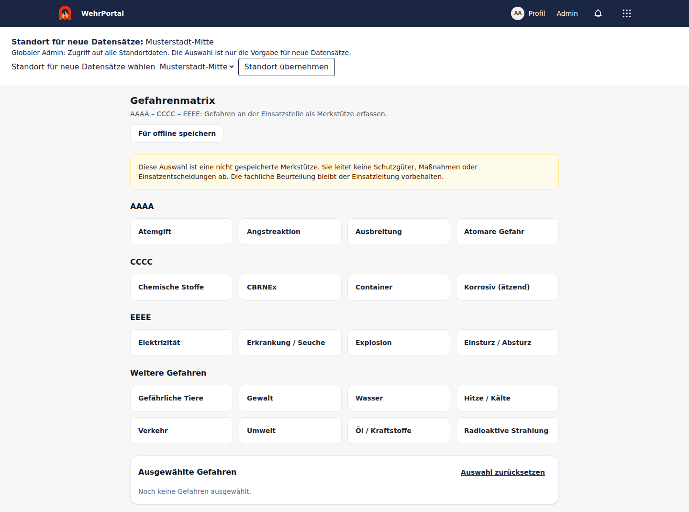

Die Gefahrenmatrix bietet eine interaktive Auswahl von Gefahren aus den Gruppen AAAA, CCCC, EEEE und „Weitere“. Bei einer Auswahl zeigt eine Tabelle die Gefahren als Zeilen und mögliche Auswirkungen auf Schutzgüter und eigene Kräfte als Spalten. Sie speichert die Auswahl nicht, bewertet nicht die konkrete Einsatzlage und leitet keine Maßnahmen oder Einsatzentscheidungen ab. Das Modul ist standardmäßig ausgeschaltet.

### Gefahrstoffdatenbank

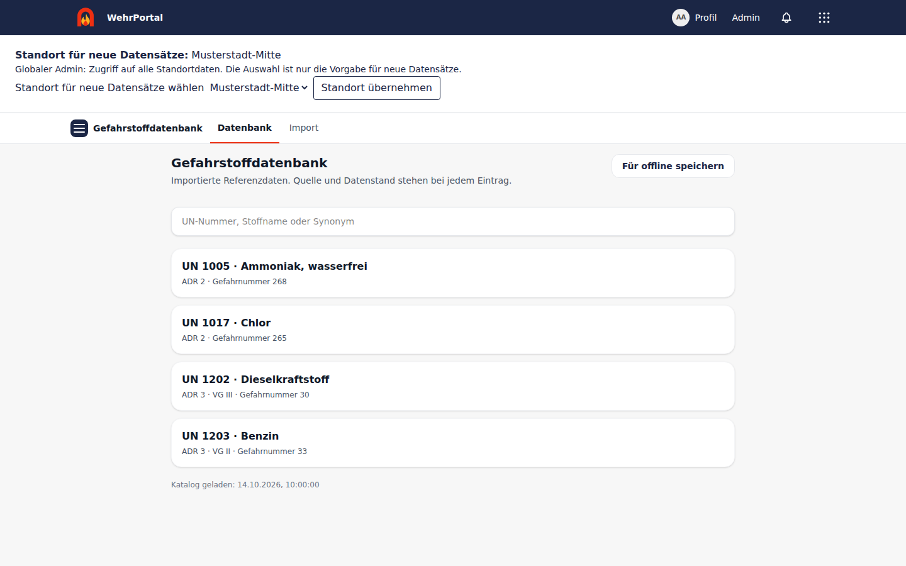

Die Gefahrstoffdatenbank ist standortübergreifend und enthält keine vorinstallierten Stoffdaten. Oberhalb der Suche zeigt sie unabhängig vom Importbestand die neun allgemeinen GHS-Gefahrenpiktogramme als rot umrandete SVG-Abbildungen mit Kurzbeschreibung. Ein Gefahrstoffbeauftragter kann eigene CSV- oder JSON-Datenbestände mit UN-Nummer, Name und optionalen Angaben zu ADR, GHS, Gefahren und Maßnahmen importieren. Vor der Übernahme werden alle Zeilen geprüft; fehlerhafte oder doppelte UN-Nummern verhindern den gesamten Import. Bestehende UN-Nummern werden aktualisiert, nicht enthaltene Datensätze bleiben unverändert. Quelle und Datenstand werden bei jedem Datensatz gespeichert und in der Suche angezeigt.

Importiert werden dürfen nur Daten, für die die Wehr die nötigen Speicher- und Nutzungsrechte hat. Die Importfunktion bezieht selbst keine Daten von BAM, DGUV oder anderen Anbietern. Das Modul Expositionen dokumentiert tatsächliche Expositionen und ist keine Referenzdatenbank.

Die Gefahrenmatrix ist ein standortübergreifendes Modul und arbeitet mit lokaler Bedienung ohne Speicherung. In der Gefahrenmatrix und Gefahrstoffdatenbank kann **„Für offline speichern“** gewählt werden. Die Matrix ist anschließend offline nutzbar; für die Stoffsuche wird der zuletzt geladene Datenbestand auf diesem Gerät zwischengespeichert. Nach einem Datenimport muss die Offline-Kopie auf dem Gerät erneut gespeichert werden. Es werden keine personenbezogenen Einsatzdaten für diese Funktion lokal zwischengespeichert.

### Kleiderkammer

#### Meine Ausrüstung (`/kleiderkammer`)

Die Kachel „Kleiderkammer“ auf der Startseite führt zu „Meine Ausrüstung“. Dort sieht jedes Mitglied mit Modulzugang die Teile, die ihm aktuell ausgegeben sind: Artikel, Größe, Artikelcode und seit wann. Zurückgegebene Teile erscheinen nicht.

- **Mitglieder:** Die Kleiderkammer hat keine eigene Mitgliederverwaltung. Ausrüstung wird direkt an Kameraden der Suite ausgegeben; Abteilungen, Funktionen, Dienstgrad, Status und Notizen pflegen Admins unter `/admin/kameraden`.
- **Mängel melden:** Ein Tipp auf ein Teil („Mängel melden“) öffnet das Feld für eine Nachricht an den Kleiderwart (z. B. Reißverschluss defekt, Größe passt nicht).
- **Wäsche anfordern:** Oben auf „Meine Ausrüstung“ wählt das Mitglied ein oder mehrere seiner Teile (z. B. Jacke und Hose nach einem Brandeinsatz) und gibt eine **Begründung** an – Pflicht; Vorschläge per Tipp: „Nach Brandeinsatz – kontaminiert“, „Stark verschmutzt“, „Nach Einsatz mit Gefahrstoffen“, „Regelmäßige Wäsche“, frei änderbar. Die Kleiderwarte (ohne Kleiderwart die Admins) bekommen eine Benachrichtigung (Glocke, Push, Mail) mit allen Teilen und dem Grund. Teile mit offener Anforderung sind ausgegraut und tragen „Wäsche angefordert“; beim Teil steht die Anforderung mit Stand („angefordert“, „gewaschen“). Im Verwaltungsbereich unter **„Mängel & Wäsche“** (Spalte „Art“, Filter Mangel/Wäsche) setzt der Kleiderwart **„Gewaschen“**: Das Mitglied bekommt Bescheid, und ein Teil mit Artikelcode bekommt die Wäsche mit Datum und Grund in seine Pflegehistorie (Wäsche/Imprägnierung). Mängel werden wie bisher mit „Erledigt“ abgeschlossen.
- **Scannen (Handy):** Kleiderwarte und Admins haben auf dem Handy auf jeder Seite der Kleiderkammer – in der App und im Verwaltungsbereich – unten über die ganze Breite einen roten Knopf **„Scannen“**, der zur Scan-Seite führt (nicht auf der Scan-Seite selbst).
- **Rollen:** Admins und Kameraden mit der Rolle „Kleiderwart“ sehen zusätzlich „Verwaltung“ (Zahnrad) in der Modulleiste. Nur sie kommen in den Verwaltungsbereich `/admin/kleiderkammer`; normale Mitglieder bekommen dort 403.

#### Verwaltung (`/admin/kleiderkammer`)

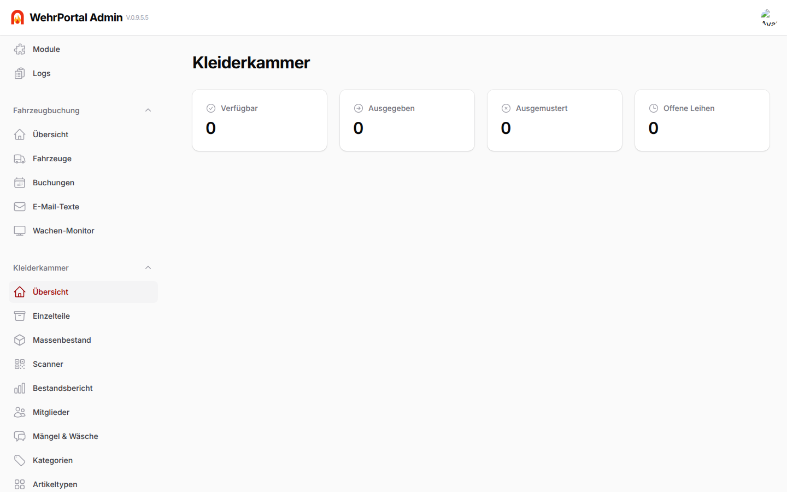

- **Mitglieder:** Liste aller Kameraden mit Abteilungen, Dienstgrad, Status, Notizen und Anzahl ausgeliehener Teile, Filter nach Abteilung, Status und „Mit Ausrüstung“. „Alle zurückfordern“ bucht alles zurück. Ein Klick auf die Zeile öffnet das **Kleiderkammerprofil**:
  - Name, Abteilungen, Funktionen, Dienstgrad und Status zur Info (pflegen Admins unter `/admin/kameraden`), dazu die Notizen, die Kleiderwarte hier bearbeiten.
  - **Ausrüstung:** aktuell ausgegebene Teile (per Filter auch die zurückgegebenen) mit „Zurücknehmen“. „Teil ausgeben“ sucht verfügbare Einzelteile nach Code, Artikelname, Gruppe und Größe (mehrere Wörter grenzen ein, z. B. „Jacke L“); das Feld funktioniert auch mit einem Handscanner. „Aus Bestand ausgeben“ wählt Artikeltyp, Gruppe, Größe (mit Lagerbestand) und Anzahl; die Größe aus dem Profil ist vorausgewählt. Bei zu wenig Bestand erscheint ein Hinweis. Nur aktive Mitglieder lassen sich ausrüsten.
  - **Konfektionsgrößen:** pro Artikeltyp eine Größe (bei Artikeltypen mit Gruppen auch die Gruppe), z. B. Diensthose Damen 40.
- **Ausgabe:** Ausgeben lässt sich nur an Kameraden mit Status „aktiv“ (Austrittssperre).
- **Kategorien:** Über „Reihenfolge ändern“ lassen sich die Kategorien per Drag & Drop sortieren; „Fertig“ beendet den Modus. Die Reihenfolge wird sofort gespeichert.
- **Artikeltypen:** Liste mit Name zuerst, Suche nach Name und Filtern nach Kategorie, „Größe relevant“, „Wäscheprotokoll“, „Einzeln erfasst“ und „Kettensägenschutz“. Sortierbar wie die Kategorien.
- **Gruppen:** Pro Artikeltyp lassen sich eigene Gruppen anlegen, etwa „Damen“/„Herren“ bei Diensthosen oder „S-Guard“/„Viking“ bei PSA. Sie gelten nur für diesen Artikeltyp, lassen sich sortieren und nicht löschen, solange Größen, Teile, Bestand oder Ausgaben daran hängen. Hat ein Artikeltyp Gruppen, fragen Einzelteil- und Bestandsformular danach (optional). Bestand wird je Artikeltyp, Größe und Gruppe geführt; Ausgabe und Rückgabe buchen auf die passende Gruppe.
- **Größen:** Bei Artikeltypen mit „Größe relevant“ stehen die Größen unten auf der Bearbeiten-Seite: hinzufügen, umbenennen, per Drag & Drop sortieren. Hat der Artikeltyp Gruppen, lässt sich jede Größe einer Gruppe zuordnen (z. B. „40“ nur für „Damen“); ohne Gruppe gilt sie für alle. Jede Größe gibt es pro Artikeltyp und Gruppe nur einmal. Die Größenliste lässt sich nach Größe und Gruppe filtern (inkl. „Für alle Gruppen“). In den Formularen für Einzelteile und Bestand wird zuerst die Gruppe gewählt, danach stehen nur deren Größen und die Größen für alle Gruppen zur Auswahl. Eine Größe, zu der es Teile, Bestand, Ausgaben oder Profileinträge gibt, lässt sich nicht löschen.
- **Einzelteile:** Zur Auswahl stehen nur Artikeltypen mit „Einzeln erfasst“; Massenbestand läuft über „Bestand“. Gibt es noch keinen solchen Artikeltyp, weist das Formular darauf hin.
- **Scanner:** „Kamera starten“ fragt die Kamera-Berechtigung an und scannt QR-Codes und Strichcodes; ein bekannter Code öffnet das Teil. Ist der Code unbekannt, öffnet sich für Admins und Kleiderwarte „Einzelteil anlegen“ mit dem Code vorausgefüllt; der Artikeltyp wird aus dem Code erraten (Wehr-Präfix + Code-Präfix des Artikeltyps, z. B. `WEHREJA0007` → Einsatzjacke; das Wehr-Präfix stellt der Admin unter Einstellungen ein, Standard `WEHR`). Über „Ausgeben an“ lässt sich das neue Teil direkt einem Mitglied ausgeben. Für alle anderen bleibt ein unbekannter Code ein 404. Wird der Zugriff verweigert oder fehlt eine Kamera, steht der Grund unter dem Kamerabild. Alternativ lässt sich der Code von Hand eingeben.

### Mängelmanagement

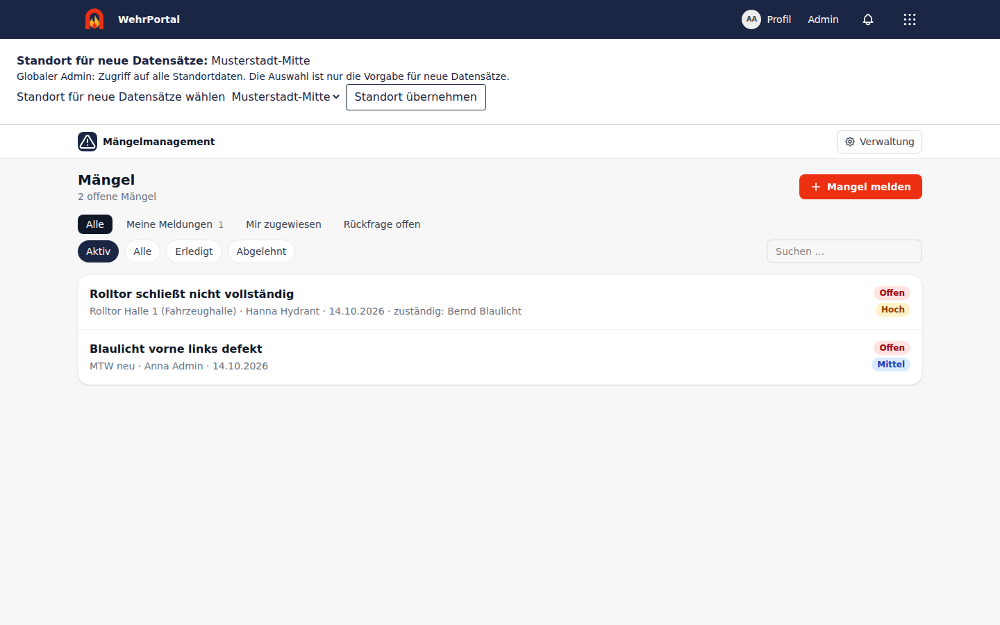

Mängel erfassen und bis zur Erledigung verfolgen. Das Modul ist nach der Installation ausgeschaltet; ein Admin aktiviert es unter Admin → Module und vergibt den Modulzugang. Die Kachel „Mängelmanagement“ führt zur Mängelliste (`/maengelmanagement`).

Bei aktivierten Standorten gehören Mängel und QR-Code-Geräte zu einem Feuerwehrstandort. Lokale Verantwortliche – Wehrführung und Gerätewarte – sehen und bearbeiten nur Daten der Standorte, für die sie zuständig sind; Standortmitglieder sehen die Geräte und Mängel ihrer Standorte. Ein neuer Mangel übernimmt den Standort des ausgewählten Fahrzeugs, Ausrüstungsgeräts oder QR-Code-Geräts, sonst den aktuellen Standort. Noch nicht zugeordnete Altgeräte bleiben globalen Admins und Gemeindebrandinspektoren vorbehalten, bis sie einem Standort zugewiesen sind.

- **Mangel melden:** Jedes Mitglied mit Modulzugang meldet einen Mangel mit Titel, Beschreibung, Dringlichkeit (niedrig, mittel, hoch, kritisch) und bis zu drei Fotos. Als Betroffenes wählt man ein Objekt aus der Liste, ein **Fahrzeug** (aus der gemeinsamen Fahrzeugliste; aus der Fahrzeugakte vorausgewählt), ein **Gerät der Ausrüstungsverwaltung** (wenn eingeschaltet; aus der Geräteseite vorausgewählt, `?geraet=AR-0001`) oder gibt frei einen Ort an. Ein Gerät der Ausrüstung bekommt dort zugleich einen Schaden (es gilt als defekt, die Gerätewarte wissen Bescheid); ist der Mangel erledigt, wird der Schaden als repariert abgeschlossen und das Gerät ist wieder einsatzbereit, sofern nichts anderes offen ist. Mängel aus Fahrzeugprüfungen der Fahrzeugverwaltung kommen automatisch hinzu. Fotos werden auf höchstens 1280 Pixel verkleinert und in der Datenbank gespeichert.
- **QR-Code am Gerät:** Jedes Gerät hat einen Code (`MM-0001`, …) und einen QR-Code. Wer ihn scannt, landet im Meldeformular mit vorausgewähltem Gerät. Die Codes laufen über denselben Scan-Weg `/i/{code}` wie in der Kleiderkammer. Die Kleiderkammer bietet für unbekannte Codes das Anlegen eines Teils nur noch an, wenn kein anderes Modul den Code kennt.
- **Transparenz:** Alle Mitglieder des Moduls sehen alle Mängel mit Status, Dringlichkeit, Zuständigem und dem vollständigen Verlauf, und können kommentieren – auch mit bis zu drei **Fotos**. Ansichten: alle, **meine Meldungen**, **mir zugewiesen**, **Rückfrage offen**; Filter: aktiv, alle, erledigt, abgelehnt; Suche nach Titel, Ort, Gerät und Fahrzeug.
- **Bearbeiten in der App:** Verantwortliche und wer zuständig ist ändern Status, Dringlichkeit und Zuständigkeit direkt auf der Seite des Mangels (mit Notiz, z. B. „Ersatzteil bestellt“) – auch am Handy, ohne Verwaltung. „übernehmen“ macht den Verantwortlichen zuständig und setzt einen offenen Mangel auf „in Bearbeitung“.
- **Rückfrage:** „Rückfrage an …“ stellt dem Melder eine Frage (optional mit Foto). Er bekommt eine Benachrichtigung, der Mangel ist mit „Rückfrage“ markiert und die Startseite des Melders zeigt sie, bis er antwortet; seine Antwort (gern mit Foto) schließt die Rückfrage und geht an den, der gefragt hat, und den Zuständigen.
- **Doch nicht behoben:** Bis 30 Tage nach „erledigt“ kann der Melder den Mangel mit Begründung (und Foto) wieder öffnen; der Zuständige bzw. die Verantwortlichen werden benachrichtigt.
- **Zuständig je Objekt:** Unter Geräte/Objekte lässt sich je Objekt eine zuständige Person hinterlegen (z. B. der Hausmeister für die Tore); neue Mängel daran werden ihr gleich zugewiesen.
- **Erinnerung:** `maengel:remind` läuft täglich um 7:15 Uhr; die Verantwortlichen bekommen eine Übersicht über Mängel, für die seit 2 Tagen niemand zuständig ist, Rückfragen ohne Antwort seit 7 Tagen und Mängel, an denen sich seit 30 Tagen nichts getan hat – jeden höchstens einmal pro Woche.
- **Startseite und Jahresbericht:** Die Karte „Mängel“ zeigt offene Rückfragen an einen selbst, die einem zugewiesenen Mängel und die eigenen offenen Meldungen, Verantwortlichen dazu offen, kritisch und ohne Zuständigen. Der Jahresbericht hat den Abschnitt „Mängel“ (gemeldet, erledigt, Ø Tage bis erledigt, zum Jahresende offen, häufigste Objekte).
- **Verwaltung:** Admins und Kameraden mit der Rolle „Verantwortlicher“ arbeiten außerdem unter `/admin/maengelmanagement`: Status (offen, in Bearbeitung, erledigt, abgelehnt), Dringlichkeit und Zuständigen ändern, mit Notiz, sowie Geräte samt druckbarem QR-Code pflegen. Jede Änderung steht im Verlauf.
- **Benachrichtigung:** Ein neuer Mangel geht per Mail an alle Verantwortlichen, gibt es keinen, an die Admins (kritische mit „DRINGEND“ im Betreff). Melder und Zuständige bekommen eine Mail, wenn jemand anderes den Status ändert, kommentiert oder zuweist. Ein Mailfehler verhindert die Änderung nicht.
- **Löschen:** Kameraden, die Mängel gemeldet haben, lassen sich nicht einfach löschen; setze sie auf „Ausgetreten“ oder nutze „Löschen mit Übertragung“.

### Schichtplan

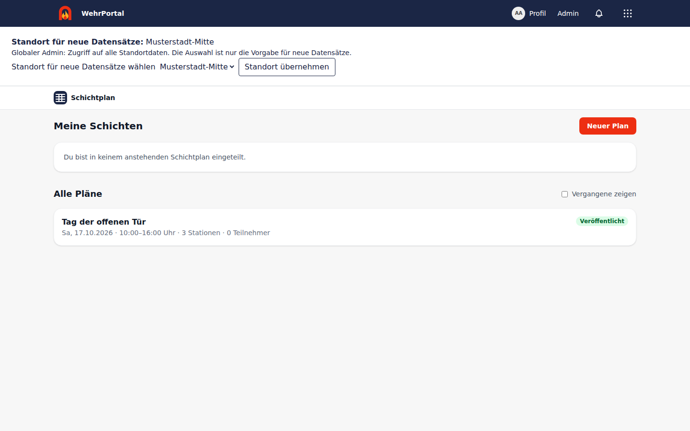

Schichten für Arbeitsdienste, Feste und Stände planen, etwa den Pommesstand der Jugendfeuerwehr auf dem Dorffest, den Grillstand des aktiven Dienstes oder den Arbeitsdienst am Gerätehaus – vom Planer automatisch gerecht verteilt oder von den Mitgliedern selbst eingetragen. Jeder Plan gehört genau zu einem Standort; Abteilungen und Teilnehmende werden auf diesen Standort begrenzt. Der Standort steht in Planlisten, Druckansicht, CSV und Benachrichtigungen. Das Modul ist nach der Installation ausgeschaltet; ein Admin aktiviert es unter Admin → Module und vergibt den Modulzugang. Wer Pläne anlegt, bekommt die Rolle „Planer“ (Admins dürfen es immer); die Standardrolle Wehrführung darf Pläne an ihren zugewiesenen Standorten verwalten.

- **Plan anlegen** (`/schichtplan/neu`): Standort, wofür, Ort, Datum, Beginn und Ende (liegt das Ende vor dem Beginn, geht der Plan über Mitternacht), Schichtlänge (30 Minuten bis 3 Stunden) und wie viele Schichten jemand höchstens am Stück macht (Standard 2). Optional eine Abteilung desselben Standorts und eine Vorlage für die Stationen. Bei einem Kalendertermin wird dessen einzelner Standort übernommen, sofern der Planer ihn verwalten darf. Aus Beginn, Ende und Schichtlänge entstehen die Zeitblöcke; der letzte darf kürzer sein. Ändern sich Zeiten oder Schichtlänge, werden die Blöcke neu angelegt und die Einteilung geleert.
- **Stationen:** Name und wie viele Personen gleichzeitig dort stehen (z. B. Fritteuse 2, Kasse 1). Weniger Plätze entfernen die überzähligen Einteilungen, von Hand gesetzte zuletzt. Die Stationen eines Plans lassen sich als Vorlage speichern („Pommesstand JF“, „Grillstand Aktive“) und beim nächsten Fest übernehmen.
- **Teilnehmer:** einzeln hinzufügen oder „ganze Abteilung hinzufügen“; in der Auswahl und in der Teilnehmerliste steht hinter jedem Namen die Abteilung. Teilnehmen können nur Kameraden des Planstandorts mit Konto und Zugang zum Modul. Auch Stationsverantwortliche müssen diesem Standort angehören. Pro Teilnehmer lässt sich eine Verfügbarkeit setzen („ab 16 Uhr“, „bis 19 Uhr“); Einteilungen außerhalb fallen dann weg.
- **Automatische Verteilung** („Plan füllen“ / „Neu verteilen“): Ziel ist, dass jeder jede Station einmal macht, bevor sich etwas wiederholt, und alle gleich viele Schichten haben (höchstens eine Schicht Unterschied). Pro Zeitblock wird zuerst nach Fairness bestimmt, wer arbeitet (wer bisher die wenigsten Schichten hat, wer nicht schon zu viele am Stück hatte, wer gerade Pause hatte); diese Personen werden dann per optimaler Zuordnung so auf die Stationen gesetzt, dass möglichst viele eine für sie neue Station bekommen. Ein Nachlauf tauscht innerhalb eines Blocks Stationen, wenn das Wiederholungen spart, und von 40 Durchläufen wird der beste gespeichert. Niemand steht in einem Block an zwei Stationen. Reichen die Leute nicht, bleiben Plätze frei und werden rot markiert, statt jemanden doppelt einzuteilen; die Pausenregel wird nur gebrochen, wenn sonst ein Platz leer bliebe.
- **Von Hand ändern:** Jeder Platz ist eine Auswahl. Wer im selben Block schon an einer anderen Station steht, tauscht mit der Person auf dem Platz. Von Hand gesetzte Plätze bekommen ein Schloss und bleiben beim Neuverteilen stehen; das Schloss lässt sich auch an automatisch gefüllten Plätzen setzen und wieder lösen.
- **Übersicht:** Schichten pro Person (von–bis), unbesetzte Plätze und welche Station jemand noch nicht hatte.
- **Veröffentlichen und per E-Mail senden:** Erst veröffentlichte Pläne sehen die Teilnehmer. „Veröffentlichen“ benachrichtigt Teilnehmer und Stationsverantwortliche in der App (Glocke, mit den eigenen Schichten und Link zum Plan) – ohne Mail. „Per E-Mail senden“ (erscheint nach dem Veröffentlichen) ist ein eigener Schritt: Jeder bekommt eine Mail mit seinen eigenen Schichten und dem ganzen Plan als Tabelle, beim ersten Mal „Schichtplan: …“, danach „Schichtplan (aktualisiert): …“; so lässt sich nach Änderungen der aktuelle Stand noch einmal an alle schicken. Ohne das bekommen nach dem Veröffentlichen alle, deren Schichten der Planer geändert hat (umgesetzt, getauscht, entfernt, Zeiten geändert), automatisch eine Mail mit ihren neuen Schichten bzw. „nicht mehr eingeteilt“ – sobald 10 Minuten lang nichts mehr am Plan geändert wurde, damit nicht jeder Klick eine Mail auslöst (`schichtplan:notify-changes`, alle 5 Minuten). Bei Selbst-Eintragung gilt das nicht; dort erfährt jemand sofort, wenn der Planer einen Platz für ihn zurückgibt. Ein Mailfehler bricht nichts ab.
- **Stationsverantwortung:** Pro Station lässt sich unter „Stationen“ eine Person wählen, die den ganzen Abend für die Station verantwortlich ist – ein Teilnehmer, der zusätzlich Schichten hat, oder jemand anderes mit Zugang zum Schichtplan. Sie steht im Plan, in der Druckansicht, in der CSV und in der Mail („Verantwortlich“) und sieht und bekommt den veröffentlichten Plan auch ohne eigene Schicht.
- **Druckansicht:** Raster aus Zeiten und Stationen mit Verantwortlichen (freie Plätze rot) und darunter „Wer hat wann was“ zum Aushängen am Stand.
- **CSV-Export** (Knopf „CSV“ im Plan und im Editor, für alle, die den Plan sehen dürfen): für Excel (UTF-8, Semikolon) aufgebaut wie die Druckansicht – Titel, Zeit, Ort und Standort, eine Spalte je Station, eine Zeile „Verantwortlich“, eine Zeile je Zeitblock mit den Namen; darunter jede Person mit ihren Schichten und ihrer Stationsverantwortung.
- **Selbst-Eintragung** (beim Anlegen oder unter „Ereignis bearbeiten“ → „Mitglieder tragen sich selbst ein“): Statt dass der Planer einteilt, suchen sich die Kameraden freie Plätze selbst aus. Einstellbar sind eine **Frist** (leer = bis zum Beginn), **höchstens Schichten je Person** und ob Eintragungen **bestätigt** werden müssen. Die **Zielgruppe** (Abteilungen und/oder Funktionen; eine Funktion umfasst ihre Unterfunktionen; leer = alle mit Zugang) bestimmt, wer den Plan sieht und sich eintragen darf. Im Planer-Modus hat sie keine Wirkung; dort sehen den Plan wie bisher nur Teilnehmer und Stationsverantwortliche. „Veröffentlichen“ lädt die Zielgruppe in der App (Glocke) zur Eintragung ein; „Per E-Mail senden“ schickt der Zielgruppe die Einladung per Mail – wer schon eingetragen ist, bekommt stattdessen seine Schichten.
  - **Eintragen** (`/schichtplan/{id}/eintragen`): Raster aus Zeitblöcken und Stationen mit Namen und freien Plätzen; „Eintragen“ nimmt einen Platz, die eigenen Schichten stehen oben mit „austragen“. Geprüft wird: Platz frei (gleichzeitige Eintragungen können den letzten Platz nicht doppelt vergeben), nur ein Platz je Zeitblock, höchstens so viele Schichten am Stück wie eingestellt, das Limit je Person, Schicht noch nicht begonnen, Frist nicht vorbei. Nach der Frist ändert nur noch der Planer etwas. Selbst eingetragene Plätze bekommen ein Schloss; „Plan füllen“ verteilt danach nur noch die übrigen Lücken.
  - **Genehmigung:** Ist sie eingeschaltet, steht ein Platz zunächst auf „angefragt“ (und ist reserviert). Planer und die **Stationsverantwortung** der Station bekommen eine Mail und bestätigen oder lehnen (mit optionaler Begründung) auf der Eintragungsseite ab; der Kamerad bekommt das Ergebnis per Mail. Was der Planer selbst einträgt, ist sofort bestätigt. Angefragte Plätze stehen in Plan, Druck und CSV mit „(angefragt)“.
  - **Für wen:** Jeder Kamerad trägt sich nur selbst ein und aus. Planer können über „Wer trägt sich ein?“ einen anderen aus der Zielgruppe eintragen oder austragen; gespeichert wird, wer eingetragen hat.
  - **Erinnerung:** `schichtplan:remind` läuft stündlich; bis 24 Stunden vor der ersten bestätigten Schicht bekommt jeder einmal eine Mail mit seinen Schichten des Plans (gilt für alle veröffentlichten Pläne, auch vom Planer eingeteilte).
  - **Startseite und Übersicht:** „Helfer gesucht“ mit der Zahl freier Plätze für alle, die sich noch eintragen können, und „x Schicht-Anfragen zu bestätigen“ für Planer und Stationsverantwortliche.
- **Im Kalender** (wenn „Kalender & Termine“ eingeschaltet ist): Beim Veröffentlichen legt der Plan einen Kalendertermin (Art „Veranstaltung“) an – bei Selbst-Eintragung für die Zielgruppe, sonst für Teilnehmer, Stationsverantwortliche und den Planer. Titel, Ort, Zeit und Zielgruppe folgen späteren Änderungen am Plan; die Art kann der Terminverwalter ändern. Der Termin zeigt den Plan mit „Helfer eintragen“, der Plan verlinkt „Im Kalender ansehen“. Wird der Plan gelöscht, verschwindet auch sein Termin; löscht der Terminverwalter den Termin, legt der Plan ihn nicht neu an. Umgekehrt bietet jeder Kalendertermin Planern „Schichtplan anlegen“: Titel, Ort, Datum, Uhrzeit und Zielgruppe werden übernommen und der Plan hängt am Termin, ohne ihn zu verändern.
- **Für Teilnehmer** (`/schichtplan`): „Meine Schichten“ zeigt die anstehenden veröffentlichten Pläne mit den eigenen Schichten und einer Stationsverantwortung. Der Plan zeigt oben „Deine Schichten“ (Zeit, Station, mit wem man dort steht und wer verantwortlich ist) und die eigene Stationsverantwortung, darunter den **gesamten Schichtplan**: eigene Plätze rot umrandet und fett, die Zeilen der eigenen Schichten hinterlegt, die Verantwortlichen unter den Stationsnamen. Pläne, in denen man weder steht noch verantwortlich ist, und Entwürfe bleiben unsichtbar. Auf dem Handy steht der gesamte Schichtplan Station für Station untereinander (je Station die Zeitblöcke mit Namen), auf größeren Bildschirmen als Tabelle.

### Mitteilungen

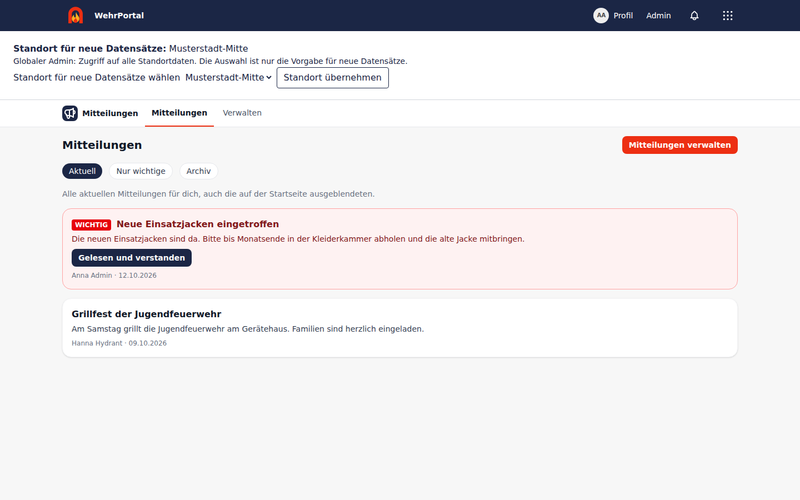

Nachrichten der Wehrführung oder der Admins an die Kameraden. Das Modul ist nach dem Update eingeschaltet und auf „Neue Kameraden automatisch freischalten“ gestellt, sodass alle aktiven Kameraden es sehen. Im bisherigen Rollenmodell bekommt, wer schreiben darf, die Modulrolle „Redakteur“ (Admins dürfen es immer); beim Umstieg wurde das frühere Häkchen „Darf Mitteilungen veröffentlichen“ in diese Rolle übernommen. Für den optionalen Standortrollenadapter gelten stattdessen die unten beschriebenen ausdrücklichen Standortvergaben.

- **Startseite:** Aktuelle Mitteilungen stehen ganz oben, wichtige zuerst – aber nur, wenn es welche gibt. Normale lassen sich dort ausblenden, wichtige nicht.
- **Mitteilungen** (`/mitteilungen`): alle aktuellen Mitteilungen für den Kameraden, auch die auf der Startseite ausgeblendeten; Filter **„Nur wichtige“** und **Archiv** (Mitteilungen, deren Zeitraum vorbei ist).
- **Verwalten** (`/mitteilungen/verwalten`): Titel und Text, optional Zeitraum (TT.MM.JJJJ, „ab“ und „bis einschließlich“) und Zielgruppe (Abteilungen und/oder **Funktionen** – z. B. alle Maschinisten, eine Funktion schließt ihre Unterfunktionen ein; leer = alle). **Wichtige** Mitteilungen stehen rot ganz oben und lassen sich nicht ausblenden. Auf Wunsch geht die Mitteilung zusätzlich per E-Mail an alle Empfänger mit Zugang zum Modul (dann auch in die Glocke und als Push). Für kurzfristige Ansagen („Dienst heute erst um 19:30“) gibt es **„Ohne E-Mail nur in die Glocke und als Push“**: Die Empfänger bekommen den Eintrag unter der Glocke und – wo eingeschaltet – eine Push-Nachricht aufs Handy, aber keine Mail.
- **Anhänge:** PDF-, Office- und Bilddateien (je bis 10 MB, in der Datenbank gespeichert) direkt an der Mitteilung – auf der Startseite, unter Mitteilungen und als Hinweis in der Mail. Öffnen können sie nur die Empfänger und die Redakteure.
- **Lesebestätigung** (Häkchen beim Schreiben): Jeder Empfänger bestätigt mit **„Gelesen und verstanden“** – auf der Startseite und unter Mitteilungen; bis dahin lässt sich die Mitteilung auf der Startseite nicht ausblenden. Unter „Verwalten“ zeigt **„Lesebestätigungen“** je Mitteilung „x von y gelesen, z bestätigt“ und wer noch fehlt; **„Erinnern“** schickt genau diesen Kameraden die Mitteilung noch einmal („Bitte bestätigen: …“, Glocke, Push, Mail). Auch ohne Lesebestätigung sieht man, wer sie gelesen hat (Öffnen der Mitteilungen oder eines Anhangs) – anders als im Messenger nachvollziehbar und DSGVO-konform auf dem eigenen Server.
- **Standort:** Mit Locations kann eine Mitteilung als **Allgemein** oder für genau einen Standort veröffentlicht werden. Standortmitteilungen sehen nur aktive Modulnutzer mit Mitgliedschaft am Standort (auch bei mehreren Standorten); Gruppen und Funktionen schränken die Zielgruppe zusätzlich ein. Vorhandene Mitteilungen bleiben bei der Migration allgemein. Standort-Admins dürfen nur Mitteilungen ihres Standorts verwalten; sie können keine allgemeine oder fremde Mitteilung anlegen.
- **Standort-Redakteursrollen (optional):** Nach expliziter Vergabe aktiviert `LOCATIONS_SCOPED_ROLE_MODULES=mitteilungen` den zielbezogenen Adapter (mit Anwesenheit: `anwesenheit,mitteilungen`). Nicht-Admins benötigen dann eine gültige Rolle `redakteur` am konkreten Zielstandort; alte globale Rollen, Autorenschaft und Standort-Adminrechte ersetzen sie nicht. Allgemeine Mitteilungen verwalten dann nur globale Admins. Änderungen des Standorts benötigen Rechte am alten und neuen Ziel; Anhänge, Statistik, Erinnerungen und Versandanforderungen prüfen ebenfalls die konkrete Mitteilung. Normale Empfängerrechte und externe Kanalkonfiguration bleiben getrennt. Es werden keine Rollen automatisch kopiert. Vorbereitung und Rückfallgrenzen: [Mitteilungen](MITTEILUNGEN.md#optionale-standort-redakteursrollen-p2b).
- **ntfy und Matrix (optional):** Unter **Admin → Mitteilungen → Externe Kanäle** richten globale Admins das allgemeine Ziel und Standort-Admins jeweils ihre Standortziele ein. In **Verwalten** wird jeder externe Versand ausdrücklich angefordert; App, E-Mail, Glocke und Browser-Push bleiben unabhängig davon. Es wird nur der Titel und Text ohne Anhänge versendet. Abteilungs-/Funktionsmitteilungen, noch nicht veröffentlichte Mitteilungen und Erinnerungen werden nicht an gemeinsame Räume/Topics gesendet. Es gibt keinen Ersatzversand in ein allgemeines Ziel. Externe Raum-/Topic-Mitgliedschaften müssen Betreiber selbst sicher und aktuell halten; Details und Grenzen: [Mitteilungen einrichten](MITTEILUNGEN.md).
- **Veröffentlichungszeitraum:** Liegt eine Mitteilung noch in der Zukunft oder ist sie abgelaufen, wird sie auch bei aktivierten E-Mail-, Glocken-, Push- oder externen Versandhäkchen nicht verschickt. Eine spätere Veröffentlichung löst keinen automatischen Nachversand aus; die gewünschten Kanäle müssen dann ausdrücklich angefordert werden.


### Lehrgänge & Qualifikationen

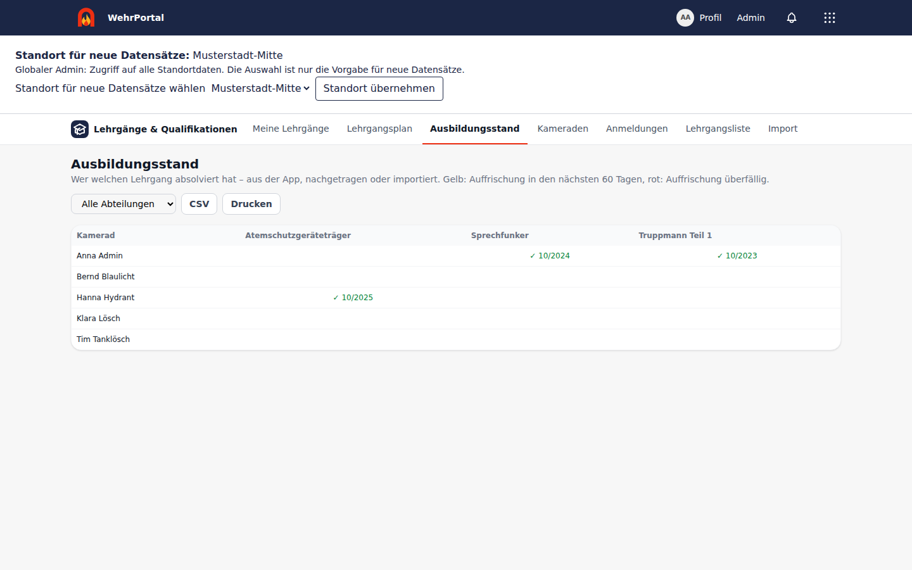

Kameraden melden ihr **Interesse** an Lehrgängen des Kreises, die Ausbildungsleitung meldet in fox112 Bedarf an und trägt die bestätigten Termine ein. Das Modul ist nach der Installation ausgeschaltet; ein Admin aktiviert es unter Admin → Module und vergibt den Modulzugang. Rollen: „Ausbildungsleiter“ bearbeitet die Anmeldungen (Admins dürfen es immer), „Wehrführung“ sieht, welche Lehrgänge die Kameraden absolviert haben. **Wer benachrichtigt wird:** Mails und Glocke zu neuem Interesse und zu Absagen gehen nur an die aktiven Kameraden mit der Rolle **Ausbildungsleiter** – Admins ohne diese Rolle bekommen nichts, dürfen die Anmeldungen aber weiter bearbeiten. Nur wenn es keinen aktiven Ausbildungsleiter gibt, gehen sie ersatzweise an die Admins, damit nichts verloren geht. Dasselbe gilt für die Karte auf der Startseite („x Absagen – in fox112 abmelden und als erledigt markieren“, „x Kameraden mit Interesse an einem Lehrgang – in fox112 anmelden“): Sie erscheint genau bei denen, die auch benachrichtigt werden – ein Admin ohne die Rolle sieht sie nicht, solange es einen Ausbildungsleiter gibt. Soll z. B. der Wehrführer mitbenachrichtigt werden, bekommt er die Rolle Ausbildungsleiter (sie umfasst alles, was die Rolle Wehrführung sieht; je Modul hat ein Kamerad eine Rolle). Vergeben wird die Rolle unter Admin → Kameraden beim Modul-Zugriff oder unter Admin → Module.

**Lehrgänge:** Grundlage sind die Lehrgänge **ohne festen Termin** auf der Seite „Restplätze Lehrgänge“ des eigenen Kreises im Lehrgangsportal fox112. Die Adresse trägt der Ausbildungsleiter unter **Lehrgangsliste → fox112 des Kreises** ein (es reicht `https://kreis.fox112.de` oder nur der Kreisname; angenommen werden nur https-Adressen auf `fox112.de`); „Speichern und einlesen“ liest sofort ein. Ohne Adresse wird nichts eingelesen und die Liste nur von Hand gepflegt; auf „Anmeldungen“ steht dann ein Hinweis. Lehrgänge mit Termin und Restplätzen werden nicht übernommen. `lehrgaenge:import-catalog` liest die Seite täglich um 6:30 Uhr ein (nur bei aktivem Modul); der Ausbildungsleiter kann sie jederzeit oben auf „Anmeldungen“ mit **„Lehrgänge von fox112 aktualisieren“** neu laden (daneben steht der Stand des letzten Imports). Varianten eines Lehrgangs (z. B. „(Wochenendlehrgang)“, „(Wochenlehrgang)“) stehen unter dem Namen. **Lehrgangsliste** (`/lehrgaenge/lehrgangsliste`, für Ausbildungsleiter): Die Ausbildungsleitung entscheidet, welche Lehrgänge den Kameraden **angeboten** werden – fox112 macht nur Vorschläge.
- **Vorschläge aus fox112:** Neue Lehrgänge aus fox112 kommen nicht von selbst in die Liste, sondern stehen oben als Vorschlag mit **„Anbieten“** oder **„Nicht anbieten“** (dann wird er auch beim nächsten Import nicht wieder vorgeschlagen; unten unter „Nicht angeboten und nicht mehr vorgeschlagen“ lässt sich das zurücknehmen). „Alle anbieten“ übernimmt alle auf einmal, z. B. beim ersten Einlesen. Die Ausbildungsleiter bekommen nach einem Import mit Neuem eine Nachricht (Glocke, Push, Mail), die Startseite nennt die offenen Vorschläge.
- **Nicht mehr in fox112:** Verschwindet ein angebotener Lehrgang aus fox112, wird er **nicht** gelöscht und bleibt angeboten – oft nimmt der Kreis ihn nur vorübergehend heraus. Er steht unter „Nicht mehr in fox112“ (seit wann, wie viele Interesse gemeldet haben) mit **„Weiter anbieten“** oder **„Entfernen“**; die Ausbildungsleiter werden informiert. Taucht er wieder auf, ist die Frage erledigt.
- **Löschen:** Jeder Lehrgang lässt sich aus der Liste löschen, eigene wie aus fox112. Hat ihn noch niemand absolviert oder angefragt, ist er weg; sonst wird er nur aus der Liste genommen, die Einträge der Kameraden behalten ihn. Führt fox112 ihn weiter, wird er beim nächsten Import **wieder vorgeschlagen** („von dir gelöscht, fox112 führt ihn weiter“) und kommt erst mit „Anbieten“ zurück.
- **„angeboten“** (Schalter je Lehrgang) nimmt einen Lehrgang aus dem Angebot, ohne ihn zu löschen; daneben steht, ob er in fox112 ist, nicht mehr in fox112 (zuletzt …) oder von Hand ergänzt, und wie viele Kameraden Interesse gemeldet haben. Fehlt ein Lehrgang ganz (z. B. Vegetationsbrandbekämpfung), trägt der Ausbildungsleiter ihn von Hand ein – er wird sofort angeboten; taucht er später in fox112 unter demselben Namen auf, wird er zusammengeführt. Bei einem Fehler des Imports bleibt alles unverändert und unter dem Knopf steht „fehlgeschlagen“ mit dem Grund.

**Der Ablauf**

1. **Interesse melden:** Der Kamerad wählt unter „Meine Lehrgänge“ (`/lehrgaenge`) einen Lehrgang (mit Suche) und meldet mit „Interesse melden“ sein Interesse, optional mit Bemerkung; der Status heißt dann „Interesse gemeldet“. (Bewusst nicht „Bedarf anmelden“: so heißt in fox112 der nächste Schritt der Wehr.) Die Ausbildungsleiter bekommen eine Mail. Für einen Lehrgang mit laufender Anmeldung oder einen absolvierten geht das nicht noch einmal.
2. **Kameraden anmelden** (Ausbildungsleiter und Admins, „Anmeldungen“ → „Kameraden zu einem Lehrgang anmelden“): Lehrgang wählen, einen oder mehrere Kameraden ankreuzen (mit Suche), optional eine Bemerkung – sie stehen dann wie nach eigenem Interesse unter „Bedarf“ (Bemerkung „Angemeldet von …“) und bekommen eine E-Mail und einen Eintrag in der Glocke; wer schon angemeldet ist oder den Lehrgang absolviert hat, wird übersprungen. Danach läuft alles wie gewohnt (fox112, Termine, Absolviert).
   **Dashboard des Ausbildungsleiters** („Anmeldungen“, `/lehrgaenge/anmeldungen`): das Interesse je Lehrgang, die Kameraden nummeriert in der Reihenfolge ihrer Meldung mit „Interesse seit“ und Bemerkung; der Lehrgang mit der längsten Wartezeit oben. Die Startseite nennt die Zahl der Kameraden mit Interesse an einem Lehrgang, die noch nicht in fox112 angemeldet sind.
3. **Anmeldung in fox112 und Warteliste:** Der Ausbildungsleiter meldet in fox112 Bedarf an und den Kameraden dort von Hand an. Danach klickt er beim Kameraden **„In fox112 angemeldet“**: Der Kamerad wandert von „Interesse“ in den Abschnitt **„Warteliste“** (mit Datum der Anmeldung), zählt auf der Startseite nicht mehr als offenes Interesse und bekommt eine E-Mail und einen Eintrag in der Glocke („Auf der Warteliste“); unter „Meine Lehrgänge“ und auf seiner Startseiten-Karte steht „Warteliste“. „Zurück zu Interesse“ nimmt einen Fehlklick zurück. Absagen und Ablehnen gehen auf der Warteliste wie vorher. Hat fox112 bestätigt, trägt er mit „Bestätigt – Termine eintragen“ einen oder mehrere Lehrgangstage ein, jeweils Datum, Uhrzeit von/bis und Lehrgangsort (ein weiterer Tag übernimmt Zeit und Ort des vorigen).
4. **Mail an den Kameraden:** Er bekommt alle Tage mit Uhrzeit und Ort per Mail und sieht sie unter „Meine Lehrgänge“ (und auf der Startseite: die Karte „Lehrgänge“ zeigt jedem Kameraden mit Modulzugang immer seinen Stand – nächster Lehrgang, laufende Anmeldungen, fällige Auffrischungen, Zahl der absolvierten; Kameraden ohne Modulzugang sehen sie, sobald sie angemeldet sind). Korrigiert der Ausbildungsleiter die Termine („Termine ändern“), geht eine Mail „Lehrgangstermine geändert“ raus.
5. **Hinweis 14 Tage vorher:** `lehrgaenge:remind-upcoming` (täglich 7:20 Uhr) schickt 14 Tage vor dem ersten Lehrgangstag eine Mail mit den Tagen, einmal. Wird ein Lehrgang erst innerhalb der 14 Tage bestätigt, ist die Bestätigung der Hinweis.
6. **Absagen:** Unter „Meine Lehrgänge“ kann der Kamerad sein Interesse oder einen bestätigten Lehrgang absagen, mit Grund (Pflicht). Die Ausbildungsleiter bekommen eine Mail mit dem Grund und sehen die Absage oben unter „Anmeldungen“ (letzte 90 Tage) mit der Bitte, den Kameraden in fox112 abzumelden. Danach markiert der Ausbildungsleiter sie mit **„Erledigt – in fox112 abgemeldet“** (mit Datum, „rückgängig“ möglich). Die Startseite nennt rot alle Absagen der letzten 90 Tage, die noch nicht als erledigt markiert sind – sie verschwinden also nicht mehr nach 7 Tagen von selbst, sondern erst, wenn sie erledigt sind. (Beim Update auf V.0.9.5.4 gelten Absagen, die älter als 7 Tage sind, als erledigt.)
7. **Absagen bleiben gespeichert:** Kamerad („Absagen“ unter „Meine Lehrgänge“) und Ausbildungsleiter (Anmeldungen und Kameraden-Seite) sehen jede Absage mit Datum, Grund und ob der Lehrgang schon bestätigt war. Danach kann er wieder Interesse melden.

**Ablehnen:** Admins und Ausbildungsleiter können Interesse und bestätigte Anmeldungen unter „Anmeldungen“ mit „Ablehnen“ zurückweisen. Ein Kommentar ist Pflicht und geht per E-Mail an den Kameraden. Die Ablehnung steht beim Kameraden unter „Absagen und Ablehnungen“, auf seiner Kameraden-Seite und 90 Tage lang unter „Anmeldungen“ („Abgelehnt“); danach kann er wieder Interesse melden.

**Absolviert:** Hat der Kamerad den Lehrgang erfolgreich besucht, setzt der Ausbildungsleiter unter „Bestätigt“ den Status auf **Absolviert** (Datum = letzter Lehrgangstag). Absolvierte Lehrgänge sieht der Kamerad unter „Meine Lehrgänge“; Ausbildungsleiter und Wehrführung sehen sie unter „Kameraden“ (`/lehrgaenge/kameraden`, alle aktiven Kameraden mit der Zahl absolvierter Lehrgänge) im Profil des Kameraden, dazu laufende Anmeldungen und Absagen.

**Nachtragen:** Lehrgänge aus der Zeit vor der App, aus einem anderen Kreis oder von der Landesfeuerwehrschule trägt der Ausbildungsleiter im Profil des Kameraden unter „Absolvierten Lehrgang nachtragen“ ein: Lehrgang (Vorschläge aus der Liste, ein unbekannter wird mit seinem Namen angelegt, aber den Kameraden nicht angeboten), Datum (**freiwillig**, nicht in der Zukunft) und optional eine Bemerkung (z. B. Ort oder Nachweis). Ohne Datum steht der Lehrgang mit „absolviert (Datum unbekannt)“ in der Liste und im Ausbildungsstand mit „✓“; er zählt als Qualifikation, aber ohne Datum gibt es keine „gültig bis“-Angabe und keine Erinnerung an eine Auffrischung, er erscheint nicht im Jahresbericht und zählt in der Atemschutz-Einsatzbereitschaft als AGT-Lehrgang, aber nicht als Belastungsübung (die braucht ein Datum). Ein späteres Nachtragen mit Datum ergänzt bei einem Lehrgang mit Wiederholungsintervall das Datum; sonst lässt sich das Datum über „Bearbeiten“ nachholen.

**Für mehrere Kameraden auf einmal** (zum ersten Einpflegen der alten Lehrgänge): unter „Kameraden“ (`/lehrgaenge/kameraden`) → **„Lehrgang für mehrere Kameraden nachtragen“**: Lehrgang eingeben, optional Datum und Bemerkung, dann die Kameraden ankreuzen (Filter nach Abteilung, „Alle ohne den Lehrgang wählen“, „Keine“). Wer den Lehrgang schon hat, ist ausgegraut und wird übersprungen; die Meldung nennt, wie viele nachgetragen wurden. So ist z. B. „Truppmann Teil 1“ für die ganze Einsatzabteilung mit einem Klick eingetragen. Läuft für den Lehrgang noch eine Anmeldung des Kameraden, wird sie auf „Absolviert“ gesetzt statt doppelt eingetragen; ein schon absolvierter Lehrgang lässt sich nicht zweimal eintragen. Nachgetragene Lehrgänge stehen mit „nachgetragen“ in der Liste. Sie zählen überall mit: in der **Atemschutz**-Einsatzbereitschaft (AGT-Lehrgang), im **Jahresbericht** (Aus- und Fortbildung, nach Datum) und in der Personalakte.

**Bearbeiten und löschen:** Admins und Ausbildungsleiter können im Profil des Kameraden jeden absolvierten Lehrgang – nachgetragen oder über die App absolviert – **bearbeiten** (Lehrgang, auch ein neuer Name, Datum, Bemerkung; ein Lehrgang, der schon absolviert eingetragen ist, wird nicht doppelt) und **löschen**. Beim Löschen ist eine **Begründung freiwillig**: Mit Begründung bleibt dokumentiert, was gelöscht wurde (Lehrgang, Datum der Absolvierung), warum, von wem und wann – sichtbar für Ausbildungsleiter und Wehrführung unter „Gelöschte Lehrgänge“ im Profil des Kameraden. Ohne Begründung ist der Eintrag einfach weg (das Admin-Log hält die Löschung wie jede Änderung fest). Ein gelöschter Lehrgang zählt nirgends mehr – auch nicht für die Atemschutz-Einsatzbereitschaft und den Jahresbericht. Die Wehrführung sieht die Lehrgänge, ändert sie aber nicht.

**Wiederholungsintervall und Auffrischung:** In der Lehrgangsliste bekommt ein Lehrgang auf Wunsch „Auffrischung alle … Monate“ (z. B. Sanitätsausbildung alle 24). Absolvierte Lehrgänge zeigen dann „gültig bis“ (gelb in den letzten 60 Tagen, rot danach) – im Profil des Kameraden, unter „Meine Lehrgänge“, in der Personalakte und in der Personalverwaltung. `lehrgaenge:remind-refresh` (täglich 7:22 Uhr) erinnert den Kameraden einmal je Fälligkeit, die Ausbildungsleiter bekommen eine Übersicht; die Startseite zeigt fällige und überfällige Auffrischungen. Wird derselbe Lehrgang mit einem späteren Datum eingetragen (nachgetragen oder importiert), ist das die Auffrischung – kein zweiter Eintrag.

**Ausbildungsstand** (`/lehrgaenge/ausbildungsstand`, Ausbildungsleiter und Wehrführung): eine Tabelle Kameraden × absolvierte Lehrgänge mit Monat/Jahr, fällige Auffrischungen gelb, überfällige rot, Filter nach Abteilung, druckbar und als CSV.

**Ergebnisse importieren** (`/lehrgaenge/import`, Ausbildungsleiter): Ergebnislisten externer Träger – Kreisausbildung, Landesfeuerwehrschule, Export aus FireCircle oder einer anderen Lehrgangsverwaltung – als CSV statt jedes Ergebnis einzeln nachzutragen. Kopfzeile mit **Lehrgang**, **Datum** (Abschluss) und **E-Mail** oder **Name** (auch „Nachname, Vorname“ oder Spalten Vorname/Nachname), optional **Ergebnis**. Eine Vorschau zeigt je Zeile, was passiert: wird eingetragen, Auffrischung, schon eingetragen, Kamerad nicht gefunden (Name nicht eindeutig), Lehrgang oder Datum fehlt, nicht bestanden – übersprungen. „Übernehmen“ trägt die passenden ein (Bemerkung „Import: Dateiname“); unbekannte Lehrgänge werden angelegt, aber nicht angeboten. Eine direkte Schnittstelle zu FireCircle bietet der Anbieter nicht offen an.

**Lehrgangsplan** (`/lehrgaenge/plan`, Ausbildungsleiter und Wehrführung): alle kommenden bestätigten Lehrgangstage nach Monat, je Tag Lehrgang, Uhrzeit, Ort und die Kameraden (mit Link zu ihrem Profil); wer am selben Tag zur selben Zeit am selben Ort denselben Lehrgang besucht, steht in einer Zeile. „Ganzes Jahr“ zeigt auch die vergangenen Tage eines Jahres (`?jahr=2027`, mit Blättern); druckbar.

**Personalakte → Lehrgänge** (`/personalakte/lehrgaenge`): Jeder Kamerad mit Modulzugang sieht seine absolvierten Lehrgänge mit Datum und die bestätigten mit ihren Tagen. Dieselbe Übersicht steht in der **Personalverwaltung** in der Akte des Kameraden, solange das Modul Lehrgänge eingeschaltet ist.

**Landesfeuerwehrschule:** Eine direkte Schnittstelle gibt es nicht, weil die Schulen keine offene Schnittstelle anbieten. Das Angebot des Kreises kommt aus fox112 (siehe oben); Ergebnisse von der Landesfeuerwehrschule werden nachgetragen.

### Übungsdienstplaner

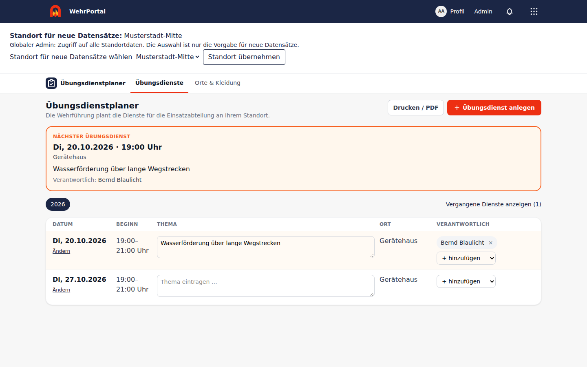

Die **Wehrführung** plant Übungsdienste der **Einsatzabteilung**. Zusätzlich können **Jugendwarte** Dienste der Jugendfeuerwehr und **Kinderwarte** Dienste der Kinderfeuerwehr planen; die jeweiligen Gemeindewarte sind dafür standortübergreifend zuständig. Die Berechtigung kommt aus der Rolle „Wehrführung“ im Feuerwehrmodul Einsatzbericht oder einer passenden Rolle im Übungsdienstplaner – nicht aus einer Vereinsfunktion. Zuerst werden ein oder mehrere zugängliche Standorte gewählt (der Stammstandort ist vorausgewählt), danach die dort passenden Abteilungen. Die Abteilungsnamen enthalten den Standort in Klammern. Lokale Rollen bleiben auf die eigenen Standorte beschränkt; Gemeindewarte und Admins können die jeweils passenden Abteilungen aller Standorte verwalten. Das Modul ist nach der Installation ausgeschaltet und wird nicht automatisch freigeschaltet. Ein Admin aktiviert es unter Admin → Module und weist die passenden Rollen zu.

- **Plan** (`/uebungsdienste`): ganz oben der **nächste Übungsdienst** (Datum, Beginn, Ort, Thema, Verantwortliche), darunter die kommenden Dienste des Jahres mit Datum (mit Wochentag), Beginn, Thema, Ort und Verantwortlichen, nach Jahr umschaltbar. **Vergangene Dienste** sind ausgeblendet; „Vergangene Dienste anzeigen (n)“ blendet sie (abgeschwächt) ein. Auf dem Handy ist jeder Dienst eine Karte (Datum · Beginn · Ort, darunter Thema und Verantwortliche, große Eingabefelder), am PC eine Tabelle. Dienste zeigen außerdem die Zahl der Zu-, Vielleicht- und Absagen aus dem Kalender.
- **Thema** (Freitext) und **Verantwortlich** (Auswahl unter allen aktiven Kameraden, mehrere möglich, mit × entfernen) ändert die Wehrführung direkt im Plan; gespeichert wird sofort. So bleiben getauschte Dienste aktuell. Wer als Verantwortlicher für einen kommenden Dienst eingetragen wird, bekommt eine Mail und den Eintrag in der Glocke mit Datum, Uhrzeit, Ort und Thema (außer man trägt sich selbst ein).
- **Dienst anlegen** (`/uebungsdienste/anlegen`, Knopf oben, Wehrführung und Admins): einzeln oder als **Serie** (erster Dienst, alle x Wochen bis zum letzten Dienst, Beginn und Ende, Treffpunkt aus der Liste der Orte oder frei, Kleidung; höchstens 60 auf einmal). Der eigene Standort ist vorausgewählt. Es können mehrere zugängliche Standorte für gemeinsame Übungen gewählt werden; je Standort wird ausschließlich dessen Abteilung „Einsatzabteilung“ eingeladen. **Ändern** (`/uebungsdienste/{id}/bearbeiten`, Wehrführung und Admins): Datum, Beginn und Treffpunkt, dort auch „Dienst löschen“.
- **Drucken / PDF** (`/uebungsdienste/druck`): der Plan des Jahres als schlichte Tabelle für A4 mit Wehrname und Stand; „Drucken / als PDF speichern“ öffnet den Druckdialog des Browsers, dort „Als PDF speichern“ wählen (am Handy über Teilen → Drucken). Umschaltbar zwischen ganzem Jahr und nur kommenden Diensten.
- **Startseite:** Die Wehrführung mit Modulzugang sieht die Karte „Nächster Übungsdienst“ ihres Standorts mit Datum, Uhrzeit, Thema, Verantwortlichen und Treffpunkt und öffnet damit den Plan. Aktive Kameraden sehen den nächsten Dienst, wenn sie der Einsatzabteilung eines eingeladenen Standorts angehören – mit Datum, Uhrzeit, Treffpunkt und Kleidung, ohne Thema und Verantwortliche.
- **Im Kalender der Kameraden** (wenn „Kalender & Termine“ eingeschaltet ist): Jeder Dienst steht als Termin **„Übungsdienst“** (Art Übung) im Kalender – mit Zeit (Beginn bis Ende, ohne Ende zwei Stunden, ohne Beginn ganztägig), **Treffpunkt** mit Adresse und Navigation, **Kleidung** und nur für die Einsatzabteilung der ausgewählten Standorte. Die Eingeladenen können dort mit **Zusagen** oder **Absagen** antworten; der Plan zeigt die Rückmeldungen als Übersicht. **Thema und Verantwortliche erscheinen dort nie** – auch nicht im Kalender-Abo, auf der Startseite oder in Mails; sie bleiben im Plan der Wehrführung. Ändern oder Löschen des Dienstes ändert bzw. löscht den Termin (wer zu- oder vielleicht zugesagt hat, erfährt eine neue Zeit oder einen neuen Ort); im Kalender steht „Kommt aus dem Übungsdienstplaner“. Dienste, die noch nicht im Kalender sind (z. B. weil der Kalender später eingeschaltet wurde, letzte zwölf Monate und kommende), übernimmt `uebungsdienste:sync-calendar` stündlich; einen im Kalender gelöschten Termin legt er nicht wieder an. Auf der Startseite der Kameraden erscheint der Dienst als „Nächster Termin“, und die im Kalender erfasste Anwesenheit zählt in der Personalverwaltung zur Dienstbeteiligung.
- **Orte & Kleidung** (`/uebungsdienste/orte-kleidung`, Wehrführung und Admins): dieselben Listen wie im Kalender (siehe „Orte & Kleidung“ unter Kalender & Termine).

### Einsatzbericht


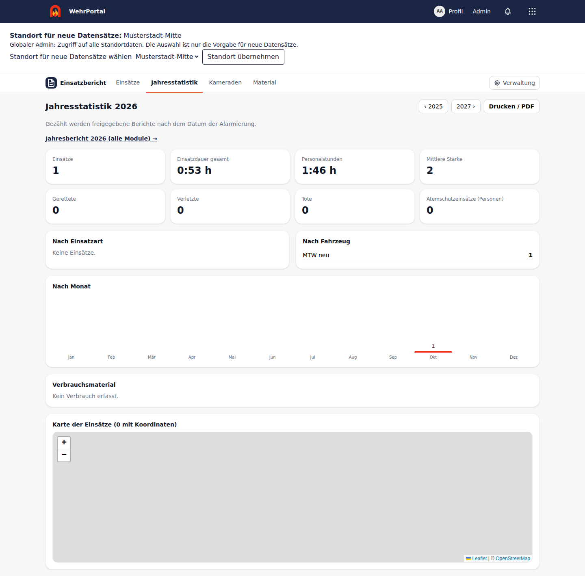

Ersetzt den Papier-Einsatzbericht: Der Einsatzleiter erfasst jeden Einsatz einmal digital, die Wehrführung gibt ihn frei. Aus denselben Daten entstehen die Jahresstatistik und die Einsätze in der Personalakte. Alarmierung und Rückmeldung bleiben in DIVERA 24/7. Das Modul ist nach der Installation ausgeschaltet; ein Admin aktiviert es unter Admin → Module und schaltet über „x Kameraden“ frei. Rollen: **Einsatzleiter** (auch Gruppenführer) legen Einsätze an, bearbeiten und schließen sie ab; **Wehrführung** gibt frei, korrigiert, wertet aus und legt die Pflichtfelder fest (Admins dürfen alles). Bei aktiven Locations gilt die Standardrolle **Wehrführung** nur für Berichte ihrer zugewiesenen Standorte; neue Berichte erhalten den aktuell gewählten zugewiesenen Standort. Unzugeordnete historische Berichte bleiben globalen Rollen vorbehalten. Kameraden ohne Rolle sehen nur ihre eigenen Einsätze. Berichte werden dauerhaft aufbewahrt.

- **Einsätze** (`/einsatzbericht`, Einsatzleiter und Wehrführung): alle Einsätze eines Jahres, neueste zuerst, mit Stichwort, Nummer, Zeit, Adresse, Einsatzart, Stärke, Fahrzeugen und Zustand; Filter nach Jahr und Zustand, Suche nach Stichwort, Adresse und Nummern. „+ Neuer Einsatz“ legt einen **Entwurf** mit der nächsten **laufenden Nummer** des Jahres an (z. B. `2026/007`), Alarmierung = jetzt, Einsatzleiter = wer ihn anlegt. Die Nummer ist im Bericht änderbar (Format `JJJJ/001`), etwa um einen nachträglich erfassten Einsatz in die Reihenfolge einzuordnen; doppelte Nummern werden abgelehnt.
- **Bericht** (`/einsatzbericht/{id}`): die Blöcke des Papierformulars – Kopfdaten (laufende Nummer, Einsatznummer der Leitstelle, Stichwort), Zeiten (Alarmierung, Ausrücken, Eintreffen, Einsatzende, wieder einsatzbereit; Dauer = Alarmierung bis Einsatzende), Einsatzstelle (Adresse, Objekt, Eigentümer oder Betroffene), Einsatzart (Brand klein/mittel/groß, Technische Hilfe, First Responder, Fehlalarm, Sonstiges), Lage und Maßnahmen, Personen und Schäden (Gerettete, Verletzte, Tote, Sach- und Umweltschäden), Beteiligte (Polizei, Rettungsdienst, Nachbarwehren, sonstige Stellen), Abschluss (Übergabe, Brandwache, Einsatzleiter). Auf dem Handy als Karten mit großen Feldern; Die Knöpfe stehen immer unten: Bei einem Entwurf **„Einsatz starten“** (macht ihn zum aktuellen Einsatz) und **„Entwurf speichern“** (bleibt Entwurf), bei einem aktuellen Einsatz „Speichern“; dazu „Abschließen“. Nach dem Speichern erscheint über den Buttons kurz „Entwurf gespeichert.“ bzw. „Gespeichert.“; fehlen noch Pflichtfelder, nennt der Hinweis sie (gelb), und die Seite springt zum ersten leeren Pflichtfeld in Formularreihenfolge und hebt es kurz hervor. Eine ungültige Eingabe (z. B. unvollständige Uhrzeit) wird nicht gespeichert, die Seite springt zu ihr. Scheitert „Abschließen“ an fehlenden Pflichtfeldern, springt die Seite ebenso zum ersten. „Navigation“ öffnet Google Maps mit der Adresse als Ziel (einfacher Link, kein API-Schlüssel nötig).
- **Fahrzeuge und Besatzung:** Fahrzeuge aus den Stammdaten der Fahrzeugbuchung, je Fahrzeug die Zeiten (ausgerückt, an Einsatzstelle, ab Einsatzstelle, wieder im Gerätehaus; anfangs aus Ausrücken und Eintreffen des Einsatzes) und die Besatzung mit Funktion (Einsatzleiter, Zugführer, Gruppenführer, Staffelführer, Maschinist, Melder, Angriffs-, Wasser-, Schlauch-, Sicherheitstrupp, Einsatzkraft) und Atemschutz. Zur Besatzung können nur aktive Mitglieder der **Einsatzabteilung** gewählt werden; bei aktiven Locations müssen sie außerdem dem Standort des Fahrzeugs angehören. Jede Einsatzkraft gehört zu genau einem Fahrzeug oder zur **Bereitschaft** am Gerätehaus; wer schon eingeteilt ist, wechselt. Die **Stärke** steht je Fahrzeug und gesamt im Format Führung/Unterführer/Mannschaft/Gesamt (z. B. 0/1/8/9; Einsatz- und Zugführer zählen als Führung, Gruppen- und Staffelführer als Unterführer); die Bereitschaft zählt als Einsatzteilnahme, nicht zur Stärke.
- **Zustände:** *Entwurf* – angelegt, aber noch nicht gestartet (z. B. vorbereitet oder nachträglich erfasst); Kameraden sehen ihn nicht, es gibt keine Lagemeldungen und keinen QR-Zugang. *Aktuell* – mit „Einsatz starten“ (oder direkt aus DIVERA) ist es der laufende Einsatz; ohne Einsatzende sehen ihn alle unter „Laufende Einsätze“. Einsatzleiter bearbeiten Entwürfe und aktuelle Einsätze. *Abgeschlossen* – der Einsatzleiter bestätigt mit „Abschließen“; dafür müssen die **Pflichtfelder** gefüllt sein (im Bericht mit * markiert), danach ist der Bericht für ihn gesperrt. *Freigegeben* – die Wehrführung prüft und gibt frei. Die Wehrführung kann abgeschlossene und freigegebene Berichte weiter korrigieren oder „Wieder öffnen“ (zurück zu „Aktuell“). Berichte, die vor Einführung des Zustands „Aktuell“ Entwurf waren, wurden beim Update zu „Aktuell“ (das bedeutete „Entwurf“ bis dahin). Jede Änderung steht mit Name und Zeit unter „Änderungen“ am Bericht und in den Logs.
- **Statusliste** (oben in der Liste): Kacheln mit der Zahl der Berichte je Zustand im Jahr – Entwurf, Aktuell, zur Freigabe, Freigegeben; ein Tipp filtert die Liste. Darunter „Noch nicht freigegeben“ je Einsatzart. Nebenberichte sind in der Liste gekennzeichnet, signierte Berichte auch.
- **Geführte Angaben zur Einsatzart:** Mit der Einsatzart fragt der Bericht passende Zusatzangaben ab – **Brand:** Brandobjekt, Ausdehnung, vermutete Brandursache, Rauchwarnmelder, Löschmittel, Wasserentnahme (mit eingeschalteter Wasserkarte werden die nächsten Entnahmestellen zur Einsatzstelle vorgeschlagen); **Technische Hilfe:** Art der Hilfeleistung (Verkehrsunfall, Türöffnung, Tierrettung, Unwetter, Ölspur, Gefahrstoff …), eingeklemmte Personen, beteiligte Fahrzeuge, Gefahrstoff/UN-Nummer; **Fehlalarm:** Art (Brandmeldeanlage, Rauchwarnmelder, gut gemeint, böswillig), Auslöser und Meldergruppe der BMA, „Kostenersatz prüfen“; **First Responder:** Verlauf, AED eingesetzt. Wechselt die Einsatzart, fallen Angaben weg, die nicht mehr passen. Die Jahresstatistik und der Jahresbericht zählen die Auswahlfelder (z. B. Brandursachen, Fehlalarm-Arten), der Druck enthält alle Angaben. Als Pflichtfeld „Angaben zur Einsatzart“ braucht der Abschluss Brandobjekt, Art der Hilfeleistung, Art des Fehlalarms bzw. Verlauf.
- **Unterschrift und Prüfsumme:** Beim Abschließen kann der Einsatzleiter, bei der Freigabe die Wehrführung auf dem Bildschirm unterschreiben (Feld „Unterschrift (optional)“ über den Knöpfen). Die Freigabe speichert eine **Prüfsumme (SHA-256)** über den Inhalt des Berichts (Felder, Fahrzeuge mit Zeiten, Besatzung, Material). Korrigiert die Wehrführung später etwas, zeigen Bericht und Druck „nach der Freigabe geändert“ – sonst „Inhalt seitdem unverändert“; die Änderungen stehen wie immer unter „Änderungen“. Der Druck zeigt beide Unterschriften mit Name und Zeit. „Wieder öffnen“ entfernt Unterschriften und Prüfsumme.
- **Haupt- und Nebenberichte:** Bei großen Einsätzen legt der Einsatzleiter unter „Nebenberichte“ für einen Zug, eine Abteilung oder einen Abschnitt einen eigenen Bericht an (z. B. „Löschzug Nord“). Er übernimmt die Kopfdaten (Stichwort, Zeiten, Adresse, Einsatzart), bekommt die Nummer des Hauptberichts mit Anhang (`2027/014-1`) und eine eigene Besatzung, eigene Fahrzeuge und eigene Lagemeldungen; abgeschlossen und freigegeben wird jeder für sich. Der Hauptbericht zeigt seine Nebenberichte mit Stärke und die **Gesamtstärke**. In der Statistik zählt der Einsatz **einmal**; Personalstunden, Fahrzeuge und Atemschutzeinsätze der Nebenberichte zählen mit, ebenso in Personalakte, Stundennachweis und Atemschutz.
- **Erinnerungen:** `einsatzbericht:remind` läuft täglich um 8 Uhr: Ist ein Einsatz 3 Tage nach der Alarmierung noch Entwurf oder aktuell, bekommt der Einsatzleiter (sonst wer ihn angelegt hat) eine Erinnerung; wartet ein abgeschlossener Bericht seit 7 Tagen auf die Freigabe, die Wehrführung. Jeden Bericht höchstens einmal pro Woche, nur mit Nummer, Stichwort und Datum.
- **Pflichtfelder** (`/admin/einsatzbericht/einstellungen`, Wehrführung): Stichwort, Leitstellennummer, Alarmierung, Eintreffen, Einsatzende, wieder einsatzbereit, Adresse, Einsatzart, Angaben zur Einsatzart, Lage, Maßnahmen, Einsatzleiter, mindestens eine Einsatzkraft. Vorgabe: Stichwort, Alarmierung, Adresse, Einsatzart, Einsatzleiter, mindestens eine Einsatzkraft.
- **Drucken / PDF** (`/einsatzbericht/{id}/druck`): der ganze Bericht als A4-Seite mit Besatzung je Fahrzeug, Stärke und Unterschriftsfeldern; über den Druckdialog des Browsers „Als PDF speichern“.
- **Jahresstatistik** (`/einsatzbericht/statistik`, Wehrführung): Einsätze je Jahr (nach Alarmierung; gezählt werden nur **freigegebene** Berichte, siehe unten), Einsatzdauer, Personalstunden (Dauer × Einsatzkräfte), mittlere Stärke, Gerettete, Verletzte, Tote, Atemschutzeinsätze, nach Einsatzart, nach Fahrzeug und als Balken je Monat; druckbar.
- **Erst die Freigabe zählt:** In Jahresstatistik, Materialverbrauch, Einsatzkarte und Jahresbericht fließen nur freigegebene Berichte ein. Warten noch abgeschlossene Berichte auf die Freigabe, zeigt die Statistik einen Hinweis mit ihrer Zahl und dem Link zur Liste. Unter Einsatzbericht → Einstellungen → „Statistik und Jahresbericht“ kann die Wehrführung das abschalten; dann zählen wie früher auch abgeschlossene Berichte.
- **Jahresbericht** (`/einsatzbericht/jahresbericht?jahr=2027`, Wehrführung, Link in der Jahresstatistik): ein druckbarer Bericht für die Jahreshauptversammlung, den jedes eingeschaltete Modul mit einem eigenen Abschnitt füllt – **Einsätze** (Zahlen, nach Einsatzart, Fahrzeug und Monat), **Mitglieder** (Personalverwaltung: Stand am Jahresende nach Abteilung, Eintritte, Austritte, Beförderungen, Ehrungen, mittlere Dienstbeteiligung), **Dienste und Termine** (Kalender: nach Art, Teilnahmen), **Übungsdienste**, **Aus- und Fortbildung** (Lehrgänge: abgeschlossene und nachgetragene Lehrgänge nach Lehrgang), **Fahrten** (Fahrtenbuch: Fahrten und Kilometer je Fahrzeug), **Atemschutz** (Überwachungen, Trupps, Nachweise), **Geräteprüfungen** (Ausrüstung) und **Löschwasserversorgung** (Wasserkarte). Ausgeschaltete Module und Abschnitte ohne Daten fehlen einfach.
- **Meine Einsätze** (auf dem Profil, `/personalakte`): sobald das Modul freigeschaltet ist. Jeder sieht nur die eigenen: Einsätze gesamt und im laufenden Jahr, Einsatzstunden, davon unter Atemschutz, und die Liste mit Datum, Stichwort, Fahrzeug, Funktion und Dauer – gespeist aus der Besatzung, nichts wird doppelt gepflegt; es zählen nur abgeschlossene und freigegebene Einsätze. Die Wehrführung sieht unter „Kameraden“ (`/einsatzbericht/kameraden`) alle mit ihren Zahlen und Einsätzen. Einsätze aus der Zeit vor der App werden nicht nachgetragen.
- **Startseite:** Einsatzleiter sehen die Zahl aktueller Einsätze und offener Entwürfe, die Wehrführung die Berichte, die auf Freigabe warten.
- **Benachrichtigungen:** Schließt der Einsatzleiter einen Bericht ab, bekommen die für seinen Standort zuständigen Wehrführungen und Admins eine Mail und den Eintrag in der Glocke („Einsatzbericht zur Freigabe“); gibt die Wehrführung ihn zurück, erfährt es, wer ihn abgeschlossen hat. Darin stehen nur Nummer, Stichwort und Datum.
- **Datenschutz:** Den vollen Bericht (mit Daten Dritter) sehen nur Einsatzleiter, Wehrführung und Admins. Kameraden, die in einem Bericht stehen, lassen sich nicht einfach löschen (stattdessen „Ausgetreten“ oder „Löschen mit Übertragung“).
- **DIVERA 24/7 (Webhook):** DIVERA schickt bei jeder Alarmierung die Einsatzdaten an `/webhooks/divera/{schlüssel}`; daraus wird ein **aktueller Einsatz** (kein Entwurf – die Alarmierung ist ja passiert) mit Stichwort, Meldung, Adresse, ggf. Koordinaten und der Eingangszeit als Alarmierung, Herkunft „DIVERA“ (im Bericht oben blau mit der Meldung; Einsatzleiter und Ersteller bleiben leer, im Log „System“). Besatzung, Ausrück- und Endzeiten kommen darüber nicht und bleiben Handeingabe.
  - **Einrichtung** im Admin-Bereich unter Einsatzbericht → Einstellungen (`/admin/einsatzbericht/einstellungen`, Wehrführung; erreichbar über das Zahnrad „Verwaltung“ in der Modulleiste): „Webhook eingeschaltet“, Adresse anzeigen und **kopieren**, **neu erzeugen** (die alte gilt dann nicht mehr). Der lange Zufallsschlüssel in der Adresse ist der Schutz (DIVERA signiert nicht) und wird verschlüsselt gespeichert; eine falsche Adresse gibt 404. In DIVERA (Lizenz ALARM oder PRO): Verwaltung der Einheit → Einstellungen → Schnittstellen → Datenübergabe → Webhooks, POST, JSON, Inhalt „Textinformationen“.
  - **Standort:** Sind Standorte eingeschaltet, wird in den Einstellungen ein fester aktiver Standort für den Webhook ausgewählt. Alarme und Test-Alarme werden diesem Standort zugeordnet; bei mehreren Standorten ohne gültige Auswahl wird der Request als Fehler protokolliert und kein unzugeordneter Einsatz angelegt. Gibt es genau einen aktiven Standort, wird er verwendet, bis die Auswahl gespeichert ist. Ohne Standortfunktion bleibt das bisherige globale Verhalten erhalten. Bereits vorhandene Berichte werden nicht rückwirkend geändert.
  - **Andere Leitstellen- und Alarmierungssysteme:** Der Webhook ist nicht auf DIVERA festgelegt. Jedes System, das bei einer Alarmierung einen HTTP-POST schicken kann, lässt sich über die Feldzuordnung anbinden.
  - **Feldzuordnung** in den Einstellungen statt fest im Code: je Berichtsfeld (Alarm-Kennung, Stichwort, Meldung, Adresse, Breiten-/Längengrad, Kennzeichen Probealarm) die Namen im Request, mehrere mit Komma, verschachtelte mit Punkt (`data.title`); auch unter `data` wird gesucht. Vorgabe: `id`, `title`, `text`, `address`, `lat`, `lng`. Angenommen werden JSON, XML, Formulardaten, Text (landet in der Meldung) und GET mit Parametern.
  - **Rohdaten-Protokoll:** Jeder Request wird unverändert gespeichert (Zeit, Methode, Content-Type, Inhalt, Ergebnis) und nach 90 Tagen gelöscht. Die Einstellungen zeigen die letzten 20 mit Ergebnis (Einsatz angelegt, an bestehenden Einsatz gehängt, gefiltert, Webhook aus, Fehler), Link zum Einsatz und Rohdaten, dazu alle **Felder des letzten Requests** – so lässt sich die Zuordnung am ersten Testalarm ablesen. Bei ausgeschaltetem Webhook wird der Request nur gespeichert.
  - **Test-Alarm** (Einstellungen, ohne DIVERA): Stichwort, Meldung, Adresse und optional Koordinaten eingeben und „Test-Alarm senden“. Der Alarm wird mit den Feldnamen der aktuellen Zuordnung gebaut und läuft durch denselben Ablauf wie ein DIVERA-Request (Rohdaten-Protokoll, Filter, Duplikate, Einsatz, Geocoding); jeder Test-Alarm ist ein eigener Alarm. „Als Probealarm kennzeichnen“ prüft den Filter (kein Einsatz), „Über die öffentliche Adresse senden“ schickt ihn als echten HTTP-Aufruf an die Webhook-Adresse und prüft so auch Erreichbarkeit und Schlüssel. Ohne Probealarm entsteht ein echter Einsatz, der danach gelöscht werden kann. Ob DIVERA dieselben Feldnamen schickt, zeigt erst ein echter Alarm.
  - **Duplikate:** Eine Nachalarmierung mit derselben Alarm-Kennung erzeugt keinen zweiten Einsatz, sondern hängt am bestehenden; ohne Kennung gelten gleiches Stichwort und gleiche Adresse innerhalb von 2 Stunden als derselbe Einsatz.
  - **Filter:** Requests mit dem Kennzeichen Probealarm und solche, deren Stichwort oder Meldung eines der eingestellten Wörter enthält (Vorgabe: Probealarm, Testalarm), erzeugen keinen Einsatz.
  - **Robustheit:** Der Endpunkt antwortet sofort mit 200 und legt den Einsatz erst danach an; höchstens 30 Requests pro Minute je Adresse. Schlägt die Verarbeitung fehl, steht der Fehler im Protokoll, und der Einsatz lässt sich wie immer von Hand anlegen.

- **Adressvorschläge und Geocoding:** Ist unter Admin → Einstellungen → Dienste ein Google-Maps-Schlüssel hinterlegt, schlägt das Adressfeld beim Tippen (ab 3 Zeichen) passende Adressen und Orte vor – **Google Places API (New)**, Autocomplete, nur Deutschland, bevorzugt im Umkreis der bisherigen Einsätze. Ein Tipp auf einen Vorschlag übernimmt die richtig geschriebene Adresse und setzt den Punkt auf der Karte; bei einem Ort (z. B. Schule, Firma) kommt sein Name ins Feld „Objekt“, wenn es leer ist. Der Schlüssel bleibt auf dem Server, der Browser fragt nur die App. In der Google Cloud Console muss dafür die **Places API (New)** aktiviert sein (zusätzlich zur Geocoding API). Wird die Adresse von Hand getippt, ermittelt die App wie bisher die Koordinaten (Geocoding), ebenso beim DIVERA-Einsatz ohne Koordinaten. Ohne Schlüssel ist das Adressfeld ein normales Textfeld; die Navigation funktioniert trotzdem.
- **Lagemeldungen (Einsatztagebuch):** Kurze Situationsberichte mit Text, bis zu 3 Fotos (direkt mit der Handykamera; der Server verkleinert auf 1600 px und speichert WebP in der Datenbank), Zeit und Absender. **Wichtig** markierte stehen oben und sind rot hervorgehoben; markieren kann der Absender beim Senden, umschalten Einsatzleiter und Wehrführung. Solange ein Einsatz **läuft** (aktuell, ohne Einsatzende), sehen alle Kameraden mit Modulzugang ihn unter „Einsätze“ (`/einsatzbericht`) als „Laufende Einsätze“ und schreiben über `/einsatzbericht/{id}/lage` – ohne den vollen Bericht zu sehen; die Seite aktualisiert sich alle 15 Sekunden. Danach sehen und schreiben nur Einsatzleiter und Wehrführung. Eigene Meldungen lassen sich löschen, solange der Einsatz läuft, Einsatzleiter und Wehrführung löschen jede. Die Meldungen stehen am Bericht und mit Fotos im Druck.
- **Verbrauchsmaterial:** Im Bericht Material aus dem **Katalog** wählen und die Menge eintragen (auch mit Komma) oder mit „Nicht im Katalog“ frei eingeben (Bezeichnung, Kategorie, Einheit); Mengen lassen sich ändern. Name, Kategorie und Einheit werden in den Bericht übernommen, eine spätere Katalogänderung ändert alte Berichte nicht. Der **Katalog** (`/einsatzbericht/material`, nur Admins) führt Bezeichnung, Kategorie (Löschmittel, Bindemittel, Sanitätsmaterial, Betriebsstoffe, Sonstiges) und feste Einheit (Liter, Kilogramm, Sack, Stück, Meter); vorbelegt mit gängigem Material. Benutztes Material wird beim Löschen nur deaktiviert. Gezählt wird nur der Verbrauch, kein Bestand. Die **Jahresstatistik** zeigt den Verbrauch je Kategorie und Material mit Zahl der Einsätze; der Druck enthält das Material des Einsatzes.
- **Karte:** Im Bericht zeigt eine Karte (OpenStreetMap über Leaflet, kein Schlüssel im Browser) die Einsatzstelle. Der Punkt kommt aus dem Geocoding oder von DIVERA; wer den Bericht bearbeiten darf, **verschiebt** ihn oder tippt auf die Karte (z. B. Feldweg, Autobahnabschnitt), „Punkt entfernen“ löscht ihn. Die Navigation nutzt dann die Koordinaten. Die Jahresstatistik zeigt eine **Karte aller Einsätze** des Jahres mit Koordinaten.
- **QR-Zugang für externe Wehren:** Bei Großeinsätzen erzeugt der Einsatzleiter (oder die Wehrführung) im Bericht unter „Externe Wehren“ (oder oben mit „QR-Code erzeugen“ neben „Navigation“ und „Drucken / PDF“; danach steht dort „QR-Code“ zum Großanzeigen) einen **QR-Code** für genau diesen Einsatz („QR groß anzeigen“ zum Scannen vom eigenen Bildschirm). Die Handykamera öffnet die Adresse `/extern/{schlüssel}` (40 Zeichen Zufall) direkt, ohne Login. Beim ersten Scan meldet sich die Wehr einmal an (Name der Wehr, Fahrzeug, Stärke z. B. 1/8/9) – erkannt wird das Handy an einem Cookie, ein zweites Handy ist eine eigene Meldung. Danach: **Statusknöpfe** (Auf Anfahrt, An Einsatzstelle, Im Bereitstellungsraum, Einsatzbereit, Abgerückt) und **Lagemeldungen** mit bis zu 3 Fotos aus dem eigenen Abschnitt. Darunter stehen unter „Deine Meldungen“ die eigenen Status und Lagemeldungen in einer Liste mit Uhrzeit, die neuesten oben (Status mit Kennzeichnung „Status“).
  - **Intern:** Die angemeldeten Wehren stehen im Bericht mit letztem Status und Verlauf, ihre Lagemeldungen im Einsatztagebuch als „Extern: Wehr · Fahrzeug · Stärke“; beides auch im Druck.
  - **Grenzen:** Der Code gilt nur, solange der Einsatz läuft (aktuell, ohne Einsatzende), lässt sich sofort **sperren** oder durch einen **neuen Code** ersetzen (der alte gilt dann nicht mehr). Externe sehen nur ihre eigenen Meldungen, keine Personal- und keine Berichtsdaten (kein Stichwort, keine Adresse). Je Handy höchstens 30 Lagemeldungen und 60 Status, 10 pro Minute; je Einsatz höchstens 50 Wehren; die Seite ist nicht für Suchmaschinen. Der Schlüssel wird verschlüsselt gespeichert und nie ins Log geschrieben.

#### Ergänzung durch EinsatzberichtPlus

Mit `EINSATZBERICHT_PLUS_ENABLED` (Standard: an) erscheint im Berichtseditor ein Zusatzbereich. Er wird zusammen mit dem Einsatzbericht geladen und hat keinen eigenen Modulschalter; zum Bearbeiten braucht man dieselben Rechte wie für den Bericht.

- **Kostenpflicht:** Für den gesamten Einsatz lässt sich markieren, dass Kostenersatz zu prüfen ist; Kostenträger und Bemerkung können ergänzt werden. Das Kennzeichen ist nicht auf Fehlalarme beschränkt.
- **Beteiligte Personen:** Personen außerhalb der Besatzung lassen sich strukturiert mit Rolle und Kontakt erfassen, statt sie nur in ein Freitextfeld zu schreiben. Personenbezogene Zusatzangaben werden verschlüsselt gespeichert.
- **Verdienstausfall:** Für Einsatzkräfte der Besatzung können Arbeitgeber, Stunden und Bearbeitungsstand festgehalten werden. Wird ein Kamerad gelöscht, entfallen seine zugehörigen Verdienstausfall-Einträge.
- **Externes Fahrzeug:** Ein Fahrzeug, das nicht in der gemeinsamen Fahrzeugliste steht, kann als Freitext angegeben werden; reguläre Fahrzeuge werden weiterhin wie bisher aus der Liste ausgewählt.
- **Sollbesatzung:** Ist das Modul Fahrzeuge aktiv und im Fahrzeugprofil eine Sollbesatzung hinterlegt, weist der Bericht auf Unter- oder Überbesetzung hin. Das ist ein Hinweis, keine Pflicht und keine Sperre. Ohne Sollbesatzung erscheint kein Hinweis.

Die Zusatzangaben sind derzeit nicht im Berichtsdruck oder in Statistiken enthalten. Sie nutzen eigene Tabellen und ändern keine Core-Tabellen. Weitere technische Hintergründe und Grenzen: [EinsatzberichtPlus](EINSATZBERICHT.md).

### Kalender & Termine

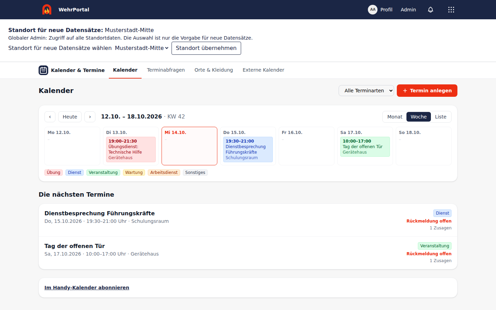

Zentraler Kalender für Übungen, Dienste, Arbeitsdienste, Veranstaltungen und Wartungen. Das Modul ist nach der Installation ausgeschaltet; ein Admin aktiviert es unter Admin → Module und vergibt den Modulzugang. Wer Termine anlegt und externe Kalender einbindet, bekommt die Rolle „Terminverwalter“ (Admins dürfen es immer).

Bei aktiven Locations wählen Terminverwalter für Termine und Terminabfragen ausdrücklich einen oder mehrere Standorte; der aktuelle Standort ist vorausgewählt. Abteilungen, Funktionen und einzelne Kameraden werden passend dazu gefiltert, und Rückmeldungen sowie Benachrichtigungen gelten nur für Mitglieder dieser Standorte. Die globale Rolle „Terminverwalter“ und Admins können alle aktiven Standorte verwalten; die standortgebundene Wehrführung nur die ihr zugewiesenen Standorte.

- **Gemeinsame Übungen:** Im Feld **„Gemeinsam mit“** stehen die beteiligten Wehren oder Organisationen (z. B. „FF Nachbarstadt, THW Ortsverband“); es erscheint am Termin, in der Mail zum neuen Termin, im Kalender-Abo und in Vorlagen.
- **Kalender** (`/kalender`): drei Ansichten – **Monat** (Montag bis Sonntag, mehrtägige Termine an jedem Tag, heute markiert), **Woche** (sieben Tage mit Uhrzeit und Ort, auf dem Handy untereinander, mit Kalenderwoche) und **Liste** (alle Termine des Monats nach Tagen, mit eigener Rückmeldung). Mit ‹ › blättert man monats- bzw. wochenweise, „Heute“ springt zurück. Welche Ansicht beim Öffnen kommt, bestimmt die Profileinstellung „Standardansicht in den Kalendern“, dieselbe wie bei der Fahrzeugbuchung. Unter Monat und Woche stehen die Termine der nächsten 60 Tage mit der eigenen Rückmeldung. Filter nach Terminart: Übung, Dienst, Arbeitsdienst, Veranstaltung, Wartung, Sonstiges. Abgesagte Termine bleiben durchgestrichen sichtbar.
- **Sichtbarkeit:** Ein Termin gilt für alle Kameraden mit Kalender-Zugang oder nur für ausgewählte Abteilungen, **Funktionen** (eine Funktion schließt ihre Unterfunktionen ein, z. B. „Maschinist“ auch „Maschinist HLF“) und/oder einzeln eingeladene Kameraden (z. B. der Jugendwart aus der Einsatzabteilung beim JF-Ausflug, oder nur die Führung bei einer Besprechung); Terminverwalter sehen alles.
- **Termin anlegen:** Titel, Art, Beginn und Ende mit dem Datums- und Zeitwähler des Browsers wie bei der Fahrzeugbuchung (ein neuer Termin dauert 60 Minuten; wird der Beginn verschoben, wandert das Ende mit) oder ganztägig, auch über mehrere Tage, Ort, Beschreibung, Zielgruppe. Optional **Wiederholung** jede Woche, alle 2 Wochen oder jeden Monat bis zu einem Datum (höchstens 104 Termine; 19 Uhr bleibt auch nach der Zeitumstellung 19 Uhr; der 31. wird in kürzeren Monaten zum letzten Tag). Optional eine Mail an die Zielgruppe.
- **Ort und Kleidung:** Der Ort kommt aus der Liste **„Orte“** (Name und Adresse; der Termin zeigt dann die Adresse und einen Link **„Navigation“** zu Google Maps) oder wird frei eingegeben – ein freier Ort, der genau wie ein gespeicherter heißt, bekommt Adresse und Navigation auch. Dazu lässt sich die geforderte **Kleidung** ankreuzen (mehrere möglich, z. B. Einsatzkleidung, Dienstuniform). Beides steht beim Termin, auf der Karte „Nächster Termin“, in der Mail zum neuen Termin und im Kalender-Abo (Adresse als Ort, Kleidung in der Beschreibung).
- **Orte & Kleidung** (`/kalender/orte-kleidung`, Terminverwalter): Orte mit Adresse und Kleidung anlegen, ändern, sortieren und löschen. Die Listen gehören nicht einem Modul, sondern allen: Der Übungsdienstplaner pflegt dieselben (unter Übungsdienstplaner → „Orte & Kleidung“), was in einem Modul hinzukommt, steht im anderen sofort zur Auswahl. Ein gelöschter Ort bleibt bei Terminen als Name stehen. Auch die Ort-Felder im Schichtplan und bei Terminabfragen schlagen die gespeicherten Orte vor; der Schichtplan zeigt bei einem gespeicherten Ort die Adresse und „Navigation“.
- **Termine aus anderen Modulen:** Termine aus dem Übungsdienstplaner und vom Schichtplan angelegte Termine tragen den Hinweis, wo sie gepflegt werden; Änderungen dort werden übernommen.
- **Termin-Vorlagen:** Für regelmäßige Termine (z. B. „Arbeitsdienst Samstag 9–12 Uhr“) speichert „Als Vorlage speichern“ Titel, Art, Uhrzeit, Dauer, Ort, Beschreibung, Rückmeldung mit Frist (als Tage vor dem Termin), Mindestbesetzung und Zielgruppe. Beim Anlegen füllt „Vorlage übernehmen“ das Formular für das gewählte Datum; Vorlagen gelten für alle Terminverwalter.
- **Terminabfrage** (`/kalender/abfragen`): Terminverwalter schlagen 2 bis 30 Termine vor (Doodle-Prinzip), mit Art, Ort, Zielgruppe wie beim Termin und optionaler Antwortfrist; die Zielgruppe bekommt eine Mail. Jeder kreuzt pro Vorschlag „Ja“, „Wenn nötig“ oder „Nein“ an und kann bis zum Abschluss ändern; alle sehen die Antworten, der beste Termin (Ja zählt doppelt, „Wenn nötig“ einfach) ist hervorgehoben. „Festlegen“ legt daraus den Kalendertermin mit derselben Zielgruppe an, übernimmt Ja und „Wenn nötig“ als Zu- bzw. Vielleicht-Rückmeldung und benachrichtigt die Zielgruppe; danach ist die Abfrage geschlossen. Abfragen lassen sich auch ohne Termin schließen, wieder öffnen oder löschen. Wer noch nicht geantwortet hat, wird zwei Tage vor der Frist einmal erinnert. Offene, unbeantwortete Abfragen stehen auf der Startseite.
- **Rückmeldung:** Für Termine mit „Rückmeldung erwünscht“ sagen Kameraden der Zielgruppe zu, ab oder „vielleicht“, mit Kommentar, bis zur optionalen Frist (bei Terminreihen mit gleichem Abstand je Termin). Alle sehen, wer zu-, ab- oder vielleicht zugesagt hat; Terminverwalter sehen zusätzlich, wer noch nicht geantwortet hat. Optional lässt sich eine **Mindestbesetzung** angeben; Termin und Liste zeigen dann, wie viele Zusagen noch fehlen. Wer nicht geantwortet hat, bekommt **einmal eine Erinnerung** per Mail – zwei Tage vor der Frist, ohne Frist drei Tage vor dem Termin (`kalender:remind-responses`, stündlich).
- **Teilnehmer verwalten:** Auf der Terminseite sehen Terminverwalter alle Eingeladenen, tragen Rückmeldungen für andere ein (etwa nach einem Anruf, auch nach der Frist) und erfassen ab Beginn die **Anwesenheit**, auch für Kameraden, die nicht eingeladen waren. Die Liste mit Abteilungen, Rückmeldung, Kommentar und Anwesenheit gibt es als CSV und als **Druckansicht** (A4, mit Spalte für die Unterschrift).
- **Bearbeiten, absagen, löschen:** Bei Terminreihen lassen sich Titel, Art, Ort, Beschreibung, Rückmeldung und Zielgruppe auf die folgenden Termine übertragen; die Zeiten gelten nur für den einen Termin. Absagen schickt allen, die zu- oder vielleicht zugesagt haben, eine Mail; „Doch stattfinden lassen“ macht es rückgängig und sagt es ihnen ebenfalls. Ändern sich Zeit oder Ort eines kommenden Termins, bekommen alle, die zu- oder vielleicht zugesagt haben, eine Mail mit neuem und bisherigem Stand; mit „Änderung an alle der Zielgruppe per E-Mail schicken“ geht jede Änderung an die ganze Zielgruppe. Löschen geht für einen Termin oder mit allen Folgeterminen.
- **Externe Kalender** (`/kalender/externe-kalender`): Kalender anderer Stellen (Kreisfeuerwehrverband, Gemeinde, Schulferien …) per iCal-Adresse (`https://` oder `webcal://`) einbinden. Die Termine erscheinen für alle mit der gewählten Terminart, sind nur lesbar und werden stündlich aktualisiert (`kalender:sync-sources`) sowie auf Knopfdruck. Was aus dem Kalender verschwindet, verschwindet auch hier; Fehler beim Abruf stehen an der Quelle. Wiederholungen werden mit Häufigkeit, Intervall, Anzahl, Enddatum, Ausnahmen und verschobenen Einzelterminen aufgelöst; feinere Regeln (z. B. „jeder zweite Dienstag im Monat“) nicht.
- **Auf der Website einbinden:** Termine mit dem Häkchen „Öffentlich“ (z. B. Tag der offenen Tür) erscheinen ohne Login unter `/kalender/oeffentlich` als schlichte Liste zum Einbetten per `<iframe>` und unter `/kalender/oeffentlich.ics` als Abo – nur Titel, Zeit, Ort und Beschreibung, nie Namen oder Rückmeldungen, keine abgesagten Termine. Den fertigen HTML-Code gibt es unter „Externe Kalender & Einbindung“.
- **Kalender-Abo:** Unter „Im Handy-Kalender abonnieren“ steht eine persönliche Adresse für Google, Apple oder Outlook mit allen Terminen, die für den Kameraden bestimmt sind (90 Tage zurück, ein Jahr voraus). Die Adresse ersetzt das Login; „Neue Adresse erzeugen“ macht die alte ungültig.
- **Schichtplan zum Termin:** Ist der Schichtplan eingeschaltet, zeigt ein Termin seine Schichtpläne mit „Helfer eintragen“; Planer legen dort mit „Schichtplan anlegen“ einen Plan mit den Daten des Termins an. Veröffentlichte Schichtpläne erscheinen von selbst im Kalender (siehe Schichtplan).
- **Erziehungsberechtigte:** Hat ein Kamerad Erziehungsberechtigte eingetragen (siehe Startseite und Navigation), bekommen sie dieselben Termin-Mails mit einem Link, über den sie für das Kind zu- oder absagen – ohne eigenes Konto. Terminverwalter sehen die Rückmeldung in der Teilnehmerliste mit „(Rückmeldung von …)“.
- **Startseite:** Die Karte „Nächster Termin“ (nur Termine der eigenen Zielgruppe, auch Übungsdienste) zeigt den nächsten Termin mit Ort, Navigation, Kleidung, der eigenen Rückmeldung oder dem Hinweis „Bitte Rückmeldung geben“. Sie steht bei **jedem aktiven Kameraden**, auch ohne Zugang zum Kalender – dann ohne Link und ohne Rückmeldung.

### Bestand


Alles, was die Wehr hat, an einem Ort (`/bestand`, im Menü der Ausrüstung und in der Fahrzeugübersicht verlinkt) – über die Module hinweg, ohne doppelte Listen: **Fahrzeuge** (Fahrzeugverwaltung), **Geräte** (Ausrüstungsverwaltung), **Kleiderkammer**, **Schlüssel** und die Objekte des **Mängelmanagements**. Jeder sieht nur, was er im jeweiligen Modul sehen darf (Kleidung nur Kleiderwarte, Schlüssel nur Schlüsselwarte); ausgeschaltete Module fehlen.

- **Suchen & Scannen:** ein Feld für Name, Inventarnummer, Seriennummer, Kennzeichen, Funkrufname, FIN, Code. Die Treffer stehen nach Modul mit Ort und Zustand (einsatzbereit, ausgeliehen, defekt, Prüfung überfällig, offene Mängel …). Barcode- und RFID-Lesegeräte tippen den Code in das Feld; ein Code, den ein Modul kennt, öffnet das Objekt direkt (wie der Scan `/i/{code}`, aber ohne dass die Kleiderkammer unbekannte Codes als neues Teil anbietet). Am Android-Handy liest **„NFC-Tag lesen“** die Kennung eines NFC-Tags.
- **Ersatzbeschaffung** (Gerätewarte und Fahrzeugwarte): was in den nächsten 3 bis 20 Jahren ersetzt werden muss, nach Jahr mit Summe – Geräte, deren **Lebensdauer** endet (geschätzt mit dem Kaufpreis), und Fahrzeuge mit **geplanter Ersatzbeschaffung** (Jahr und geschätzte Kosten in den Stammdaten des Fahrzeugs); schon Fälliges steht oben. Druckbar, als Grundlage für Haushalt und Investitionsplanung.

### Ausrüstungsverwaltung

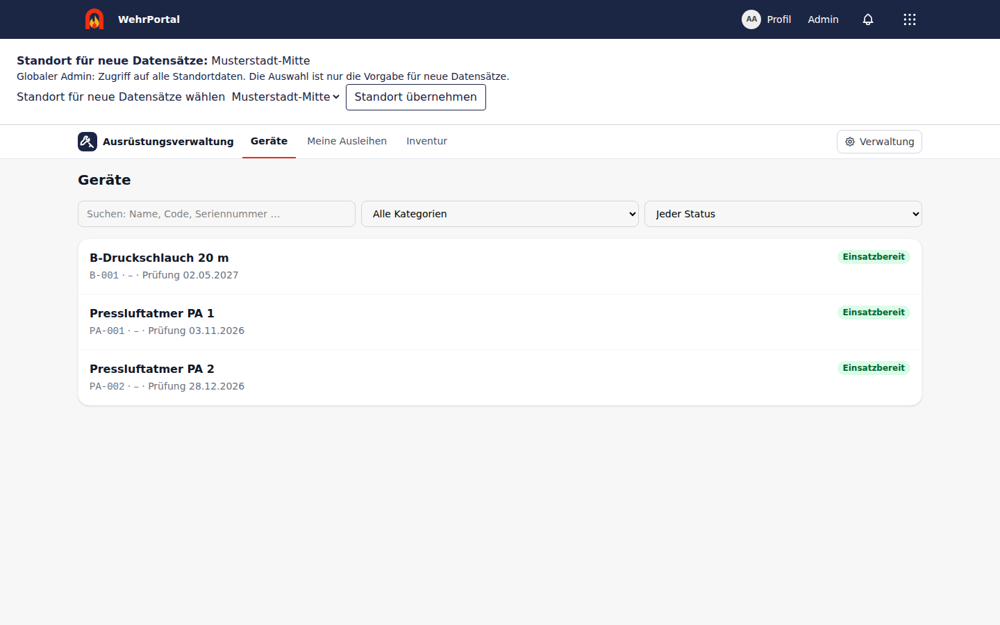

Das gesamte Material der Wehr: Geräte mit Standort, Prüffristen, Lebensdauer und Verfügbarkeit, interne Ausleihe, Schäden, Hersteller-Rückrufe und Beladeplan. Das Modul ist nach der Installation ausgeschaltet; ein Admin aktiviert es unter Admin → Module und vergibt den Modulzugang und die Rolle „Gerätewart“.

#### Für alle Kameraden (`/ausruestung`)

- **Meine Ausleihen:** was man gerade hat und bis wann (überfällige rot), dazu eigene Reservierungen zum Stornieren.
- **Geräte:** alle Geräte im Dienst mit Status, organisatorischem Standort, Lagerort/Fahrzeug und nächster Prüfung; Suche nach Name, Code, Seriennummer, Hersteller, Modell; Filter nach Kategorie und Status. Hinweise „Prüfung überfällig“ und „Lebensdauer abgelaufen“ stehen am Gerät.
- **Geräteseite:** Daten, Verlauf, wer es gerade hat oder reserviert hat, wann es zuletzt bei einer Inventur gesehen wurde. Hier meldet man einen **Schaden** (das Gerät wird sofort als defekt gekennzeichnet, die Gerätewarte bekommen eine Mail), **reserviert** es für einen Zeitraum oder trägt einen **Einsatz** oder eine **Übung** ein (Einsatzhistorie).
- **QR-Code, Barcode, RFID/NFC:** Der Scan des Etiketts (`/i/AR-0001`), des Hersteller-Barcodes oder des **RFID-/NFC-Tags** öffnet die Geräteseite, für Gerätewarte direkt die Verwaltung. Tags eignen sich für Geräte ohne Platz für ein Etikett; ihre Kennung wird ohne Trennzeichen in Großbuchstaben gespeichert (`04:a2:3b` = `04A23B`).
- **Geräteinfo ohne Login** (zuschaltbar): Für den schnellen Blick direkt am Fahrzeug oder Gerät schalten Gerätewarte unter `/admin/ausruestung/geraeteinfo` („Geräteinfo per QR-Code“) ein, dass ein Scan **ohne Anmeldung** eine kurze Seite zeigt (`/geraeteinfo/{code}`): Name, Code, Kategorie, ob das Gerät einsatzbereit ist (sonst defekt, gesperrt, in Reparatur …) mit Hinweisen wie „Prüfung überfällig“, die nächste Prüfung und wohin es gehört (Standort, Fahrzeug, Geräteraum). Seriennummer, Kaufdaten, Ausleihen, Schäden und Namen erscheinen dort nicht; die Seite ist für Suchmaschinen gesperrt. Angemeldete kommen wie bisher zur Geräteseite. Standard: aus – dann führt der Scan ohne Login zur Anmeldung.

#### Für Gerätewarte (`/admin/ausruestung`)

- **Übersicht:** Geräte im Bestand und einsatzbereit, Prüfungen in 30 Tagen und überfällig, abgelaufene Lebensdauer, gesperrte Geräte und offene Schäden, überfällige Ausleihen.
- **Geräte:** Code (automatisch `AR-0001` …, oder eigener), Kategorie, Hersteller, Modell, Seriennummer, Charge, Hersteller-Barcode, Herstellungs-, Inbetriebnahme- und Kaufdatum, Kaufpreis, organisatorischer Standort sowie Lagerort/Fahrzeug und Geräteraum. Der organisatorische Standort lässt sich getrennt vom physischen Lagerort in der Gerätedatei wechseln; Sammelaktionen bieten beide Änderungen separat. Lebensdauer und Prüfintervall kommen aus der Kategorie, jedes Gerät kann eigene Werte haben. Filter nach Kategorie, Standort, Lagerort, Status, „Prüfung in 30 Tagen fällig“ und „Lebensdauer abgelaufen“. Auf der Geräteseite stehen Verlauf, Prüfungen, Ausleihe, Schäden und Rückrufe.
- **RFID-/NFC-Tag zuordnen:** im Gerät unter „RFID-/NFC-Tag“ (Verwaltung) oder auf der Geräteseite: Kennung eintippen, mit einem RFID-Lesegerät einlesen oder am Android-Handy mit Chrome **„Per NFC anlernen“** und den Tag ans Handy halten. Ein Tag gehört zu genau einem Gerät.
- **Reinigung & Wartung:** Gerätewarte tragen auf der Geräteseite Reinigungen und Wartungen mit Datum, Notiz und Kosten in den Verlauf ein. Die Geräteseite zeigt ihnen die **Kosten über die Lebensdauer** (Kauf + Reparaturen + Reinigung/Wartung).
- **Inventur** (`/ausruestung/inventur`, Gerätewarte): Raum oder Fahrzeug wählen, dann alles erfassen, was da ist – Barcode- oder RFID-Lesegerät (tippt in das Feld), **NFC am Handy** („NFC-Tags lesen“, dann Tag für Tag ans Handy halten), eintippen oder abhaken. Live sichtbar: x von y gefunden, Ausgeliehenes (zählt nicht als fehlend), **woanders gebuchte** Geräte (werden beim Abschließen auf Wunsch hierher umgebucht) und unbekannte Codes. „Inventur abschließen“ speichert das Ergebnis (gefunden, fehlend, umgebucht, unbekannt), vermerkt bei jedem Gerät „vorhanden“ bzw. „nicht gefunden“ im Verlauf und setzt „zuletzt gesehen“. Die Inventur übernimmt den Standort des ausgewählten Lagerorts; lokale Gerätewarte sehen nur Inventuren ihrer Standorte. Historische Inventuren ohne Standort bleiben globalen Admins vorbehalten.
- **Prüfungen:** Eine bestandene Prüfung setzt die nächste Frist aus dem Intervall. Eine nicht bestandene sperrt das Gerät und legt einen Schaden an.
- **Lebensdauer:** gezählt ab Herstellungsdatum (ohne Datum ab Inbetriebnahme). Die Kategorien bringen Vorschlagswerte für Helme, Atemschutz, Druckluftflaschen, Leinen, Gurte, Leitern, Rettungsgeräte, CSA und elektrische Geräte mit (unter „Kategorien & Fristen“, mit Grundlage). Es sind Startwerte; sie müssen mit den Herstellerangaben und den geltenden DGUV-Regeln abgeglichen werden.
- **Ausleihe:** sofort ausleihen („Ausleihen“ am Gerät) oder reservieren; eine Reservierung wird beim Abholen „ausgegeben“. Überschneidende Zeiträume werden abgelehnt (halb offen wie bei Fahrzeugbuchungen). Defekte, gesperrte, ausgesonderte Geräte und Geräte mit überfälliger Prüfung oder abgelaufener Lebensdauer werden nicht ausgegeben. Bei der Rücknahme lässt sich ein Schaden gleich mit erfassen.
- **Schäden & Reparatur:** gemeldet → in Reparatur → repariert (mit Notiz und Kosten) oder ausgesondert. Erst wenn der letzte offene Schaden erledigt ist, ist das Gerät wieder einsatzbereit.
- **Rückrufe:** Globale Gerätewarte erfassen Rückrufmeldungen der Hersteller (Hersteller, optional Modell, Seriennummernbereich, Charge, Produktionszeitraum). Alle passenden Geräte werden sofort gefunden und **gesperrt**, auch Geräte, die später erfasst oder geändert werden; die jeweils zuständigen Gerätewarte erhalten nur die Treffer ihres Standorts per E-Mail. Lokale Gerätewarte sehen in der Rückrufverwaltung nur die eigenen Treffer und können diese mit Vermerk erledigen; der ursprüngliche Status wird wiederhergestellt, sofern kein anderer Rückruf das Gerät sperrt. Nur globale Gerätewarte dürfen Rückrufdefinitionen anwenden oder schließen; das Schließen gibt alle betroffenen Geräte frei. Seriennummern werden als Zahl verglichen, wenn sie Zahlen sind, sonst in natürlicher Reihenfolge. Rückrufe aus externen Quellen werden nicht automatisch abgerufen, sie werden von Hand erfasst.
- **Standorte & Fahrzeuge:** Räume, Lager und Fahrzeuge mit organisatorischem Standort sowie ihren Geräteräumen (G1, G2, Dach …) und der **Soll-Beladung** je Geräteraum (Kategorie und Anzahl). Gerätewarte sehen nur die Lagerorte ihrer Standorte; Geräte können nur einem Lagerort desselben Standorts zugewiesen werden. Globale Admins sehen auch historische Lagerorte ohne Zuordnung und können sie einem Standort zuweisen. Ein Lagerort kann erst den Standort wechseln, wenn alle dort eingelagerten Geräte einzeln umgezogen wurden.
- **Beladeplan:** Soll-/Ist-Vergleich je Fahrzeug und Geräteraum: Soll, Ist, davon einsatzbereit, fehlend oder zu viel, mit Grund bei nicht einsatzbereiten Geräten; dazu Geräte, die nicht im Plan stehen oder keinem Geräteraum zugeordnet sind. Ausgeliehene Geräte zählen nicht als an Bord. Lokale Gerätewarte sehen nur die Lagerorte und Geräteraumpläne ihrer verwalteten Standorte; globale Admins sehen alle.
- **Inventur-Export:** CSV (Excel-tauglich, Semikolon, UTF-8) mit allen Geräten, die die aktuellen Filter treffen, inkl. Kaufdatum, Kaufpreis, Lebensdauer und nächster Prüfung – für Inventur und Versicherung.
- **Erinnerungen:** `ausruestung:send-reminders` läuft täglich um 7 Uhr. Die Gerätewarte (ohne Gerätewart die Admins) bekommen eine Übersicht: Prüfungen in den nächsten 30 Tagen oder überfällig, Lebensdauer endet in 90 Tagen oder ist abgelaufen, gesperrte Geräte, offene Schäden, überfällige Ausleihen – nur wenn etwas ansteht, und höchstens einmal am Tag. Wer ein Gerät nach der Frist noch hat, bekommt einmal eine Erinnerung.
- Kameraden mit Ausleihen lassen sich nicht einfach löschen; setze sie auf „Ausgetreten“ oder nutze „Löschen mit Übertragung“.

### Budget & Finanzen

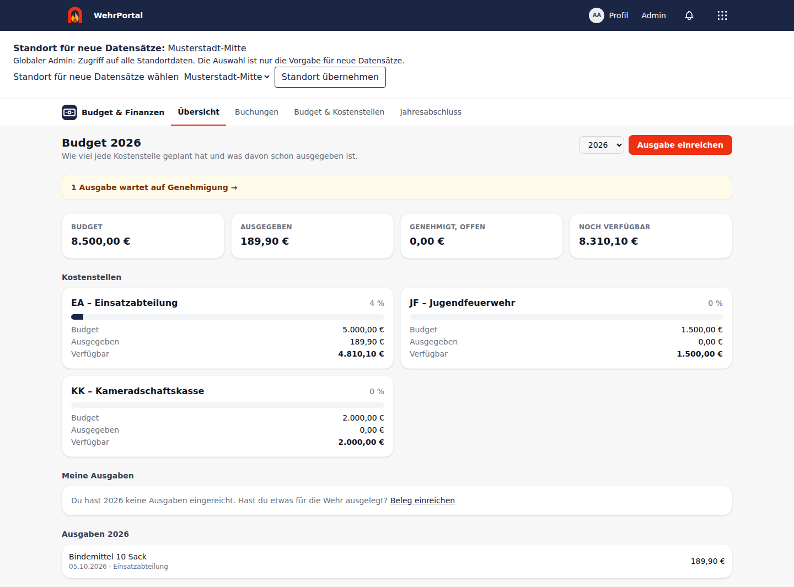

Finanzverwaltung der Wehr: Budgets je Standort, Kostenstelle und Jahr planen, Ausgaben mit Beleg einreichen und genehmigen, Einnahmen buchen, Jahresabschluss und Export für Steuerberater und Behörden. Das Modul ist nach der Installation ausgeschaltet; ein Admin aktiviert es unter Admin → Module und schaltet über „x Kameraden“ frei (oder „automatisch freischalten“ für alle). Rollen: **Kassenwart** (Kostenstellen, Budgets aller Standorte, direkt buchen, bezahlen, Jahresabschluss) und **Wehrführung** (am zugewiesenen Standort genehmigen, dessen Buchungen und Budget verwalten); Admins dürfen alles. Neue Buchungen erhalten den Stammstandort des einreichenden Kameraden; der Kassenwart kann den Standort auswählen oder ändern. Alle anderen mit Zugang reichen eigene Ausgaben ein und sehen nur diese mit ihrem Bearbeitungsstand; die Übersicht ist auf den ausgewählten Standort begrenzt, sofern sie nicht ausdrücklich für alle Kameraden freigegeben ist. Der Jahresabschluss bleibt standortübergreifend und konsolidiert. Beträge werden in Cent gespeichert und deutsch geschrieben („1.234,56“).

- **Einstellungen** (unten auf „Budget & Kostenstellen“, Kassenwart und Admins): was die Wehr nutzt.
  - **Budget** (Standard an): aus, gibt es keine Budgets und kein „verfügbar“ – die Seite heißt dann „Kostenstellen & Einstellungen“, Übersicht, Jahresabschluss und Druck zeigen nur das Ist. Gespeicherte Budgets bleiben und sind beim Wiedereinschalten zurück.
  - **Jahresabschluss** (Standard an): aus, verschwindet die Seite „Jahresabschluss“ (mit Druck und „Jahr abschließen“); der CSV- und Beleg-Export steht dann oben unter „Buchungen“. Schon abgeschlossene Jahre bleiben gesperrt.
  - **Übersicht für alle Kameraden** (Standard aus): an, sehen alle Kameraden den Stand je Kostenstelle und alle genehmigten und bezahlten Ausgaben (ohne Belege und Namen), standortübergreifend.
  - Einreichen, Genehmigen, Bezahlen und die Buchungsliste funktionieren in jeder Kombination; wer nur die eingereichten Rechnungen braucht, schaltet Budget und Jahresabschluss aus.
- **Übersicht** (`/finanzen`): Kameraden sehen hier **Meine Ausgaben {Jahr}** – ihre eingereichten Ausgaben mit Status (eingereicht, genehmigt, abgelehnt, bezahlt), sonst nichts; der Reiter heißt für sie „Meine Ausgaben“. Kassenwart, Admins und Wehrführung sehen die Übersicht für alle Standorte beziehungsweise ihre zugewiesenen Standorte. Standort, Kostenstellenbudget, Ausgegeben (bezahlt), Genehmigt-offen und Verfügbar mit Balken (rot, wenn überzogen) sowie Einnahmen sind nach Standort filterbar; oben stehen die Summen der Auswahl. Ohne Budget stehen nur Ausgegeben, Genehmigt-offen und Einnahmen da. Darunter **Meine Ausgaben** mit Status und **Ausgaben {Jahr}**: genehmigte und bezahlte Ausgaben mit Bezeichnung, Datum und Kostenstelle – ohne Belege und ohne Namen. Nach Jahr und Standort umschaltbar.
- **Ausgabe einreichen** (`/finanzen/einreichen`): Standort (beim Mitglied der Stammstandort), Wofür, Betrag, Datum des Belegs, Kostenstelle, Händler und Bemerkung (optional), dazu mindestens ein **Beleg** – Foto direkt mit der Handykamera (wird auf 2000 px verkleinert und als WebP gespeichert) oder PDF bis 10 MB, höchstens 5 je Buchung. Der Kassenwart kann den Standort festlegen oder ändern. Belege liegen in der Datenbank (`fin_receipts`) und sind nur für den Einreicher, den Kassenwart, die für diesen Standort zuständige Wehrführung und Admins abrufbar. Jede Buchung bekommt eine laufende **Belegnummer** je Jahr (`2027-001`).
- **Genehmigung:** Kassenwart und die Wehrführung des Buchungsstandorts bekommen eine Mail und den Eintrag in der Glocke, die Startseite zeigt „x Ausgaben zu genehmigen“. In der Buchung (`/finanzen/buchung/{id}`) „Genehmigen“ (Kommentar optional) oder „Ablehnen“ (Kommentar Pflicht); die eigene Ausgabe genehmigt immer jemand anderes (außer Admins). Gilt die erste von zwei gleichzeitigen Entscheidungen. Danach trägt der Kassenwart „Als bezahlt“ ein, mit Zahlungshinweis (z. B. Überweisung). Der Kamerad bekommt bei Genehmigung, Ablehnung und Zahlung eine Mail. Bis zur Entscheidung kann er die Ausgabe ändern oder zurückziehen; danach ändert nur der Kassenwart. Jede Änderung steht unter „Änderungen“ und in den Logs.
- **Budget planen** (`/finanzen/budget`): Kassenwart und Admins wählen einen Standort und planen dort den Betrag je Kostenstelle und Jahr; die Wehrführung verwaltet nur Budgets ihrer zugewiesenen Standorte. „Budgets aus {Vorjahr} übernehmen“ übernimmt nur die Budgets dieses Standorts. Kostenstellen sind ein gemeinsamer Katalog (Nr., Name, Beschreibung, aktiv) und werden vom Kassenwart verwaltet; benutzte Kostenstellen lassen sich nur ausschalten, nicht löschen. Ausgeschaltete sind nicht mehr wählbar, alte Buchungen behalten sie.
- **Buchungen** (`/finanzen/buchungen`, Kassenwart, Wehrführung und Admins): Buchungen mit Filtern (Standort, Jahr, Status, Art, Kostenstelle, Suche); die Wehrführung sieht nur ihre Standorte, der Kassenwart alle. „Zu genehmigen“ zählt alle Jahre im jeweiligen Geltungsbereich. **Buchung erfassen** (`/finanzen/buchen`, Kassenwart): Einnahmen (z. B. Spenden, Zuschüsse) und bereits bezahlte Ausgaben ohne Genehmigung.
- **Jahresabschluss** (`/finanzen/jahresabschluss`, Kassenwart und Admins): Budget und Ist über alle Standorte je Kostenstelle mit Summen und Saldo; **Drucken / PDF** (A4 mit Buchungsliste und Unterschriftszeilen für Kassenwart, Kassenprüfer und Wehrführung), **Buchungen als CSV** (Excel: Semikolon, Dezimalkomma, UTF-8; Belegnummer, Datum, Art, Kostenstelle, Standort, Bezeichnung, Händler, Betrag, Status, Genehmigt von/am, Bezahlt am) und **Belege als ZIP** (Dateien nach Belegnummer benannt, CSV dabei). Exportiert werden genehmigte und bezahlte Buchungen. „Jahr abschließen“ geht erst, wenn keine Ausgabe des Jahres mehr offen ist; der Abschluss sperrt Buchungen und Budgets aller Standorte. Wieder öffnen können nur Admins.

Vorhandene Budgets und Buchungen ohne Standort bleiben als **Altbestand ohne Standort** erhalten und werden nicht anhand des heutigen Mitgliedsstandorts zugeordnet. Kassenwart und Admins sehen diese Buchungen in der standortübergreifenden Liste und im Jahresabschluss; sie können sie beim Bearbeiten einem aktiven Standort zuordnen. Budgets ohne Standort sind im Budgetplan als Altbestand sichtbar und können dort angepasst werden; neue Budgets und Buchungen benötigen einen aktiven Standort. Die Wehrführung eines Standorts sieht keine unzugeordneten Altbuchungen.

### Verbandbuch & Vorfälle

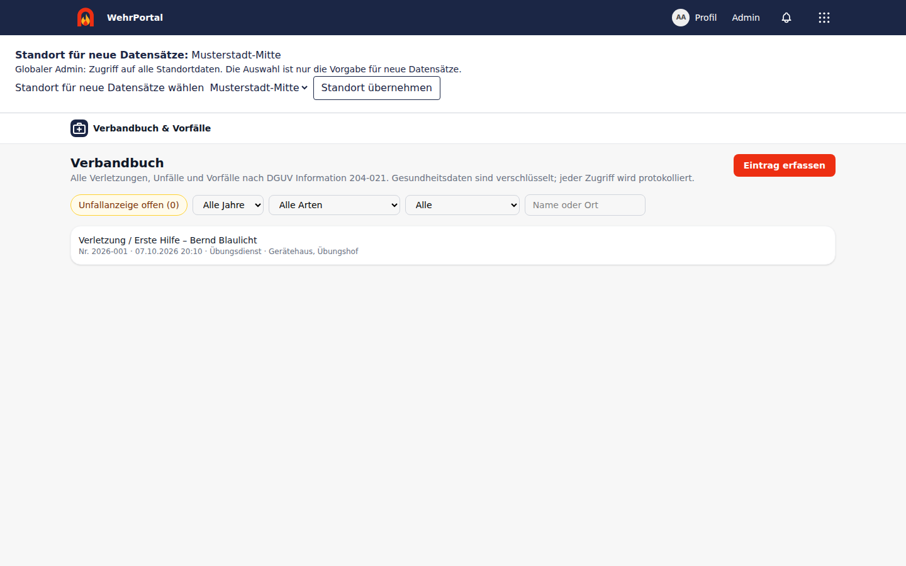

Verbandbuch nach DGUV rechtssicher digital führen – Verletzungen und Vorfälle mit Unterschrift dokumentieren. Jede Verletzung im Dienst gehört ins Verbandbuch, auch die kleine: Treten später Beschwerden auf, belegt der Eintrag den Unfall gegenüber der Unfallkasse. Die Einträge enthalten alle Angaben der DGUV Information 204-021 („Dokumentation der Erste-Hilfe-Leistungen“). Das Modul ist nach der Installation ausgeschaltet; ein Admin aktiviert es unter Admin → Module und schaltet es frei (sinnvoll: „automatisch freischalten“, damit jeder Kamerad einen Eintrag schreiben kann). Neue Einträge werden einem aktiven Standort zugeordnet. Die zuständige Wehrführung verwaltet ausschließlich diesen Standort; GBI/SBI und Admins dürfen standortübergreifend verwalten. Historische Einträge ohne belastbare Standortzuordnung bleiben der global berechtigten Stelle und den beteiligten Personen vorbehalten. Alle anderen mit Zugang schreiben Einträge und sehen nur die, in denen sie als verletzte Person, Ersthelfer oder Erfasser stehen.

- **Eintrag erfassen** (`/verbandbuch/neu`): Art (**Verletzung / Erste Hilfe**, **Unfall** oder **Vorfall ohne Verletzung**, z. B. ein Beinaheunfall), Zeitpunkt, wobei (Einsatz, Übungsdienst, sonstiger Dienst, Jugendfeuerwehr, Veranstaltung, Sonstiges), organisatorischer **Standort** und konkreter Ort; die verletzte Person (Kamerad aus der Liste oder **„Person ohne Profil – Namen eintragen“** mit Freitext-Namen für alle, die kein eigenes Profil in der App haben, z. B. ein Kind der Jugendfeuerwehr, ein Mitglied des Musikzugs oder ein Gast; ebenso beim Ersthelfer), Hergang und Zeugen; Art und Umfang der Verletzung, Erste-Hilfe-Maßnahmen, wer sie wann geleistet hat (vorbelegt: man selbst; leer = Zeitpunkt des Ereignisses) und ob ein Arzt aufgesucht wurde. Der Standort muss aktiv und für den Erfasser zugänglich sein; er wird unveränderlich am Eintrag gespeichert. Pflicht sind bei Verletzung und Unfall die Person und die Verletzung, bei Verletzung auch die Maßnahmen; ein Vorfall braucht nur Hergang, Zeit und Ort. Der Zeitpunkt darf nicht in der Zukunft und nicht mehr als zehn Jahre zurück liegen.
- **Unterschrift:** Wer den Eintrag schreibt, unterschreibt mit Finger, Stift oder Maus auf dem Bildschirm; die verletzte Person kann daneben selbst unterschreiben (optional). Leere oder zu kurze Unterschriften werden abgelehnt. Gespeichert wird die Unterschrift als PNG mit Name und Zeitpunkt. Jeder Eintrag bekommt eine laufende **Nummer** je Jahr (`2027-003`).
- **Revisionssicher:** Nach dem Speichern ist der Eintrag gesperrt – auch in der Datenbank (Trigger), nicht nur in der App. Ergänzungen und Korrekturen gehen nur als **Nachtrag** (verletzte Person, Ersthelfer, Erfasser und Verantwortliche); Nachträge lassen sich ebenfalls nicht ändern. Über Inhalt, Unterschriften und Nachträge wird eine SHA-256-Prüfsumme gebildet (Nachträge als Kette); die Seite zeigt „Geprüft: … unverändert“ oder eine Warnung. Falsche oder doppelte Einträge werden **storniert** (mit Grund), nicht gelöscht.
- **Benachrichtigungen:** Die zuständige Wehrführung des Standorts sowie GBI/SBI und Admins bekommen bei einem neuen Eintrag eine Mail und den Eintrag in der Glocke; die verletzte Person ebenfalls, wenn sie Kamerad ist und den Eintrag nicht selbst geschrieben hat. Die Mails nennen nur Art, Datum und Nummer – **keine Gesundheitsdaten**; die Einzelheiten stehen nur in WehrPortal.
- **Unfallanzeige:** Bei einem Unfall mit Arztbesuch zeigen Startseite („x Unfälle mit Arztbesuch ohne vermerkte Unfallanzeige“), Liste und Eintrag „Unfallanzeige offen“, bis die zuständige Wehrführung, GBI/SBI oder ein Admin vermerkt, wann die Anzeige an die Unfallkasse ging (mit Hinweis, z. B. Aktenzeichen). Die Anzeige selbst geht weiter über die Unfallkasse.
- **Verbandbuch** (`/verbandbuch`, Verantwortliche): Wehrführungen sehen nur die Einträge ihres Standorts; GBI/SBI und Admins sehen alle. Die Liste bietet Filter (Jahr, Art, „Unfallanzeige offen“, Storniert) und Suche nach Name und Ort. **Drucken / PDF** für einen Eintrag (`/verbandbuch/{id}/druck`) oder das eigene Standort-Jahresbuch (`/verbandbuch/jahr/{jahr}/druck`), mit Unterschriften, Nachträgen und Prüfsumme. Kameraden ohne Verwaltungsrolle sehen hier „Meine Einträge“; in der **Personalakte → Verbandbuch** stehen die Einträge, in denen man selbst verletzt wurde.
- **Datenschutz:** Hergang, Verletzung, Zeugen, Erste-Hilfe-Maßnahmen und Nachträge sind in der Datenbank mit dem `APP_KEY` verschlüsselt (wer den Schlüssel wechselt, muss den alten in `APP_PREVIOUS_KEYS` behalten). Die Einträge stehen nicht im allgemeinen Admin-Log; stattdessen hat jeder Eintrag ein eigenes **Zugriffsprotokoll** (angelegt, angesehen, gedruckt, Nachtrag, Unfallanzeige, storniert), das die Verantwortlichen unter dem Eintrag sehen. Kameraden, die in Einträgen stehen, lassen sich nicht löschen (Status „Ausgetreten“ setzen).
- **Löschfrist:** Die DGUV Vorschrift 1 § 24 Abs. 6 verlangt fünf Jahre; WehrPortal bewahrt die Dokumentation **zehn Jahre** auf. Jeder Eintrag wird am Ende des zehnten Jahres nach dem Jahr, in dem er geschrieben wurde, mit Unterschriften, Nachträgen und Protokoll automatisch gelöscht (täglich, `model:prune`). Vorher lässt er sich nicht löschen, auch nicht direkt in der Datenbank; die Frist lässt sich verlängern, aber nie verkürzen. Einträge, die schon vor V.0.9.5.4 geschrieben wurden, haben beim Update ebenfalls zehn Jahre bekommen. Mit „Länger aufbewahren“ bleibt ein Eintrag über die Frist hinaus erhalten (z. B. solange die Unfallkasse noch Fragen hat), bis die Verantwortlichen das wieder aufheben.

### Expositionen (Gefahrstoffe)

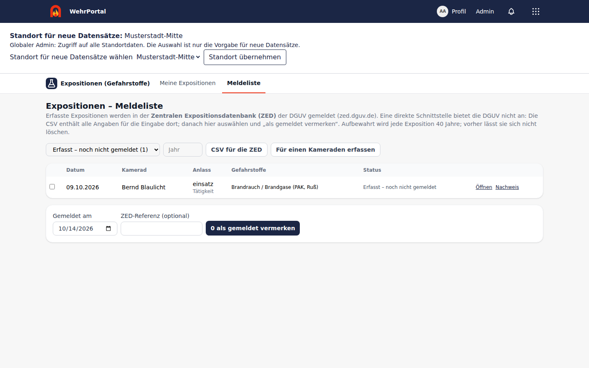

Wer bei Einsatz oder Übung krebserzeugenden, keimzellmutagenen oder reproduktionstoxischen Gefahrstoffen ausgesetzt war – Brandrauch mit PAK und Ruß, Asbest, Benzol und Co. –, muss das nach § 14 Gefahrstoffverordnung dokumentiert bekommen: 40 Jahre aufbewahrt und an die **Zentrale Expositionsdatenbank (ZED)** der DGUV gemeldet. Das Modul ist nach der Installation ausgeschaltet; ein Admin aktiviert es unter Admin → Module (sinnvoll: „automatisch freischalten“, damit jede Einsatzkraft ihre eigenen erfassen kann). Bei aktivierten Standorten verwalten GBI/SBI standortübergreifend und die für den jeweiligen Standort zuständige Wehrführung nur dessen Expositionen; die Wehrführung wird über **Standardrollen** zugewiesen. Betroffene Einsatzkräfte sehen weiterhin ihre eigenen Einträge. Alte globale Expositionsbeauftragten-Rollen erweitern diesen Gesundheitsdatenzugriff nicht. Ohne aktivierte Standorte gilt weiterhin die bisherige Modulrolle **Expositionsbeauftragter**; ohne zuständige Person bekommen die Admins die Hinweise.

- **Erfassen** (`/expositionen/erfassen`): Datum, Anlass (z. B. „Einsatz 2027/012 · FEU 2“), Tätigkeit (Innenangriff, Außenangriff, Nachlöscharbeiten, Brandwache, Technische Hilfe, Gefahrstoffeinsatz, Dekontamination, Reinigung von Gerät und Kleidung, Übung …) mit Freitext, **Gefahrstoffe** (häufige zum Ankreuzen, weitere frei – gern mit CAS-Nummer), Dauer, Aufnahmeweg (eingeatmet, über die Haut, verschluckt, unbekannt), **Schutzmaßnahmen** (umluftunabhängiger Atemschutz, Filtergerät, CSA, Schutzkleidung, Handschuhe, keine) und Bemerkung – keine Befunde. Jede Einsatzkraft erfasst ihre eigenen; der Expositionsbeauftragte auch für andere.
- **Aus dem Einsatzbericht für die Besatzung:** Im Bericht steht der Abschnitt „Gefahrstoff-Exposition“. GBI/SBI und die zuständige Wehrführung tragen mit **„Für die Besatzung erfassen“** einmal ein, was passiert ist, und wählen die Einsatzkräfte – wer im Bericht „unter Atemschutz“ steht, ist vorausgewählt und hat den Atemschutz schon als Schutzmaßnahme. Jeder bekommt einen **Vorschlag** (Glocke, Push, Mail ohne Inhalt), ergänzt ihn (z. B. Dauer, eigene Schutzausrüstung) und **bestätigt** – oder verwirft ihn, wenn er nicht dabei war.
- **Nach einem Brandeinsatz fragt die Startseite:** Wer in den letzten 14 Tagen bei einem Brand (klein, mittel, groß) in der Besatzung stand und noch nichts erfasst hat, liest „Warst du beim letzten Brandeinsatz Gefahrstoffen ausgesetzt?“ – mit „Erfassen“ (Anlass, Datum und Atemschutz schon ausgefüllt) oder „Nein“.
- **Meine Expositionen** (`/expositionen`, auch Personalakte → Expositionen): alle eigenen mit Status (Vorschlag, erfasst, an die ZED gemeldet) und **„Nachweis drucken“** – der Auszug für die Einsatzkraft, z. B. beim Ausscheiden aus der Feuerwehr oder für den Arzt.
- **Meldeliste** (`/expositionen/verwaltung`, Expositionsbeauftragter): alle Expositionen nach Status und Jahr, **CSV** mit allen Angaben für die Eingabe in der ZED (zed.dguv.de – eine Schnittstelle zum direkten Übertragen bietet die DGUV nicht an), danach auswählen und **„als gemeldet vermerken“** (Datum, optional ZED-Referenz). Ausgetretene Kameraden sind markiert („Nachweis aushändigen“), der Nachweis lässt sich für jeden drucken. Die Startseite nennt die noch nicht gemeldeten.
- **Ändern:** Die Einsatzkraft ändert ihre Exposition, bis sie gemeldet ist, der Expositionsbeauftragte immer. Jede Aktion steht mit Name und Zeit unter der Exposition (vorgeschlagen, erfasst, bestätigt, geändert, gemeldet).
- **Datenschutz und Aufbewahrung:** Tätigkeit, Gefahrstoffe und Bemerkung sind **verschlüsselt** gespeichert; das allgemeine Admin-Log enthält keine Inhalte, Mails nur den Anlass. Eine erfasste Exposition ist **40 Jahre** ab dem Tag geschützt – die Datenbank verweigert vorher das Löschen, auch für Admins; danach löscht `model:prune` sie täglich. Nur ein nie bestätigter Vorschlag lässt sich verwerfen. Wird ein Kamerad mit „Löschen mit Übertragung“ entfernt, bleiben seine Expositionen mit seinem Namen erhalten und gehen nie auf einen anderen über.
- **Jahresbericht:** Abschnitt „Gefahrstoff-Expositionen“ mit Zahl der Expositionen, betroffenen Einsatzkräften und den an die ZED gemeldeten.

### Führerscheine

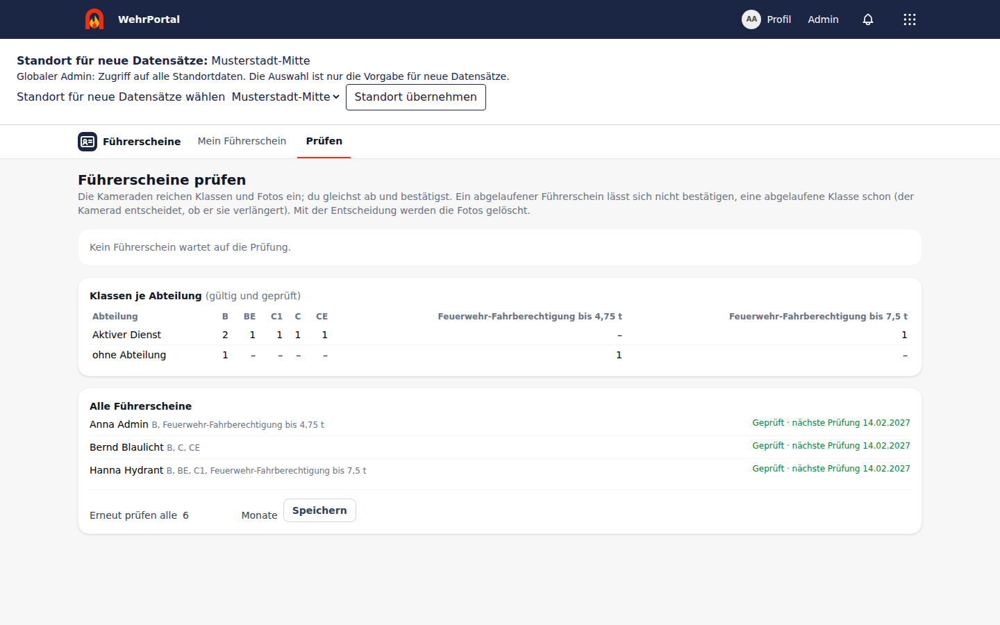

Führerscheinkontrolle ohne Kontrolltermin in der Wache: Die Kameraden reichen ihren Führerschein einmal per Foto ein, der **Führerscheinprüfer** gleicht ab, die App behält die Fristen im Blick und sagt, wer welches Fahrzeug fahren darf. Das Modul ist nach der Installation ausgeschaltet; ein Admin aktiviert es unter Admin → Module (sinnvoll: „automatisch freischalten“). Der Führerscheinprüfer muss kein Admin sein – „Prüfen“ ist ein Reiter der Modulleiste; ohne Prüfer übernehmen die Admins.

- **Mein Führerschein** (`/fuehrerscheine`, auch Personalakte → Führerschein): Klassen ankreuzen (AM bis T und die **Feuerwehr-Fahrberechtigung bis 4,75 t bzw. 7,5 t**), je Klasse das Ablaufdatum von der Rückseite (Spalte 11; bei C1, C, D … Pflicht, sie gelten fünf Jahre), das Ablaufdatum der Karte (Feld 4b, leer bei alten Führerscheinen) und **Fotos von Vorder- und Rückseite** – auf dem Handy direkt mit der Kamera. „Zur Prüfung einreichen“ meldet es den Prüfern (Glocke, Push, Mail).
- **Prüfen** (`/fuehrerscheine/pruefen`): Die eingereichten Führerscheine mit beiden Fotos und den Angaben; „Stimmt – bestätigen“ oder „Zurückweisen“ (mit Grund, den der Kamerad bekommt). Ein **abgelaufener Führerschein** lässt sich nicht bestätigen, eine abgelaufene Klasse schon – ob er sie verlängert, entscheidet der Kamerad. Mit der Entscheidung werden die **Fotos gelöscht**; gespeichert bleiben Klassen, Daten und jede Prüfung mit dem bestätigten Stand und dem Prüfer (Nachweis der Halterpflicht). Nach dem eingestellten Abstand (Vorgabe **6 Monate**, unten auf der Seite) ist die nächste Prüfung fällig.
- **Fristen:** `fuehrerscheine:remind` (täglich 7:25 Uhr) erinnert den Kameraden einmal je Frist, wenn eine Klasse oder die Karte in 60 Tagen abläuft und wenn die Prüfung fällig ist. Mit eingeschaltetem **Kalender** stehen diese Tage zusätzlich als Termine in seinem eigenen Kalender (nur für ihn sichtbar, auch im Abo). Die Startseite zeigt einen zurückgewiesenen, abgelaufenen oder fälligen Führerschein, dem Prüfer die wartenden.
- **Klassen je Abteilung:** Auf „Prüfen“ zählt eine Tabelle die gültigen, geprüften Klassen je Abteilung – z. B. wie viele C1-Fahrer die Jugendfeuerwehr hat; darunter alle Führerscheine mit Status und nächster Prüfung.
- **Wer darf fahren?** Mit der **Fahrzeugverwaltung** ergibt sich aus der Führerscheinklasse des Fahrzeugs (oder sonst aus der zulässigen Gesamtmasse: bis 3,5 t B, bis 4,75 t C1 oder Feuerwehr-Fahrberechtigung, bis 7,5 t C1 oder Fahrberechtigung 7,5 t, darüber C), wer es fahren darf – das Fahrzeugprofil listet sie. Im **Fahrtenbuch** erscheint beim Eintragen einer Fahrt ein Hinweis, wenn der Fahrer keinen geprüften Führerschein, keine gültige passende Klasse oder eine fällige Prüfung hat (es sperrt nicht).
- **Nachweise und Personalverwaltung:** Ein geprüfter Führerschein steht unter Personalakte → Nachweise als Karte „Fahrerlaubnis“ mit dem Prüf-QR-Code; die Akte in der Personalverwaltung zeigt Status und Klassen.

### Unterweisungen

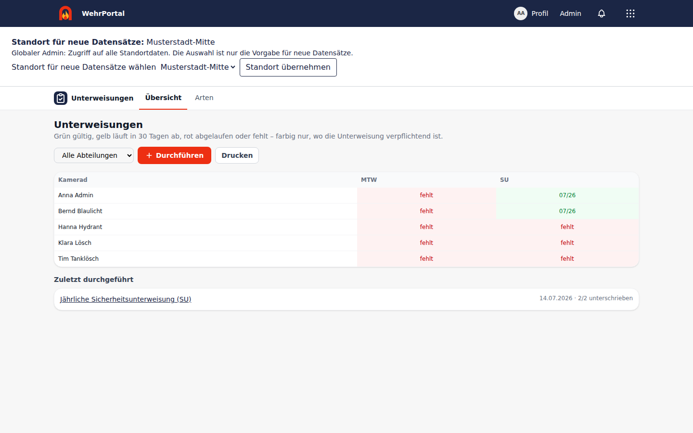

Unterweisungen (z. B. die jährliche Unterweisung nach DGUV Vorschrift 49, Einsatzstellenhygiene, Absturzsicherung) und Einweisungen (auf ein Fahrzeug oder Gerät, z. B. Motorkettensäge) – mit Fristen und dem Nachweis, den die Unfallkasse sehen will. Das Modul ist nach der Installation ausgeschaltet; ein Admin aktiviert es unter Admin → Module (sinnvoll: „automatisch freischalten“). Rolle: **Unterweisungsbeauftragter** (muss kein Admin sein – Übersicht und Arten sind Reiter der Modulleiste, „Durchführen“ ist die Hauptaktion); ohne einen übernehmen die Admins. Der globale Atemschutzwart kann mit aktivierten Standorten zusätzlich ausschließlich Arten verwalten und durchführen, die als Atemschutz-Unterweisung zählen; andere Unterweisungen und Einweisungen bleiben für ihn gesperrt.

- **Arten** (`/unterweisungen/arten`): Name, **Kürzel**, Unterweisung oder Einweisung (optional auf ein Fahrzeug), **Wiederholen alle … Monate** (leer = einmalig), **verpflichtend für** alle aktiven Kameraden oder bestimmte Abteilungen und Funktionen (mit Unterfunktionen), Inhalt/Grundlage, „zählt auch als Atemschutz-Unterweisung (FwDV 7)“. „Übliche Unterweisungen anlegen“ legt UVV, Einsatzstellenhygiene, Atemschutz-Unterweisung, Absturzsicherung, Motorkettensäge und Hydraulisches Rettungsgerät als Vorlage an.
- **Durchführen** (`/unterweisungen/durchfuehren`): Art, Datum, wer unterwiesen hat, Teilnehmer (vorausgewählt: wer sie braucht; mit Kalender auch **aus einem Kalendertermin übernehmen** – wer dort anwesend war), Inhalt und Dokumente (z. B. Folien, Betriebsanweisung). Danach **unterschreiben die Teilnehmer auf dem Tablet** nacheinander („Unterschrift speichern – weiter“); wer nicht da ist, unterschreibt später auf dem eigenen Handy unter „Meine Unterweisungen“. **„Nachweis drucken“** gibt die Liste mit Datum, Unterweisendem, Inhalt und allen Unterschriften.
- **Übersicht** (`/unterweisungen/uebersicht`): Kameraden × Arten mit dem letzten Datum; wo die Unterweisung verpflichtend ist grün (gültig), gelb (läuft in 30 Tagen ab) oder rot (abgelaufen oder fehlt); Filter nach Abteilung, druckbar; darunter die zuletzt durchgeführten mit „x/y unterschrieben“.
- **Meine Unterweisungen** (Personalakte → Unterweisungen; Startseite und 3×3-Menü führen Kameraden ohne Rolle dorthin, den Beauftragten zur Übersicht mit „Durchführen“ am Titel): verpflichtende und besuchte mit Stand und „bis“, offene Unterschriften. Die Startseite zeigt fällige, fehlende und offene Unterschriften, dem Beauftragten die Zahl der Kameraden mit Rückstand. `unterweisungen:remind` (täglich 7:30 Uhr) erinnert einmal je Fälligkeit, der Beauftragte bekommt eine Übersicht.
- **Zusammenarbeit:** Eine Art „zählt als Atemschutz-Unterweisung“ wird in der **Atemschutzüberwachung** als Unterweisung gewertet. Eine **Einweisung auf ein Fahrzeug** führt im **Fahrtenbuch** zu einem Hinweis, wenn der Fahrer nicht (mehr) eingewiesen ist. Die **Personalverwaltung** zeigt die Unterweisungen in der Akte; der **Jahresbericht** hat den Abschnitt „Unterweisungen“.
- **Qualifikations-Kürzel:** In der Kameraden-Liste der Personalverwaltung steht bei jedem, was gerade gilt – Kürzel der gültigen Unterweisungen, **AGT**/**CSA** (einsatzbereit, Atemschutz), Führerscheinklassen ab C1 und Feuerwehr-Fahrberechtigung (Führerscheine) und absolvierte Lehrgänge mit Kürzel (in der Lehrgangsliste je Lehrgang einzutragen, z. B. „TF“, „Ma“).

### Wartungsmanagement

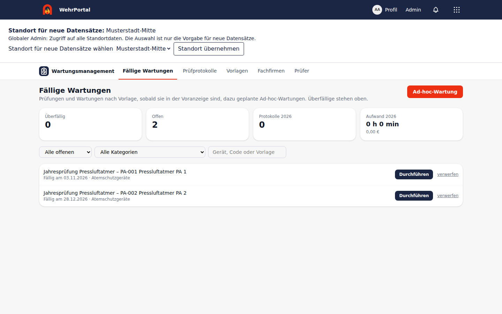

Digitale Prüf- und Wartungsverwaltung mit Unterschrift für alle Feuerwehrgeräte und Fristen. Das Modul arbeitet mit den **Geräten der Ausrüstungsverwaltung** (Kategorien, Lebensdauer, Prüffristen); diese muss ebenfalls eingeschaltet sein, sonst zeigt das Modul nur einen Hinweis. Nach der Installation ist es ausgeschaltet; ein Admin aktiviert es unter Admin → Module. Rollen: **Gerätewart** (Vorlagen, Fachfirmen, Prüfer und Qualifikationen, Ad-hoc-Wartungen planen, Protokolle stornieren, Stundensatz) und **Prüfer** (Wartungen durchführen und unterschreiben); Admins dürfen alles. Bei aktivierten Standorten können Wehrführung und Gerätewart als Standardrollen je Standort Wartungen dort planen, durchführen, stornieren und einsehen; standortübergreifende Vorlagen, Fachfirmen, Qualifikationen und Stundensatz bleiben den globalen Gerätewarten und Admins vorbehalten. Alle anderen mit Zugang sehen fällige Wartungen, Geräte und Protokolle.

- **Wartungsvorlagen** (`/wartung/vorlagen`): Name, Beschreibung/Grundlage, für alle Geräte einer **Kategorie** und/oder einzelne Geräte, **Wiederholung** in Monaten (leer = nur bei Bedarf; bei Wahl der Kategorie wird ihr Prüfintervall vorgeschlagen), **Voranzeige** in Tagen, **Checkliste** (Prüfpunkte, mehrere auf einmal zeilenweise, Reihenfolge per Pfeil), ob die Wartung **als Prüfung gilt** (setzt die Prüffrist am Gerät), wer prüft (eigene Prüfer mit optional nötiger **Qualifikation**, oder **Fachfirma** als Vorschlag) und geschätzter Zeitaufwand. Jede Vorlage gibt es als **Checkliste PDF** zum Ausdrucken. Vorlagen mit Protokollen werden beim Löschen nur ausgeschaltet.
- **Fällige Wartungen** (`/wartung`): `wartung:plan` läuft täglich um 6:45 Uhr (und nach jedem Speichern einer Vorlage oder eines Protokolls) und legt für jedes Gerät eine Wartung an, sobald ihr nächster Termin in der Voranzeige liegt – höchstens eine offene je Vorlage und Gerät. Der nächste Termin ist das Intervall nach dem letzten Protokoll; ohne Protokoll die Prüffrist des Geräts (wenn die Vorlage als Prüfung gilt), sonst das Intervall nach Inbetriebnahme bzw. Erfassung. Ausgeschaltete Vorlagen und ausgesonderte Geräte schließen ihre offenen Wartungen. Die Liste zeigt Überfällige zuerst, Filter nach Kategorie, „Fachfirma“ und Suche; oben die Zahlen des Jahres (Protokolle, nicht bestanden, Aufwand und Kosten), unten Geräte, deren **DGUV-Lebensdauer** in den nächsten 180 Tagen endet oder abgelaufen ist. Die Gerätewarte (ohne Gerätewart die Admins) bekommen täglich eine Mail mit neu fälligen und neu überfälligen Wartungen, jede nur einmal; die Startseite zeigt Gerätewarten und Prüfern „x Wartungen offen / überfällig“. Lokale Wehrführungen und Gerätewarte sehen dabei nur Geräte und Protokolle ihres zugewiesenen Standorts.
- **Durchführen** (`/wartung/durchfuehren`): aus der Liste, vom Gerät oder **ad hoc** (Gerät suchen, Vorlage optional; ohne Vorlage eigene Prüfpunkte oder nur Befund, „gilt als Prüfung“ wählbar). Jeder Prüfpunkt wird mit *in Ordnung*, *Mangel* (mit Beschreibung) oder *entfällt* bewertet, dazu Ergebnis, Befund, **Zeitaufwand**, Materialkosten und bis zu 10 **Fotos oder PDFs**. Prüfer ist entweder man selbst mit einer eigenen gültigen Qualifikation (Pflicht, wenn die Vorlage eine verlangt) oder eine **Fachfirma** mit dem Namen ihres Prüfers, optional Prüfer-ID/Sachkunde-Nr. und Rechnungsbetrag; ihr Prüfbericht kommt als Anhang dazu. Der Prüfer **unterschreibt auf dem Bildschirm**. Das Datum darf nicht in der Zukunft und nicht mehr als zwei Jahre zurück liegen.
- **Folgen am Gerät:** Gilt die Wartung als Prüfung, wird sie in der Ausrüstungsverwaltung als Prüfung eingetragen – bestanden setzt die nächste Prüffrist, nicht bestanden sperrt das Gerät als defekt mit Schadensmeldung (Mail an die Gerätewarte der Ausrüstung). Eine nicht bestandene Wartung, die keine Prüfung ist, meldet ebenfalls einen Schaden; eine bestandene steht im Verlauf des Geräts.
- **Prüfprotokolle** (`/wartung/protokolle`): laufende Nummer je Jahr (`W-2027-004`), Filter nach Jahr und Ergebnis, Suche nach Gerät, Prüfer, Prüfer-ID und Fachfirma, Summen von Aufwand und Kosten. Jedes Protokoll als **PDF** mit eingebetteter Unterschrift, Checkliste, Kosten, Fotos und Prüfsumme – für DGUV-Nachweise und Versicherungen. **Revisionsfest:** Ein unterschriebenes Protokoll und seine Anhänge lassen sich nicht ändern oder löschen, auch nicht direkt in der Datenbank (Trigger). Über Inhalt, Unterschrift und Anhänge wird eine SHA-256-Prüfsumme gebildet; Seite und PDF zeigen, ob alles unverändert ist. Falsche Protokolle storniert der Gerätewart mit Grund; die Prüffrist am Gerät bleibt dabei, sie wird in der Ausrüstungsverwaltung korrigiert. Wird ein Gerät gelöscht, bleibt das Protokoll mit Code und Name erhalten.
- **Kosten:** Zeitaufwand × **Stundensatz** (unter Vorlagen, wird ins Protokoll übernommen) + Material + Rechnung der Fachfirma.
- **Fachfirmen** (`/wartung/fachfirmen`): Name, Ansprechpartner, E-Mail, Telefon, Notizen, aktiv; dazu Zahl der Protokolle, letzter Einsatz und Summe der Rechnungen.
- **Prüfer & Qualifikationen** (`/wartung/pruefer`): je Kamerad Qualifikationen (z. B. Gerätewart Atemschutz, Sachkundiger PSAgA, Elektrofachkraft) mit **Prüfer-ID**, „gültig bis“ und Nachweis; abgelaufene stehen rot und sind beim Prüfen nicht mehr wählbar. Ins Protokoll kommen Name, Qualifikation und Prüfer-ID als fester Text – der **Qualifikationsnachweis** bleibt, auch wenn die Qualifikation später geändert wird. Je Prüfer: Zahl der Protokolle und letztes Datum.
- **Gerät** (`/wartung/geraete/{id}`): Prüffrist, **DGUV-Lebensdauer** (Jahre, Ende, Grundlage der Kategorie), die geltenden Vorlagen mit nächstem Termin, offene Wartungen, alle Protokolle; „Ad-hoc-Wartung planen“ (Gerätewart) und „Durchführen“. Lebensdauer und Prüfintervall werden in der Ausrüstungsverwaltung am Gerät bzw. an der Kategorie gepflegt; das Modul ergänzt dort die Kategorien Feuerwehrschutzkleidung, Schutzhandschuhe, Sicherheitsschuhe und Sprungpolster (Startwerte, mit Herstellerangaben abgleichen).

### Atemschutzüberwachung

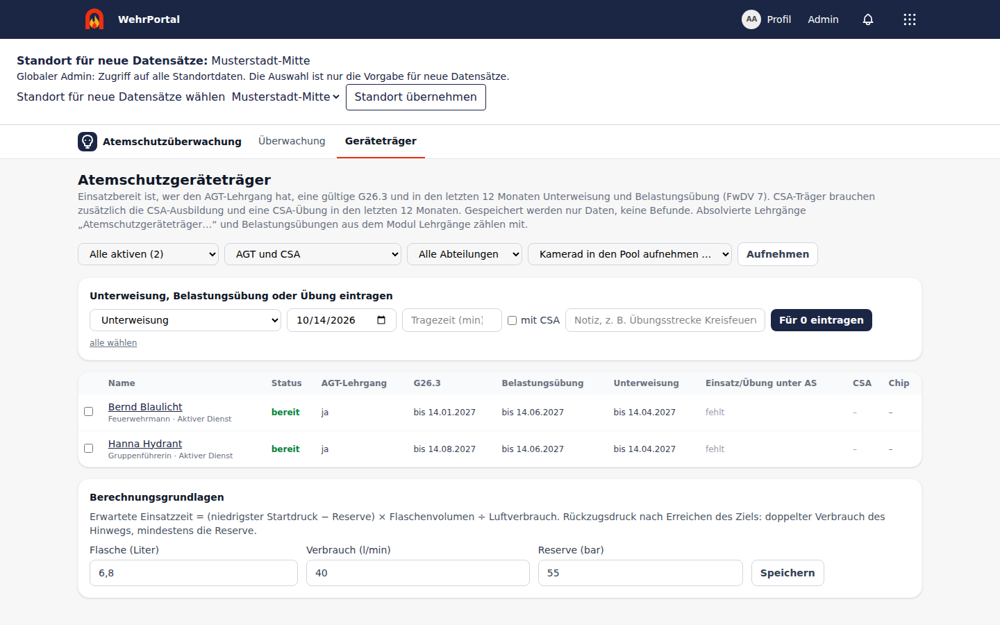

Digitale Atemschutzüberwachung: die Überwachung der Trupps im Einsatz (Uhr, Drücke, Rückweg, Warnungen) und die Verwaltung der Atemschutzgeräteträger (G26.3, Unterweisung, Belastungsübung) in einem Modul. Nach der Installation ist es ausgeschaltet; ein Admin aktiviert es unter Admin → Module. Rollen: **Atemschutzwart** (Leiter Atemschutz: Pool, Fristen, Chips, Berechnungsgrundlagen, Überwachung) und **Überwacher** (nur noch ein Merkmal; die Überwachung selbst darf **jede Einsatzkraft mit Modulzugang** führen, bei aktiven Standorten an den für sie sichtbaren Standorten); Admins dürfen alles. Die **Pflege der Geräteträger** (Pool, G26.3, Nachweise, Einstellungen) ist Verwaltung und liegt hinter dem Zahnrad der Modulleiste, getrennt von den Werkzeugen im Einsatz. Der Atemschutzwart kann als globale Standardrolle vergeben werden; dadurch erhält er Modulzugang und alle Atemschutzwart-Rechte. Alle anderen mit Zugang sehen die Zahlen des Pools und unter **Personalakte → Atemschutz** (`/personalakte/atemschutz`) den eigenen Stand. Wer im Pool ist, hat außerdem den **Atemschutzpass** auf dem Handy (Personalakte → Nachweise): Einsatzbereitschaft, AGT-Lehrgang, G26.3, Belastungsübung, Unterweisung, Einsatz/Übung unter Atemschutz, bei CSA-Trägern die CSA-Bereitschaft und die **Tragezeit** des Jahres nach Einsatz, Übung, Belastungsübung und CSA – mit QR-Code, über den z. B. die Atemschutzwerkstatt oder eine Nachbarwehr den Stand prüft.

- **Einsatzbereit** ist, wer den **AGT-Lehrgang** hat, eine gültige **G26.3** und in den letzten 12 Monaten **Belastungsübung** und **Unterweisung** (FwDV 7). Die jährliche **Einsatz/Übung unter Atemschutz** wird angezeigt, sperrt aber nicht; jeder Trupp, in dem man war, zählt automatisch – und, wenn das Modul **Einsatzbericht** eingeschaltet ist, jeder gestartete Einsatz, in dem man in der Besatzung als „unter Atemschutz“ angehakt ist, auch ohne Überwachung (nach Alarmierungszeit; Entwürfe zählen nicht). „Frist läuft ab“ heißt: eine dieser Fristen endet in den nächsten 30 Tagen. Gespeichert werden **nur Daten, keine Befunde**. Ist das Modul **Lehrgänge** eingeschaltet, zählen dort absolvierte Lehrgänge „Atemschutzgeräteträger…“ und Belastungsübungen mit (das spätere Datum gilt, die Liste zeigt „aus Lehrgänge“).
- **CSA-Träger** (Chemikalienschutzanzug): Beim Geräteträger „CSA-Träger“ ankreuzen, optional mit Datum der CSA-Ausbildung. **CSA-bereit** ist, wer unter Atemschutz einsatzbereit ist und in den letzten 12 Monaten eine **CSA-Übung** hatte – eingetragen als Nachweis „CSA-Übung“ oder „mit CSA“, oder als CSA-Trupp in der Überwachung. Die Liste hat eine Spalte CSA und den Filter „Nur CSA-Träger“; die Startseite und der Jahresbericht nennen die CSA-Bereiten. Die CSA-Übung hat dieselbe Erinnerung wie die anderen Fristen (30 Tage vorher, je Frist einmal).
- **Tragezeiten:** Jeder Nachweis kann die **Tragezeit in Minuten** und „mit CSA“ bekommen; dazu zählen die Trupps der Überwachung (Anschluss bis Ablegen). Ausgewiesen wird die Tragezeit des Jahres getrennt nach **Einsatz, Übung, Belastungsübung und mit CSA** – im Atemschutzpass, unter Personalakte → Atemschutz und im Jahresbericht (Stunden der ganzen Wehr, Trupps je Geräteträger gezählt).
- **Geräteträger** (`/admin/atemschutz/geraetetraeger`, Admin-Bereich, Gruppe „Atemschutz“, hinter dem Zahnrad der Modulleiste): Gepflegt vom **Atemschutzwart** (alle Geräteträger) und von der **Wehrführung je Standort** (Standardrolle „Wehrführung“, nur Kameraden ihres Standorts; bei ausgeschalteten Standorten nur der Atemschutzwart). Unter dem Namen stehen Dienstgrad und Abteilungen aus den Mitgliedsdaten (keine Zweitpflege: eine Änderung unter Admin → Kameraden ist sofort sichtbar), Filter nach Status und **Abteilung**. Kameraden in den Pool aufnehmen, je Kamerad AGT-Lehrgang (mit Datum), G26.3 untersucht am / gültig bis (Vorschlag: drei Jahre) und **RFID-Chip** (Feld antippen, Chip an den Leser halten); Tabelle mit allen Fristen, Filter nach Status. **Unterweisung, Belastungsübung oder Übung** für mehrere auf einmal eintragen (Sammelaktion „Nachweis eintragen“; fremde Standorte werden übersprungen). **Berechnungsgrundlagen** (eigene Seite `/admin/atemschutz/berechnung`, nur Atemschutzwart und Admin): Flaschenvolumen (6,8 l), Luftverbrauch (40 l/min) und Reserve (55 bar) – sie werden beim Registrieren eines Trupps übernommen und stehen im Protokoll.
- **Mehrere Standorte und Protokoll:** An einem Einsatz oder einer Übung sind meist mehrere Standorte beteiligt: Beim Starten lassen sich mehrere ankreuzen (der Standort eines verknüpften Einsatzberichts ist immer dabei); die Überwachung ist an allen sichtbar. Im Board steht das **Protokoll**: freie Kommentare mit automatischem Zeitstempel, jederzeit und beliebig oft (auch nach dem Ende der Überwachung); sie stehen im PDF.
- **Überwachung** (`/atemschutz`): oben die Zahlen des Pools und laufende Überwachungen; Atemschutzüberwacher starten eine neue (Einsatz oder Übung, optional zu einem Einsatzbericht, der Entwurf oder aktuell ist) und sehen, wer **jetzt verfügbar** ist (einsatzbereit und in keinem Trupp), dazu die letzten Überwachungen mit PDF. Bei aktivierten Standorten übernimmt eine verknüpfte Überwachung den Standort des Einsatzberichts; eine eigenständige Überwachung verlangt die Auswahl eines aktiven Standorts. Der Standort wird in der Übersicht und im Protokoll angezeigt. Überwacher sehen und verwalten nur Überwachungen an Standorten, zu denen sie Zugang haben; der globale Atemschutzwart bleibt standortübergreifend berechtigt. Historische Überwachungen ohne belastbare Standortzuordnung bleiben unzugeordnet und sind nur für globale Atemschutzwarte und Admins zugänglich.
- **Trupp registrieren** (`/atemschutz/ueberwachung/{id}`): Truppname und Auftrag, optional **„Trupp im Chemikalienschutzanzug (CSA)“** (dann braucht jedes Mitglied die CSA-Bereitschaft, sonst nur mit Bestätigung; der Trupp trägt im Board und im PDF „CSA“), Geräteträger per **RFID-Scan** (USB- oder Bluetooth-Leser, die die Chip-Nummer mit Enter eintippen), per Klick aus dem Pool (grün einsatzbereit, gelb Frist läuft ab, rot nicht einsatzbereit) oder als AGT einer anderen Wehr mit Namen; je Geräteträger der Flaschendruck und wer Truppführer ist. Zwei bis vier Geräteträger, niemand in zwei Trupps zugleich. Wer nicht einsatzbereit ist (oder nicht im Pool), lässt sich nur mit Bestätigung einsetzen; der Grund steht im Protokoll.
- **Im Einsatz:** „Anschluss – Uhr starten“ startet die Uhr (läuft sekundengenau im Browser). Je Trupp: **erwartete Einsatzzeit** = (niedrigster Startdruck − Reserve) × Flaschenvolumen ÷ Verbrauch, **Druckkontrollen** nach 1/3 und 2/3 dieser Zeit, aktuelle Drücke, **Rückzugsdruck** (nach „Ziel erreicht“ der doppelte Verbrauch des Hinwegs, mindestens die Reserve) und „Rückzug spätestens in ~x min“ mit dem aus dem Verbrauch geschätzten Druck. Knöpfe: Druck eintragen, Ziel erreicht (Druck aller), Rückzug, Abgelegt (Enddrücke aller).
- **Warnungen:** Druckkontrolle fällig, Rückzugsdruck erreicht, Restdruck an der Reserve, erwartete Zeit überschritten, niedriger Flaschendruck beim Start (< 270 bar). Sie stehen rot am Trupp und oben mit „Quittieren“; jede neue Warnung piept und vibriert (Ton abschaltbar). Die Seite aktualisiert sich alle 5 Sekunden, mehrere Geräte zeigen denselben Stand. Jede Warnung wird mit Zeitpunkt und Quittierung gespeichert.
- **Dokumentation:** Eine Überwachung endet erst, wenn alle Trupps abgelegt sind. Das **PDF-Protokoll** enthält je Trupp Auftrag, Anschluss, Ziel, Rückzug, Ablegen, Dauer, erwartete Zeit, Rückzugsdruck, Druckverlauf je Geräteträger, Bestätigungen und Warnungen sowie die Berechnungsgrundlagen.
- **Einsatzbericht:** Ist eine Überwachung mit einem Einsatzbericht verknüpft, werden die Kameraden eines gestarteten Trupps dort als „unter Atemschutz“ markiert (sofern sie in der Besatzung stehen und der Bericht nicht freigegeben ist). Der Bericht zeigt einen Abschnitt „Atemschutzüberwachung“ mit Link zum Protokoll und zum Starten einer Überwachung für diesen Einsatz; der Druck des Berichts enthält die Trupps.
- **Personalakte → Atemschutz:** der eigene Stand mit allen Fristen, die Nachweise und unter „Unter Atemschutz“ die Trupps aus der Überwachung sowie die Einsätze, in denen man im Einsatzbericht als „unter Atemschutz“ steht (ohne die, die schon über einen Trupp drinstehen).
- **Personalverwaltung:** Die Akte des Kameraden zeigt seinen Atemschutz-Stand (einsatzbereit oder warum nicht, alle Fristen).
- **Jahresbericht:** Abschnitt „Atemschutz“ mit Überwachungen (Einsatz/Übung), Trupps, Geräteträgern im Einsatz und eingetragenen Nachweisen (Unterweisung, Belastungsübung) des Jahres; im laufenden Jahr dazu der Pool mit den Einsatzbereiten.
- **Startseite:** Atemschutzwarte und Überwacher sehen „x einsatzbereit / x läuft bald ab / x nicht einsatzbereit“, Geräteträger ihren eigenen Stand.
- **Erinnerungen:** `atemschutz:remind` läuft täglich um 7:15 Uhr. Jeder Geräteträger bekommt pro Frist (G26.3, Belastungsübung, Unterweisung), die in 30 Tagen endet oder abgelaufen ist, eine Mail – je Frist einmal. Die **Wehrführung des jeweiligen Standorts** erhält eine Übersicht ausschließlich ihrer Geräteträger (Zuordnung über den Primärstandort des Kameraden). Der globale Atemschutzwart erhält weiterhin die Gesamtübersicht; ohne Atemschutzwart erhalten sie die Admins. Eine Wehrführung mit mehreren zugewiesenen Standorten erhält eine gemeinsame Übersicht ihrer Standorte.

### Fahrzeugverwaltung & Flotte

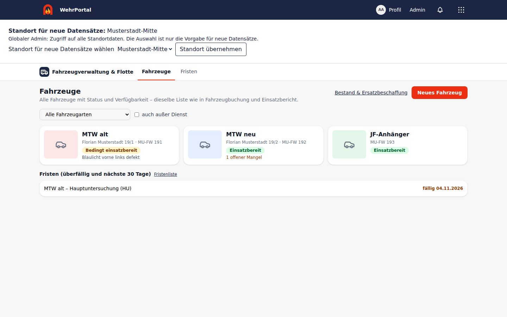


Zentrale Verwaltung aller Fahrzeuge mit Stammdaten, Status und Einsatzhistorie. Das Modul arbeitet mit **derselben Fahrzeugliste** wie Fahrzeugbuchung und Einsatzbericht – ein hier angelegtes Fahrzeug ist dort sofort wählbar, Name, Kurzname und Farbe gelten überall. Nach der Installation ist es ausgeschaltet; ein Admin aktiviert es unter Admin → Module. Rolle: **Fahrzeugwart** (Fahrzeuge anlegen und bearbeiten, Status, Werkstattzeiten, Fristen und Dokumentation); Admins dürfen alles. Alle anderen mit Zugang sehen Übersicht und Fahrzeugprofile. Das [Fahrtenbuch](#fahrtenbuch) nutzt dieselben Fahrzeuge und hält den Kilometerstand hier aktuell; ist es eingeschaltet, zeigt das Fahrzeugprofil die Fahrten und den Verbrauch des Jahres.

- **Übersicht** (`/fahrzeuge`): alle Fahrzeuge als Karten mit Foto, Funkrufname, Kennzeichen und **Verfügbarkeit jetzt** – in dieser Reihenfolge: *Außer Dienst*, *Nicht verfügbar* (Werkstatt-/Ausfallzeit), *Nicht einsatzbereit*, *Im Einsatz* (laut Einsatzbericht ausgerückt und noch nicht zurück), *Gebucht* (laufende Buchung der Fahrzeugbuchung, mit Name und Ende), *Bedingt einsatzbereit*, *Einsatzbereit*; dazu überfällige Fristen. Oben **„Im Einsatz“**: laufende Einsätze mit ihren Fahrzeugen, Personenzahl und Ausrückzeit. Unten die **Fristen** der nächsten 30 Tage und überfällige. Filter nach Fahrzeugart, „auch außer Dienst“.
- **Fahrzeugprofil / Fahrzeugakte** (`/fahrzeuge/{id}`): Stammdaten (Funkrufname, Kennzeichen, Fahrzeugart, Typ/Norm, Fahrgestell, Aufbau, Baujahr, Erstzulassung, FIN, zul. Gesamtmasse, Besatzung, Führerscheinklasse, Löschwasser, Schaummittel, Pumpe, Kilometerstand, Betriebsstunden und – wenn Locations aktiv ist – der organisatorische Standort), **Beschaffung** (beschafft am, Lieferant, Förderung, Garantie bis, geplante Ersatzbeschaffung mit Jahr und geschätzten Kosten für die Investitionsplanung im [Bestand](#bestand); Kaufpreis und Kosten sehen nur Fahrzeugwarte), **Ausstattung** als Liste, Notizen und Foto (wird verkleinert und als WebP gespeichert). Fahrzeugwarte können den Standort beim Bearbeiten wechseln. Ist die Ausrüstungsverwaltung eingeschaltet, lässt sich der separate Lagerort für die Beladung zuordnen; das Profil zeigt dann die **Beladung** (Geräte an Bord, überfällige Prüfungen, nicht einsatzbereite) mit Link zum Beladeplan.
- **Status:** einsatzbereit, bedingt einsatzbereit oder nicht einsatzbereit (die letzten beiden mit Begründung), mit Verlauf. **Außer Dienst stellen** nimmt das Fahrzeug aus Buchung und Einsatzbericht (bisherige Daten bleiben), „Wieder in Dienst stellen“ holt es zurück. Fahrzeuge ohne Buchungen oder Fahrtenbucheinträge können Fahrzeugwarte endgültig löschen; bei vorhandener Historie bleibt nur „Außer Dienst stellen“.
- **Werkstatt & Ausfallzeiten:** Von/Bis (offen = bis auf Weiteres) und Grund. In dieser Zeit ist das Fahrzeug in der **Fahrzeugbuchung nicht buchbar** (siehe dort); wer in dieser Zeit schon gebucht hat, bekommt eine Mail, die Buchung bleibt bestehen. Beginnt die Ausfallzeit sofort, wird das Fahrzeug „nicht einsatzbereit“; „Wieder da“ beendet sie und setzt es wieder auf einsatzbereit. Geplante Ausfallzeiten lassen sich entfernen.
- **Dokumente:** Fahrzeugschein, Gutachten/Prüfbericht, Betriebsanleitung, Kaufvertrag, Versicherung oder Sonstiges als Foto oder PDF, optional mit „gültig bis“ (abgelaufene rot). „Nur für Fahrzeugwarte“ blendet ein Dokument (z. B. den Kaufvertrag) für alle anderen aus.
- **Fristen & Wartungsintervalle:** Vorlagen für Hauptuntersuchung, Sicherheitsprüfung, UVV-Prüfung (DGUV Grundsatz 314-003), Pumpenprüfung, Inspektion, Hubrettung, Ladebordwand/Kran, Feuerlöscher, Fahrtenschreiber und monatliche Fahrzeugkontrolle (mit vorgeschlagenem Intervall) oder eigene; je Frist Fälligkeit, Wiederholung, Vorwarnung und **Prüfschritte** (eine Checkliste; UVV-Prüfung, Pumpenprüfung und Fahrzeugkontrolle bringen Vorschläge mit). **Erledigt eintragen** dokumentiert die Prüfung und setzt die nächste Fälligkeit (Datum + Intervall; ohne Intervall ist die Frist erledigt). Ist der Kalender eingeschaltet, steht jede Frist als ganztägiger Wartungstermin im Kalender der Fahrzeugwarte und wandert mit, wenn sie erledigt ist.
- **Fristenliste** (`/fahrzeuge/fristen`): die Fristen aller Fahrzeuge – überfällig, überfällig und nächste 90 Tage oder alle, nach Fahrzeug filterbar und druckbar.
- **Prüfungen mit Checkliste:** Beim Eintragen einer Prüfung wird jeder Prüfschritt mit „in Ordnung“, „Mangel“ oder „entfällt“ (und Bemerkung) bewertet; dazu das **Ergebnis** (bestanden / mit Mängeln – bedingt einsatzbereit / nicht bestanden – nicht einsatzbereit; ein Mangel schlägt „bedingt“ vor, „bestanden“ geht dann nicht) und optional die **Unterschrift des Prüfers** auf dem Bildschirm. Das Ergebnis **setzt die Einsatzbereitschaft**: nicht bestanden → nicht einsatzbereit, die Frist bleibt bis zur Nachprüfung offen; mit Mängeln → bedingt einsatzbereit; eine bestandene (Nach-)Prüfung macht das Fahrzeug wieder einsatzbereit – aber nur, wenn eine Prüfung den Status gesetzt hatte, nicht wenn der Fahrzeugwart ihn von Hand gesetzt hat. Jeder Prüfschritt mit Mangel wird, wenn das Mängelmanagement eingeschaltet ist, dort als **Mangel am Fahrzeug** angelegt (nicht bestanden: Dringlichkeit hoch). „Prüfprotokoll“ druckt Fahrzeug, Prüfschritte, Befunde, Ergebnis und Unterschrift.
- **Prüfungen, Wartungen & Reparaturen:** jeder Eintrag mit Art, Datum, Kilometerstand (aktualisiert den Kilometerstand im Profil, wenn höher), Kosten, Werkstatt/Prüfer, **Rechnungsnummer**, Notizen und bis zu 5 Fotos oder PDFs (Prüfbericht, Rechnung). Fahrzeugwarte sehen die Kosten des laufenden Jahres. Sind die **Finanzen** eingeschaltet, reicht „Kosten bei den Finanzen als Ausgabe einreichen“ den Betrag mit Kostenstelle und denselben Belegen dort ein (der Kassenwart entscheidet wie bei jeder Ausgabe).
- **Mängel:** Mit eingeschaltetem Mängelmanagement zeigt das Profil die offenen Mängel des Fahrzeugs mit „Mangel melden“ (das Fahrzeug ist vorausgewählt), die Übersicht die Zahl offener Mängel je Fahrzeug. **QR-Etikett drucken** (Fahrzeugwarte) gibt ein Etikett mit dem Code `FZ-…` für das Fahrzeug; wer ihn scannt, landet in der Fahrzeugakte.
- **Einsätze und Buchungen:** das Profil zeigt die Einsätze des Fahrzeugs aus dem Einsatzbericht (mit Zahl im laufenden Jahr; Einsatzleiter sehen den Link zum Bericht) und die kommenden Buchungen aus der Fahrzeugbuchung.
- **Jahresbericht:** Abschnitt „Fahrzeuge: Prüfungen, Wartungen & Reparaturen“ – je Fahrzeug Prüfungen (davon mit Mängeln), Wartungen, Reparaturen und Kosten.
- **Erinnerungen:** `fahrzeuge:remind` läuft täglich um 6:50 Uhr; die Fahrzeugwarte (ohne Fahrzeugwart die Admins) bekommen eine Mail mit Fristen, die in die Vorwarnung kommen oder überfällig werden – jede nur einmal, nach „erledigt“ wieder neu. Die Startseite zeigt allen „x von y einsatzbereit“ und Fahrzeugwarten überfällige Fristen.

### Fahrtenbuch

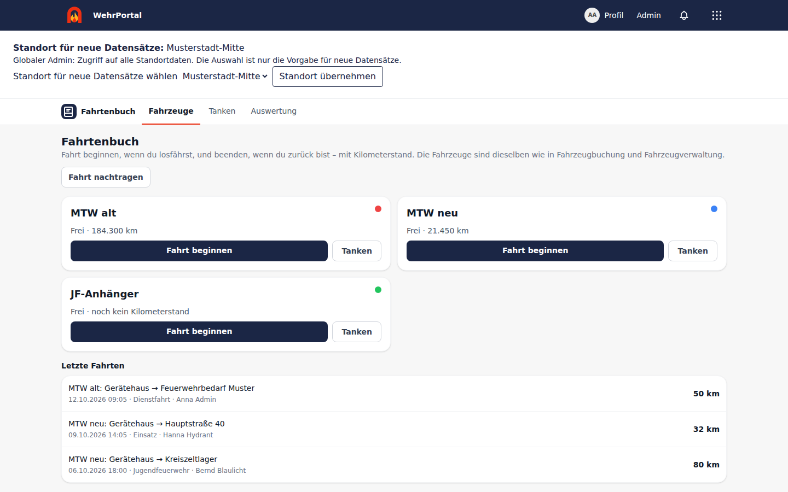

Elektronisches Fahrtenbuch für alle Feuerwehrfahrzeuge – ersetzt die Papierversion. Die Fahrzeuge sind **dieselben wie in Fahrzeugbuchung und Fahrzeugverwaltung** (aktive Fahrzeuge). Nach der Installation ist es ausgeschaltet; ein Admin aktiviert es unter Admin → Module (sinnvoll: „automatisch freischalten“, damit alle Fahrer eintragen können). Rolle: **Fahrtenbuchwart** (Korrekturen, Stornierungen, Auswertung, Export); Admins dürfen alles. Bei aktiviertem Standortkonzept richten sich Fahrten, Tankdaten und Belege nach dem Standort des Fahrzeugs; Fahrer können nur für diesen Standort ausgewählt werden. Alle mit Zugang beginnen und beenden Fahrten, tragen nach, tanken und lesen die Fahrtenbücher der für sie erreichbaren Fahrzeuge.

- **Übersicht** (`/fahrtenbuch`): alle erreichbaren Fahrzeuge mit Standort, „frei“ und letztem Kilometerstand oder „unterwegs: Name seit …“, Knöpfe **Fahrt beginnen** / **Fahrt beenden** und **Tanken**; oben die eigene offene Fahrt, unten die letzten Fahrten. Den Fahrer wählt man beim Beginnen (Vorgabe: wer angemeldet ist); die Auswahl ist auf Kameraden am Fahrzeugstandort begrenzt.
- **Fahrt beginnen:** Fahrzeug, Fahrer, Zeit (Vorgabe jetzt), **Kilometerstand** (vorbelegt mit dem letzten bekannten aus Fahrten, Tanken und Fahrzeugverwaltung), Start (Vorgabe „Gerätehaus“), **Zweck** (Einsatz, Übung/Ausbildung, Dienstfahrt, Werkstatt/Prüfung, Jugendfeuerwehr, Veranstaltung, Sonstiges; bei Dienstfahrt und Sonstiges mit Anlass) und Mitfahrer. **Automatische Zuordnung:** Hat der Fahrer jetzt eine Buchung (Fahrzeugbuchung), werden Fahrzeug und Anlass übernommen und die Buchung verknüpft; steht das Fahrzeug in einem laufenden Einsatz (Einsatzbericht), wird der Zweck „Einsatz“ und der Bericht verknüpft. Ein Fahrzeug hat höchstens eine offene Fahrt.
- **Fahrt beenden:** Zeit, Kilometerstand bei der Rückkehr und Ziel; die gefahrene Strecke ergibt sich. Der Kilometerstand kann nicht unter dem Beginn liegen und nicht mehr als 3.000 km darüber; eine neue Fahrt kann nicht unter dem Ende der letzten beginnen. Das Ende setzt den **Kilometerstand in der Fahrzeugverwaltung**. Wer eine Fahrt länger als 12 Stunden offen lässt, bekommt einmal eine Erinnerung (`fahrtenbuch:remind`, stündlich); die Startseite zeigt „Du bist mit … unterwegs“.
- **Fahrt nachtragen:** Beginn und Ende auf einmal, auch für zurückliegende Tage; überschneidet sie sich mit einer anderen Fahrt des Fahrzeugs, wird sie abgelehnt.
- **Fahrtenbuch je Fahrzeug** (`/fahrtenbuch/fahrzeug/{id}`): alle Fahrten eines Jahres mit Zeit, Kilometerständen, Strecke, Start → Ziel, Zweck, Einsatznummer und Fahrer; **Lücken** im Kilometerstand zwischen zwei Fahrten werden angezeigt („Lücke 40 km davor“). Darunter das Tanken und der Verbrauch.
- **Rechtssicher:** Fahrten werden nie gelöscht. Nur der Fahrtenbuchwart korrigiert eine Fahrt – mit Grund; die alten Werte bleiben mit Name und Zeit an der Fahrt („Korrekturen“). Eine falsche Fahrt wird **storniert** (mit Grund) und bleibt durchgestrichen im Fahrtenbuch und im Export. Jede Fahrt speichert Fahrer und wer sie eingetragen hat.
- **Tanken** (`/fahrtenbuch/tanken`): Fahrzeug, Zeit, Kilometerstand (vorbelegt), Kraftstoff (Diesel, Benzin, AdBlue, Sonstiges), Liter, Betrag, Tankstelle, „voll getankt“ und Beleg (Foto oder PDF). Der **Verbrauch** wird von Volltanken zu Volltanken berechnet (alle Liter dazwischen über die gefahrenen Kilometer, ohne AdBlue).
- **Auswertung** (`/fahrtenbuch/auswertung`, Fahrtenbuchwart): je Fahrzeug und Jahr Fahrten, Kilometer, Kilometer nach Zweck, Liter, Tankkosten und Ø Verbrauch, mit Summen.
- **Export für Steuer und Versicherung** (Fahrtenbuchwart, im Fahrtenbuch des Fahrzeugs): **Fahrten als CSV** (Excel: Semikolon, UTF-8; Datum, Beginn, Ende, Kilometerstände, Strecke, Start, Ziel, Zweck, Anlass, Einsatz, Fahrer, Mitfahrer, Bemerkung, Storno), **Tanken als CSV** und **Drucken / PDF** (A4 quer mit allen Fahrten und Verbrauch).
- **Verknüpfungen:** Der Einsatzbericht zeigt die Fahrten seines Einsatzes, das Fahrzeugprofil der Fahrzeugverwaltung die Fahrten und den Verbrauch des Jahres.

### Wasserkarte & Hydranten

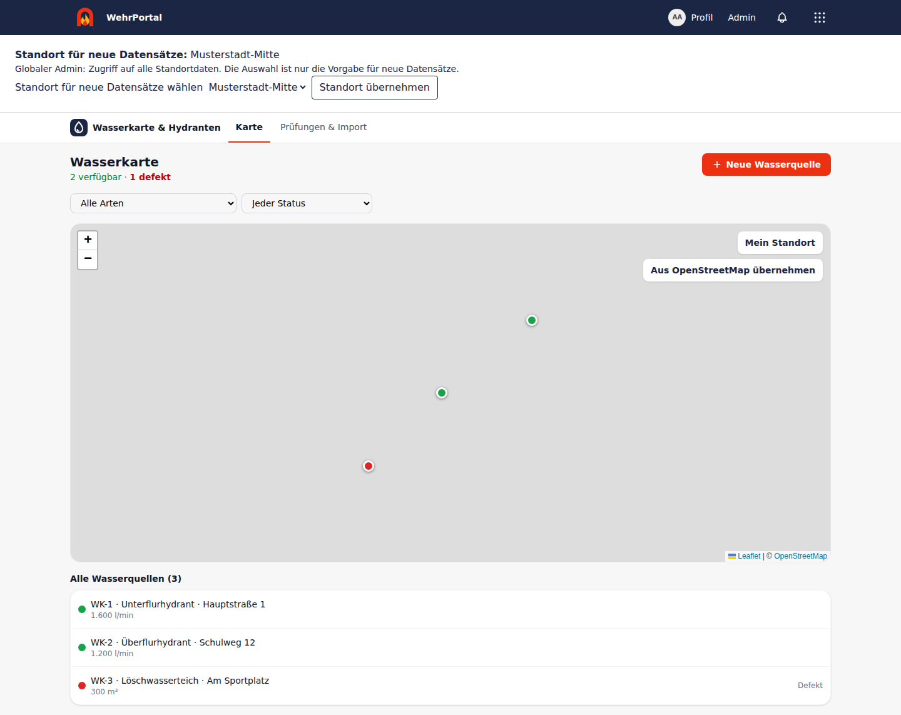

Digitale Hydrantenkarte: alle Löschwasserquellen mit Status, Leistungsdaten und Prüfdatum, im Einsatz automatisch die nächsten zur Einsatzstelle. Nach der Installation ist das Modul ausgeschaltet; ein Admin aktiviert es unter Admin → Module (sinnvoll: „automatisch freischalten“). Rolle: **Hydrantenwart** (Quellen anlegen und bearbeiten, Status, Prüfungen, Mängel beheben, Import); Admins dürfen alles. Alle mit Zugang sehen Karte und Daten und melden Mängel. Die Karte nutzt OpenStreetMap (Leaflet), kein API-Schlüssel nötig.

- **Karte** (`/wasserkarte`): alle Quellen als Punkte – **grün verfügbar, rot defekt, grau gesperrt**, ein **gelber Rand**, wenn die Prüfung überfällig ist oder in den nächsten 30 Tagen ansteht (oben mit Zahl) –, Popup mit Art, Nummer, Leistung, Lage und Link; Filter nach Art und Status (auch „Prüfung fällig“); darunter die Liste mit Leistung und Prüfstand. **„Mein Standort“** (GPS des Handys) zeigt die nächsten Quellen mit Entfernung. Die Karte prüft jede Minute auf Änderungen – meldet jemand einen Mangel, wird der Punkt auf allen offenen Karten rot.
- **Arten:** Unterflurhydrant, Überflurhydrant, Löschwasserteich, Löschwasserbrunnen, Löschwasserbehälter/Zisterne, offenes Gewässer/Saugstelle. Je Quelle: Nummer, Position, Lage, **Durchfluss/Fördermenge (l/min), Ruhedruck, Nennweite (DN), Inhalt (m³), Saughöhe (m)** (bei Saugstellen), Betreiber, Prüfintervall (Vorgabe 12 Monate) und Notizen (Zufahrt, Saughöhe, Schlüssel).
- **Neue Wasserquelle** (Hydrantenwart): Position durch Tippen auf die Karte, Ziehen des Punkts oder **„Mein Standort (GPS) übernehmen“** direkt am Hydranten; Koordinaten lassen sich auch eintippen. „Auf der Karte“ aus = zurückgebaut, die Historie bleibt.
- **Mängel melden** (alle): Beschreibung und optional Foto; die Quelle steht sofort auf **defekt**, die Hydrantenwarte (ohne Hydrantenwart die Admins) bekommen eine Mail. „Behoben“ (mit Vermerk) macht sie wieder verfügbar, sobald kein Mangel mehr offen ist.
- **Status** (Hydrantenwart): verfügbar, defekt oder gesperrt (z. B. Baustelle), mit Grund; jeder Wechsel steht im Statusverlauf.
- **Prüfungen:** Datum, Ergebnis (in Ordnung/Mangel), gemessener Durchfluss, Ruhe- und Fließdruck. Eine Prüfung setzt die nächste Prüffrist und übernimmt die gemessenen Werte; ein Mangel macht die Quelle defekt, eine Prüfung „in Ordnung“ ohne offenen Mangel wieder verfügbar. **Prüfungen & Import** (`/wasserkarte/pruefungen`) zeigt offene Mängel und fällige Prüfungen (überfällig und nächste 30 Tage); `wasserkarte:remind` schickt täglich um 6:55 Uhr eine Mail mit neu fälligen, jede Quelle einmal je Frist. Die Startseite zeigt Hydrantenwarten defekte Quellen und überfällige Prüfungen.
- **Import** der Liste des Wasserversorgers als CSV (Semikolon oder Komma): Kopfzeile mit mindestens Breitengrad/`lat` und Längengrad/`lng`; erkannt werden Nummer, Art (z. B. „Unterflur“, „Überflur“, „Teich“), Lage, Durchfluss, Druck, DN, Inhalt, Saughöhe und Betreiber. Eine schon vorhandene Nummer wird aktualisiert statt doppelt angelegt; fehlerhafte Zeilen werden mit Zeilennummer übersprungen.
- **Aus OpenStreetMap übernehmen** (Hydrantenwart, Knopf auf der Karte): holt über die Overpass-API alle in OpenStreetMap kartierten Löschwasserquellen im **sichtbaren Kartenausschnitt** (höchstens etwa 30 × 20 km) – Hydranten (`emergency=fire_hydrant`, Unter-/Überflur, Nummer, DN, Durchfluss, Druck), Löschwasserbehälter, -teiche und Saugstellen. Zuerst eine **Vorschau**: wie viele neu sind, wie viele an einer schon erfassten Quelle liegen (bis 15 m, gleiche Gattung – z. B. aus der Liste des Wasserversorgers) und wie viele schon übernommen wurden. „Übernehmen“ legt die neuen an (Hydranten mit 12 Monaten Prüfintervall) und verknüpft die nahen; **was der Hydrantenwart erfasst hat, wird nie überschrieben**, nur leere Felder werden ergänzt. Jede Quelle merkt sich ihre OpenStreetMap-ID, ein zweiter Import verdoppelt nichts. Die Quelle zeigt „Herkunft: OpenStreetMap“ mit Link (© OpenStreetMap-Mitwirkende, ODbL). Die Daten stammen von freiwilligen Kartierern und können fehlen oder veraltet sein – Status und Leistung vor Ort prüfen. Ist Overpass ausgelastet, kommt ein Hinweis; dann später erneut versuchen.
- **Prüfnachweis als CSV** (Knopf auf „Prüfungen & Import“, Hydrantenwart): alle Quellen auf der Karte mit Art, Lage, Koordinaten, Status, technischen Daten, letzter Prüfung (Datum, Ergebnis, gemessener Durchfluss, Fließdruck, **geprüft von**) und nächster Prüfung – z. B. für die Gemeinde oder den Wasserversorger; Semikolon, für Excel. Die Quelle selbst zeigt bei „Letzte Prüfung“, wer geprüft hat.
- **Vor Ort per QR-Code:** Auf jeder Quelle druckt der Hydrantenwart mit **„QR-Etikett drucken“** ein Etikett (Nummer, Art, Lage, Code `WK-…`) für die Saugstelle oder das Hinweisschild. Wer es mit dem Handy scannt (`/i/WK-…`), landet nach der Anmeldung direkt bei der Quelle – Mangel melden oder Prüfung eintragen, mit „Mein Standort“ auf der Karte.
- **Im Einsatz:** Hat ein Einsatz Koordinaten (Adressvorschlag, Geocoding, DIVERA oder Punkt auf der Karte), zeigen der **Einsatzbericht** und die **Lagemeldungen** (Lagemonitor für alle Kameraden, solange der Einsatz läuft) „Löschwasser in der Nähe“: Karte mit Einsatzstelle und den nächsten Quellen im Umkreis von 1,5 km, verfügbare zuerst und hervorgehoben, defekte und gesperrte durchgestrichen mit Grund, jeweils mit Entfernung. „Wasserkarte öffnen“ zeigt die ganze Karte um die Einsatzstelle.

### Objektpläne & Brandschutzunterlagen

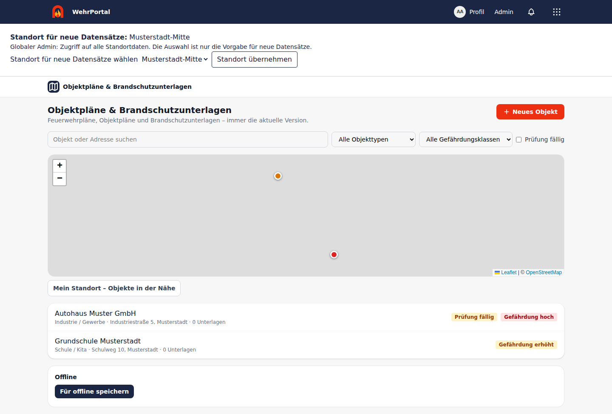

Digitale Objektpläne, Feuerwehrpläne und Brandschutzunterlagen – sofort verfügbar bei Alarm. Das Modul ist nach der Installation ausgeschaltet; ein Admin aktiviert es unter Admin → Module und vergibt den Zugang. Lesen dürfen alle mit Modulzugang, die Unterlagen pflegt die Rolle **Planverwalter** (Admins dürfen es immer).

- **Bibliothek** (`/objektplaene`): alle aktiven Objekte mit Suche (Name, Adresse), Filter nach **Objekttyp** (Wohngebäude, Schule / Kita, Krankenhaus / Pflege, Versammlungsstätte, Industrie / Gewerbe, Lager / Logistik, Landwirtschaft, Öffentliches Gebäude, Verkehrsanlage, Sonstiges) und **Gefährdungsklasse** (normal, erhöht, hoch – farbig auf Karte und Liste), Karte (OpenStreetMap) und „Mein Standort – Objekte in der Nähe“ per GPS. Läuft gerade ein Einsatz an einem Objekt, steht er ganz oben.
- **Objekt** (`/objektplaene/objekt/{id}`): was man bei der Anfahrt wissen muss – Gefährdungsklasse, Brandmeldeanlage, Feuerwehrschlüsseldepot, Gefahrstoffe, besondere Gefahren (rot), Zufahrt / Anleiterstellen / BMA-FIBS, Ansprechpartner, Hinweise, Navigation – und die Unterlagen mit „Öffnen“.
- **Unterlagen und Versionen:** Je Objekt beliebig viele Unterlagen (Feuerwehrplan nach DIN 14095, Objekt- / Lageplan, Feuerwehr-Laufkarte, Brandschutzordnung, Gefahrstoffliste, Einsatz- / Alarmplan, Sonstiges) als PDF (bis 10 MB) oder Bild (wird zu WebP, längste Seite 3000 px). „Neue Version“ ersetzt den Plan, mit Stand des Plans und „Was hat sich geändert?“; die bisherigen Versionen bleiben im **Verlauf** (wer, wann, Stand, Änderung). Kameraden sehen und öffnen nur die aktuelle Version, ältere nur Planverwalter – so ist kein veralteter Plan im Umlauf.
- **Objekt anlegen** (Planverwalter): Name, Objekttyp, Gefährdungsklasse, Merkmale, Adresse und Position (Karte, GPS oder „Position aus Adresse“, wenn ein Google-Schlüssel hinterlegt ist), **Umkreis** des Objekts (20–2000 m, Standard 150 m) für die Vorschläge im Einsatz, Texte und Prüffrist. Nicht mehr aktive Objekte sind archiviert: Sie erscheinen weder in der Bibliothek noch im Einsatz.
- **Überprüfung:** Mit einer Prüffrist (z. B. alle 24 Monate) wird das Objekt fällig; „Unterlagen geprüft“ (mit Hinweis) vermerkt die Prüfung und setzt die nächste Frist. Die Planverwalter (ohne Rolleninhaber die Admins) bekommen täglich um 7:05 Uhr eine Mail mit neu fälligen Objekten (`objektplaene:remind`, je Objekt einmal), auf der Startseite „x Objekte: Überprüfung der Pläne fällig“ und in der Bibliothek den Filter „Prüfung fällig“.
- **Bei Alarm (GPS-Vorschläge):** Hat ein laufender Einsatz im Einsatzbericht Koordinaten (Adressvorschlag, Geocoding, DIVERA oder Karte), werden die Objekte vorgeschlagen, in deren Umkreis (plus 100 m Toleranz) die Einsatzstelle liegt – mit Entfernung, Gefährdung, Merkmalen und den Plänen als Knöpfe: im **Einsatzbericht**, in den **Lagemeldungen** (Lagemonitor), oben auf der **Startseite** aller Kameraden mit Modulzugang und oben in der Bibliothek.
- **Offline:** „Für offline speichern“ (Kasten „Offline“ am Ende der Bibliothek; „Neues Objekt“ steht am Titel) legt die Bibliothek, alle Objektseiten und die aktuellen Pläne im Browser ab (Service Worker, Bereich `/objektplaene`). Ohne Netz öffnen sich diese Seiten und Pläne aus dem Speicher; online wird immer der neueste Stand geladen und dabei gleich mitgespeichert. Neue Versionen kommen offline erst nach erneutem Speichern an. Der Stand („Offline gespeichert: …“) steht auf dem Gerät; „Offline-Daten löschen“ entfernt alles wieder – wichtig auf fremden oder gemeinsam genutzten Geräten, denn die Daten bleiben auch nach dem Abmelden im Browser.

### Personalverwaltung

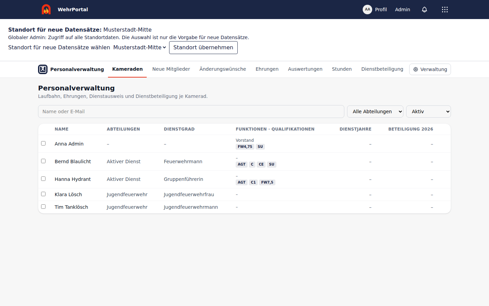

Die Personalakte der Wehr: was ein Kamerad wann war, welche Ehrungen er hat und wie oft er zum Dienst kommt. Die aktuellen Mitgliedsdaten (Dienstgrad, Abteilungen, Funktionen, Status, Eintritt) bleiben wie bisher unter Admin → Kameraden; das Modul baut darauf auf. Es ist nach der Installation ausgeschaltet; ein Admin aktiviert es unter Admin → Module. Ohne aktivierte Standorte pflegt die Rolle **Personalverwalter** die Akten; mit aktivierten Standorten sind GBI/SBI standortübergreifend und die per Standardrolle zugewiesene Wehrführung nur für Mitglieder ihrer Standorte zuständig. Admins dürfen es immer. Alle anderen mit Modulzugang sehen nur ihre eigene Akte. Admin → Kameraden bleibt davon unberührt.

- **Rollen:** Ohne aktivierte Standorte pflegen **Personalverwalter** (im Rahmen ihrer Abteilungen); **Personaleinsicht** sieht Liste, Akten und Auswertungen nur lesend. Bei aktivierten Standorten verwalten ausschließlich GBI/SBI und die zuständige Wehrführung die fremden Personalakten; alte globale Rollen **Personalverwalter** und **Personaleinsicht** gewähren keinen Zugriff. In allen Modi sehen Leseberechtigte keine privaten Personalfelder, Erziehungsberechtigten oder Dienstausweis-Details und können keine Formulare, Sammelverarbeitung, Ehrungen, Änderungswünsche oder Einstellungen verwalten.
- **Neue Mitglieder** (`/personalverwaltung/neu`, Personalverwalter – kein Admin nötig): Name, E-Mail, Eintritt, Dienstgrad, Geschlecht und Abteilungen (beschränkte Personalverwalter nur ihre) – „Anlegen und einladen“ zeigt sofort den **QR-Code der Einladung** und bietet „Per E-Mail schicken“. **Viele auf einmal** per CSV (z. B. die alte Excel-Liste): Name oder Vorname/Nachname und E-Mail, optional Abteilung(en), Dienstgrad, Eintritt, Geschlecht sowie Geburtsdatum, Mobil, Straße, PLZ, Ort, soweit diese Felder eingeschaltet sind; die Vorschau zeigt je Zeile „wird angelegt“, „wird ergänzt“ (gleiche E-Mail, Abteilungen kommen dazu) oder den Fehler (unbekannte Abteilung, ungültige E-Mail, fremde Abteilung). Die Akte jedes Kameraden hat „Einladung (QR-Code)“ und „Einladung per Mail“.
- **Einstellungen** (im Admin-Bereich unter `/admin/personalverwaltung/einstellungen`, über das Zahnrad „Verwaltung“ in der Modulleiste): **Anschrift, Geburtsdatum und Mobilnummer** einzeln ein- und ausschalten (Standard: aus) und die **Selbstpflege** durch die Kameraden. Ohne aktivierte Standorte dürfen Personalverwalter konfigurieren; mit Standorten nur globale Admins und GBI/SBI, weil die Einstellungen für alle Standorte gelten. Private Angaben sehen die Kameraden selbst sowie – bei aktivierten Standorten – GBI/SBI und die für ihren Standort zuständige Wehrführung. Ausgeschaltete Felder verschwinden überall; gespeicherte Angaben bleiben erhalten.
- **Persönliche Daten** in der Akte: Berechtigte Personalverwalter sehen und pflegen die eingeschalteten Felder (mit Alter); bei aktivierten Standorten sind dies GBI/SBI und die zuständige Wehrführung. Die **Adressliste** gibt es als CSV für Excel (Name, E-Mail, Abteilungen und die eingeschalteten Felder) und sie ist auf dieselben Standorte begrenzt.
- **Selbstpflege** (`/personalakte/persoenliche-daten`, Menüpunkt „Persönliche Daten“ in der Personalakte, solange eingeschaltet): Jeder Kamerad trägt seine Anschrift, sein Geburtsdatum und seine Mobilnummer selbst ein. Ändert er etwas, bekommen ohne aktivierte Standorte die zuständigen Personalverwalter einen Hinweis; mit Standorten nur GBI/SBI und zuständige Wehrführung. Die Nachricht nennt geänderte Felder, keine Werte, und führt zur Akte.
- **Kameraden** (`/personalverwaltung`): Liste mit Suche, Filter nach Abteilung und Status, Dienstgrad, Dienstjahren (ab Eintritt), Dienstbeteiligung des Jahres und dem Hinweis „Ehrung fällig“.
- **Laufbahn, die sich selbst schreibt:** Jede Änderung von Dienstgrad, Abteilung, Funktion und Status wird mit Datum festgehalten – beim Speichern unter Admin → Kameraden sofort, Änderungen auf anderen Wegen (z. B. Import) spätestens nach einer Stunde (`personalverwaltung:sync-history`, stündlich). Die ersten Einträge übernehmen die bekannten Daten („Im Dienstgrad seit“, Eintritt). Frühere Stationen aus der Papierakte lassen sich nachtragen (mit „seit“ und „bis“), Daten korrigieren und nachgetragene Stationen löschen; die aktuelle Station kommt immer aus den Mitgliedsdaten. Umbenannte Abteilungen oder Funktionen behalten in der Laufbahn den Namen von damals.
- **Diensthistorie:** Neben den Stationen (Dienstgrad, Abteilung, Funktion, Status) trägt der Personalverwalter **Ereignisse** mit einem Datum ein (z. B. Verpflichtung, Ernennung, Versetzung, Übertritt) und **Dienstzeiten in anderen Wehren** (seit/bis, z. B. vor dem Umzug). Zu jedem Eintrag lassen sich **Nachweise** anhängen (PDF, JPG oder PNG bis 10 MB, gespeichert in der Datenbank): „Nachweis“ am Eintrag; der Kamerad sieht und öffnet sie in seiner Personalakte, sonst nur die zuständigen Personalverwalter. Ein Ereignis lässt sich wieder löschen, seine Nachweise gehen mit.
- **Anrechenbare Dienstzeit:** Statt nur ab dem Eintritt zu zählen, rechnet die App aus der Diensthistorie: Zeiten mit Status „Aktiv“ plus Dienstzeiten in anderen Wehren, **ohne Unterbrechungen** (z. B. Austritt und späterer Wiedereintritt). Die **Jugendfeuerwehr** regelt der Personalverwalter unter Einstellungen → Dienstzeit: Abteilung der Jugendfeuerwehr wählen und „zählt voll“, „zählt ab einem Alter“ (z. B. 16, braucht das Geburtsdatum – ohne zählt sie ganz, mit Hinweis) oder „zählt nicht“. Akte und Personalakte zeigen „Anrechenbare Dienstzeit: x Jahre, y Monate“ mit Beginn und was abgezogen oder dazugezählt wurde; die Liste der Kameraden zeigt die anrechenbaren Dienstjahre. Die **fälligen Ehrungen** richten sich danach: Wer zwei Jahre unterbrochen hat, ist zwei Jahre später dran. Gibt es keine Status-Historie, zählt wie bisher der Eintritt.
- **Runde Geburtstage:** Ist das Geburtsdatum eingeschaltet, zeigt die Seite Ehrungen zusätzlich die runden Geburtstage des Jahres (50, 60 … und ab 70 alle fünf Jahre) – für Glückwünsche und Ehrungen.
- **Ehrungen** (`/personalverwaltung/ehrungen`): Ehrungsarten frei anlegen, mit oder ohne Dienstjahre (z. B. „Feuerwehr-Ehrenzeichen 25 Jahre“ nach 25, „Leistungsabzeichen“ ohne). Die Liste **„Fällig“** zeigt für das gewählte Jahr jeden aktiven Kameraden, der die Dienstjahre bis zum 31.12. erreicht und die Ehrung noch nicht hat – überfällige rot –, bereit für die Jahreshauptversammlung; „Verliehen“ trägt sie mit dem gewählten Datum ein. Dazu die im Jahr verliehenen. Gezählt wird ab dem Eintrittsdatum. In der Akte des Kameraden lassen sich Ehrungen auch frei eintragen (mit „verliehen von“ und Bemerkung). **„Übliche Ehrungsarten anlegen“** legt Feuerwehr-Ehrenzeichen 10, 25, 40, 50 und 60 Jahre, Leistungsabzeichen, Ehrennadel des Kreisfeuerwehrverbandes und Deutsches Feuerwehr-Ehrenkreuz an (vorhandene Namen bleiben unberührt – die genauen Namen unterscheiden sich je Land und Verband, also danach anpassen); **„Kopieren“** legt eine Ehrungsart als Vorlage für eine ähnliche an.
- **Sammelverarbeitung** (Liste der Kameraden): Kameraden ankreuzen, dann für alle auf einmal **befördern** (eine Stufe höher oder auf einen gewählten Dienstgrad, jeweils in der Form des Kameraden – Oberfeuerwehrmann / Oberfeuerwehrfrau –, mit Datum; die Diensthistorie bekommt das Datum der Beförderung), eine **Ehrung eintragen** (Ehrungsart oder frei, mit Datum) oder eine **Funktion zuweisen bzw. entfernen**. Wer schon so weit ist oder die Ehrung schon hat, wird übersprungen und genannt. Die Liste zeigt neben Abteilung und Dienstgrad auch die aktuellen Funktionen.
- **Auswertungen** (`/personalverwaltung/auswertungen`): für Kommune, Kreis- oder Landesverband direkt aus der Diensthistorie, im Rahmen der eigenen Abteilungen – **Funktionsträger** (je Funktion, mit „seit“), **Dienstgrade** (vom höchsten an, mit „seit“ und Abteilung), **Beförderungen** und **Ehrungen** eines Zeitraums; druckbar (ohne Bedienelemente) und als CSV.
- **Dienstausweis:** Nummer, „gültig bis“ und Geburtsort (für den Ausweis) in der Akte; läuft einer in den nächsten 60 Tagen ab, steht es auf der Startseite der Personalverwalter. Unter Einstellungen → **„Digitaler Dienstausweis“** zeigen **alle aktiven Mitglieder** ihn auf dem Handy – auch ohne Zugang zur Personalverwaltung: das Ausweis-Symbol oben rechts neben Glocke und Profilbild öffnet `/dienstausweis`. Die Karte ist aufgebaut wie der amtliche Feuerwehr-Dienstausweis im Scheckkartenformat – Foto links, Name mit Dienstgrad und Abteilung, darunter **Geburtsdatum, Geburtsort, Ausstellende Behörde, Ausweisnummer, Mitglied der Feuerwehr, Gültig bis** (Monat/Jahr), unten ein Band mit dem Logo der Wehr und „FEUERWEHR DIENSTAUSWEIS“ –, aber in den Farben der App und ohne Landeswappen oder Verbandslogos: Sie ist die **digitale Ausfertigung** („Echtheit per QR-Code prüfen“), kein amtlicher Ausweis. Darunter der Prüf-QR-Code (10 Minuten gültig, erneuert sich von selbst). Einstellungen dazu: **Ausstellende Behörde** (z. B. „Gemeinde Musterstadt“), Geburtsdatum auf dem Ausweis (Standard: an, wenn das Feld Geburtsdatum eingeschaltet und eingetragen ist), Geburtsdatum auch auf der Prüfseite (Standard: aus), **nur mit Ausweisnummer** zeigen (dann gehört der digitale immer zu einem ausgegebenen Ausweis). Die Prüfseite zeigt Geburtsort, Behörde, Feuerwehr, Dienstgrad, Abteilung, Nummer und Gültigkeit. Standard: aus.
- **Änderungswünsche** (`/personalverwaltung/aenderungswuensche`): Unter Personalakte → Laufbahn & Ehrungen meldet jeder Kamerad mit „Änderung melden“, was in seiner Akte fehlt oder falsch ist (Thema: Name/E-Mail/Eintritt/Status, Dienstgrad/Abteilung/Funktion, Ehrungen, Dienstausweis, Lehrgänge, Atemschutz, Sonstiges; höchstens fünf offene). Die zuständigen Personalverwalter (mit seiner Abteilung; ohne Personalverwalter die Admins) bekommen Glocke, Push und Mail; die Liste zeigt die offenen mit Link zur Akte. „Erledigt“ oder „Nicht übernommen“ (dann mit Begründung) schließt den Wunsch ab, der Kamerad bekommt die Antwort und sieht seine Wünsche mit Status in der Personalakte. Die Startseite der Personalverwalter nennt die offenen Änderungswünsche.
- **Dienstbeteiligung** (`/personalverwaltung/dienstbeteiligung`, wenn „Kalender & Termine“ eingeschaltet ist): aus der Anwesenheit im Kalender, ohne doppelte Erfassung. Gezählt werden die Termine des Jahres der gewählten Arten (Standard: Übung, Dienst, Arbeitsdienst – auch die Übungsdienste aus dem Übungsdienstplaner), die nicht abgesagt und vorbei sind, für die der Kamerad eingeladen war und bei denen überhaupt Anwesenheit erfasst wurde; vor dem Eintritt zählt nichts. Je Kamerad „anwesend x von y“ und Prozent (grün ab 60 %, gelb ab 30 %), dazu der Durchschnitt und eine CSV für Excel.
- **Zugriff je Abteilung** (`/personalverwaltung/zugriff`, nur Admins): Ohne aktivierte Standorte lässt sich ein Personalverwalter auf Abteilungen beschränken. Bei aktivierten Standorten richtet sich der Zugriff stattdessen ausschließlich nach der Standardrolle Wehrführung und deren zugewiesenen Standorten; alte globale Personalverwaltungsrollen und Abteilungsbeschränkungen erweitern den Zugriff nicht.
- **Lehrgänge und Atemschutz:** Ist das Modul Lehrgänge eingeschaltet, zeigt die Akte des Kameraden seine absolvierten und bestätigten Lehrgänge; ist die Atemschutzüberwachung eingeschaltet, seinen Atemschutz-Stand.
- **Personalakte → Laufbahn & Ehrungen** (`/personalakte/laufbahn`): Jeder Kamerad mit Modulzugang sieht seine eigene Laufbahn, Ehrungen, den Dienstausweis und die eigene Dienstbeteiligung (dieses und letztes Jahr).
- **Stunden** (`/personalverwaltung/stunden`): der Stundennachweis aller aktiven Kameraden (im Rahmen der eigenen Abteilungen) für ein Jahr – Spalten je Herkunft (Dienste und Termine, Einsätze, Aus- und Fortbildung, Schichten) und Gesamt, die meisten oben, mit CSV (eine Zeile je Dienst, Einsatz, Lehrgangstag oder Schicht), z. B. für die Ehrenamtskarte oder die Gemeinde. Die Akte des Kameraden zeigt seine Stunden des laufenden Jahres. Der **Jahresbericht** hat den Abschnitt „Geleistete Stunden“.
- **Startseite:** Personalverwalter sehen offene Änderungswünsche, „x Ehrungen fällig“ und auslaufende Dienstausweise.
- **Löschen mit Übertragung:** Diensthistorie (mit Nachweisen), Ehrungen und Dienstausweis gehören zur Person und werden mit ihr gelöscht.

Für die übrige App (Profil, Admin → Kameraden, Buchungskonflikte, Geburtstagskarten) bleiben Anschrift, Geburtsdatum und Mobilnummer wie unter „Profil“ beschrieben abgeschaltet (`App\Support\MemberFields`); die Personalverwaltung schaltet sie nur für sich ein.

### Schlüsselverwaltung


Wer welchen Schlüssel der Wehr hat – statt Liste im Schlüsselkasten. Das Modul ist nach der Installation ausgeschaltet; ein Admin aktiviert es unter Admin → Module. Die Rolle **Schlüsselwart** pflegt die Schlüssel (Admins dürfen es immer; ein Schlüsselwart muss kein Admin sein). Das Modul selbst (`/schluessel`) ist die Liste aller Schlüssel für den Schlüsselwart mit „Neuer Schlüssel“ am Titel; alle anderen mit Modulzugang sehen ihre eigenen auf dem Profil.

- **Alle Schlüssel** (`/schluessel`, Schlüsselwart; Nummer und Name führen zum Schlüssel, unter „Bei“ führt der Name für Admins zum Kameraden unter Admin → Kameraden): Schlüssel, Transponder/Chips, Schließkarten und Handsender mit Nummer (automatisch `SL-0001` …, oder eigene), Bezeichnung, Schließanlage/-gruppe, Aufbewahrung, wenn er nicht ausgegeben ist (z. B. Schlüsselkasten), Notizen und **was er schließt**: einen Ort aus der gemeinsamen Liste der Orte (mit Adresse und Navigation), ein Fahrzeug und – wenn die Objektpläne eingeschaltet sind – ein Objekt (z. B. den FSD-Schlüssel einer Schule). Suche nach Schlüssel, Nummer, Schließung oder Kamerad, Filter nach Status (vorhanden, ausgegeben, verloren, ausgesondert).
- **Ausgeben mit Schlüsselquittung:** an einen aktiven Kameraden, optional mit Rückgabefrist und Bemerkung; der Kamerad bestätigt den Empfang mit seiner **Unterschrift auf dem Bildschirm**. Die Quittung gibt es als Druckansicht (mit Unterschrift, Feld für den Schlüsselwart). Ein Schlüssel kann nur einmal gleichzeitig ausgegeben sein (in der Datenbank abgesichert). Der Kamerad bekommt eine Mail und einen Eintrag in der Glocke. **Zurückgenommen** schließt die Ausgabe; der Verlauf zeigt jede Ausgabe mit Zeitraum, wer ausgegeben und wer zurückgenommen hat.
- **Verlust:** Der Kamerad meldet unter „Meine Schlüssel“, der Schlüsselwart am Schlüssel „Verloren“; die Schlüsselwarte (ohne Schlüsselwart die Admins) bekommen eine Mail mit dem, was er schließt – ob ein Schloss getauscht werden muss. „Wiedergefunden“ macht ihn wieder verfügbar, „Aussondern“ nimmt ihn aus der Liste.
- **Meine Schlüssel** (auf dem Profil): eigene Schlüssel mit Frist, Quittung und „Verloren melden“.
- **Erinnerung:** `schluessel:remind` läuft täglich um 7:10 Uhr; wer einen Schlüssel über die Frist hat, bekommt einmal eine Mail. Die Startseite zeigt dem Kameraden „Schlüssel zurückgeben“, dem Schlüsselwart überfällige, verlorene und **Schlüssel bei Kameraden, die nicht mehr aktiv sind** (ausgetreten oder inaktiv – zum Einsammeln; auch oben in der Liste).
- **QR-Etikett:** Die Schlüsselseite zeigt den QR-Code des Schlüssels; der Scan (`/i/SL-0001`) öffnet für den Schlüsselwart den Schlüssel, für alle anderen „Meine Schlüssel“ auf dem Profil.
- **Mit den anderen Modulen:** Die Seite eines **Objekts** (Objektpläne) und eines **Fahrzeugs** (Fahrzeugverwaltung) zeigt seine Schlüssel mit Aufbewahrung oder „ausgegeben“ (wer ihn hat, sieht nur der Schlüsselwart); die Akte in der **Personalverwaltung** zeigt die Schlüssel des Kameraden. „Löschen mit Übertragung“ überträgt die Ausgaben.

### Hydrantenkontrolle

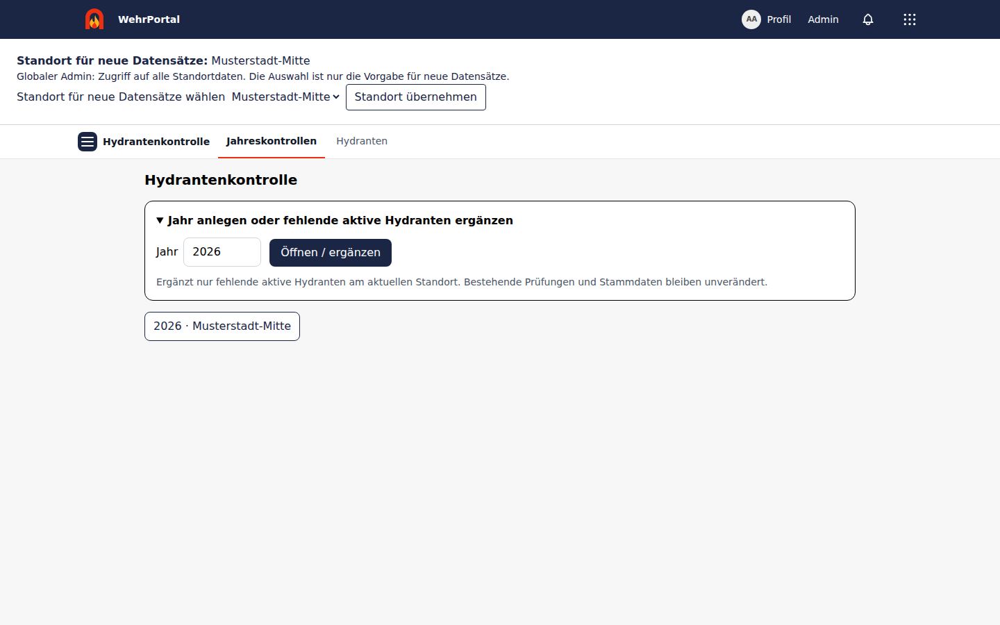

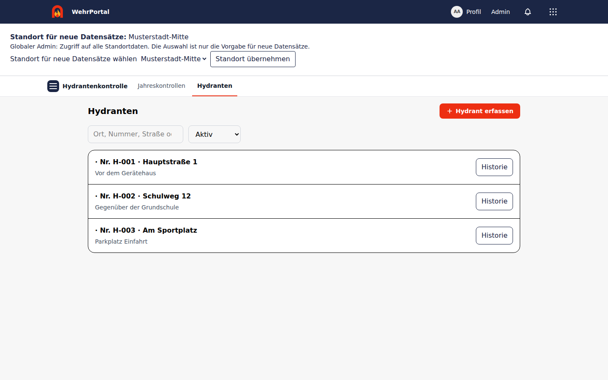

Das Modul **Hydrantenkontrolle** wird unter **Admin → Module** aktiviert. Dort Modulzugang und Rolle `hydrantenwart` oder `uebergreifend` vergeben; aktive Admins benötigen keine zusätzliche Rolle. `HYDRANTENKONTROLLE_ENABLED=false` lädt das Modul nicht. Die Modulleiste bietet **Jahreskontrollen** und **Hydranten**. `hydrantenwart` sieht nur Hydranten des im Kameradenprofil hinterlegten Orts; `uebergreifend` ist für Kommune, Brandschutzamt/GBI, SPI und andere Stellen mit Sicht auf alle Orte.

- **Stammdaten:** Pflicht-Ort, Nummer, Straße, optionale Hausnummer, Lagebeschreibung und Koordinaten. Beim `hydrantenwart` wird der Ort aus dem Kameradenprofil übernommen und kann nicht geändert werden; für `uebergreifend` ist er frei eintragbar. Straße oder Lagebeschreibung oder ein vollständiges Koordinatenpaar ist Pflicht. Archivieren statt Löschen erhält bestehende Jahresdaten.
- **Jahreskontrolle:** Erst Stammdaten erfassen, dann das Jahr über **Öffnen / ergänzen** anlegen. Alle aktiven Hydranten des aktuellen Standorts werden als ungeprüft aufgenommen. Das erneute Öffnen ergänzt nur fehlende aktive Hydranten; vorhandene Kontrollwerte und eingefrorene Stammdaten bleiben erhalten. Über die Jahreslinks kann die Bearbeitung an späteren Tagen fortgesetzt werden.
- **Erfassung:** Prüfdatum innerhalb des gewählten Jahres, automatisch der speichernde Kamerad als Prüfer, alle zehn Mängel der Excel-Checkliste, „Unterflurhydrant in Ordnung“ und Bemerkungen. „In Ordnung“ und Mängel schließen sich aus. Ohne Prüfdatum und ohne Ergebnis bleibt der Hydrant ausdrücklich ungeprüft; Bemerkungen sind bereits möglich.
- **Übersicht und Historie:** Gesamt, ungeprüft, in Ordnung und mit Mängeln; Suche nach Ort/Nummer/Straße und Filter nach Prüfstatus. Über **Historie** bei einem Hydranten werden die gespeicherten Jahresstände mit Prüfdatum, Ergebnis, Prüfer, Mängeln und Bemerkungen absteigend nach Jahr angezeigt. Die Kennzahlen beziehen sich immer auf das ganze Jahr, nicht nur auf die gefilterte Liste.
- **PDF-Bericht:** Je Jahr jederzeit als Zwischenstand oder Jahresbericht mit Organisation, Erstellungsdatum (Europe/Berlin), Prüfübersicht und Einzelbefunden herunterladen. Der Export ist ein echtes mehrseitiges A4-PDF und enthält stets alle Hydranten des gewählten Jahres, unabhängig vom Bildschirmfilter.
- **Historie und Grenzen:** Jedes Jahr hat eigene Kontrollsätze und Stammdatenkopien; die Historie eines Hydranten zeigt den zuletzt gespeicherten Stand je Jahr. Spätere Änderungen und Archivierung ändern vorhandene Jahresdaten nicht. Paralleles Speichern mit veraltetem Bearbeitungsstand wird abgewiesen; bitte neu laden und Änderungen abgleichen. Änderungen innerhalb eines Jahres werden im Aktivitätslog dokumentiert (dessen reguläre Aufbewahrungsfrist gilt weiterhin), aber nicht als separate Revision in der Kontrollhistorie gespeichert. Jahre bleiben bewusst bearbeitbar, es gibt keine endgültige Versiegelung. Keine automatische Übernahme aus Excel, keine Offline-Synchronisierung und keine automatische Kopplung an die Wasserkarte: deren Lösch-/Änderungslogik bleibt unverändert.

Zusätzlich zur bestehenden Standortbegrenzung gilt für `hydrantenwart` der Ort aus dem Kameradenprofil; neue Hydranten übernehmen ihn automatisch. Wer `uebergreifend` zugewiesen ist, sieht Hydranten aller Orte und Standorte. Beim `hydrantenwart` muss im Kameradenprofil ein Ort hinterlegt sein. Mit aktivem **Locations** gehören neue Hydranten und Jahreskontrollen weiterhin zum aktuell gewählten Standort; Nummern und Jahre sind pro Standort eindeutig.

**Schnelleinstieg:** Unter `/hydrantenkontrolle/hydranten` den Bestand erfassen, unter `/hydrantenkontrolle` das Jahr anlegen und die einzelnen Hydranten über **Bearbeiten → Kontrolle speichern** dokumentieren. An weiteren Tagen den vorhandenen Jahreslink öffnen, nicht ein anderes Jahr anlegen. Zum Abschluss den Filter **Ungeprüft** kontrollieren und über **PDF-Bericht** den aktuellen Jahresstand herunterladen.

Die [ausführliche Bedienungsanleitung](README.md#hydrantenkontrolle-bedienungsanleitung) beschreibt Einrichtung, alle Mängelfelder, Korrekturen, Archivierung und typische Rückfragen.

### Vereinsverwaltung

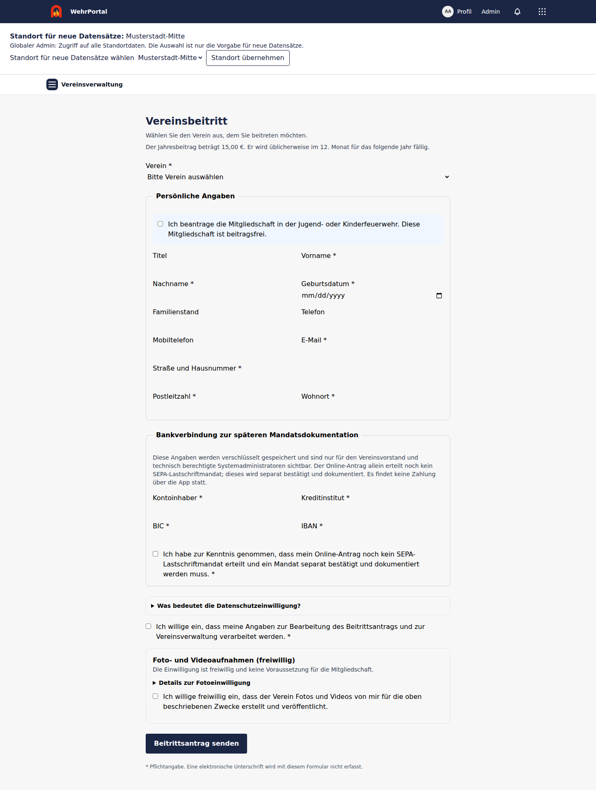
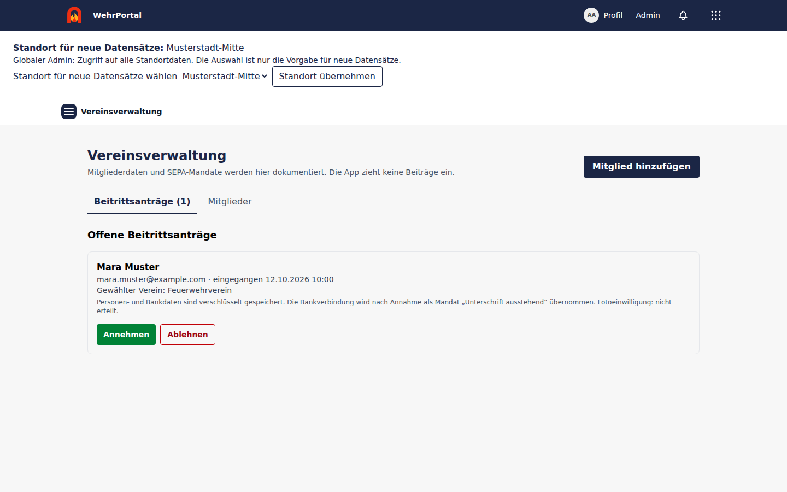

Die Vereinsverwaltung wird nach der Migration unter **Admin → Module** aktiviert. System-Admins legen unter **Admin → Vereine** jeden Verein an, ordnen ihn genau einem Standort zu und weisen die Vorstandsmitglieder zu. Diese Zuordnung vergibt den Modulzugang; es gibt keinen globalen Vereinsvorstand. Vorstände können nur den ihnen zugeordneten Verein verwalten. Für den App-Zugriff ist ein aktives Kameradenkonto erforderlich; Mitglieder ohne App-Konto können trotzdem verwaltet werden.

Die öffentliche Beitrittsseite `/vereinsbeitritt` nimmt persönliche Angaben, die Auswahl des Vereins und die Bankverbindung entgegen. Ein Beitrittsantrag und das daraus angelegte Mitglied bleiben dem ausgewählten Verein zugeordnet. Anträge erscheinen nur im Bereich des zuständigen Vorstands. Annahme legt ein passives Vereinsmitglied mit dem konfigurierten Standardbeitrag an; Ablehnung löscht die personenbezogenen Angaben des Antrags. Der Vorstand kann Mitglieder ergänzen und bearbeiten, Mitgliedsart, Beitrag und Austrittsdatum pflegen und optional ein Kameradenkonto verknüpfen. Dabei kann er relevante Personaldaten aktiver Kameraden am Standort des Vereins verwenden; andere Standorte und andere Vereine bleiben abgegrenzt. Aktive Kameraden lassen sich außerdem in ihrer Personalakte mit „Vereinsmitglied“ eintragen; Name und Kontaktdaten werden ausschließlich aus der Personalverwaltung bezogen. Beim Abwählen wird die Mitgliedschaft mit Austrittsdatum beendet, nicht gelöscht.

Bankdaten und persönliche Angaben werden mit dem Anwendungsschlüssel verschlüsselt in der Datenbank gespeichert. Beim Antrag werden Version und Zeitpunkt der Datenschutzeinwilligung aufgezeichnet. Die freiwillige Foto-/Videoeinwilligung ist davon getrennt und keine Voraussetzung für den Beitritt. Bei Jugendmitgliedern müssen Erziehungsberechtigte zustimmen; ab 14 Jahren wird zusätzlich die Zustimmung der Jugendlichen abgefragt. Zweck und Hinweise zu Veröffentlichungen, Internet-Risiken, Widerruf und privaten WhatsApp-Gruppen lassen sich im Formular aufklappen. Version und Zeitpunkt der Fotoentscheidung werden dokumentiert; das Formular erfasst keine handschriftliche Unterschrift.

Wer **Jugend-/Kinderfeuerwehr** auswählt, wird kostenfrei geführt. Bankdaten und SEPA-Hinweis entfallen; auch bei späterer Bearbeitung setzt die App den Beitrag auf null und entfernt Mandatsdaten. Bei regulären Mitgliedschaften erteilt der Online-Antrag ausdrücklich kein SEPA-Lastschriftmandat; Unterschrift, Mandatsreferenz und Mandatsstatus werden separat dokumentiert. Die App erstellt weder SEPA-Dateien noch führt sie Zahlungen aus.

Vor Inbetriebnahme `VEREIN_ANNUAL_FEE_CENTS` (Standard `1500`), `VEREIN_BILLING_MONTH` (Standard `12`), `VEREIN_BILLING_YEAR_OFFSET` (Standard `1`), `VEREIN_PRIVACY_NOTICE_VERSION`, `VEREIN_PHOTO_CONSENT_VERSION` und optional `VEREIN_CREDITOR_ID` konfigurieren. Das Modul lässt sich mit `VEREINSVERWALTUNG_ENABLED=false` vollständig abschalten. Betreiber müssen vor der öffentlichen Nutzung die Angaben zur Datenverarbeitung, Aufbewahrung und Rechtsgrundlage für ihre konkrete Vereinsorganisation prüfen und ergänzen. Die kurzen Texte und die aufklappbaren Erläuterungen sind keine individuelle Rechtsberatung und müssen vor dem Einsatz mit den Vereinsvorgaben abgeglichen werden.

### Anwesenheit im Detail


Das Modul „Anwesenheit“ führt eigenständige Listen für Übungen, Dienste und Besprechungen. Ein Kalendertermin ist dafür nicht erforderlich. Nach der Migration ist das Modul zunächst inaktiv. Ein Admin schaltet es unter **Admin → Module** ein und gibt es den Kameraden frei; `ANWESENHEIT_ENABLED=false` deaktiviert das Modul vollständig.

- **Liste anlegen** (`/anwesenheit`): „Neue Liste“ öffnen und Titel, Art, Standort, Abteilung, Beginn, Ende, Übungsleiter und Teilnehmende festlegen. Jede neue Liste und Vorlage gehört genau zu einer Abteilung; Leitung und Teilnehmende werden auf diese Abteilung begrenzt. Beginn und Ende bestimmen automatisch Dauer und Teilnehmerzahl. Die Abteilung wird mit Standort angezeigt. Wenn das Kalender-Modul aktiv ist, kann ein Termin als Vorbelegung für Titel, Art, Ort und Zeiten verwendet werden; danach ist die Anwesenheitsliste ein eigener Datensatz.
- **Entwurf und Abgabe:** Eine Liste lässt sich zunächst als Entwurf speichern und später vervollständigen. Der Ersteller kann eigene Entwürfe bearbeiten. Mit „Abgeben“ wird die Liste abgeschlossen; danach können Modulverwalter sie weiterhin bearbeiten. Abgegebene Listen zählen im Stundennachweis und Jahresbericht, Entwürfe nicht.
- **Teilnehmende und Anhänge:** Die Teilnehmendenauswahl enthält Kameraden des Standorts der Liste. Bei Bedarf lassen sich Dateien anhängen (höchstens fünf Dateien zu je 5 MB). Beim Löschen einer Liste werden auch ihre Anhänge entfernt.
- **PDF und E-Mail:** Eine Liste kann als PDF geöffnet und per E-Mail versendet werden. Als Empfänger gelten die Adressen der einzelnen Liste, sonst die unter **Admin → Anwesenheit → Einstellungen** hinterlegten Standardadressen. Nur globale Admins ändern diesen instanzweiten Standard; Verwalter sehen ihn schreibgeschützt. Ein Versandfehler verhindert nicht, dass die Liste gespeichert bleibt.
- **Vorlagen:** Unter **Admin → Anwesenheit → Vorlagen** (`/admin/anwesenheit/vorlagen`) können Verwalter Vorlagen anlegen und bearbeiten. Eine Vorlage übernimmt Angaben als Startwerte für neue Listen; spätere Änderungen an der Vorlage ändern keine bereits angelegten Listen.
- **Zugriff:** Kameraden mit Modulzugang erstellen eigene Listen und bearbeiten ihre Entwürfe. Im bisherigen Rollenmodell verwalten `verwalter` und zuständige Standort-Admins die Listen und Vorlagen. Jugend- und Kinderwarte verwalten nur Listen und Vorlagen ihrer ausdrücklich zugewiesenen passenden Abteilungen; Gemeindewarte sehen die jeweiligen Gruppen standortübergreifend. Mit dem optionalen Anwesenheitsadapter (`LOCATIONS_SCOPED_ROLE_MODULES=anwesenheit`) benötigen sonstige Nicht-Admins dafür eine gültige Rolle `verwalter` am jeweiligen Zielstandort; eine Rolle an einem anderen Standort reicht nicht. Globale Admins behalten sämtliche Datenzugriffe. Die Vorbereitung der Umstellung steht unter [Locations](#locations-im-detail).
- **Offline:** Bei aktivierter Offline-Funktion können Titel, Art, Zeiten, Leitung, Gästezahl und Teilnehmendenauswahl als lokaler Entwurf wiederhergestellt werden. Standortwahl, Notizen, Empfänger und Anhänge werden nicht gespeichert. Der Entwurf muss nach dem Wiederherstellen geprüft und regulär abgesendet werden; er wird nicht automatisch synchronisiert. Siehe [Offline und PWA](#offline-und-pwa-im-detail).

Ausführliche technische Angaben zu Rechtevergabe, Standortbezug und Datenspeicherung stehen in der [Dokumentation Anwesenheit](ANWESENHEIT.md).

### Dateien im Detail


„Dateien“ ist ein internes Modul für Dateiablagen und benötigt keinen eigenen `DATEIEN_ENABLED`-Schalter. Ein Admin schaltet es unter **Admin → Module** frei. Außer in der automatisch freigegebenen Standortablage gibt die Modulfreigabe noch keinen Zugriff auf Dateien; Ablagen und Einträge erhalten eigene Rechte.

- **Ablage einrichten (globaler Admin):** Unter **Admin → Dateien** (`/admin/dateien`) eine Ablage anlegen. Optional einen Standort und ein Speicher-Kontingent in MiB angeben. Wenn Dateien und Locations aktiv sind, erhält jeder Standort automatisch eine eigene Ablage; alle Standortangehörigen dürfen dort auch ohne eigenen Dateien-Modulzugang lesen, hochladen und Ordner erstellen, aber keine Rechte verwalten. Diese Freigabe gilt nur für die eigene Standortablage. Ablagen ohne Standort sind gemeinsam standortübergreifend sichtbar. Das Kontingent berücksichtigt alle Versionen und den Papierkorb, nicht nur aktuelle Dateien.
- **Dateigruppen:** Unter **Admin → Dateien** Dateigruppen erstellen und bestehende Mitglieder zuordnen. Sie sind unabhängig von Abteilungen und Funktionen. `gruppenverwalter` dürfen Gruppen und deren Mitglieder verwalten, erhalten dadurch aber kein Leserecht auf Dateien.
- **Zugriff vergeben:** Im Explorer (`/dateien`) eine Ablage öffnen und über „Rechte“ einzelne Kameraden, Abteilungen oder Dateigruppen mit **Lesen**, **Bearbeiten** oder **Verwalten** freigeben. Neue Unterordner erben diese Rechte; für eine individuelle Freigabe dort die Vererbung unterbrechen. Standortangehörige dürfen den automatischen Standortordner nicht verwalten; diese Berechtigung bleibt Standort-Admins und ausdrücklich berechtigten Verwaltern vorbehalten. Das höchste zutreffende Benutzer- oder Gruppenrecht gilt:

  | Recht | Was damit möglich ist |
  |---|---|
  | Lesen | Auflisten, ansehen, herunterladen und Versionsverlauf lesen |
  | Bearbeiten | Zusätzlich hochladen, Ordner erstellen, umbenennen sowie neue Versionen und Wiederherstellungen anlegen |
  | Verwalten | Zusätzlich Rechte und Vererbung ändern, verschieben, Papierkorb verwalten und endgültig löschen |

- **Ordner und Dateien:** Im Explorer Ordner anlegen, Dateien einzeln oder mehrfach hochladen sowie ganze Ordner per Drag & Drop samt Unterordnern übernehmen (bis zu 50 Dateien und 500 Ordner je Uploadvorgang). Uploads zeigen den Fortschritt und lassen sich abbrechen. Außerdem kann man suchen, Favoriten markieren oder zuletzt verwendete Einträge öffnen. Es gibt eine Bildvorschau, Kommentare und ZIP-Download. „Mit mir geteilt“ zeigt direkte Freigaben auch dann, wenn der übergeordnete Ordner nicht lesbar ist. Die Suche berücksichtigt Namen und Beschreibungen, nicht Dateiinhalte.
- **Rechtevererbung:** Neue Einträge erben die Rechte des Elternordners beziehungsweise der Ablage. Wird die Vererbung unterbrochen, gelten an diesem Eintrag nur seine eigenen Rechte und unterhalb davon die dort neu gesetzten Rechte. Eine Direktfreigabe zeigt keine gesperrten Eltern oder Geschwister. Verschieben benötigt „Verwalten“ sowohl am Ausgangs- als auch am Zielort; Verschieben zwischen Ablagen ist nicht verfügbar.
- **Versionen und Papierkorb:** Für Inhaltsänderungen „Neue Version“ verwenden; der Explorer überschreibt nicht stillschweigend bei Namenskonflikten. Eine ältere Version wiederherzustellen erzeugt eine neue aktuelle Version und erhält den bisherigen Verlauf. „Löschen“ verschiebt in den Papierkorb. Eine Wiederherstellung setzt voraus, dass der Elternordner verfügbar und der Name frei ist. Endgültiges Löschen erfordert „Verwalten“, eine Bestätigung und das Ende der Mindestaufbewahrung (Standard 30 Tage); Dateien werden nicht automatisch endgültig gelöscht.
- **Standortzugriff:** Ist Locations aktiv, begrenzt die Ablagenberechtigung zusätzlich auf deren Standort. Benutzer-, Abteilungs- und Dateigruppenfreigaben heben diese Grenze nicht auf. Standortlose Ablagen und Dateigruppen gelten als gemeinsam. Einzelheiten und Grenzen stehen unter [Locations](#locations-im-detail).
- **Öffentliche Lesefreigaben:** Sie sind standardmäßig deaktiviert. Ein Admin muss sie global und zusätzlich für die jeweilige Ablage erlauben. Danach können Personen mit „Verwalten“ für eine Datei oder einen Ordner einen zeitlich befristeten, nur lesenden Download-Link erzeugen; optional mit Passwort oder Download-Limit. Das Token wird nur einmal angezeigt. Externe können weder hochladen noch bearbeiten, ältere Versionen sehen oder Office nutzen. Einen weitergeleiteten Link kann jeder verwenden, der ihn kennt; deshalb Laufzeit kurz halten und ein Passwort über einen anderen Kanal übermitteln. Admins können Freigaben widerrufen.
- **Online-Office:** Optional lässt sich genau ein separat betriebener ONLYOFFICE- oder Collabora-Server konfigurieren. Die Admin-Einstellungen müssen Browser-Adresse, Rückruf und gegebenenfalls interne Serveradresse enthalten; ONLYOFFICE benötigt ein JWT-Secret. Im Explorer wird „Im Office bearbeiten“ nur mit Bearbeitungsrecht und unterstütztem Format angeboten. PDF und alte Binärformate lassen sich nicht bearbeiten. Sitzungen und Dateiänderungen werden weiterhin auf aktuelle Zugriffsrechte geprüft.
- **Betrieb:** Datei-Inhalte liegen privat unter `storage/app/private/dateien`, nicht im öffentlichen Webverzeichnis. Dieser Speicher muss persistent und schreibbar sein. Datenbank und Dateien immer gemeinsam und konsistent sichern und wiederherstellen; Virenscan ist nicht integriert. Standard-Uploadlimit: 20 MiB; Admins können es bis 50 MiB erhöhen, sofern PHP, Livewire und Reverse-Proxy das Limit ebenfalls erlauben.

Nicht verfügbar sind WebDAV, Desktop-Synchronisierung, Offline-Bearbeitung und PDF-/Office-Vorschau. Die [Dateien-Dokumentation](DATEIEN.md) beschreibt unter anderem die Admin-Einstellungen, Protokolle, Wartungskommandos, Office- und Freigabeoptionen ausführlicher; die [Roadmap](DATEIEN-ROADMAP.md) trennt geplante von umgesetzten Funktionen.

### Locations im Detail

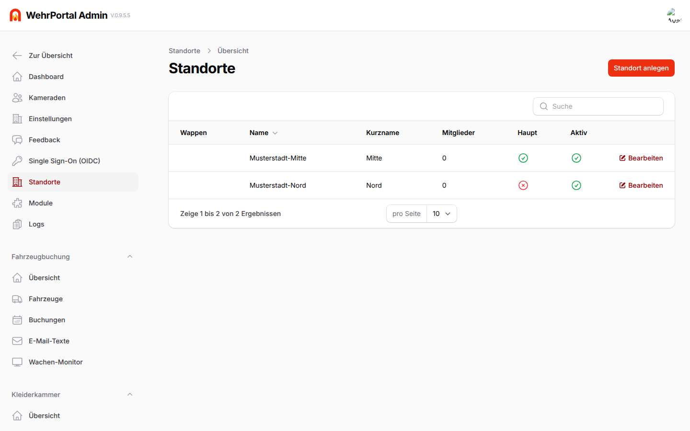

Das Modul Locations ergänzt ausgewählte Datensätze um einen Standort. Es ist standardmäßig aktiv; `LOCATIONS_ENABLED=false` schaltet Standortverwaltung und Standortbegrenzung ab. Standorte sind eine organisatorische Abgrenzung, keine vollständige Mandantentrennung.

- **Fristenübersichten an die Wehrführung:** Bei aktivierten Standorten gehen Übersichten zu Atemschutzfristen, Fahrzeugfristen, Lehrgangsauffrischungen, Unterweisungen, Ausrüstung, Wartung und liegen gebliebenen Mängeln auch an die gültig zugewiesene **Standardrolle Wehrführung des betroffenen Standorts**. Die Inhalte bleiben standortbezogen: Personenfristen richten sich nach dem Primärstandort des Kameraden, Fahrzeug- und Gerätefristen nach dem Standort des Fahrzeugs bzw. Geräts, Mängel nach ihrem eigenen Standort. Widerrufene, abgelaufene oder noch nicht begonnene Vergaben, inaktive Mitglieder und inaktive Standorte erhalten keine lokalen Übersichten. Ohne Standortzuordnung werden keine lokalen Empfänger geraten; bestehende globale Fachverantwortliche und deren Admin-Ersatz bleiben erhalten. Die Benachrichtigung erweitert keine Verwaltungsrechte; bei Lehrgängen und Unterweisungen erscheint ohne entsprechende Fachberechtigung kein Verwaltungslink in Mail oder Glocke. Persönliche Erinnerungen bleiben unverändert. Wasserkarte und Objektpläne sind gemeinsame geografische Kataloge ohne organisatorische Standortzuordnung; ihre Prüfhinweise bleiben bei den bisherigen Fachverantwortlichen.
- **Standorte anlegen:** Der globale Admin öffnet **Admin → Standorte** und legt die benötigten Standorte an. Die Migration erzeugt bereits einen Hauptstandort; mindestens ein Standort muss bestehen bleiben. Vorhandene Datensätze werden bei der Migration diesem Standort zugeordnet.
- **Mitglieder und Zuständigkeiten:** Auf der Standortseite aktive Kameraden standortübergreifend suchen, dem Standort hinzufügen und bei Bedarf zu Standort-Admins machen; globale Admins können zusätzlich Standorte direkt im Kameradenformular zuweisen. Ein Mitglied kann einem oder mehreren Standorten zugeordnet werden. Ein Standort-Admin darf nur den eigenen Standort verwalten; globale Admins können alle Standorte einsehen und ändern.
- **Abteilungen:** Es gibt nur die zentrale Verwaltung unter **Admin → Abteilungen**. Jeder Standort erhält automatisch die Abteilungen **Einsatzabteilung**, **Jugendfeuerwehr**, **Kinderfeuerwehr**, **Alters- und Ehrenabteilung**, **Vorstand** und **Verein**; weitere individuelle Abteilungen bleiben möglich. Jede Abteilung gehört genau zu einem Standort; eine gleichnamige Abteilung an einem anderen Standort ist ein eigener Eintrag. Der Standort steht in der Abteilungsliste und in Klammern hinter dem Namen in allen Auswahlfeldern. Standort-Admins verwalten ihre Abteilungen ebenfalls dort; auf der Standortseite ordnen sie nur Mitglieder und Abteilungen einander zu. Die Mitgliedschaft im Vorstand wird manuell gepflegt.
- **Mehrfachzugehörigkeit:** Kameraden können mehreren Standorten und Abteilungen zugeordnet werden und mehrere Funktionen gleichzeitig innehaben. Die Abteilung, Funktion und der Primärstandort bleiben getrennte Angaben.
- **Fahrzeuge und Ausrüstung:** Auf der Standortseite oder in den jeweiligen Fahrzeug-/Geräteformularen Fahrzeuge und Ausrüstung einem zugänglichen Standort zuweisen oder zwischen zugänglichen Standorten verschieben. Fahrzeug- und Geräteübersichten zeigen den organisatorischen Standort; bei Geräten bleibt der physische Lagerort bzw. das Fahrzeugfach separat. Für die vom Modul unterstützten Datensätze filtern Listen und Abfragen automatisch auf die Standorte, zu denen das angemeldete Mitglied gehört.
- **Standort auswählen:** Auf angemeldeten App-Seiten steht unter der Kopfzeile der **Standort für neue Datensätze**. Bei mehreren aktiven berechtigten Standorten lässt er sich mit Auswahl und **Standort übernehmen** auch ohne JavaScript wechseln; der bestehende Wechsel im Admin-Menü bleibt erhalten. Die Auswahl ist eine Vorbelegung, kein zusätzlicher Zugriff und kein Filter für sämtliche Daten. Globale Admins behalten ihre standortübergreifenden Rechte. Entzogene oder inaktive Ziele werden nicht angeboten; ohne aktiven berechtigten Standort weist die Anzeige darauf hin und das Anlegen standortbezogener Daten wird abgewiesen, statt stillschweigend den Hauptstandort zu verwenden. Bei ausgeschaltetem Modul Locations erscheint der Bereich nicht.
- **Standort-Admin im Admin-Bereich:** Standort-Admins gelangen in ihren begrenzten Verwaltungsbereich. Sie können dort Standortname, Mitglieder und zugehörige Fahrzeuge/Ausrüstung pflegen. Globale Core-Adminseiten bleiben globalen Admins vorbehalten.
- **Standort-Modulrollen (gestufter Rollout):** Nur globale Admins vergeben unter **Admin → Standorte → Standort bearbeiten → Standort-Modulrollen und Verlauf** Rollen je Person, Modul und Standort mit Begründung und optionalem Ablauf; Entzüge bleiben im Verlauf erhalten. Eine Zuweisung ohne Fachrolle erlaubt nur den Moduleinstieg. Standardmäßig bleiben die bisherigen Modulregeln aktiv. Nach ausdrücklicher Vorbereitung aktiviert `LOCATIONS_SCOPED_ROLE_MODULES=anwesenheit,mitteilungen` die zielbezogenen Adapter für diese beiden Module; auch einzeln aktivierbar. Alte globale Rollen werden dann nicht als Ersatz für fehlende Standort-Verwaltungsrollen verwendet; andere Fachmodule werden dadurch noch nicht umgestellt.
- **Standardrollen (laufender Rollout):** Globale Admins können unter **Admin → Standardrollen** die freigegebenen Profile mit Begründung und optionalem Ablauf zuweisen oder widerrufen. Das GBI/SBI-Profil gewährt Zugriff auf alle aktiven Module und Standorte, ohne technische Adminrechte zu vergeben. Zielgenau integriert sind Anwesenheitsverwaltung, Übungsdienstplanung und Personalverwaltung: Wehrführung ist jeweils auf zugewiesene Standorte begrenzt; Personalakten, private Personalfelder und Änderungsbenachrichtigungen sind standortbezogen, globale Personaldaten-Einstellungen bleiben GBI/SBI und Admins vorbehalten. Jugend- und Kinderwarte verwalten dort nur Mitglieder ihrer exakt zugewiesenen Abteilungen; Gemeindewarte sehen die jeweils passenden Gruppen standortübergreifend. Jugend- und Kinderwarte dürfen Ehrungen für ihre Mitglieder erfassen, aber keine globalen Ehrungsarten ändern. Standortverlust widerruft lokale Vergaben unwiderruflich. In der Fahrzeugverwaltung sind Gerätewart-Berechtigungen auf Fahrzeuge des zugewiesenen Standorts begrenzt. Auch Geräteabfragen und -änderungen, Bestands-/Ersatzbeschaffung, Schäden, Ausleihen, Rückruf-Treffer und Inventuren sind standortbezogen; eine Inventur übernimmt den Standort ihres Lagerorts und blendet fremde Inventuren aus. Schaden-, Rückruf- und tägliche Geräteübersichten werden lokalen Gerätewarten nur für ihren Standort zugestellt; globale Gerätewarte und Admins erhalten weiterhin das Gesamtbild. Physische Lagerorte und Beladepläne sind standortgebunden und lokale Gerätewarte sehen nur die eigenen. Die Gerätewart-Standardrolle kann je Standort vergeben werden; globale Stammdaten, Rückrufdefinitionen und die Gäste-Geräteinfo bleiben weiterhin globalen Gerätewarten vorbehalten. Die Wehrführung verwaltet Einsatzberichte nur an ihren Standorten; Lagefunktionen, Freigaben und Benachrichtigungen folgen dem Berichtstandort, neue Berichte übernehmen den aktiven zugewiesenen Standort. Der Atemschutzwart bleibt global, verwaltet in den Unterweisungen aber nur Atemschutz-Unterweisungen; gewöhnliche Atemschutzüberwacher verwalten nur Überwachungen an zugänglichen Standorten. Der Bürgermeister kann bei `LOCATIONS_LEADERSHIP_ENABLED=true` ausschließlich jährliche Einsatzzahlen aller aktiven Standorte sehen; Einsatzberichte und andere Module bleiben gesperrt. **Brandschutzamt** wird erst zur Vergabe angeboten, wenn Locations, Ausrüstung und Kleiderkammer aktiv sowie `LOCATIONS_CLOTHING_STOCK_ENABLED=true` und `LOCATIONS_CLOTHING_PERSONAL_ENABLED=true` gesetzt sind. Dann gelten die globale Gerätewartverwaltung und die getrennten, standortübergreifenden Bestands- und persönlichen Kleiderkammer-Prüfungen; widerrufene oder inaktive Rollen öffnen den Zugriff nicht. Im Verbandbuch und bei Expositionen sind Gesundheitsdaten ebenfalls standortbezogen abgesichert. Für noch nicht angepasste Gesundheits- und Personaldatenmodule gelten weiterhin ausschließlich deren bestehende Berechtigungen. Der Rollout ist nicht abgeschlossen.
- **Persönliche Kleiderkammerrechte (separater Opt-in):** `LOCATIONS_CLOTHING_PERSONAL_ENABLED=true` verwendet ausdrücklich je Standort vergebene persönliche Kleiderwartrechte statt alter globaler Kleiderwartrollen. Reine Mengenbestandsrechte bleiben getrennt. Persönliche Größen sind ein gemeinsames Profil des Mitglieds; einzelne Ausgaben und Nachrichten benötigen zusätzlich eine passende bekannte Artikel-/Bestandsherkunft und Empfängermitgliedschaft am konkreten Quellstandort. Es werden weder alte Ausgaben einem heutigen Standort zugerechnet noch Rollen automatisch übertragen. Allgemeine Mitgliedsnotizen, Pflegehistorien und das Abschließen einer Einzelteilwäsche mit Behandlungseintrag bleiben in diesem Modus globalen Admins vorbehalten. Globale Admins behalten alle Rechte; Mitglieder behalten die eigene Selbstbedienung, jedoch nach Rückgabe kein dauerhaftes Recht auf den aktuellen Inventardatensatz. Voraussetzungen, Grenzen und Aktivierung: [personenbezogene Kleiderkammerrechte](LOCATIONS.md#personenbezogene-kleiderkammerrechte-gesonderter-rollout).
- **Trockenläufe:** `php artisan locations:inventory-module-roles` zeigt mögliche Standortzuordnungen bestehender Modulrollen, ohne sie zu übertragen. `php artisan locations:audit-data` (optional `--json`) zählt Bestandsdaten und fehlende direkte Standortzuordnungen ohne personenbezogene Inhalte oder automatische Änderungen. Auch ein bestandener Schema-Guard oder eine vollständig gefüllte Standortspalte ist noch kein Nachweis vollständiger Isolation.
- **Führungsprofile (P6-Grundlage):** Standardmäßig aus (`LOCATIONS_LEADERSHIP_ENABLED=false`). Bei aktivierter Grundlage zeigt die Standardrolle Bürgermeister im Admin-Bereich jährliche Einsatzsummen aller aktiven Standorte; Einzelberichte und personenbezogene Inhalte bleiben ausgeschlossen. Die separate, zeitlich begrenzte P6-Vergabe und die geschützte Konsole `locations:leadership summary` bleiben standortgenau. Weitere bestätigte Aggregat-Projektionen für Brandschutzamt und GBI/SPI sind noch keine Freigabe zur Rollenvergabe oder zu vorhandenen Vollansichten. Kommunale Admins sind nicht vorgesehen, auch alte entsprechende Vergaben öffnen keine Rechte. Globale Adminrechte bleiben unverändert. Details: [Führungsprofile](LOCATIONS.md#führungsprofile-vorbereitete-berechtigungsgrundlage-p6).
- **Betriebsbereitschaft (P7-Vorprüfung):** `php artisan locations:check-readiness` (optional `--json`) trennt die technische Nur-Lese-Inventur von offenen Freigabehindernissen. Exitcode `2` bedeutet weiterhin blockiert, `1` Prüfung nicht verfügbar. Weder ein leerer Datenbestand noch grüne Tests ersetzen die ausstehenden Datenschutz-, Restore-, Modul- und Browserabnahmen. Es wird keine Mehrstandort-Betriebsfreigabe erteilt. Details: [Betriebsbereitschaft](LOCATIONS.md#betriebsbereitschaft-prüfen-p7).
- **Altbestandsbeziehungen (P3):** `php artisan locations:audit-data --relations` (zusätzlich `--json` möglich) prüft deklarierte Elternverweise und direkte Standortabweichungen in einem konsistenten Nur-Lese-Snapshot. Fehlende oder inaktive Standorte, fehlende Eltern und NULL-Mehrdeutigkeiten werden als technische Anzahlen ausgewiesen; nicht geprüfte Beziehungen bleiben ausdrücklich offen. Abweichungen sind fachliche Prüfkandidaten, keine automatisch bestätigten Verstöße. Der Befehl ordnet nichts zu und ändert keine NULL-/Shared-Regeln. Vorgehen, Ausgabe und Grenzen: [Altbestandsprüfung](LOCATIONS.md#altbestand-beziehungs--und-konfliktvorprüfung-p3).
- **Kontrollierte Bestandszuordnung:** `php artisan locations:assign-attendance <plan.json>` prüft ausdrücklich vorgeschlagene Standortzuordnungen für bisher standortlose Anwesenheitslisten und -vorlagen. Standard ist die Vorschau; die atomare Übernahme verlangt einen aktiven globalen Admin, Grund, aktuellen Prüfwert und Backup-Bestätigung. Keine automatische Verteilung, keine E-Mails und kein Verschieben bereits zugeordneter Daten. Ablauf und Rückfallgrenzen stehen unter [Bestandszuordnung Anwesenheit](LOCATIONS.md#bestandszuordnung-anwesenheit-p3-erster-datenbereich).
- **Kleiderkammer-Vorprüfung:** `php artisan locations:audit-clothing` (optional `--json`) zählt ungeklärte Artikelstandorte und prüfbedürftige Artikel-/Mitgliedsbeziehungen. Kataloge, Mengenbestand und persönliche Daten werden getrennt betrachtet; der Bericht ändert weder Daten noch Zugriffsrechte und bestätigt keine vollständige Isolation. Ein standortübergreifender Bezug ist fachlich zu prüfen, nicht automatisch ein Regelverstoß. Details: [lesende Hybrid-Vorprüfung](LOCATIONS.md#kleiderkammer-lesende-hybrid-vorprüfung-p4).
- **Kleiderkammer-Einzelteilzuordnung:** `php artisan locations:assign-clothing <plan.json>` ordnet ausdrücklich geprüfte, bisher standortlose Einzelteile mit Vorschau, Zustandsprüfwert und unveränderlichem Journal zu. Laufende Ausgaben werden auf passende Empfängermitgliedschaft geprüft; Mengenbestand und Historie werden nicht umgeschrieben. Keine vollständige Hybrid-Freigabe. Voraussetzungen und Rückfallgrenzen: [kontrollierte Einzelteilzuordnung](LOCATIONS.md#kleiderkammer-kontrollierte-einzelteilzuordnung-p4).
- **Mengenbestandszuordnung:** `php artisan locations:assign-clothing-stock <plan.json>` ordnet ausdrücklich geprüfte ganze Mengenbestandszeilen zu, ohne Stückzahlen zu ändern. Offene passende Mengenausgaben blockieren die Übernahme. Das Werkzeug teilt keine Mengen auf und führt keine Lager zusammen. Ablauf: [Mengenbestandszuordnung](LOCATIONS.md#kleiderkammer-mengenbestandszuordnung-als-vorbereitung-p4).
- **Standortgetrennter Mengenbestand:** Die zusätzliche Locations-Migration erlaubt dieselbe Artikeltyp-/Größen-/Gruppenkombination einmal je Standort. Ausgaben wählen einen konkreten Herkunftsbestand; mehrdeutige historische Rücknahmen werden atomar abgewiesen, auch bei abgeschalteten Adaptern. Keine automatische Aufteilung oder Umschreibung historischer Herkunft. Voraussetzungen, Formularbedienung und Grenzen des alten Import-/Exportformats: [standortgetrennter Mengenbestand](LOCATIONS.md#kleiderkammer-standortgetrennter-mengenbestand-p4).
- **Lagerumbuchungen und historische Korrekturvermerke:** Die geschützte Betreiberkonsole bietet `locations:transfer-clothing-stock` für atomare, unveränderlich journalisierte Umbuchungen mit ausdrücklichen Rechten an Quelle und Ziel. Gegenbuchungen ersetzen das Bearbeiten alter Buchungen; ein UUID-Schlüssel verhindert doppelte Ausführung. `locations:correct-clothing-history` ergänzt ausschließlich für abgeschlossene Mengenausgaben einen belegten Korrekturvermerk nach Adminprüfung, Vorschau und ausdrücklicher Bestätigung. Originalherkunft, damalige Rücknahme und Mengen werden dabei nicht geändert. Voraussetzungen, Pflichtoptionen, Verlauf und Grenzen: [Umbuchungen und historische Korrekturvermerke](LOCATIONS.md#kleiderkammer-umbuchungen-und-historische-korrekturvermerke-p4).
- **Herkunftsbestand bei Mengenausgaben:** Bei installierter optionaler Herkunftsspalte speichert die reguläre Ausgabe den tatsächlich belasteten Bestand. Rücknahmen füllen genau diesen Bestand auf, auch nach Katalogänderungen oder Abschalten von Locations. Alte Ausgaben ohne Herkunftsverweis werden keinem Lager geraten zugeordnet: Mehrere passende Bestände führen zum atomaren Abbruch. Es gibt keinen automatischen Backfill. Details: [herkunftsgebundene Mengenausgaben](LOCATIONS.md#kleiderkammer-herkunftsgebundene-mengenausgaben-p4).
- **Optionaler Standortschutz für Mengenbestand:** `LOCATIONS_CLOTHING_STOCK_ENABLED=true` verlangt ausdrücklich vergebene Bestandsrechte je Standort. Die reine Rolle „Mengenbestand“ erlaubt Bestandsansicht und Stückzahlkorrektur, aber keine persönlichen Größen, Ausgabehistorien oder sonstige Kleiderkammer-Verwaltung. Mengenausgaben brauchen zusätzlich die persönliche Verwaltungsberechtigung nach dem jeweils aktivierten Personenadapter. Unzugeordnete Bestände, historische Rücknahmen ohne Herkunft und pauschale Datenübertragungen bleiben globalen Admins vorbehalten; diese behalten sämtliche Rechte, dürfen aber keine mehrdeutigen Lagerziele umgehen. Standardmäßig aus, keine vollständige Mehrstandort-Freigabe. Einrichtung und Grenzen: [Mengenbestandsadapter](LOCATIONS.md#kleiderkammer-optionaler-mengenbestandsadapter).
- **Gemeinsame Datensätze:** Der allgemeine Standortscope lässt Datensätze ohne Standort (`NULL`) weiterhin gemeinsam sichtbar. Fachliche Regeln können dies enger begrenzen: Anwesenheitslisten und -vorlagen ohne Standort bleiben bei aktivem Modul Locations globalen Admins zur Prüfung vorbehalten. Für vertrauliche Daten einen geprüften Standort verwenden; NULL ist keine allgemeine Freigabe.
- **Grenzen:** Die Abgrenzung gilt für die konfigurierten Modelle, darunter Mitglieder, Gruppen, Fahrzeuge, Ausrüstung, Kleiderkammerartikel, Einsatzberichte, Mängel und Kalendertermine. Direkte `DB::table()`-Abfragen umgehen den Eloquent-Scope; eindeutige Kennungen bleiben global. Nicht jedes Core-Formular bietet eine Standortauswahl. Deshalb ist Locations kein Ersatz für eine vollständige Mandantentrennung oder zusätzliche Datenschutzprüfung.

Die Liste der begrenzten Modelle und weitere Hinweise zu Migration und Weiterentwicklung stehen in der [Locations-Dokumentation](LOCATIONS.md).

## Übergreifende Funktionen

Diese Funktionen begleiten die Module: Sie haben keine eigene Fachmodul-Kachel und werden über ihre jeweiligen Einstellungen konfiguriert.

### Offline und PWA im Detail

WehrPortal ist installierbar und zeigt bei fehlender Verbindung eine Offline-Seite. Die Offline-Funktion ergänzt dies um lokale Entwürfe für ausdrücklich gekennzeichnete Formulare. `OFFLINE_ENABLED=false` deaktiviert die Offline-Statusanzeige und Entwürfe, nicht aber das Manifest, den Root-Service-Worker oder die Offline-Fallback-Seite.

- **Offline-Status:** Der Statusbereich zeigt, ob das Gerät verbunden ist und wie viele lokale Entwürfe gespeichert sind. „Jetzt synchronisieren“ aktualisiert den Service Worker und den Entwurfsstatus; die Eingaben werden dabei nicht an den Server gesendet.
- **Wasserkarte:** Im Formular einer Löschwasserquelle werden ausdrücklich markierte Felder – darunter Art, Nummer, Lage, Koordinaten, Durchfluss, Druck, Nennweite, Inhalt, Saughöhe, Betreiber, Prüfintervall und Kartenstatus – lokal gesichert. Notizen, Dateien und nicht markierte Felder sind nicht Teil des Entwurfs.
- **Anwesenheit:** Titel, Art, Zeiten, Leitung, Gästezahl und Teilnehmendenauswahl können lokal gespeichert werden. Standortwahl, Notizen, Empfänger und Dateien bleiben außen vor.
- **Entwurf wiederherstellen:** Nach erneuter Verbindung das betreffende Formular öffnen und den vorhandenen Entwurf wiederherstellen. Eingaben vor dem normalen Absenden prüfen oder den Entwurf verwerfen. Es gibt keine automatische Übermittlung und kein Wiederholen zwischengespeicherter Livewire-Anfragen; Anmeldung, Validierung und Geschäftsregeln laufen beim regulären Absenden weiter.
- **Lokale Daten:** Entwürfe werden je Benutzer und Formularseite im Browser abgelegt, verfallen nach 30 Tagen und werden beim Abmelden gelöscht. Auf gemeinsam genutzten Geräten können sie bis dahin lokale Angaben enthalten.
- **Was der Service Worker speichert:** Der Root-Service-Worker cached die Offline-Seite und öffentliche, versionierte statische Assets, aber keine Navigationen, angemeldeten Seiten, Login-, Admin- oder Livewire-Anfragen. Objektpläne verwenden bewusst einen eigenen Offline-Speicher für die Bibliothek, Objektseiten und aktuelle Pläne; neue Planversionen müssen für Offline-Nutzung erneut gespeichert werden.

Es gibt keine allgemeine Offline-Synchronisierung, keinen automatischen Versand von Formularen und keine Offline-Bearbeitung der Dateien. Details zu den unterstützten Feldern und den Speichergrenzen: [Offline-Dokumentation](OFFLINE.md).

### OIDC / Single Sign-On im Detail

Die OIDC-Anmeldung ergänzt den Login per E-Mail-Link um die Anmeldung an einem externen Identitätsanbieter (z. B. Keycloak). Sie nutzt Authorization Code mit PKCE. Der Anbieter muss öffentlich über HTTPS erreichbar sein. `OIDC_ENABLED=false` entfernt OIDC-Routen und Einstellungen; `OIDC_FORCE_DISABLED=true` schaltet den IdP-Login im Notfall ab und gibt den Link-Login wieder für alle frei.

1. **Identitätsanbieter vorbereiten:** In Keycloak einen OpenID-Connect-Client anlegen, Client Authentication einschalten und nur den Standard Flow aktivieren. In WehrPortal unter **Admin → Single Sign-On (OIDC)** die exakte Redirect-URI ablesen und beim Client eintragen (zum Beispiel `https://wehrportal.example.com/auth/oidc/callback`, ohne Wildcards). Client-ID und Client-Secret bereithalten.
2. **Benutzer im IdP vorbereiten:** Die Scopes `openid email profile` verwenden und sicherstellen, dass Benutzer eine bestätigte E-Mail (`email_verified`) haben. Der IdP muss Discovery-, Schlüssel- und Token-Endpunkte über eine öffentliche HTTPS-Adresse bereitstellen.
3. **Verbindung in WehrPortal konfigurieren:** Unter **Admin → Single Sign-On (OIDC)** Issuer-URL, Client-ID, Client-Secret, Scopes und gewünschten Button-Text eintragen. Mit „Verbindung testen“ Konfiguration und Schlüsselabruf prüfen; danach „Single Sign-On aktiv“ einschalten. Das Secret wird mit `APP_KEY` verschlüsselt gespeichert, nicht wieder angezeigt und beim Leer-Lassen beibehalten.
4. **Ersten Login testen:** Standardmäßig wird ein bereits vorhandenes, aktives WehrPortal-Konto nur mit einer bestätigten, übereinstimmenden E-Mail verknüpft. Inaktive Konten werden abgelehnt. Optional kann die automatische Kontoanlage (JIT) eingeschaltet werden; neu angelegte Konten erhalten dadurch weder Adminrechte noch Modulzugänge und müssen anschließend regulär freigeschaltet werden.
5. **Weitere Logins:** Nach der ersten Verknüpfung identifiziert die Kombination aus Issuer und `sub` das Konto. Eine bestehende Verknüpfung wird nicht allein wegen einer später übereinstimmenden E-Mail auf eine andere IdP-Identität übertragen. Gruppen- und Rollen-Claims werden nicht ausgewertet; Adminrechte und Modulzugänge bleiben von der Personalverwaltung in WehrPortal abhängig.
- **Nur Single Sign-On:** Diese Einstellung blendet den Link-Login für normale Nutzer aus. Lokale System-Admins behalten ihn und melden sich unter `/anmelden/lokal` an. Mindestens ein aktiver lokaler Admin muss bestehen bleiben; der letzte lässt sich nicht entfernen oder deaktivieren, solange „Nur Single Sign-On“ aktiv ist. Vor dem Einschalten einen funktionierenden lokalen Notfallzugang testen.
- **Notfall-Wiederherstellung:** Bei Serverzugriff kann der IdP-Login deaktiviert und ein lokaler Admin eingerichtet werden:

  ```bash
  php artisan oidc:disable
  php artisan oidc:make-local-admin hanna@example.com [--grant-admin]
  ```

  Alternativ `OIDC_FORCE_DISABLED=true` setzen und den Container neu starten. Die Wiederherstellung des Link-Logins ist damit auch möglich, wenn die Admin-Oberfläche nicht erreichbar ist.

Nicht umgesetzt sind RP-initiated Logout und die Zuordnung von IdP-Gruppen oder -Rollen zu WehrPortal-Rechten. Eine ausführlichere Keycloak-Anleitung, Claim-Prüfungen und Fehlersuche enthält die [OIDC-Dokumentation](OIDC.md).
